# Tema 1 — Componentes pasivos

**Asignatura:** Componentes y Circuitos Electrónicos
**Titulación:** Grado en Ingeniería de Tecnologías de Telecomunicación — Universidad de Granada (UGR)

> Esquema completo del Tema 1 (43 diapositivas): **resistores, condensadores e inductores**. Contiene **todo lo que aparece en las diapositivas**, explicado para estudiar.
>
> - Las imágenes (`T1_figNN_...png`) son recortes de las diapositivas. **Deben estar en la misma carpeta que este `.md`**. Al final hay un índice de figuras.
> - **(diap. N)** indica la diapositiva de la que sale cada apartado.
> - **➕ Ampliación** = aclaración o cálculo mío que **no está en las diapositivas**. ⚠️ = errata o incoherencia detectada en las diapositivas.
> - Notación: $Z$ impedancia, $\omega=2\pi f$, $j$ unidad imaginaria.

---

## Índice

0. [Resumen exprés](#0-resumen-exprés)
1. [Introducción (diap. 2)](#1-introducción-diap-2)
2. [Resistores](#2-resistores)
3. [Condensadores](#3-condensadores)
4. [Inductores](#4-inductores)
5. [Comparación de los tres modelos con parásitos](#5-comparación-de-los-tres-modelos-con-parásitos)
6. [Bibliografía](#6-bibliografía)
7. [Formulario resumen](#7-formulario-resumen)
8. [Erratas e incoherencias detectadas](#8-erratas-e-incoherencias-detectadas)
9. [Preguntas de repaso](#9-preguntas-de-repaso)
10. [Índice de figuras](#10-índice-de-figuras)

---

## 0. Resumen exprés

| Componente | Propiedad | Unidad | Fórmula "constructiva" | Elementos parásitos principales |
|---|---|---|---|---|
| **Resistor** | Resistencia $R$ | $\Omega=\text{V/A}$ | $R=\rho\dfrac LS$ | $L_c$ (arrollamiento), $C_p$ (entre terminales), $L_{we}$ (patillas) |
| **Condensador** | Capacidad $C$ | $\text{F}=\text{C/V}=\text{s}/\Omega$ | $C=\varepsilon\dfrac Ad$ | $R_l$ (pérdidas del dieléctrico), $R_w$ (conectores), $L_w$ (inductancia interna y de conectores) |
| **Inductor** | Inductancia $L$ | $\text{H}=\text{Wb/A}=\text{s}\,\Omega$ | $L=\dfrac{N^2\mu A}{l}$ | $R_w$ (hilo), $C_p$ (entre espiras) |

- **Al elegir un componente real** hay que mirar: valor, **tolerancia**, y además —según el componente— **potencia y deriva térmica** (resistor), **polaridad y tensión máxima** (condensador) o **corriente de saturación y Q** (inductor).
- **Identificación:** valores normalizados (**series E**, norma IEC 60063), **código de colores**, **sistema RKM**, **código numérico EIA/SMD** y **código de tensión**.
- **Todos los componentes reales** se desvían del ideal a partir de cierta frecuencia por sus **parásitos**; cada modelo tiene una **frecuencia de resonancia**:
  - Condensador: $\omega_r=\dfrac1{\sqrt{CL_w}}$, con $Z=R_w$ en $\omega_r$.
  - Inductor: $\omega_r=\sqrt{\dfrac1{LC_p}-\dfrac{R_w^2}{L^2}}$, con $Z(\omega_r)=\dfrac{L}{C_pR_w}$.

---

## 1. Introducción (diap. 2)

- En **Análisis de Circuitos** se han estudiado **componentes pasivos ideales**:

| Componente | Propiedad eléctrica característica | Unidades |
|---|---|---|
| Resistor | Resistencia | $\Omega=\text{V/A}$ |
| Condensador | Capacidad | $\text{F}=\text{C/V}=\text{s}/\Omega$ |
| Inductor | Inductancia | $\text{H}=\text{Wb/A}=\text{s}\,\Omega$ |

- En este tema se vuelve sobre ellos con un **enfoque práctico**:
  - ¿Cómo están hechos?
  - ¿Qué tipos hay?
  - ¿Cómo se identifican?
- Se estudiará **en qué aspectos se desvían del comportamiento ideal**, y se plantearán **modelos para reproducir el comportamiento real**.
- **Bibliografía:** *Passive Electronic Component Handbook*, Charles A. Harper, McGraw-Hill, 1997 (versión electrónica en http://site.ebrary.com).

---

## 2. Resistores

### 2.1 Introducción (diap. 4)

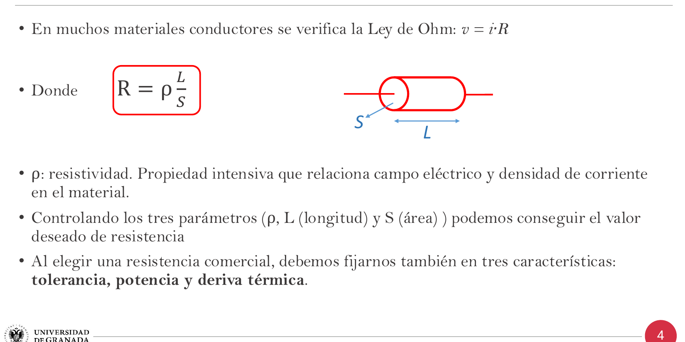

- En muchos materiales conductores se verifica la **ley de Ohm**: $v=i\cdot R$.
- La resistencia de un conductor homogéneo (longitud $L$, sección $S$):

$$
\boxed{\,R=\rho\,\frac{L}{S}\,}
$$

- **$\rho$: resistividad.** Es una **propiedad intensiva** (no depende del tamaño) que **relaciona campo eléctrico y densidad de corriente** en el material.
- **Controlando los tres parámetros** ($\rho$, $L$ longitud y $S$ área) se consigue el valor deseado de resistencia.
- Al elegir una resistencia comercial hay que fijarse además en tres características: **tolerancia, potencia y deriva térmica**.

### 2.2 Características (diap. 5)

| Característica | Definición | Fórmula |
|---|---|---|
| **Tolerancia** | Diferencia máxima entre el valor real y el nominal, en términos relativos (normalmente % del valor nominal) | $\Delta R=\dfrac{R-R_0}{R_0}\times100$ |
| **Potencia** | Máxima potencia que puede disipar sin destruirse (en W). Ej.: las resistencias de laboratorio son de **¼ W** | — |
| **Deriva térmica** | Al variar la temperatura cambian las propiedades eléctricas. Se define un **coeficiente de temperatura $\alpha$** | $R_H=R_0\left[1+\alpha\,(T_H-T_0)\right]$ |

- $R_0$: resistencia a la temperatura $T_0$; $R_H$: resistencia a la temperatura $T_H$.
- Para **dependencias no lineales**, $\alpha=\alpha(T)$.
- **Otros:** tensión máxima, estabilidad y ruido.

> ➕ El coeficiente de temperatura se da normalmente en **ppm/°C** (TCR): $\alpha=100\ \text{ppm/°C}=10^{-4}\ \text{°C}^{-1}$.

### 2.3 Tipos (diap. 6–8)

#### Hilo bobinado (*wire bound* en la diapositiva; *wirewound*) — diap. 6

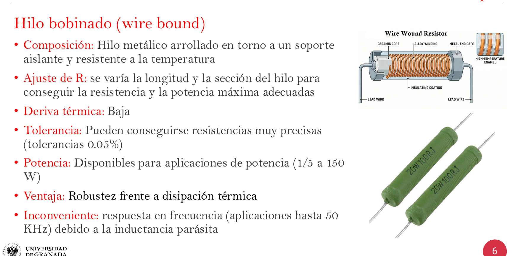

| Aspecto | Descripción |
|---|---|
| **Composición** | Hilo metálico arrollado en torno a un soporte aislante y resistente a la temperatura |
| **Ajuste de $R$** | Se varía la **longitud y la sección del hilo** para conseguir la resistencia y la potencia máxima adecuadas |
| **Deriva térmica** | Baja |
| **Tolerancia** | Pueden conseguirse resistencias muy precisas (tolerancias **0,05 %**) |
| **Potencia** | Disponibles para aplicaciones de potencia (**1/5 a 150 W**) |
| **Ventaja** | **Robustez frente a disipación térmica** |
| **Inconveniente** | **Respuesta en frecuencia** (aplicaciones hasta **50 kHz**) debido a la **inductancia parásita** |

#### Película metálica (*metal film*) — diap. 7

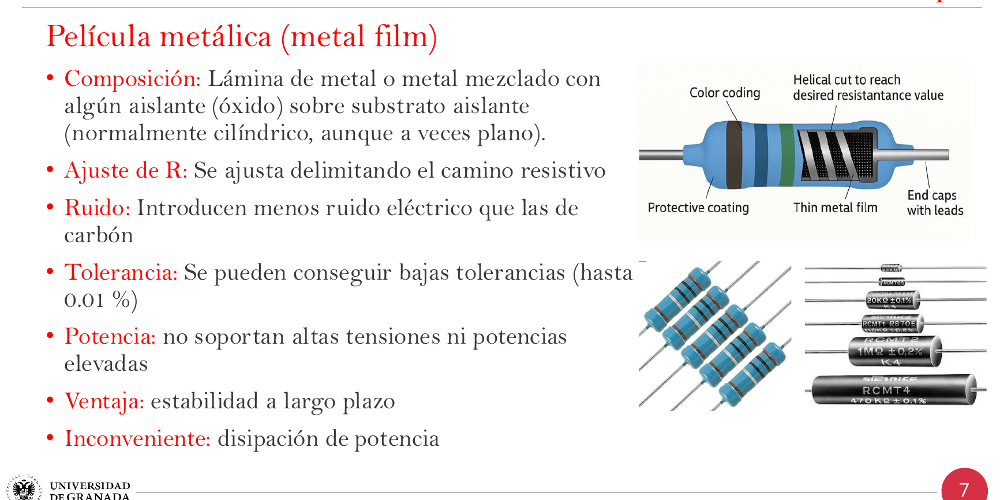

| Aspecto | Descripción |
|---|---|
| **Composición** | Lámina de metal, o metal mezclado con algún aislante (óxido), sobre un **substrato aislante** (normalmente cilíndrico, aunque a veces plano) |
| **Ajuste de $R$** | Se ajusta **delimitando el camino resistivo** (corte helicoidal) |
| **Ruido** | Introducen **menos ruido eléctrico que las de carbón** |
| **Tolerancia** | Bajas tolerancias (hasta **0,01 %**) |
| **Potencia** | **No soportan altas tensiones ni potencias elevadas** |
| **Ventaja** | **Estabilidad a largo plazo** |
| **Inconveniente** | **Disipación de potencia** |

#### Carbón — diap. 8

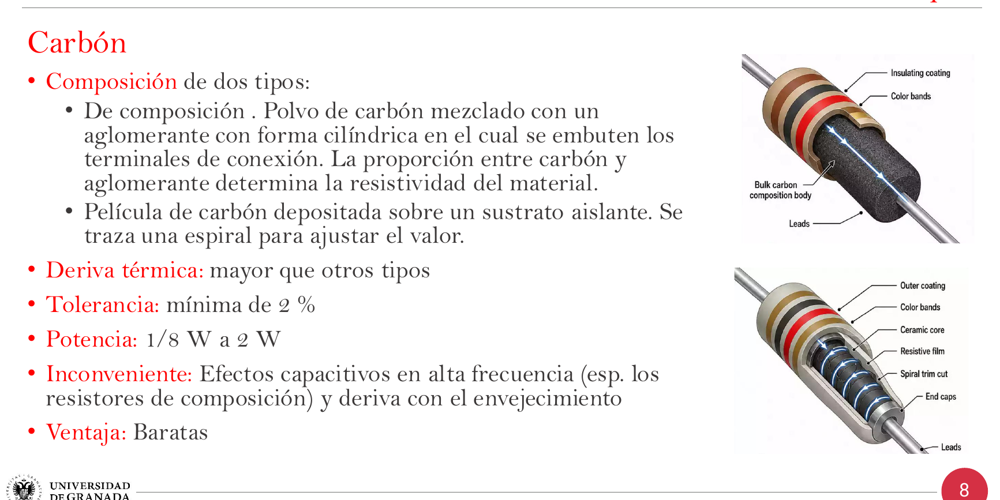

- **Composición de dos tipos:**
  - **De composición:** polvo de carbón mezclado con un aglomerante, con forma cilíndrica, en el cual se embuten los terminales. La **proporción entre carbón y aglomerante determina la resistividad**.
  - **Película de carbón** depositada sobre un sustrato aislante; **se traza una espiral** para ajustar el valor.

| Aspecto | Descripción |
|---|---|
| **Deriva térmica** | **Mayor que otros tipos** |
| **Tolerancia** | **Mínima de 2 %** |
| **Potencia** | **1/8 W a 2 W** |
| **Inconveniente** | **Efectos capacitivos en alta frecuencia** (especialmente los de composición) y **deriva con el envejecimiento** |
| **Ventaja** | **Baratas** |

### 2.4 Comparación de tecnologías (diap. 9)

| Tecnología | Carbón (composición) | Carbón (película) | Película metálica | Hilo bobinado |
|---|---|---|---|---|
| **TCR (ppm/°C)** | −200 a −1500 | −200 a −1500 | ±5 a ±50 | ±1 a ±200 |
| **Tolerancia** | ±5 a ±20 % | ±2 a ±10 % | ±0,1 a ±2 % | ±0,1 a ±10 % |
| **Potencia (W)** | 0,25 – 1 | 0,25 – 2 | 0,063 – 1 | 0,1 – >1000 |
| **Ruido (µV/V)** | 2–6 | <1 | <0,1 | Despreciable |

> **Para recordar:** carbón = barato pero poco preciso, con deriva y ruido; **película metálica** = mejor precisión, deriva y ruido; **hilo bobinado** = mayor potencia y muy preciso, pero **inductivo** (poco adecuado a frecuencias altas).

### 2.5 Potenciómetros y resistores no lineales (diap. 10)

- Los resistores pueden ser **ajustables ⇒ potenciómetros**.
- Muchos **sensores** se basan en un cambio de la resistencia con otra magnitud física:

| Variable | Nombre | Material | Aplicaciones |
|---|---|---|---|
| **Temperatura** | Termistores, **N.T.C.** o **P.T.C.** | N.T.C.: óxido semiconductor. P.T.C.: cerámica basada en titanato de bario | Control de temperatura; control de ganancia de amplificador; regulación de tensión (N.T.C.); regulación de corriente (P.T.C.) |
| **Deformación** | Galgas extensométricas | Hilo metálico o lámina metálica | Detección en rangos de baja presión |
| **Voltaje** | **Varistores** | Óxido metálico; carburo de silicio | Protección frente a transitorios; rectificación de pulsos asimétricos |
| **Humedad** | — | Carbono, películas metálicas; óxido metálico de película gruesa | Sensores de humedad |

> ➕ **NTC** (*negative temperature coefficient*): la resistencia **baja** al subir $T$. **PTC**: **sube** al subir $T$. **Varistor (VDR)**: resistencia que depende de la **tensión** aplicada.

### 2.6 Identificación

#### a) Valores normalizados: series E (diap. 11–12)

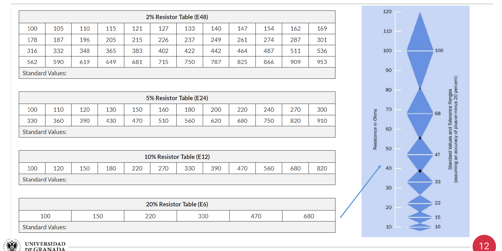

- **Serie de resistencias:** conjunto de valores disponibles. **Normalizado por la norma IEC 60063.**
- **¿Por qué usar valores normalizados?** Para **unificar criterios**, **facilitar el diseño de circuitos** y la **sustitución de componentes**.
- Hay varias series, que se nombran con una **E seguida del número de valores diferentes en una década**: **E6, E12, E24, E48, E96, E192**.
- Los valores $E_n$ de la serie $S$ se calculan con:

$$
\boxed{\,E_n(S)=10^{(n-1)/S}\,}
$$

- El resultado **se redondea**. **E12 y E24** tienen **dos dígitos significativos**; **E96 y E192**, tres. **Cuantos más valores tiene la serie, menor es la tolerancia asociada.**

| Serie | Tolerancia |
|---|---|
| **E6** | 20 % |
| **E12** | 10 % |
| **E24** | 5 % |
| **E48** | 2 % |
| **E96** | 1 % |
| **E192** | 0,1 % · 0,25 % · 0,5 % |

**Valores de las series (diap. 12):**

| Serie | Valores en una década |
|---|---|
| **E6 (20 %)** | 100, 150, 220, 330, 470, 680 |
| **E12 (10 %)** | 100, 120, 150, 180, 220, 270, 330, 390, 470, 560, 680, 820 |
| **E24 (5 %)** | 100, 110, 120, 130, 150, 160, 180, 200, 220, 240, 270, 300, 330, 360, 390, 430, 470, 510, 560, 620, 680, 750, 820, 910 |
| **E48 (2 %)** | 100, 105, 110, 115, 121, 127, 133, 140, 147, 154, 162, 169, 178, 187, 196, 205, 215, 226, 237, 249, 261, 274, 287, 301, 316, 332, 348, 365, 383, 402, 422, 442, 464, 487, 511, 536, 562, 590, 619, 649, 681, 715, 750, 787, 825, 866, 909, 953 |

La gráfica de la derecha muestra, para la serie **E6 (±20 %)**, que los intervalos de tolerancia de valores consecutivos (10, 15, 22, 33, 47, 68, 100) **se solapan**, de modo que **cualquier resistencia cae dentro de la tolerancia de algún valor normalizado**.

> ➕ **Ejemplo del cálculo:** E12 ($S=12$): $n=2\Rightarrow10^{1/12}=1{,}21\to1{,}2$; $n=3\Rightarrow10^{2/12}=1{,}468\to1{,}5$; $n=4\Rightarrow10^{3/12}=1{,}778\to1{,}8$. La diapositiva dice "redondea por exceso", pero en la práctica los valores son los de las tablas de la norma (algunos se redondean al valor más cercano, p. ej. $10^{(7-1)/6}\cdot10=68{,}1\to68$).
>
> ⚠️ La diapositiva agrupa "E96 y E192" como series de tres cifras, pero también la **E48** (101, 105, 110…) tiene tres.

#### b) Código de colores (diap. 13–14)

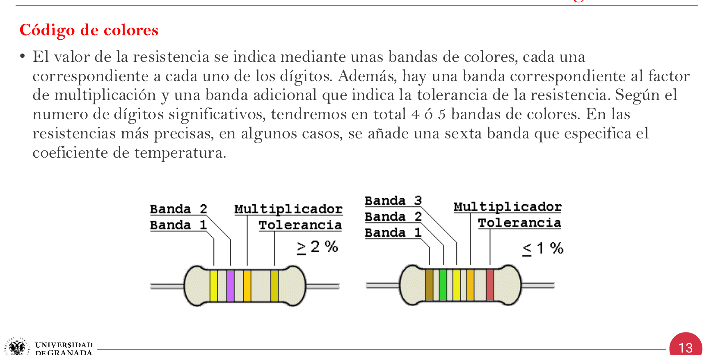
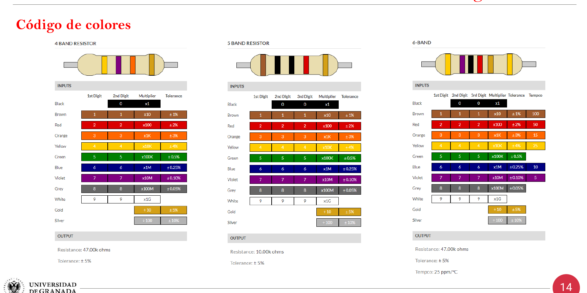

- El valor se indica mediante **bandas de colores**: una por cada dígito, **una banda del factor multiplicador** y **una banda de tolerancia**. Según el número de dígitos significativos hay **4 ó 5 bandas**. En las más precisas puede añadirse una **sexta banda: coeficiente de temperatura**.

| Nº de bandas | Banda 1 | Banda 2 | Banda 3 | Multiplicador | Tolerancia | Banda 6 |
|---|---|---|---|---|---|---|
| **4 bandas** (tolerancia ≥ 2 %) | Dígito | Dígito | — | ✔ | ✔ | — |
| **5 bandas** (tolerancia ≤ 1 %) | Dígito | Dígito | Dígito | ✔ | ✔ | — |
| **6 bandas** | Dígito | Dígito | Dígito | ✔ | ✔ | Coef. temperatura |

**Tabla de colores (de la diapositiva 14):**

| Color | Dígito | Multiplicador | Tolerancia | Coef. temp. (ppm/°C) |
|---|---|---|---|---|
| **Negro** | 0 | ×1 | — | — |
| **Marrón** | 1 | ×10 | ±1 % | 100 |
| **Rojo** | 2 | ×100 | ±2 % | 50 |
| **Naranja** | 3 | ×1K | ±3 % | 15 |
| **Amarillo** | 4 | ×10K | ±4 % | 25 |
| **Verde** | 5 | ×100K | ±0,5 % | — |
| **Azul** | 6 | ×1M | ±0,25 % | 10 |
| **Violeta** | 7 | ×10M | ±0,10 % | 5 |
| **Gris** | 8 | ×100M | ±0,05 % | — |
| **Blanco** | 9 | ×1G | — | — |
| **Oro** | — | ×0,1 | ±5 % | — |
| **Plata** | — | ×0,01 | ±10 % | — |

**Ejemplos de la diapositiva:**

| Tipo | Bandas | Resultado |
|---|---|---|
| 4 bandas | Amarillo, violeta, naranja, oro | **47 kΩ ±5 %** ($47\times10^3$) |
| 5 bandas | Marrón, negro, negro, rojo, oro | **10,00 kΩ ±5 %** ($100\times10^2$) |
| 6 bandas | Amarillo, violeta, negro, rojo, oro, amarillo | **47,00 kΩ ±5 %, 25 ppm/°C** |

#### c) Sistema RKM (diap. 15)

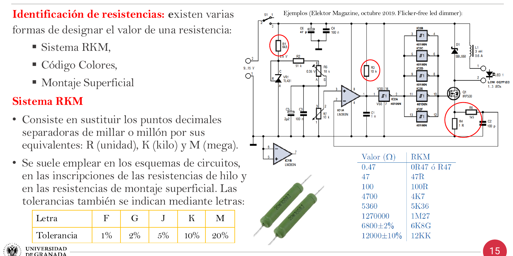

- Consiste en **sustituir el punto decimal (y los separadores de millar o millón) por la letra de la unidad**: **R** (unidad), **K** (kilo), **M** (mega).
- Se emplea en **esquemas de circuitos**, en las **inscripciones de las resistencias de hilo** y en las de **montaje superficial**.
- Las **tolerancias** también se indican con letras:

| Letra | F | G | J | K | M |
|---|---|---|---|---|---|
| **Tolerancia** | 1 % | 2 % | 5 % | 10 % | 20 % |

| Valor ($\Omega$) | RKM |
|---|---|
| 0,47 | 0R47 ó R47 |
| 47 | 47R |
| 100 | 100R |
| 4700 | 4K7 |
| 5360 | 5K36 |
| 1 270 000 | 1M27 |
| 6800 ±2 % | 6K8G |
| 12 000 ±10 % | 12KK |

> Observa que en **12KK** la primera K es "kilo" (la unidad y la coma decimal) y la segunda K es la **tolerancia del 10 %**.

#### d) Montaje superficial, SMD (diap. 16)

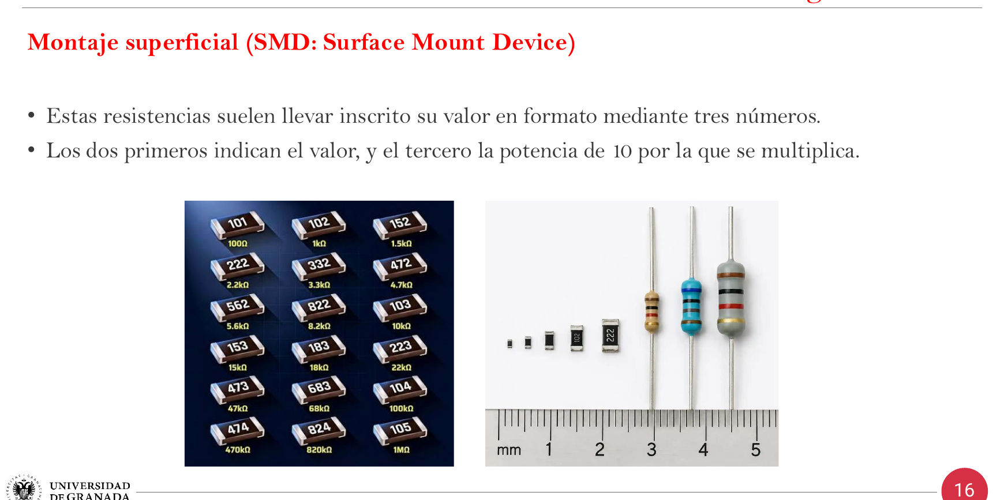

- Suelen llevar inscrito su valor **mediante tres números**: **los dos primeros indican el valor y el tercero la potencia de 10** por la que se multiplica.

| Código | Valor | Código | Valor | Código | Valor |
|---|---|---|---|---|---|
| 101 | 100 Ω | 332 | 3,3 kΩ | 183 | 18 kΩ |
| 102 | 1 kΩ | 472 | 4,7 kΩ | 223 | 22 kΩ |
| 152 | 1,5 kΩ | 562 | 5,6 kΩ | 473 | 47 kΩ |
| 222 | 2,2 kΩ | 822 | 8,2 kΩ | 683 | 68 kΩ |
| 103 | 10 kΩ | 153 | 15 kΩ | 104 | 100 kΩ |
| 474 | 470 kΩ | 824 | 820 kΩ | 105 | 1 MΩ |

### 2.7 Modelo de parásitos (diap. 17–18)

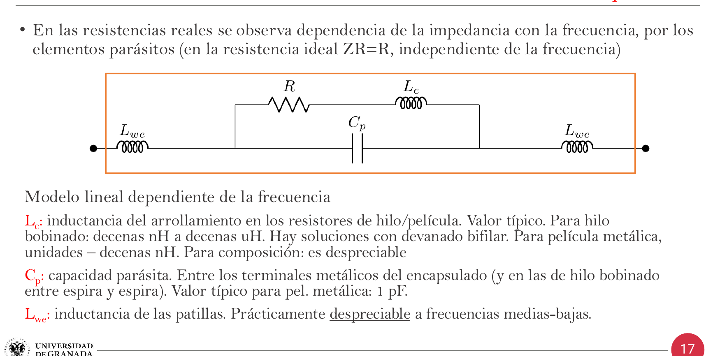

En las resistencias reales **la impedancia depende de la frecuencia** por los **elementos parásitos** (en la ideal, $Z_R=R$ no depende de la frecuencia).

**Modelo lineal dependiente de la frecuencia:** $L_{we}$ en serie en cada terminal; entre ellos, $R$ **en serie con $L_c$**, y todo ello **en paralelo con $C_p$**.

| Elemento | Significado | Valores típicos |
|---|---|---|
| $L_c$ | **Inductancia del arrollamiento** en los resistores de hilo/película | Hilo bobinado: **decenas de nH a decenas de µH** (hay soluciones con devanado **bifilar**). Película metálica: **unidades–decenas de nH**. Composición: **despreciable** |
| $C_p$ | **Capacidad parásita**, entre los terminales metálicos del encapsulado (y en las de hilo bobinado, entre espira y espira) | Película metálica: **≈ 1 pF** |
| $L_{we}$ | **Inductancia de las patillas** | **Prácticamente despreciable** a frecuencias medias-bajas |

**Impedancia (sin $L_{we}$):**

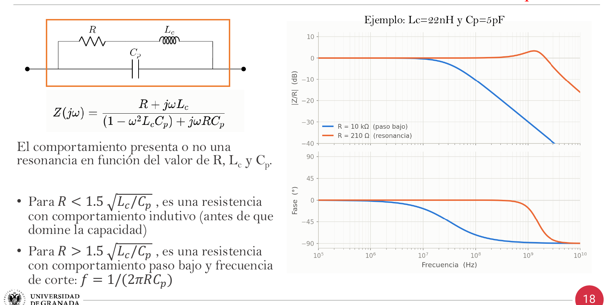

$$
\boxed{\,Z(j\omega)=\frac{R+j\omega L_c}{\left(1-\omega^2L_cC_p\right)+j\omega RC_p}\,}
$$

**El comportamiento presenta o no una resonancia en función de $R$, $L_c$ y $C_p$:**

| Condición | Comportamiento |
|---|---|
| $R<1{,}5\sqrt{L_c/C_p}$ | Resistencia con **comportamiento inductivo** (antes de que domine la capacidad) |
| $R>1{,}5\sqrt{L_c/C_p}$ | Comportamiento **paso bajo**, con **frecuencia de corte** $f=\dfrac{1}{2\pi RC_p}$ |

**Ejemplo de la diapositiva ($L_c=22$ nH, $C_p=5$ pF):** gráficas de $|Z/R|$ (dB) y fase (°) frente a la frecuencia ($10^5$–$10^{10}$ Hz) para $R=10$ kΩ (**paso bajo**) y $R=210\ \Omega$ (**resonancia**).

> ➕ **Comprobación de los límites** (cálculo mío):
> - A **baja frecuencia**: $Z\approx R+j\omega\,(L_c-R^2C_p)$ ⇒ es **inductiva** si $R<\sqrt{L_c/C_p}=66\ \Omega$ y **capacitiva** si $R>66\ \Omega$.
> - Con $L_c=22$ nH y $C_p=5$ pF, $1{,}5\sqrt{L_c/C_p}\approx100\ \Omega$ es, aproximadamente, el valor de $R$ **por encima del cual desaparece el pico de resonancia** de $|Z|$.
> - Frecuencia de corte para $R=10$ kΩ y $C_p=5$ pF: $f=\dfrac{1}{2\pi\cdot10^4\cdot5\cdot10^{-12}}\approx3{,}2$ MHz (coherente con la curva azul).
>
> ⚠️ Con esos valores, $R=210\ \Omega$ queda por encima de $1{,}5\sqrt{L_c/C_p}\approx100\ \Omega$ y no debería mostrar pico de resonancia; no he podido reproducir esa curva exacta con los datos que da la diapositiva.

---

## 3. Condensadores

### 3.1 Introducción y características (diap. 20)

- Los condensadores son elementos capaces de **almacenar carga eléctrica**.
- Capacidad de un condensador de **láminas paralelas**:

$$
\boxed{\,C=\varepsilon\,\frac{A}{d}\,}
$$

  donde $\varepsilon$ es la **constante dieléctrica del material entre las placas** metálicas.
- **Controlando los tres parámetros** ($\varepsilon$, $A$ área de las placas y $d$ distancia entre placas) se consigue el valor deseado.
- **Al elegir el condensador** hay que considerar:

| Aspecto | Significado |
|---|---|
| **Tolerancia** | Error relativo de la capacidad real respecto del valor nominal |
| **Polaridad** | Algunos (**electrolíticos**) deben colocarse de forma que una de las patillas (**terminal positivo**) tenga siempre tensión positiva respecto de la otra (terminal negativo) |
| **Tensión máxima** | La que puede soportar el condensador entre sus terminales |

### 3.2 Tipos (diap. 21–24, 26)

#### Electrolíticos (de aluminio) — diap. 21

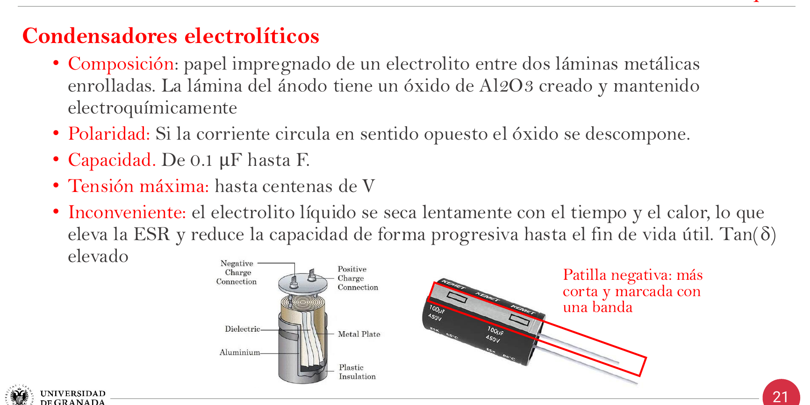

| Aspecto | Descripción |
|---|---|
| **Composición** | **Papel impregnado de un electrolito** entre dos láminas metálicas enrolladas. La lámina del **ánodo** tiene un óxido de **Al₂O₃** creado y mantenido electroquímicamente |
| **Polaridad** | Si la corriente circula en sentido opuesto, **el óxido se descompone** |
| **Capacidad** | De **0,1 µF hasta F** |
| **Tensión máxima** | Hasta **centenas de V** |
| **Inconveniente** | El **electrolito líquido se seca** lentamente con el tiempo y el calor, lo que **eleva la ESR** y **reduce la capacidad** de forma progresiva hasta el fin de vida útil. **tan(δ) elevado** |
| **Identificación** | **Patilla negativa: más corta y marcada con una banda** |

#### Electrolíticos de tántalo — diap. 22

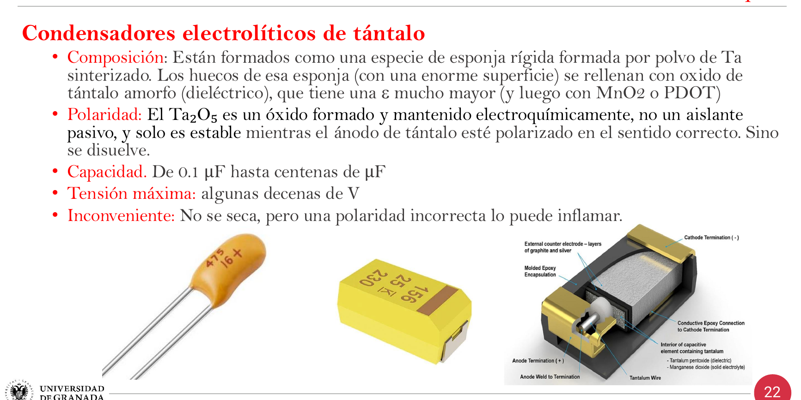

| Aspecto | Descripción |
|---|---|
| **Composición** | Una especie de **esponja rígida de polvo de Ta sinterizado**. Los huecos (enorme superficie) se rellenan con **óxido de tántalo amorfo (dieléctrico)**, que tiene una $\varepsilon$ mucho mayor (y luego con MnO₂ o PDOT) |
| **Polaridad** | El **Ta₂O₅** es un óxido **formado y mantenido electroquímicamente**, no un aislante pasivo, y solo es estable mientras el ánodo esté polarizado en el sentido correcto. Si no, **se disuelve** |
| **Capacidad** | De **0,1 µF hasta centenas de µF** |
| **Tensión máxima** | **Algunas decenas de V** |
| **Inconveniente** | **No se seca, pero una polaridad incorrecta lo puede inflamar** |

#### Plástico (film) — diap. 23

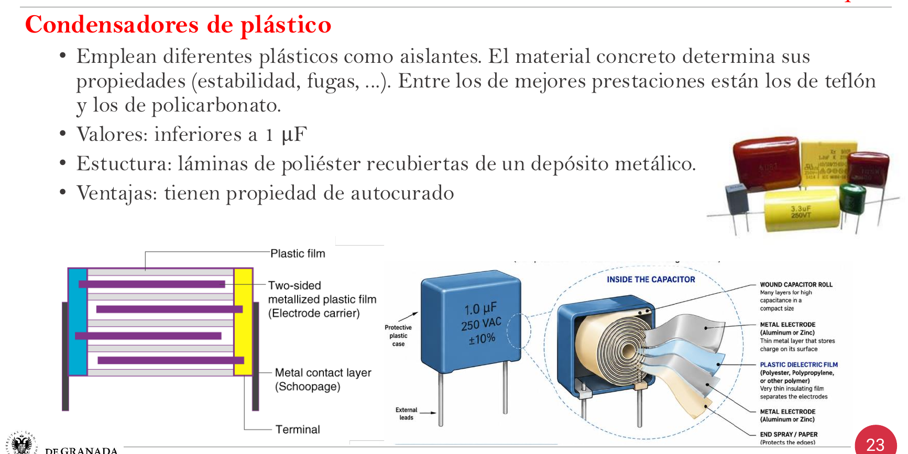

- Emplean **diferentes plásticos como aislantes**. El material concreto determina sus propiedades (estabilidad, fugas…). Entre los de mejores prestaciones están los de **teflón** y los de **policarbonato**.
- **Valores:** inferiores a **1 µF**.
- **Estructura:** láminas de poliéster recubiertas de un **depósito metálico**.
- **Ventaja:** tienen la propiedad de **autocurado**.

#### Cerámicos — diap. 24

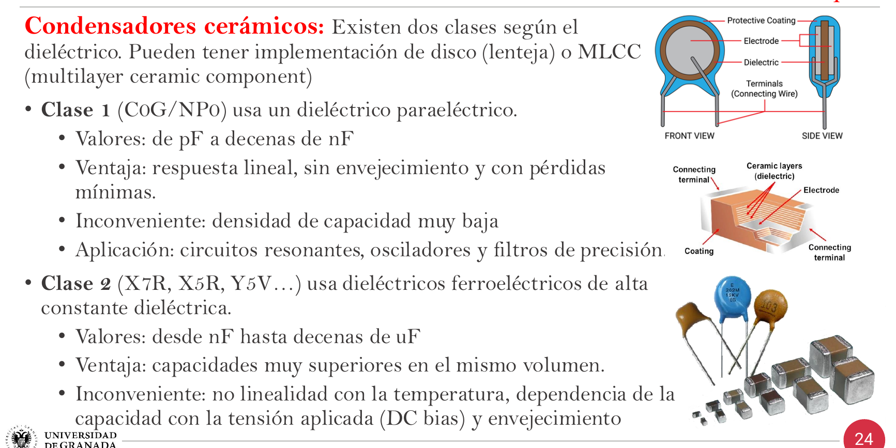

Implementación de **disco (lenteja)** o **MLCC** (*multilayer ceramic component*). Hay **dos clases** según el dieléctrico:

| | **Clase 1** (C0G/NP0) | **Clase 2** (X7R, X5R, Y5V…) |
|---|---|---|
| **Dieléctrico** | **Paraeléctrico** | **Ferroeléctricos** de alta constante dieléctrica |
| **Valores** | De **pF** a **decenas de nF** | Desde **nF** hasta **decenas de µF** |
| **Ventaja** | Respuesta **lineal**, **sin envejecimiento** y con **pérdidas mínimas** | Capacidades **muy superiores en el mismo volumen** |
| **Inconveniente** | **Densidad de capacidad muy baja** | **No linealidad con la temperatura**, **dependencia de la capacidad con la tensión aplicada (DC bias)** y **envejecimiento** |
| **Aplicación** | Circuitos **resonantes**, **osciladores** y **filtros de precisión** | — |

#### Variables: trimmer y varactor — diap. 26

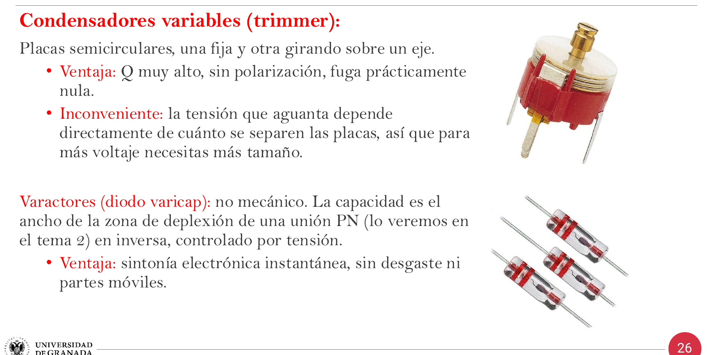

- **Condensadores variables (trimmer):** placas semicirculares, **una fija y otra girando sobre un eje**.
  - **Ventaja:** **Q muy alto, sin polarización, fuga prácticamente nula**.
  - **Inconveniente:** la tensión que aguanta depende directamente de cuánto se separen las placas, así que **para más voltaje necesitas más tamaño**.
- **Varactores (diodo varicap):** **no mecánico**. La capacidad es el **ancho de la zona de deplexión de una unión PN en inversa, controlado por tensión** (se verá en el Tema 2).
  - **Ventaja:** **sintonía electrónica instantánea**, sin desgaste ni partes móviles.

### 3.3 Comparación de tecnologías (diap. 25)

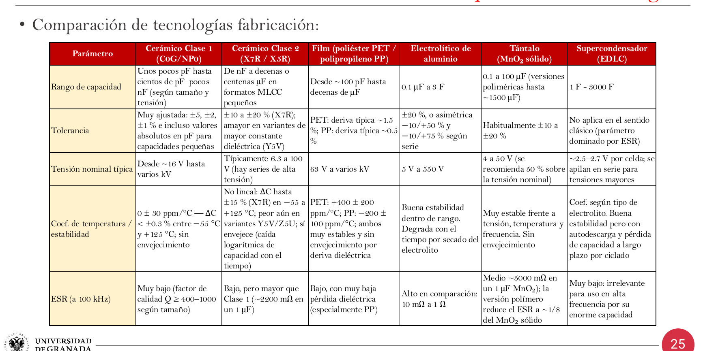

| Parámetro | Cerámico Clase 1 (C0G/NP0) | Cerámico Clase 2 (X7R/X5R) | Film (PET/PP) | Electrolítico de aluminio | Tántalo (MnO₂ sólido) | Supercondensador (EDLC) |
|---|---|---|---|---|---|---|
| **Rango de capacidad** | Unos pocos pF hasta cientos de pF–pocos nF (según tamaño y tensión) | De nF a decenas o centenas de µF en formatos MLCC pequeños | Desde ~100 pF hasta decenas de µF | 0,1 µF a 3 F | 0,1 a 100 µF (versiones poliméricas hasta ~1500 µF) | 1 F – 3000 F |
| **Tolerancia** | Muy ajustada: ±5, ±2, ±1 % e incluso valores absolutos en pF para capacidades pequeñas | ±10 a ±20 % (X7R); mayor en variantes de mayor constante dieléctrica (Y5V) | PET: deriva típica ~1,5 %; PP: deriva típica ~0,5 % | ±20 %, o asimétrica −10/+50 % y −10/+75 % según serie | Habitualmente ±10 a ±20 % | No aplica en el sentido clásico (parámetro dominado por ESR) |
| **Tensión nominal típica** | Desde ~16 V hasta varios kV | Típicamente 6,3 a 100 V (hay series de alta tensión) | 63 V a varios kV | 5 V a 550 V | 4 a 50 V (se recomienda 50 % sobre la tensión nominal) | ~2,5–2,7 V por celda; se apilan en serie para tensiones mayores |
| **Coef. temperatura / estabilidad** | 0 ± 30 ppm/°C — ΔC < ±0,3 % entre −55 °C y +125 °C; sin envejecimiento | No lineal: ΔC hasta ±15 % (X7R) en −55 a +125 °C; peor aún en Y5V/Z5U; sí envejece (caída logarítmica de capacidad con el tiempo) | PET: +400 ± 200 ppm/°C; PP: −200 ± 100 ppm/°C; ambos muy estables y sin envejecimiento por deriva dieléctrica | Buena estabilidad dentro de rango. Degrada con el tiempo por secado del electrolito | Muy estable frente a tensión, temperatura y frecuencia. Sin envejecimiento | Coef. según tipo de electrolito. Buena estabilidad pero con autodescarga y pérdida de capacidad a largo plazo por ciclado |
| **ESR (a 100 kHz)** | Muy bajo (factor de calidad Q ≥ 400–1000 según tamaño) | Bajo, pero mayor que Clase 1 (~2200 mΩ en un 1 µF) | Bajo, con muy baja pérdida dieléctrica (especialmente PP) | Alto en comparación: 10 mΩ a 1 Ω | Medio, ~5000 mΩ en un 1 µF MnO₂; la versión polímero reduce el ESR a ~1/8 del MnO₂ sólido | Muy bajo: irrelevante para uso en alta frecuencia por su enorme capacidad |

> **Para recordar:** **C0G/NP0** = estable y precisa (resonantes, filtros); **X7R/X5R** = mucha capacidad en poco volumen, pero con DC bias y envejecimiento; **film** = estable, tensiones altas; **electrolítico de aluminio** = mucha capacidad, ESR alta, se seca; **tántalo** = estable, pero ¡polaridad!; **supercondensador** = faradios, baja tensión por celda.

### 3.4 Identificación

#### a) Valores normalizados (diap. 27)

- Como en las resistencias, existe un conjunto de **valores de capacidad disponibles**, normalizado por la **norma IEC 60063** y con la **misma regla**: $E_n(S)=10^{(n-1)/S}$.
- **Valores comerciales estándar:**

| Serie | Valores en una década |
|---|---|
| **E6** (20 %) | 10, 15, 22, 33, 47, 68 |
| **E12** (10 %) | 10, 12, 15, 18, 22, 27, 33, 39, 47, 56, 68, 82 |
| **E24** (5 %) | 10, 11, 12, 13, 15, 16, 18, 20, 22, 24, 27, **30**, 33, **36**, 39, 43, 47, 51, 56, 62, 68, 75, 82, 91 |

> ⚠️ En la diapositiva 27 la fila E24 omite el **30** y el **36**; los he incluido porque son los valores correctos de la serie (coinciden con la tabla de resistencias de la diapositiva 12).

- **Las series E48/E96/E192 no se usan** en condensadores porque:
  - El valor solo se expresa con **dos cifras significativas**.
  - Las **tolerancias inferiores al 5 %** se indican con una letra en el etiquetado.
- Existen varios códigos para identificar el valor, pero **no todos los fabricantes se ajustan a ellos**.

#### b) Código numérico EIA (diap. 28)

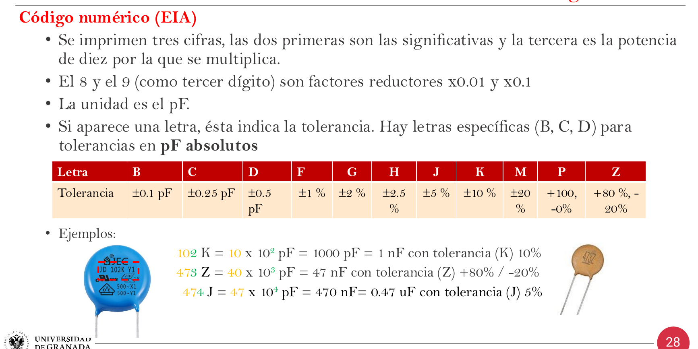

- Se imprimen **tres cifras**: las dos primeras son las **significativas** y la tercera es la **potencia de diez** por la que se multiplica.
- **8 y 9 (como tercer dígito)** son **factores reductores**: ×0,01 y ×0,1.
- **La unidad es el pF.**
- Si aparece una **letra**, indica la **tolerancia** (letras específicas B, C, D para tolerancias en **pF absolutos**):

| Letra | B | C | D | F | G | H | J | K | M | P | Z |
|---|---|---|---|---|---|---|---|---|---|---|---|
| **Tolerancia** | ±0,1 pF | ±0,25 pF | ±0,5 pF | ±1 % | ±2 % | ±2,5 % | ±5 % | ±10 % | ±20 % | +100/−0 % | +80/−20 % |

| Código | Cálculo | Valor | Tolerancia |
|---|---|---|---|
| **102 K** | $10\times10^2$ pF | 1000 pF = **1 nF** | (K) 10 % |
| **473 Z** | $47\times10^3$ pF | **47 nF** | (Z) +80 % / −20 % |
| **474 J** | $47\times10^4$ pF | 470 nF = **0,47 µF** | (J) 5 % |

> ⚠️ En la diapositiva, el ejemplo 473 Z aparece escrito como "40 × 10³ pF"; es **47 × 10³ pF**.

#### c) Notación RKM / IEC 60062 (diap. 29)

- Se imprime el valor usando **como separador decimal la letra de la unidad** (p = pF, n = nF, µ…).
- **Si se usa una coma en lugar de una letra, la unidad es el µF.**
- Si aparece una **segunda letra**, se refiere a la **tolerancia**.

| Código | Valor | Tolerancia |
|---|---|---|
| **n47** | 0,47 nF = 470 pF | — |
| **0,068 J** | 0,068 µF = 68 nF | 5 % |
| **22 K** | 22 pF | 10 % |
| **3n3** | 3,3 nF | — |
| **.1K** | 0,1 µF | 10 % |
| **4n7K** | 4,7 nF | 10 % |

#### d) Código de tensión (letra + número, EIA) (diap. 30)

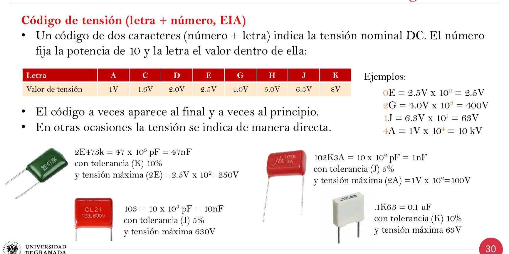

- Un código de **dos caracteres (número + letra)** indica la **tensión nominal DC**: **el número fija la potencia de 10 y la letra el valor dentro de ella**.

| Letra | A | C | D | E | G | H | J | K |
|---|---|---|---|---|---|---|---|---|
| **Valor de tensión** | 1 V | 1,6 V | 2,0 V | 2,5 V | 4,0 V | 5,0 V | 6,3 V | 8 V |

- Ejemplos: **0E** = 2,5 V × 10⁰ = 2,5 V · **2G** = 4,0 V × 10² = 400 V · **1J** = 6,3 V × 10¹ = 63 V · **4A** = 1 V × 10⁴ = 10 kV.
- El código **a veces aparece al final y a veces al principio**; otras veces la tensión se indica **directamente**.

| Marcado | Capacidad | Tolerancia | Tensión máxima |
|---|---|---|---|
| **2E473K** | $47\times10^3$ pF = 47 nF | (K) 10 % | (2E) = 2,5 V × 10² = **250 V** |
| **103** (con "J" y "630V" impresos) | $10\times10^3$ pF = 10 nF | (J) 5 % | **630 V** (directa) |
| **102K3A** | $10\times10^2$ pF = 1 nF | (K) 10 % | (3A) = 1 V × 10³ = **1 kV** |
| **.1K63** | 0,1 µF | (K) 10 % | **63 V** (directa) |

> ⚠️ En la diapositiva, el ejemplo 102K3A se interpreta como "tolerancia (J) 5 % y tensión (2A) = 1 V × 10² = 100 V". Según las propias reglas del código, **K es 10 %** y **3A = 1 V × 10³ = 1 kV**; lo he escrito así en la tabla.

#### e) Código de colores — obsoleto (diap. 31)

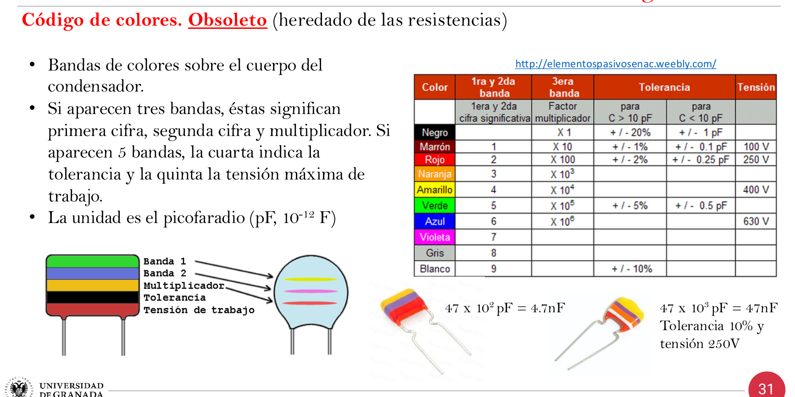

- **Obsoleto** (heredado de las resistencias). **Bandas de colores** sobre el cuerpo.
- **Tres bandas:** 1.ª cifra, 2.ª cifra y multiplicador. **Cinco bandas:** además, la 4.ª indica la **tolerancia** y la 5.ª la **tensión máxima de trabajo**.
- **Unidad: picofaradio** (pF, $10^{-12}$ F).

| Color | 1.ª y 2.ª cifra | Multiplicador | Tolerancia ($C>10$ pF) | Tolerancia ($C<10$ pF) | Tensión |
|---|---|---|---|---|---|
| Negro | 0 | ×1 | ±20 % | ±1 pF | — |
| Marrón | 1 | ×10 | ±1 % | ±0,1 pF | 100 V |
| Rojo | 2 | ×100 | ±2 % | ±0,25 pF | 250 V |
| Naranja | 3 | ×10³ | — | — | — |
| Amarillo | 4 | ×10⁴ | — | — | 400 V |
| Verde | 5 | ×10⁵ | ±5 % | ±0,5 pF | — |
| Azul | 6 | ×10⁶ | — | — | 630 V |
| Violeta | 7 | — | — | — | — |
| Gris | 8 | — | — | — | — |
| Blanco | 9 | — | ±10 % | — | — |

- Ejemplos: $47\times10^2$ pF = **4,7 nF**; $47\times10^3$ pF = **47 nF**, tolerancia 10 % y tensión 250 V.

### 3.5 Modelo de parásitos (diap. 32–34)

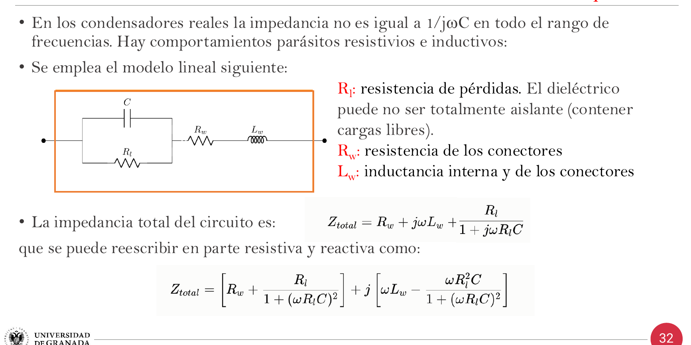

En los condensadores reales la impedancia **no es $1/j\omega C$ en todo el rango de frecuencias**: hay comportamientos parásitos **resistivos e inductivos**.

**Modelo lineal:** $C$ **en paralelo con $R_l$**, y todo ello **en serie con $R_w$ y $L_w$**.

| Elemento | Significado |
|---|---|
| $R_l$ | **Resistencia de pérdidas.** El dieléctrico puede no ser totalmente aislante (contener cargas libres) |
| $R_w$ | **Resistencia de los conectores** |
| $L_w$ | **Inductancia interna y de los conectores** |

**Impedancia total:**

$$
Z_{total}=R_w+j\omega L_w+\frac{R_l}{1+j\omega R_lC}
$$

**Reescrita en parte resistiva y reactiva:**

$$
\boxed{\,Z_{total}=\left[R_w+\frac{R_l}{1+(\omega R_lC)^2}\right]+j\left[\omega L_w-\frac{\omega R_l^2C}{1+(\omega R_lC)^2}\right]\,}
$$

#### Pérdidas y tangente de pérdidas (diap. 33)

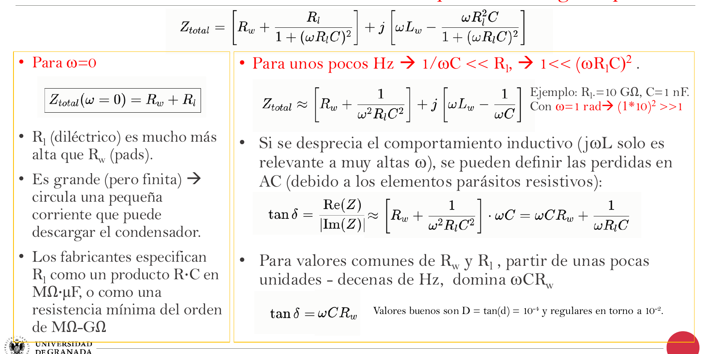

| Caso | Resultado |
|---|---|
| **$\omega=0$** (DC) | $Z_{total}(\omega=0)=R_w+R_l$ |
| **Unos pocos Hz:** $1/\omega C\ll R_l\Rightarrow1\ll(\omega R_lC)^2$ | $Z_{total}\approx\left[R_w+\dfrac{1}{\omega^2R_lC^2}\right]+j\left[\omega L_w-\dfrac1{\omega C}\right]$ |

- **En DC:** $R_l$ (dieléctrico) es **mucho más alta que $R_w$** (pads). Es **grande pero finita** ⇒ circula una pequeña corriente que **puede descargar el condensador**.
- Los fabricantes especifican $R_l$ como un **producto $R\cdot C$ en MΩ·µF**, o como una resistencia mínima del orden de **MΩ–GΩ**.
- **Ejemplo:** $R_l=10$ GΩ, $C=1$ nF. Con $\omega=1$ rad/s, $(\omega R_lC)^2=(1\cdot10)^2\gg1$ ✔.
- **Si se desprecia el comportamiento inductivo** ($j\omega L$ solo es relevante a muy altas $\omega$), se definen las **pérdidas en AC** (debidas a los elementos parásitos resistivos) mediante la **tangente de pérdidas**:

$$
\boxed{\,\tan\delta=\frac{\text{Re}(Z)}{|\text{Im}(Z)|}\approx\left[R_w+\frac{1}{\omega^2R_lC^2}\right]\omega C=\omega CR_w+\frac{1}{\omega R_lC}\,}
$$

- Para valores comunes de $R_w$ y $R_l$, **a partir de unas pocas unidades–decenas de Hz domina $\omega CR_w$**: $\tan\delta=\omega CR_w$.
- **Valores buenos:** $D=\tan\delta=10^{-4}$; **regulares**, en torno a $10^{-2}$.

#### Modelo simplificado y resonancia (diap. 34)

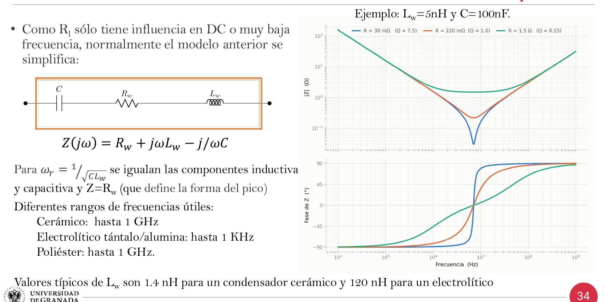

Como **$R_l$ solo influye en DC o muy baja frecuencia**, normalmente el modelo se simplifica a $C$, $R_w$ y $L_w$ **en serie**:

$$
\boxed{\,Z(j\omega)=R_w+j\omega L_w-\frac{j}{\omega C}\,}
$$

- **Frecuencia de resonancia** (serie): $\omega_r=\dfrac{1}{\sqrt{CL_w}}$. A esa frecuencia **se igualan las componentes inductiva y capacitiva** y $Z=R_w$ (que **define la forma del pico**).
  - Por debajo de $\omega_r$ el condensador **se comporta como condensador** (fase ≈ −90°); por encima, como un **inductor** (fase ≈ +90°).
- **Ejemplo de la diapositiva ($L_w=5$ nH, $C=100$ nF):** $|Z|$ muestra un mínimo en ≈ 7 MHz. Tres curvas con $R_w=30\ \text{m}\Omega$ ($Q=7{,}5$), $220\ \text{m}\Omega$ ($Q=1{,}0$) y $1{,}5\ \Omega$ ($Q=0{,}15$): cuanto menor $R_w$, **más profundo y estrecho** el mínimo.
- **Rangos de frecuencias útiles:** **cerámico: hasta 1 GHz**; **electrolítico de tántalo/alúmina: hasta 1 kHz**; **poliéster: hasta 1 GHz**.
- **Valores típicos de $L_w$:** **1,4 nH** para un cerámico y **120 nH** para un electrolítico.

> ➕ **Cálculos:** $f_r=\dfrac{1}{2\pi\sqrt{CL_w}}=\dfrac{1}{2\pi\sqrt{100\cdot10^{-9}\cdot5\cdot10^{-9}}}\approx7{,}1$ MHz. El factor de calidad es $Q=\dfrac1{R_w}\sqrt{\dfrac{L_w}{C}}=\dfrac{0{,}224}{R_w}$, que da 7,5; 1,0 y 0,15 para los tres $R_w$ de la figura (coincide con los de la leyenda).

---

## 4. Inductores

### 4.1 Introducción y características (diap. 36)

- La inductancia de una bobina depende del **material del núcleo (permeabilidad magnética)** y de la **geometría del arrollamiento**:

$$
\boxed{\,L=\frac{N^2\mu A}{l}\,}
$$

  ($N$ nº de vueltas, $\mu$ permeabilidad, $A$ sección, $l$ longitud).
- En la práctica existen **varias expresiones y tablas** que dan $L$ a partir de otros parámetros: radio del bobinado, número de vueltas, grosor del hilo y número de capas.
- **A diferencia de resistencias y condensadores**, las bobinas **a menudo se fabrican por el propio diseñador** o se solicitan de forma personalizada.
- También hay **bobinas axiales comerciales**. El catálogo suele presentar los valores en pasos de **E6, E12 o E24**, pero **no se respetan los estándares de tolerancias**, que se indican individualmente para cada modelo.

### 4.2 Tipos (diap. 37–38, 40)

#### Bobinado (*wirewound*), THT o SMD — diap. 37

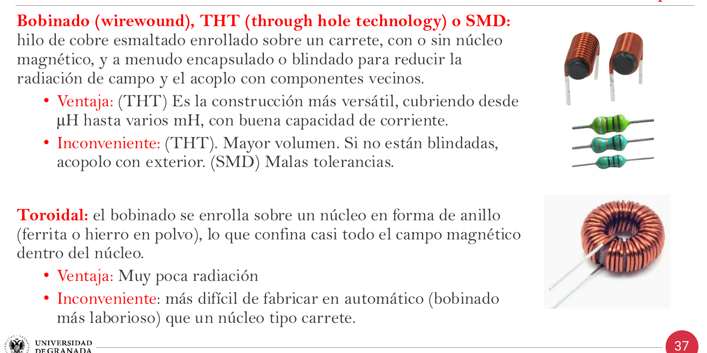

- **Hilo de cobre esmaltado** enrollado sobre un **carrete**, con o sin núcleo magnético, y a menudo **encapsulado o blindado** para reducir la radiación de campo y el acoplo con componentes vecinos.
  - **Ventaja (THT):** es la **construcción más versátil**, cubriendo desde **µH hasta varios mH**, con **buena capacidad de corriente**.
  - **Inconveniente:** (THT) **mayor volumen**; si no están blindadas, **acoplo con el exterior**. (SMD) **malas tolerancias**.

#### Toroidal

- El bobinado se enrolla sobre un **núcleo en forma de anillo** (ferrita o hierro en polvo), lo que **confina casi todo el campo magnético dentro del núcleo**.
  - **Ventaja:** **muy poca radiación**.
  - **Inconveniente:** **más difícil de fabricar en automático** (bobinado más laborioso) que un núcleo tipo carrete.

#### Multicapa (*multilayer chip inductor*) y película fina — diap. 38

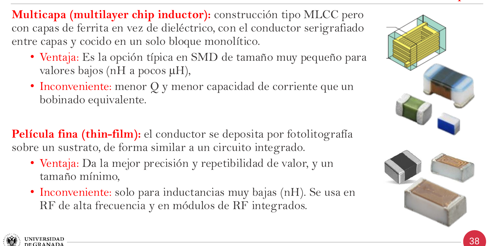

- **Multicapa:** construcción tipo **MLCC pero con capas de ferrita** en vez de dieléctrico, con el **conductor serigrafiado entre capas** y **cocido en un solo bloque monolítico**.
  - **Ventaja:** opción típica en **SMD de tamaño muy pequeño** para valores bajos (**nH a pocos µH**).
  - **Inconveniente:** **menor Q** y **menor capacidad de corriente** que un bobinado equivalente.
- **Película fina (*thin-film*):** el conductor se **deposita por fotolitografía** sobre un sustrato, de forma similar a un circuito integrado.
  - **Ventaja:** **mejor precisión y repetibilidad** de valor, y **tamaño mínimo**.
  - **Inconveniente:** **solo para inductancias muy bajas (nH)**. Se usa en **RF de alta frecuencia** y en **módulos de RF integrados**.

#### Variables (*slug-tuned*, *core-adjustable*) — casi obsoletos — diap. 40

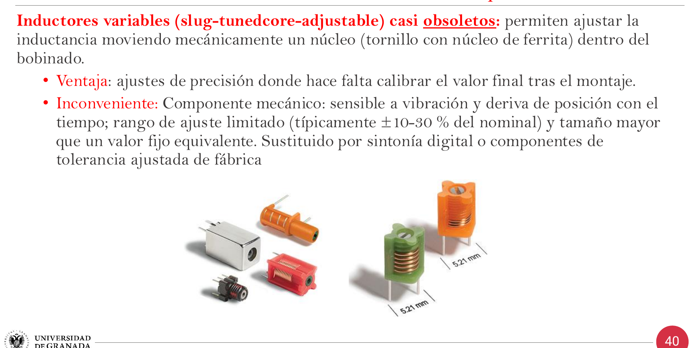

- Permiten **ajustar la inductancia moviendo mecánicamente un núcleo** (tornillo con núcleo de ferrita) dentro del bobinado.
  - **Ventaja:** **ajustes de precisión** donde hace falta calibrar el valor final tras el montaje.
  - **Inconveniente:** componente **mecánico**: sensible a vibración y **deriva de posición** con el tiempo; **rango de ajuste limitado (típicamente ±10–30 % del nominal)** y **tamaño mayor** que un valor fijo equivalente. **Sustituido por sintonía digital o componentes de tolerancia ajustada de fábrica.**

### 4.3 Comparación de tecnologías (diap. 39)

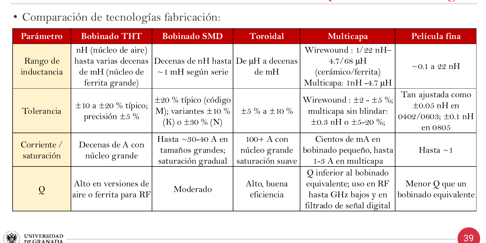

| Parámetro | Bobinado THT | Bobinado SMD | Toroidal | Multicapa | Película fina |
|---|---|---|---|---|---|
| **Rango de inductancia** | nH (núcleo de aire) hasta varias decenas de mH (núcleo de ferrita grande) | Decenas de nH hasta ~1 mH según serie | De µH a decenas de mH | *Wirewound*: 1/22 nH – 4,7/68 µH (cerámico/ferrita). *Multicapa*: 1 nH – 4,7 µH | ~0,1 a 22 nH |
| **Tolerancia** | ±10 a ±20 % típico; precisión ±5 % | ±20 % típico (código M); variantes ±10 % (K) o ±30 % (N) | ±5 % a ±10 % | *Wirewound*: ±2 – ±5 %; multicapa sin blindar: ±0,3 nH o ±5–20 % | Tan ajustada como ±0,05 nH en 0402/0603; ±0,1 nH en 0805 |
| **Corriente / saturación** | Decenas de A con núcleo grande | Hasta ~30–40 A en tamaños grandes; saturación gradual | 100+ A con núcleo grande; saturación suave | Cientos de mA en bobinado pequeño, hasta 1–3 A en multicapa | Hasta ~1 (A) |
| **Q** | Alto en versiones de aire o ferrita para RF | Moderado | Alto, buena eficiencia | Q inferior al bobinado equivalente; uso en RF hasta GHz bajos y en filtrado de señal digital | Menor Q que un bobinado equivalente |

### 4.4 Identificación (diap. 41)

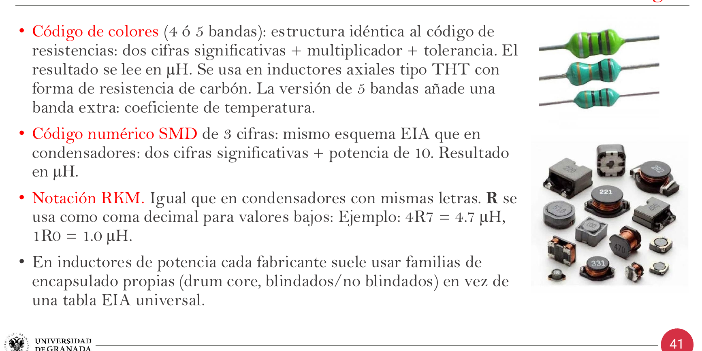

| Código | Descripción |
|---|---|
| **Colores (4 ó 5 bandas)** | Estructura **idéntica al código de resistencias**: dos cifras significativas + multiplicador + tolerancia. **El resultado se lee en µH.** Se usa en inductores axiales tipo THT con forma de resistencia de carbón. La versión de **5 bandas añade una banda extra: coeficiente de temperatura** |
| **Numérico SMD de 3 cifras** | **Mismo esquema EIA que en condensadores**: dos cifras significativas + potencia de 10. **Resultado en µH** |
| **Notación RKM** | **Igual que en condensadores, con las mismas letras**. **R se usa como coma decimal** para valores bajos: **4R7 = 4,7 µH**, **1R0 = 1,0 µH** |

- En **inductores de potencia**, cada fabricante suele usar **familias de encapsulado propias** (*drum core*, blindados/no blindados) en vez de una tabla EIA universal.

### 4.5 Modelo con parásitos (diap. 42–43)

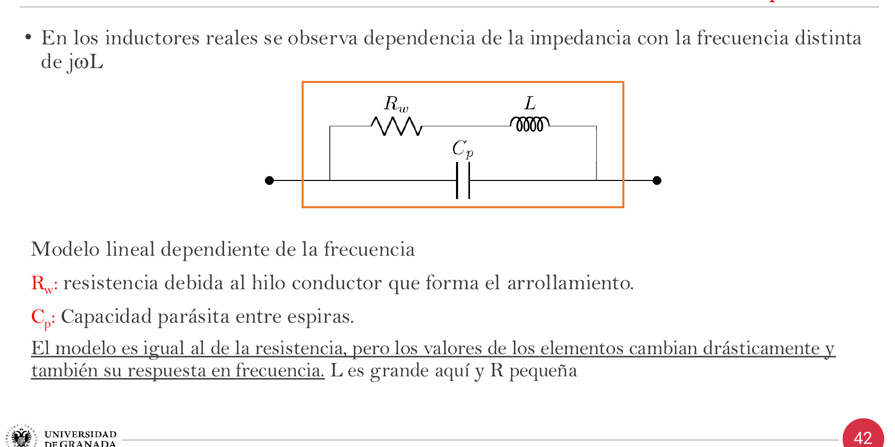

- En los inductores reales se observa **dependencia de la impedancia con la frecuencia distinta de $j\omega L$**.
- **Modelo lineal dependiente de la frecuencia:** $R_w$ **en serie con $L$**, y todo ello **en paralelo con $C_p$**.

| Elemento | Significado |
|---|---|
| $R_w$ | **Resistencia debida al hilo conductor** que forma el arrollamiento |
| $C_p$ | **Capacidad parásita entre espiras** |

> **El modelo es igual al de la resistencia, pero los valores de los elementos cambian drásticamente** y también su respuesta en frecuencia. **$L$ es grande aquí y $R$ pequeña.**

**Modelo lineal y resonancia (diap. 43):**

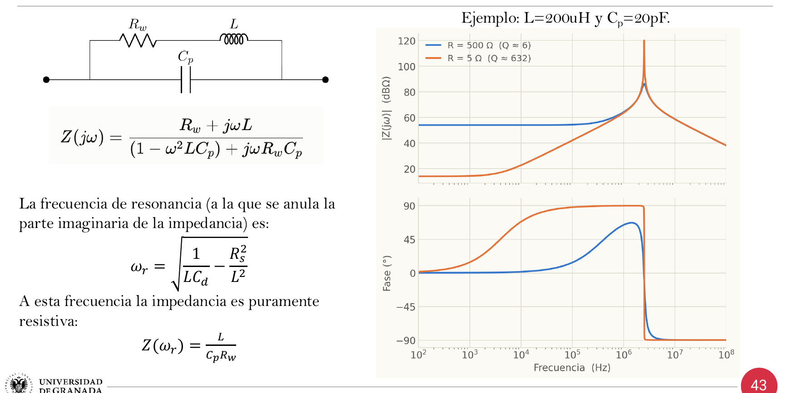

$$
\boxed{\,Z(j\omega)=\frac{R_w+j\omega L}{\left(1-\omega^2LC_p\right)+j\omega R_wC_p}\,}
$$

**Frecuencia de resonancia** (a la que **se anula la parte imaginaria** de la impedancia):

$$
\boxed{\,\omega_r=\sqrt{\frac{1}{LC_p}-\frac{R_w^2}{L^2}}\,}
$$

A esa frecuencia **la impedancia es puramente resistiva**:

$$
\boxed{\,Z(\omega_r)=\frac{L}{C_pR_w}\,}
$$

⚠️ En la diapositiva la fórmula de $\omega_r$ está escrita con $C_d$ y $R_s$, en lugar de $C_p$ y $R_w$ (mismos elementos).

**Ejemplo de la diapositiva ($L=200$ µH, $C_p=20$ pF):** $|Z|$ crece con la frecuencia (comportamiento inductivo, fase +90°) hasta un **pico de resonancia a ≈ 2,5 MHz**, y después decrece (comportamiento capacitivo, fase −90°). Curvas para $R=500\ \Omega$ ($Q\approx6$) y $R=5\ \Omega$ ($Q\approx632$).

> ➕ **Cómo se llega a $\omega_r$ y $Z(\omega_r)$:** la admitancia es $Y=j\omega C_p+\dfrac1{R_w+j\omega L}=\dfrac{R_w}{R_w^2+\omega^2L^2}+j\left(\omega C_p-\dfrac{\omega L}{R_w^2+\omega^2L^2}\right)$.
> $\text{Im}(Y)=0\Rightarrow R_w^2+\omega^2L^2=\dfrac LC_p\Rightarrow\omega_r^2=\dfrac1{LC_p}-\dfrac{R_w^2}{L^2}$. Entonces $\text{Re}(Y)=\dfrac{R_wC_p}{L}$, y $Z=1/Y=\dfrac{L}{C_pR_w}$.
>
> **Comprobación con el ejemplo:** $\omega_r\approx\dfrac{1}{\sqrt{200\cdot10^{-6}\cdot20\cdot10^{-12}}}=1{,}58\cdot10^7$ rad/s ⇒ $f_r\approx2{,}5$ MHz ✔. A esa frecuencia $\omega L\approx3162\ \Omega$, así que $Q\approx\omega L/R=6{,}3$ para 500 Ω y 632 para 5 Ω ✔.
>
> **Ejercicio típico:** $L=1$ mH, $C_p=100$ pF, $R_w=30\ \Omega$ ⇒ $\omega_r=\sqrt{10^{13}-9\cdot10^8}\approx3{,}16\cdot10^6$ rad/s ($f\approx503$ kHz) y $Z(\omega_r)=\dfrac{10^{-3}}{100\cdot10^{-12}\cdot30}\approx333\ \text{k}\Omega$.

---

## 5. Comparación de los tres modelos con parásitos

| | **Resistor** | **Condensador** | **Inductor** |
|---|---|---|---|
| **Esquema** | $(R+L_c)\ \|\ C_p$, con $L_{we}$ en las patillas | $(C\ \|\ R_l)$ en serie con $R_w$ y $L_w$ | $(R_w+L)\ \|\ C_p$ |
| **Parásito dominante** | $L_c$ (hilo/película) y $C_p$ | $L_w$ (inductancia) y $R_w$ | $C_p$ (entre espiras) y $R_w$ |
| **Comportamiento a alta frecuencia** | Inductivo (si $R$ es baja) o paso bajo (si $R$ es alta, $f=1/(2\pi RC_p)$) | **Se comporta como inductor** por encima de $\omega_r=1/\sqrt{CL_w}$ | **Se comporta como condensador** por encima de $\omega_r$ |
| **Frecuencia de resonancia** | — (depende de $R$, $L_c$, $C_p$) | $\omega_r=\dfrac1{\sqrt{CL_w}}$ (serie, mínimo de $|Z|$) | $\omega_r=\sqrt{\dfrac1{LC_p}-\dfrac{R_w^2}{L^2}}$ (paralelo, máximo de $|Z|$) |
| **$Z$ en la resonancia** | — | $Z=R_w$ | $Z=\dfrac{L}{C_pR_w}$ |
| **Valores típicos** | $L_c$: nH–µH; $C_p\approx1$ pF | $L_w$: 1,4 nH (cerámico), 120 nH (electrolítico) | $L$ grande, $R$ pequeña |

---

## 6. Bibliografía

- **Charles A. Harper**, *Passive Electronic Component Handbook*, McGraw-Hill, 1997. Versión electrónica en http://site.ebrary.com.

---

## 7. Formulario resumen

**Resistores**

| Concepto | Fórmula |
|---|---|
| Resistencia de un conductor | $R=\rho\dfrac LS$ |
| Tolerancia | $\Delta R=\dfrac{R-R_0}{R_0}\times100$ |
| Deriva térmica | $R_H=R_0\left[1+\alpha(T_H-T_0)\right]$ |
| Series normalizadas | $E_n(S)=10^{(n-1)/S}$ |
| Modelo con parásitos | $Z=\dfrac{R+j\omega L_c}{(1-\omega^2L_cC_p)+j\omega RC_p}$ |
| Frecuencia de corte ($R>1{,}5\sqrt{L_c/C_p}$) | $f=\dfrac{1}{2\pi RC_p}$ |

**Condensadores**

| Concepto | Fórmula |
|---|---|
| Láminas paralelas | $C=\varepsilon\dfrac Ad$ |
| Impedancia con parásitos | $Z=R_w+j\omega L_w+\dfrac{R_l}{1+j\omega R_lC}$ |
| Parte real e imaginaria | $\left[R_w+\dfrac{R_l}{1+(\omega R_lC)^2}\right]+j\left[\omega L_w-\dfrac{\omega R_l^2C}{1+(\omega R_lC)^2}\right]$ |
| DC | $Z(0)=R_w+R_l$ |
| Tangente de pérdidas | $\tan\delta=\dfrac{\text{Re}Z}{|\text{Im}Z|}\approx\omega CR_w+\dfrac1{\omega R_lC}$ (a partir de unas decenas de Hz, $\tan\delta\approx\omega CR_w$) |
| Modelo simplificado | $Z=R_w+j\omega L_w-\dfrac j{\omega C}$ |
| Resonancia | $\omega_r=\dfrac1{\sqrt{CL_w}}$, $Z(\omega_r)=R_w$ |

**Inductores**

| Concepto | Fórmula |
|---|---|
| Inductancia | $L=\dfrac{N^2\mu A}{l}$ |
| Modelo con parásitos | $Z=\dfrac{R_w+j\omega L}{(1-\omega^2LC_p)+j\omega R_wC_p}$ |
| Resonancia | $\omega_r=\sqrt{\dfrac1{LC_p}-\dfrac{R_w^2}{L^2}}$ |
| Impedancia en resonancia | $Z(\omega_r)=\dfrac{L}{C_pR_w}$ |

**Códigos de identificación (resumen)**

| Componente | Código | Regla |
|---|---|---|
| Resistor | Colores (4, 5 ó 6 bandas) | Cifras + multiplicador + tolerancia (+ coef. temp.) |
| Resistor | RKM | R, K, M como coma decimal; letras de tolerancia F, G, J, K, M |
| Resistor SMD | 3 cifras | 2 cifras + potencia de 10 (en Ω) |
| Condensador | Numérico EIA | 2 cifras + potencia de 10 (en **pF**); 8 → ×0,01, 9 → ×0,1; letra = tolerancia |
| Condensador | RKM / IEC 60062 | Letra de la unidad como coma; coma = µF |
| Condensador | Tensión | Número (potencia de 10) + letra (A=1 V … K=8 V) |
| Inductor | Colores, numérico SMD, RKM | Mismo esquema; resultado en **µH**; R como coma (4R7 = 4,7 µH) |

---

## 8. Erratas e incoherencias detectadas

- **Series E (diap. 11):** se dice "se redondea por exceso", pero algunos valores estándar se redondean al más cercano ($6{,}81\to6{,}8$). Se agrupan "E96 y E192" como series de tres cifras, pero la **E48** también las tiene.
- **Resistor, ejemplo de resonancia (diap. 18):** con $L_c=22$ nH y $C_p=5$ pF, $R=210\ \Omega$ supera $1{,}5\sqrt{L_c/C_p}\approx100\ \Omega$ y no debería mostrar pico; no he podido reproducir esa curva.
- **Condensadores, E24 (diap. 27):** falta el **30** y el **36**.
- **Código numérico (diap. 28):** "473 Z = 40 × 10³ pF" debería ser **47 × 10³ pF**.
- **Código de tensión (diap. 30):** "102K3A" se explica con tolerancia J (5 %) y tensión 2A (100 V); por las reglas, es **K = 10 %** y **3A = 1 kV**.
- **Inductor (diap. 43):** la fórmula de $\omega_r$ usa $C_d$ y $R_s$ en lugar de $C_p$ y $R_w$.
- **Resistor de hilo (diap. 6):** "wire bound" es *wirewound*.

---

## 9. Preguntas de repaso

1. ¿Qué tres parámetros controlan el valor de $R$ en $R=\rho L/S$? ¿Qué características hay que mirar al elegir una resistencia comercial?
2. Define tolerancia, potencia máxima y coeficiente de temperatura de un resistor. ¿Cómo se calcula $R_H$?
3. Compara los resistores de hilo bobinado, película metálica y carbón (precisión, potencia, ruido, deriva, frecuencia, precio).
4. ¿Por qué un resistor de hilo bobinado no sirve para alta frecuencia?
5. ¿Qué son un NTC, un PTC, una galga y un varistor?
6. ¿Qué es la serie E12? ¿Cuál es su tolerancia? ¿Cómo se calculan sus valores?
7. Lee: amarillo–violeta–naranja–oro; marrón–negro–negro–rojo–oro; 4K7; 6K8G; 473 (SMD).
8. Dibuja el modelo con parásitos de un resistor y explica cuándo se comporta como inductor o como paso bajo.
9. ¿Qué es un condensador electrolítico? ¿Por qué tiene polaridad? ¿Cómo se identifica la patilla negativa? ¿Qué le pasa a un tántalo con polaridad invertida?
10. Diferencia entre cerámicos de clase 1 y clase 2 (valores, estabilidad, DC bias, envejecimiento, aplicaciones).
11. ¿Qué es un varactor y cómo funciona? ¿Y un trimmer?
12. Interpreta: 102K, 473Z, 474J, n47, 4n7K, 2E473K, .1K63.
13. Dibuja el modelo de un condensador real y explica el papel de $R_l$, $R_w$ y $L_w$.
14. ¿Qué es la tangente de pérdidas? ¿Qué término domina a partir de unas decenas de Hz? ¿Qué valores son buenos?
15. Para $L_w=5$ nH y $C=100$ nF, calcula $f_r$. ¿Qué pasa por encima de $f_r$?
16. ¿Qué rangos de frecuencia son útiles para cerámicos, electrolíticos de tántalo/alúmina y poliéster?
17. ¿De qué depende la inductancia de una bobina? ¿Por qué suelen fabricarlas los propios diseñadores?
18. Compara bobinado, toroidal, multicapa, película fina y variable (valores, Q, corriente, precisión).
19. Lee: 4R7, 1R0, 221 (SMD) en inductores. ¿En qué unidad se leen?
20. Deduce $\omega_r$ y $Z(\omega_r)$ para el inductor real. Calcúlalos para $L=200$ µH, $C_p=20$ pF.

### Respuestas breves (autoevaluación)

- **P7:** 47 kΩ ±5 %; 10,0 kΩ ±5 %; 4,7 kΩ; 6,8 kΩ ±2 %; 47 kΩ.
- **P12:** 1 nF ±10 %; 47 nF (+80/−20 %); 0,47 µF ±5 %; 0,47 nF; 4,7 nF ±10 %; 47 nF ±10 % / 250 V; 0,1 µF ±10 % / 63 V.
- **P15:** $f_r\approx7{,}1$ MHz; por encima, el condensador se comporta como un inductor.
- **P19:** 4,7 µH; 1,0 µH; 220 µH (22 × 10¹ µH).
- **P20:** $\omega_r\approx1{,}58\cdot10^7$ rad/s ($f_r\approx2{,}5$ MHz); $Z(\omega_r)=L/(C_pR_w)$.

---

## 10. Índice de figuras

> Las imágenes están en la misma carpeta que este archivo `.md`.

| Figura | Diapositiva | Contenido |
|---|---|---|
| `T1_fig01_resistor_R_rho_L_S.png` | 4 | Resistor, $R=\rho L/S$ |
| `T1_fig02_resistencia_hilo_bobinado.png` | 6 | Resistencia de hilo bobinado |
| `T1_fig03_resistencia_pelicula_metalica.png` | 7 | Resistencia de película metálica |
| `T1_fig04_resistencia_carbon.png` | 8 | Resistencia de carbón |
| `T1_fig05_series_normalizadas_E6_E12_E24_E48.png` | 12 | Series normalizadas |
| `T1_fig06_codigo_colores_bandas.png` | 13 | Bandas del código de colores |
| `T1_fig07_codigo_colores_tabla.png` | 14 | Tabla del código de colores |
| `T1_fig08_sistema_RKM_resistencias.png` | 15 | Sistema RKM |
| `T1_fig09_resistencias_SMD_codigo_3_cifras.png` | 16 | Resistencias SMD |
| `T1_fig10_resistencia_modelo_parasitos.png` | 17 | Modelo de parásitos del resistor |
| `T1_fig11_resistencia_impedancia_resonancia.png` | 18 | Impedancia y ejemplo de resonancia |
| `T1_fig12_condensador_electrolitico.png` | 21 | Electrolítico |
| `T1_fig13_condensador_tantalo.png` | 22 | Tántalo |
| `T1_fig14_condensador_plastico.png` | 23 | Plástico |
| `T1_fig15_condensador_ceramico.png` | 24 | Cerámico |
| `T1_fig16_condensadores_comparacion_tecnologias.png` | 25 | Comparación de condensadores |
| `T1_fig17_condensador_trimmer_y_varicap.png` | 26 | Trimmer y varicap |
| `T1_fig18_condensador_codigo_numerico_EIA.png` | 28 | Código numérico EIA |
| `T1_fig19_condensador_codigo_tension.png` | 30 | Código de tensión |
| `T1_fig20_condensador_codigo_colores.png` | 31 | Código de colores de condensadores |
| `T1_fig21_condensador_modelo_parasitos.png` | 32 | Modelo de parásitos del condensador |
| `T1_fig22_condensador_tangente_perdidas.png` | 33 | Tangente de pérdidas |
| `T1_fig23_condensador_resonancia.png` | 34 | Resonancia del condensador |
| `T1_fig24_inductor_bobinado_y_toroidal.png` | 37 | Bobinado y toroidal |
| `T1_fig25_inductor_multicapa_y_pelicula_fina.png` | 38 | Multicapa y película fina |
| `T1_fig26_inductores_comparacion_tecnologias.png` | 39 | Comparación de inductores |
| `T1_fig27_inductor_variable.png` | 40 | Inductor variable |
| `T1_fig28_inductor_codigos.png` | 41 | Códigos de inductores |
| `T1_fig29_inductor_modelo_parasitos.png` | 42 | Modelo del inductor |
| `T1_fig30_inductor_resonancia.png` | 43 | Resonancia del inductor |

---

*Fin del esquema del Tema 1 — Componentes pasivos.*
