# Tema 4 — El transistor MOSFET

**Asignatura:** Componentes y Circuitos Electrónicos
**Titulación:** Grado en Ingeniería de Tecnologías de Telecomunicación — Universidad de Granada (UGR)

> Esquema completo del Tema 4 (49 diapositivas). Contiene **todo lo que aparece en las diapositivas**, explicado paso a paso para estudiar.
>
> - Las imágenes (`T4_figNN_...png`) son recortes de las diapositivas. **Deben estar en la misma carpeta que este `.md`** para verse. Al final hay un índice de figuras.
> - **(diap. N)** indica la diapositiva de la que sale cada apartado.
> - Los bloques marcados con **➕ Ampliación** son aclaraciones o resoluciones míos que **no están en las diapositivas** (por ejemplo, la resolución de los ejercicios que solo traen el enunciado).
> - ⚠️ marca erratas o incoherencias detectadas en las diapositivas.
> - Notación: $v_{GS}$ (minúscula) = valor total instantáneo, $V_{GS}$ (mayúscula) = valor de polarización (DC), $v_{gs}$ = pequeña señal, y $v_{ov}=v_{GS}-V_T$ = tensión de sobrecarga (*overdrive*).

---

## Índice

0. [Resumen exprés](#0-resumen-exprés)
1. [Introducción (4.1)](#1-introducción-41)
2. [Estructura y funcionamiento en DC (4.2)](#2-estructura-y-funcionamiento-en-dc-42)
3. [Circuitos de polarización (4.3)](#3-circuitos-de-polarización-43)
4. [Modelo de pequeña señal (4.4)](#4-modelo-de-pequeña-señal-44)
5. [Transistor PMOS (4.5)](#5-transistor-pmos-45)
6. [MOSFET de deplexión (4.6)](#6-mosfet-de-deplexión-46)
7. [Circuitos integrados y ley de Moore](#7-circuitos-integrados-y-ley-de-moore)
8. [Bibliografía](#8-bibliografía)
9. [Formulario resumen](#9-formulario-resumen)
10. [Tabla comparativa NMOS / PMOS](#10-tabla-comparativa-nmos--pmos)
11. [Errores típicos y trucos](#11-errores-típicos-y-trucos)
12. [Preguntas de repaso](#12-preguntas-de-repaso)
13. [Índice de figuras](#13-índice-de-figuras)

---

## 0. Resumen exprés

- El **MOSFET** (*Metal-Oxide-Semiconductor Field-Effect Transistor*) es un dispositivo de **tres terminales** (puerta G, drenador D, fuente S; más el substrato B). La **tensión puerta-fuente** $v_{GS}$ **controla la corriente** $i_{DS}$ entre drenador y fuente. **No entra corriente por la puerta** ($i_G=0$, hay un aislante).
- Si $v_{GS}<V_T$ **no hay canal**: **corte** ($i_{DS}=0$).
- Si $v_{GS}>V_T$ **se forma un canal de electrones** (NMOS) y circula corriente:
  - **Región lineal (triodo)**, $v_{DS}\le v_{GS}-V_T$: se comporta como una **resistencia controlada por $v_{GS}$**.
  - **Saturación**, $v_{DS}\ge v_{GS}-V_T$: se comporta como una **fuente de corriente controlada por tensión**, $i_{DS}=\frac{k_n}{2}(v_{GS}-V_T)^2$.
- **Polarizar** = fijar $I_{DS}$, $V_{GS}$, $V_{DS}$ con fuentes DC y resistencias. Se resuelve con **3 ecuaciones**: la curva I–V del MOSFET y las dos **mallas** (G–S y D–S).
- **Pequeña señal**: en torno al punto de polarización Q, el transistor en saturación equivale a una **fuente de corriente $g_m v_{gs}$** con una resistencia **$r_o$** en paralelo. Un amplificador de fuente común tiene ganancia $A_v=-g_mR_D$ (con $R_S$: $-g_mR_D/(1+g_mR_S)$).
- **PMOS**: mismas fórmulas cambiando signos ($v_{SG}$, $v_{SD}$, $V_T<0$, $k_p$).
- **MOSFET de deplexión**: canal ya implantado ⇒ conduce con $v_{GS}=0$; $V_T<0$ (canal N).

| Región | Condición NMOS | $i_{DS}$ | Comportamiento |
|---|---|---|---|
| **Corte** | $v_{GS}<V_T$ | $0$ | Abierto |
| **Lineal (triodo)** | $v_{GS}>V_T$ y $v_{DS}\le v_{GS}-V_T$ | $k_n\!\left[(v_{GS}-V_T)v_{DS}-\tfrac12 v_{DS}^2\right]$ | Resistencia controlada por $v_{GS}$ |
| **Saturación** | $v_{GS}>V_T$ y $v_{DS}\ge v_{GS}-V_T$ | $\frac{k_n}{2}(v_{GS}-V_T)^2\,[1+\lambda v_{DS}]$ | Fuente de corriente controlada por $v_{GS}$ |

---

## 1. Introducción (4.1)

### 1.1 Escala: ¿cuántos transistores hay? (diap. 2)

Comparación de tamaños y cantidades:

| Elemento | Dato de la diapositiva |
|---|---|
| **Ácaros** | Tamaño 280–400 µm. Cientos o miles de ellos habitan en nuestros colchones |
| **Bacterias** | 40 millones en un gramo de tierra y varios billones ($10^{12}$) en nuestro cuerpo |
| **Transistores** | **Más de 10 000 millones** en cada microprocesador |

### 1.2 Qué es un transistor y para qué sirve (diap. 3)

- **Transistores:** dispositivos con (esencialmente) **tres terminales**.
- **La corriente entre dos de ellos se controla mediante el tercero.**
- **Aplicaciones:**
  - Como **interruptores** en aplicaciones **digitales**.
  - En aplicaciones **analógicas**, como **amplificadores** o **fuentes de corriente controladas por tensión**.
- **MOSFET:** *Metal-Oxide-Semiconductor-Field-Effect-Transistor*. Es **el más común hoy en día** por:
  - Elevada **capacidad de miniaturización**.
  - **Bajo consumo**.
  - **Tecnología depurada en silicio** y también **barata**.
- Vídeo divulgativo: <https://www.youtube.com/watch?v=9JKj-wlEPMY>

### 1.3 Un poco de historia (diap. 4)

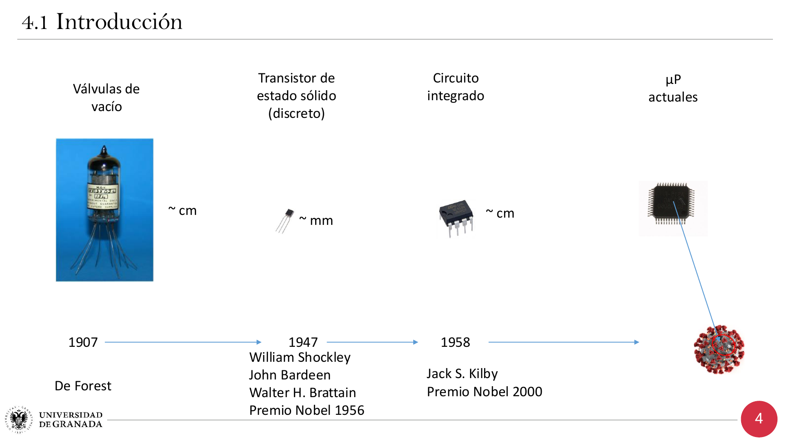

| Año | Hito | Tamaño aprox. | Personas |
|---|---|---|---|
| **1907** | **Válvulas de vacío** | ~ cm | De Forest |
| **1947** | **Transistor de estado sólido (discreto)** | ~ mm | William Shockley, John Bardeen, Walter H. Brattain (**Premio Nobel 1956**) |
| **1958** | **Circuito integrado** | ~ cm | Jack S. Kilby (**Premio Nobel 2000**) |
| Actualidad | **Microprocesadores (µP) actuales** | — | — |

---

## 2. Estructura y funcionamiento en DC (4.2)

### 2.1 Estructura (diap. 5)

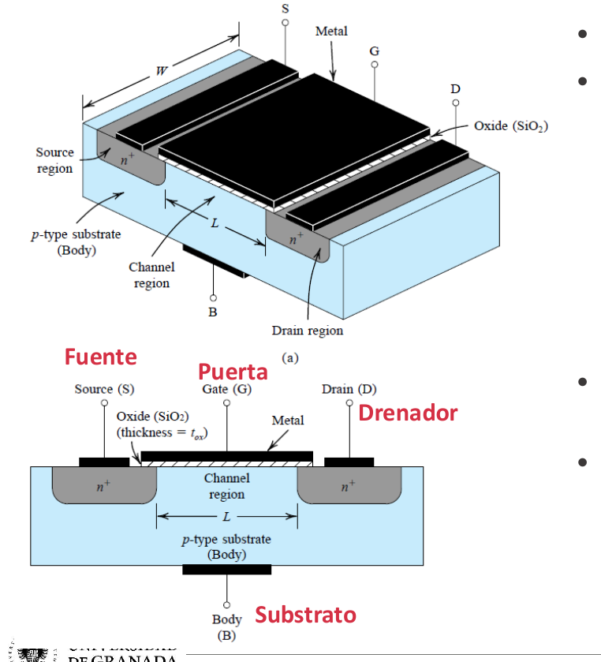

**El dispositivo:** MOSFET de **enriquecimiento de canal N (NMOS)**.

- **Substrato (Body, B)** de silicio **tipo P**.
- Dos regiones **$n^+$**: la **fuente (S)** y el **drenador (D)**.
- Sobre el canal, una capa fina de **óxido (SiO$_2$)** de espesor $t_{ox}$ y encima el **metal de la puerta (G)**.
- **$L$ = longitud del canal** (distancia entre los contactos de drenador y fuente) y **$W$ = anchura del canal**.

| Español | Inglés | Símbolo |
|---|---|---|
| **Fuente** | Source | S |
| **Puerta** | Gate | G |
| **Drenador** | Drain | D |
| **Substrato** | Body / Bulk | B |

**Ideas clave de la diapositiva:**

1. **Corriente de puerta cero** ($i_G=0$): entre puerta y canal hay un **aislante**.
2. **¿Hay corriente $I_{DS}$ al forzar una tensión $v_{DS}>0$?** Entre drenador y fuente hay **dos uniones PN enfrentadas** (N–P–N), y una de ellas siempre está en inverso ⇒ **$i_{DS}=0$**.
3. **Esto lo podemos cambiar mediante una tensión entre puerta y fuente $v_{GS}$.**
4. Las **uniones BS y BD deben estar siempre en inverso** (no queremos diodos en directo). Para ello normalmente se **cortocircuitan S y B** ($v_{BS}=0$ V). En este caso el substrato (B) **queda sin efecto y lo obviaremos**.

### 2.2 Formación de un canal conductor (diap. 6)

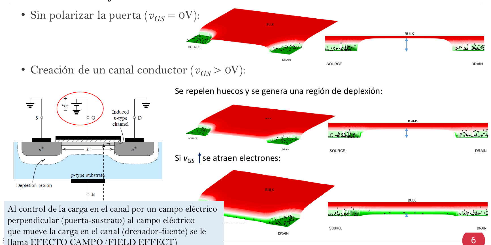

- **Sin polarizar la puerta ($v_{GS}=0$ V):** entre fuente y drenador solo hay substrato P (más las dos uniones PN). No hay camino conductor.
- **Creación de un canal conductor ($v_{GS}>0$ V):**
  1. La puerta, a tensión positiva, **repele los huecos** del substrato bajo el óxido: se genera una **región de deplexión** (sin portadores libres).
  2. Si **$v_{GS}$ aumenta**, **se atraen electrones** hacia la superficie bajo el óxido: aparece un **canal de electrones** (canal N inducido) que une fuente y drenador.
- **Efecto campo (*field effect*):** al **control de la carga en el canal** por un **campo eléctrico perpendicular** (puerta–substrato) al campo eléctrico que **mueve la carga** en el canal (drenador–fuente) se le llama **EFECTO CAMPO**.

> **Idea:** dos campos distintos. El campo **vertical** (por $v_{GS}$) decide **cuánta carga hay** en el canal; el campo **horizontal** (por $v_{DS}$) **mueve** esa carga y produce la corriente.

### 2.3 Tensión umbral y carga en inversión (diap. 7)

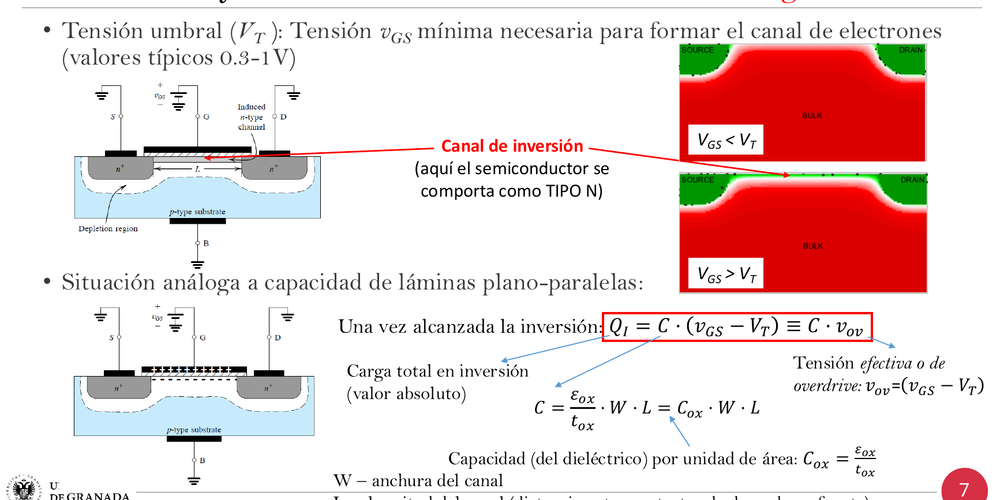

- **Tensión umbral ($V_T$):** **tensión $v_{GS}$ mínima necesaria para formar el canal de electrones** (valores típicos **0,3–1 V**).
- **Canal de inversión:** zona donde el semiconductor, que es tipo P, **se comporta como TIPO N** porque hay más electrones que huecos.
  - Si $V_{GS}<V_T$: no hay canal.
  - Si $V_{GS}>V_T$: hay canal.
- **Analogía con un condensador de láminas plano-paralelas** (puerta y canal son las dos placas; el óxido, el dieléctrico). Una vez alcanzada la inversión:

$$
\boxed{\,Q_I = C\,(v_{GS}-V_T) \equiv C\,v_{ov}\,}
$$

| Símbolo | Significado |
|---|---|
| $Q_I$ | **Carga total en inversión** (valor absoluto) |
| $v_{ov}=v_{GS}-V_T$ | **Tensión efectiva o de sobrecarga (*overdrive*)** |
| $C=\dfrac{\varepsilon_{ox}}{t_{ox}}\,W\,L=C_{ox}\,W\,L$ | **Capacidad total** de la puerta |
| $C_{ox}=\dfrac{\varepsilon_{ox}}{t_{ox}}$ | **Capacidad del dieléctrico por unidad de área** |
| $W$ | Anchura del canal |
| $L$ | Longitud del canal (distancia entre contactos de drenador y fuente) |

> Interpretación: **hasta que $v_{GS}$ no supera $V_T$ no se crea carga móvil**. A partir de ahí, la carga crece **linealmente** con $v_{ov}$.

### 2.4 Corriente $i_{DS}$ con $v_{DS}$ pequeña. Región lineal (diap. 8–9)

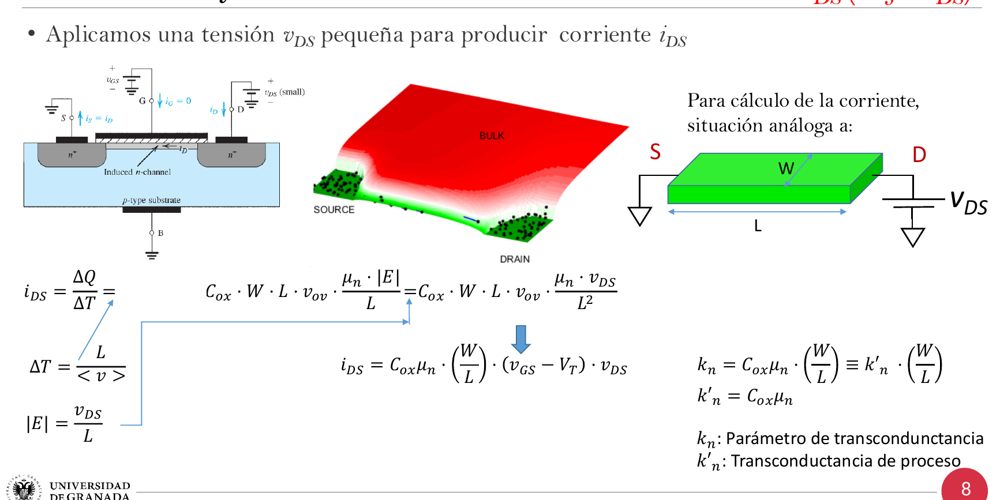

Aplicamos una tensión **$v_{DS}$ pequeña** para producir corriente $i_{DS}$. En estas condiciones el canal es **uniforme** y el cálculo es análogo al de una **barra de material** (de longitud $L$, anchura $W$) con una tensión $v_{DS}$ entre sus extremos.

**Deducción paso a paso:**

1. La corriente es **carga que atraviesa el canal por unidad de tiempo**:
$$
i_{DS}=\frac{\Delta Q}{\Delta T}=\frac{Q_I}{\Delta T}
$$
2. El tiempo que tarda una carga en recorrer el canal es $\Delta T = \dfrac{L}{\langle v\rangle}$, siendo $\langle v\rangle$ la velocidad media de los electrones:
$$
\langle v\rangle=\mu_n\,|E|,\qquad |E|=\frac{v_{DS}}{L}
$$
3. Con $Q_I=C_{ox}\,W\,L\,v_{ov}$:
$$
i_{DS}=C_{ox}\,W\,L\,v_{ov}\cdot\frac{\mu_n\,|E|}{L}=C_{ox}\,W\,L\,v_{ov}\cdot\frac{\mu_n\,v_{DS}}{L^2}
$$
4. Simplificando:
$$
i_{DS}=C_{ox}\mu_n\,\frac{W}{L}\,(v_{GS}-V_T)\,v_{DS}
$$

**Parámetros:**

$$
k_n = C_{ox}\mu_n\,\frac{W}{L}\equiv k'_n\,\frac{W}{L},\qquad k'_n=C_{ox}\mu_n
$$

| Parámetro | Nombre | Qué depende de... |
|---|---|---|
| $k_n$ | **Parámetro de transconductancia** | Proceso **y** geometría ($W/L$) |
| $k'_n$ | **Transconductancia de proceso** | Solo del proceso (óxido y movilidad $\mu_n$) |

(Se mide en **mA/V²**.)

**Resultado en la región lineal (diap. 9):**

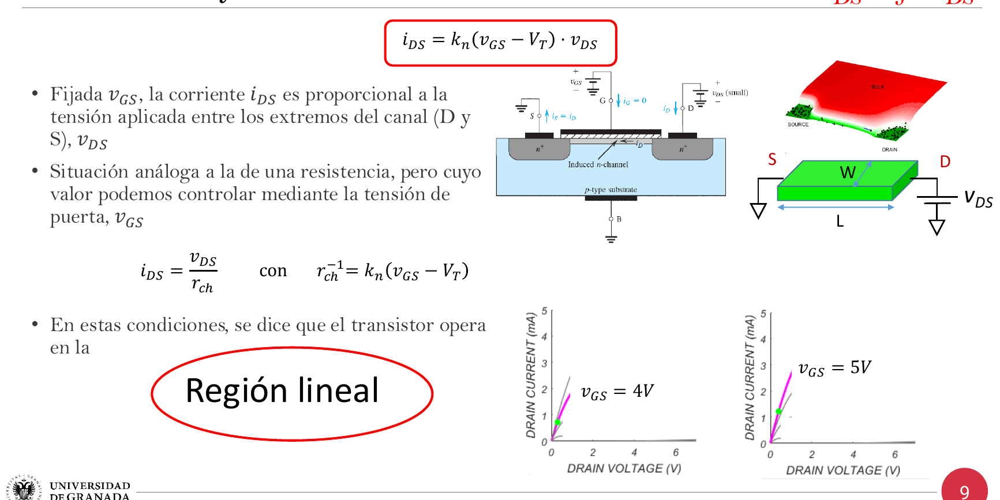

$$
\boxed{\,i_{DS}=k_n\,(v_{GS}-V_T)\,v_{DS}\,}
$$

- Con **$v_{GS}$ fijada**, la corriente $i_{DS}$ es **proporcional a $v_{DS}$**.
- Situación **análoga a una resistencia**, pero **cuyo valor controlamos con $v_{GS}$**:
$$
i_{DS}=\frac{v_{DS}}{r_{ch}}\quad\text{con}\quad r_{ch}^{-1}=k_n\,(v_{GS}-V_T)
$$
- A esto se le llama operar en la **región lineal** (en las gráficas, el tramo inicial, casi recto, de las curvas para $v_{GS}=4$ V y $v_{GS}=5$ V; la pendiente es mayor con $v_{GS}$ mayor).

### 2.5 Canal no uniforme: al aumentar $v_{DS}$ (diap. 10–11)

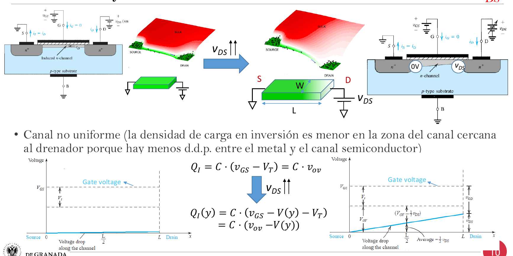

Al aumentar $v_{DS}$, el **canal deja de ser uniforme**:

- La **densidad de carga en inversión es menor en la zona cercana al drenador**, porque allí hay **menos diferencia de potencial entre el metal y el canal** semiconductor.
- Llamamos $V(y)$ a la tensión del canal en la posición $y$ ($0$ en la fuente, $v_{DS}$ en el drenador). Entonces:

$$
Q_I=C\,(v_{GS}-V_T)=C\,v_{ov}\;\xrightarrow{\;v_{DS}\uparrow\;}\;Q_I(y)=C\,(v_{GS}-V(y)-V_T)=C\,(v_{ov}-V(y))
$$

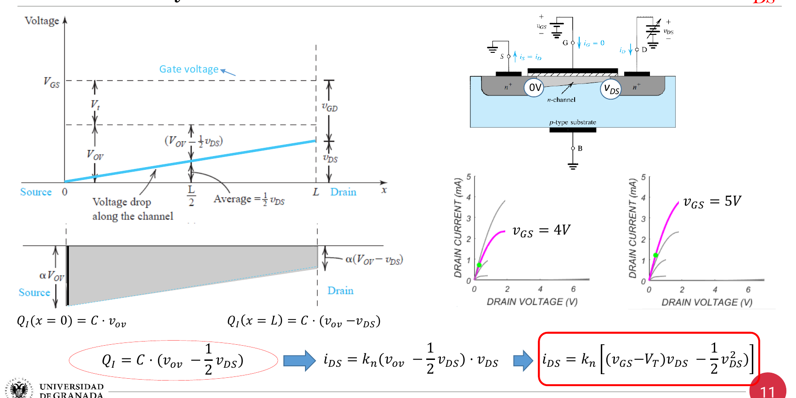

- En la **fuente** ($x=0$): $Q_I(x=0)=C\,v_{ov}$.
- En el **drenador** ($x=L$): $Q_I(x=L)=C\,(v_{ov}-v_{DS})$.
- La tensión en el canal crece **linealmente**, así que el **promedio** es $\tfrac12 v_{DS}$ y la carga media es:

$$
Q_I=C\left(v_{ov}-\tfrac12 v_{DS}\right)
$$

- Sustituyendo en la expresión de la corriente:

$$
i_{DS}=k_n\left(v_{ov}-\tfrac12 v_{DS}\right)v_{DS}
\;\Longrightarrow\;
\boxed{\,i_{DS}=k_n\left[(v_{GS}-V_T)\,v_{DS}-\tfrac12\,v_{DS}^2\right]\,}
$$

> **Comprobación:** con $v_{DS}$ muy pequeña, el término cuadrático es despreciable y se recupera $i_{DS}=k_n(v_{GS}-V_T)v_{DS}$. Al crecer $v_{DS}$ la curva **se aplana** (resistencia del canal creciente).

### 2.6 Saturación (diap. 12–13)

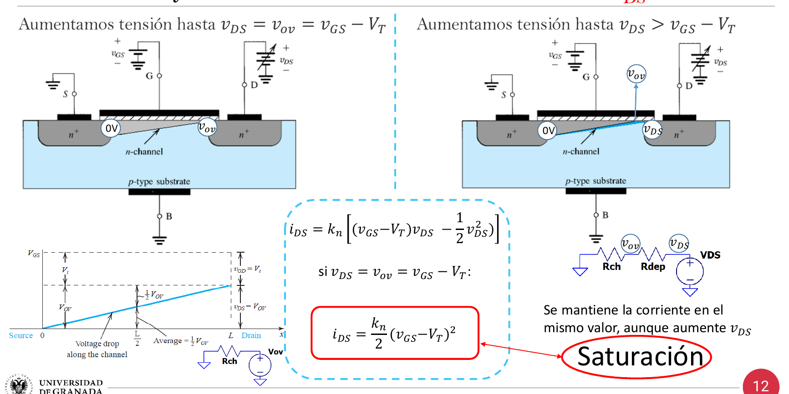

**Caso límite: $v_{DS}=v_{ov}=v_{GS}-V_T$**

- En el drenador, $Q_I(x=L)=C(v_{ov}-v_{DS})=0$: **el canal se estrangula (*pinch-off*)** en el lado del drenador.
- Equivale a que la tensión puerta-drenador sea justo $v_{GD}=v_{GS}-v_{DS}=V_T$.
- Sustituyendo $v_{DS}=v_{ov}$ en la expresión de la zona lineal:

$$
i_{DS}=k_n\left[v_{ov}^2-\tfrac12 v_{ov}^2\right]=\frac{k_n}{2}\,(v_{GS}-V_T)^2
$$

**Si seguimos aumentando $v_{DS}>v_{GS}-V_T$:**

- La zona estrangulada (de **deplexión**) **se alarga** hacia la fuente.
- El circuito equivalente es una **resistencia del canal $R_{ch}$ en serie con una resistencia de la zona de deplexión $R_{dep}$**: sobre el canal queda **$v_{ov}$** y el resto, **$v_{DS}-v_{ov}$**, cae en la zona de deplexión.
- **Se mantiene la corriente en el mismo valor, aunque aumente $v_{DS}$** ⇒ **SATURACIÓN.**

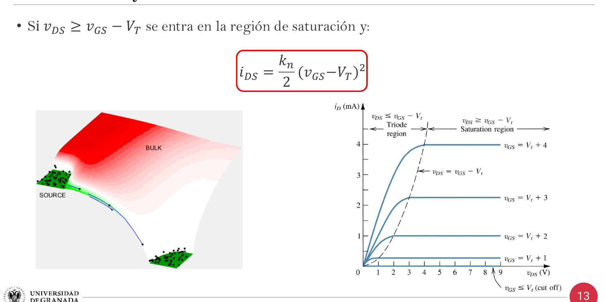

$$
\boxed{\,\text{Si } v_{DS}\ge v_{GS}-V_T\;\Rightarrow\; i_{DS}=\frac{k_n}{2}\,(v_{GS}-V_T)^2\,}
$$

**Cómo leer las curvas $i_D$–$v_{DS}$ (diap. 13):**

- Cada curva corresponde a un valor de $v_{GS}$ (en la figura, $V_t+1$, $V_t+2$, $V_t+3$ y $V_t+4$ voltios).
- La **línea de trazos** (parábola) $v_{DS}=v_{GS}-V_t$ **separa** la región **triodo** (a la izquierda) de la **saturación** (a la derecha).
- Para $v_{GS}\le V_t$: **corte** (la curva es el eje $v_{DS}$).
- En saturación, las curvas son **horizontales**: $i_D$ **no depende de $v_{DS}$**, solo de $v_{GS}$ (y crece como el cuadrado de $v_{ov}$: en la figura, con $v_{ov}=1,2,3,4$ V la corriente es proporcional a $1,4,9,16$).

### 2.7 Efecto Early (diap. 14)

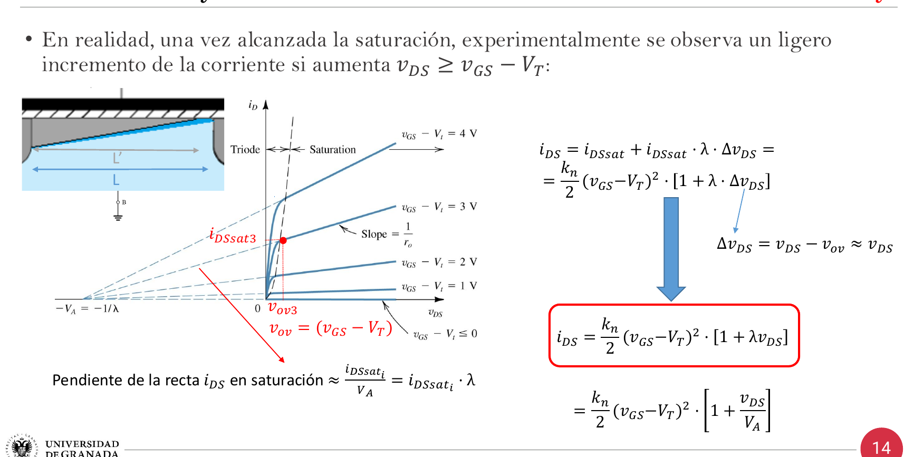

En realidad, **una vez alcanzada la saturación, experimentalmente se observa un ligero incremento de la corriente** si aumenta $v_{DS}\ge v_{GS}-V_T$.

**Causa física:** al aumentar $v_{DS}$, el punto de estrangulamiento se desplaza hacia la fuente y la **longitud efectiva del canal se acorta** ($L'<L$). Como $k_n\propto 1/L$, la corriente aumenta ligeramente (**modulación de la longitud del canal**).

**Modelo:**

$$
i_{DS}=i_{DS,sat}+i_{DS,sat}\cdot\lambda\cdot\Delta v_{DS}=\frac{k_n}{2}(v_{GS}-V_T)^2\,[1+\lambda\,\Delta v_{DS}]
$$

con $\Delta v_{DS}=v_{DS}-v_{ov}\approx v_{DS}$. Por tanto:

$$
\boxed{\,i_{DS}=\frac{k_n}{2}(v_{GS}-V_T)^2\,[1+\lambda v_{DS}]=\frac{k_n}{2}(v_{GS}-V_T)^2\left[1+\frac{v_{DS}}{V_A}\right]\,}
$$

| Símbolo | Significado |
|---|---|
| $\lambda$ | **Parámetro de modulación de la longitud del canal**; $\lambda=\dfrac{1}{V_A}$ |
| $V_A$ | **Tensión de Early** (en voltios) |

- **Pendiente** de la recta $i_{DS}$ en saturación $\approx \dfrac{i_{DS,sat}}{V_A}=i_{DS,sat}\cdot\lambda$ (y por eso se define luego $1/r_o$).
- Si se **prolongan las rectas** de saturación hacia la izquierda, **todas cortan el eje $v_{DS}$ en el mismo punto, $-V_A=-1/\lambda$**.
- $\lambda=0$ ⇒ **sin efecto Early** (curvas perfectamente horizontales). En los ejercicios, si dice $\lambda=0$, se ignora.

### 2.8 Resumen: características $i$–$v$ (diap. 15)

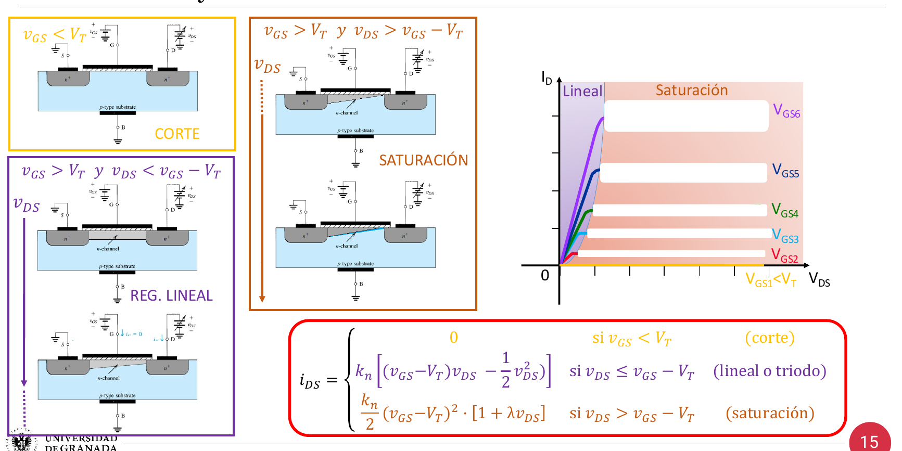

$$
i_{DS}=
\begin{cases}
0 & \text{si } v_{GS}<V_T \quad\text{(corte)}\\[4pt]
k_n\left[(v_{GS}-V_T)\,v_{DS}-\tfrac12 v_{DS}^2\right] & \text{si } v_{DS}\le v_{GS}-V_T \quad\text{(lineal o triodo)}\\[4pt]
\dfrac{k_n}{2}\,(v_{GS}-V_T)^2\,[1+\lambda v_{DS}] & \text{si } v_{DS}> v_{GS}-V_T \quad\text{(saturación)}
\end{cases}
$$

| Región | Condiciones | Canal | Dibujo |
|---|---|---|---|
| **Corte** | $v_{GS}<V_T$ | **No existe** | Solo deplexión bajo la puerta |
| **Lineal** | $v_{GS}>V_T$ y $v_{DS}<v_{GS}-V_T$ | **Continuo**, más fino en el drenador al aumentar $v_{DS}$ | $v_{DS}$ creciente reduce el canal en D |
| **Saturación** | $v_{GS}>V_T$ y $v_{DS}>v_{GS}-V_T$ | **Estrangulado** en D; el estrangulamiento avanza hacia S al subir $v_{DS}$ | $v_{DS}$ creciente alarga la zona de deplexión |

En la gráfica: las curvas $V_{GS1}<V_T$ (corte, sobre el eje), $V_{GS2},\dots,V_{GS6}$ (crecientes). A la izquierda, **zona lineal**; a la derecha, **zona de saturación**.

### 2.9 Efecto Body (diap. 16)

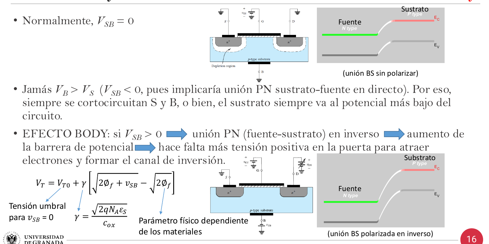

- **Normalmente $V_{SB}=0$** (unión BS sin polarizar).
- **Jamás $V_B>V_S$** ($V_{SB}<0$), pues implicaría una **unión PN sustrato-fuente en directo**. Por eso **siempre se cortocircuitan S y B**, o bien el substrato **siempre va al potencial más bajo del circuito**.
- **EFECTO BODY:** si $V_{SB}>0$ ⇒ la unión PN (fuente-sustrato) está **en inverso** ⇒ **aumenta la barrera de potencial** ⇒ **hace falta más tensión positiva en la puerta** para atraer electrones y formar el canal de inversión. Es decir, **$V_T$ aumenta**.

$$
\boxed{\,V_T=V_{T0}+\gamma\left[\sqrt{2\phi_f+v_{SB}}-\sqrt{2\phi_f}\right]\,},\qquad
\gamma=\frac{\sqrt{2\,q\,N_A\,\varepsilon_S}}{C_{ox}}
$$

| Símbolo | Significado |
|---|---|
| $V_{T0}$ | Tensión umbral para $v_{SB}=0$ |
| $\gamma$ | **Parámetro físico dependiente de los materiales** |
| $\phi_f$ | Potencial de Fermi |
| $N_A$ | Dopaje del substrato; $\varepsilon_S$ permitividad del silicio |

En los diagramas de bandas (fuente tipo N frente a sustrato tipo P): con la unión **sin polarizar** la barrera es la de equilibrio; con la unión **polarizada en inverso**, la barrera entre fuente y sustrato **es mayor**.

---

## 3. Circuitos de polarización (4.3)

### 3.1 Introducción y símbolos (diap. 17)

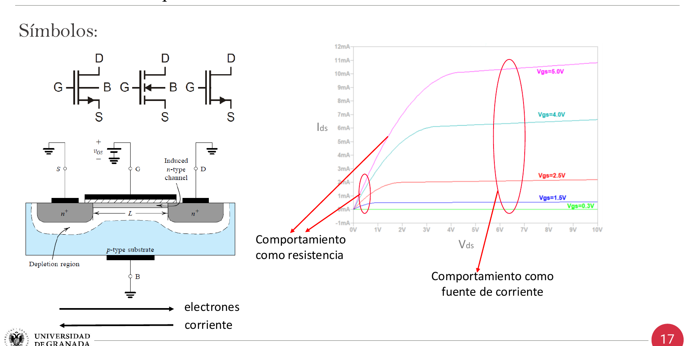

- **Símbolos** del NMOS (tres variantes): (1) con las **4 terminales** D, G, S, B y la **flecha en la fuente**; (2) con 4 terminales y la **flecha en el substrato B** (apunta hacia el canal, lo que indica substrato P); (3) con **3 terminales** (G, D, S) y la flecha en la fuente, cuando el substrato está conectado a la fuente.
- Sentido real: los **electrones** van de **S a D** y la **corriente convencional** va de **D a S**.
- En las curvas $I_{ds}$–$V_{ds}$ de la figura:
  - Para $V_{ds}$ pequeña, el transistor tiene **comportamiento como resistencia** (región lineal).
  - Para $V_{ds}$ grande, **comportamiento como fuente de corriente** (saturación).

### 3.2 Qué es polarizar (diap. 19)

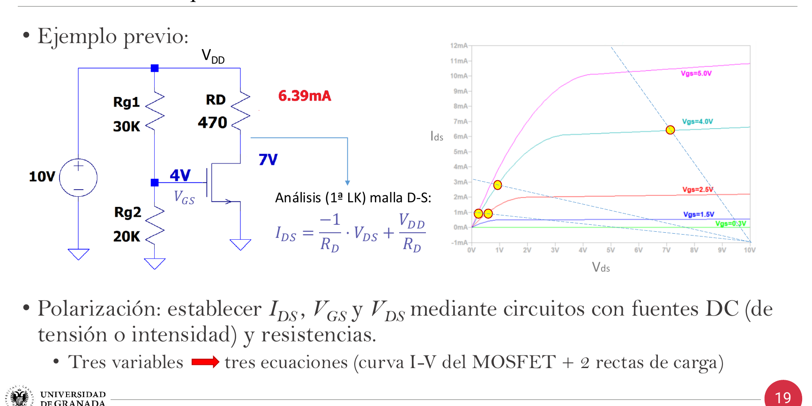

**Polarización:** establecer $I_{DS}$, $V_{GS}$ y $V_{DS}$ mediante circuitos con **fuentes DC** (de tensión o intensidad) y **resistencias**.

- **Tres variables ⇒ tres ecuaciones** (curva I–V del MOSFET + 2 rectas de carga).
- La **recta de carga** de la malla D–S (ejemplo de la diapositiva):

$$
I_{DS}=\frac{-1}{R_D}\,V_{DS}+\frac{V_{DD}}{R_D}
$$

- **Ejemplo previo (diap. 19):** $V_{DD}=10$ V, divisor $R_{G1}=30$ kΩ, $R_{G2}=20$ kΩ, $R_D=470\ \Omega$.
  - El divisor da $V_{GS}=V_G=10\cdot\dfrac{20}{50}=4$ V.
  - La intersección de la curva $V_{gs}=4$ V con la recta de carga da **$I_{DS}=6{,}39$ mA** y **$V_D=7$ V**.

> ➕ **Procedimiento general de resolución (para todos los ejercicios de polarización):**
> 1. **Suponer una región** (casi siempre **saturación**).
> 2. Con la **malla G–S** y la **ecuación del transistor**, calcular $I_{DS}$ y $V_{GS}$.
> 3. Con la **malla D–S**, calcular $V_{DS}$.
> 4. **Comprobar**: $V_{GS}>V_T$ (**descartar la raíz con $V_{GS}<V_T$** si sale una ecuación de segundo grado) y $V_{DS}\ge V_{GS}-V_T$.
> 5. Si no se cumple la condición de saturación, **repetir** suponiendo región **lineal**.

### 3.3 Ejemplo: región lineal y resistencia equivalente (diap. 18)

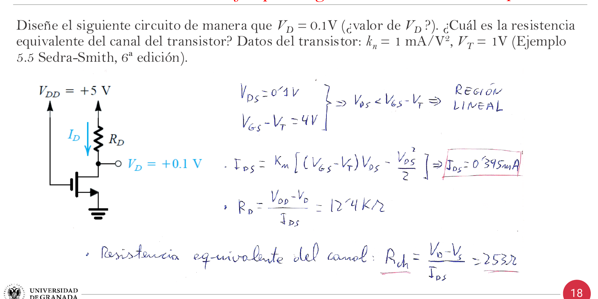

**Enunciado:** diseñe el circuito (puerta conectada a $V_{DD}=+5$ V, resistencia $R_D$ en el drenador) de manera que $V_D=0{,}1$ V (¿valor de $V_D$?). ¿Cuál es la **resistencia equivalente del canal**? Datos: $k_n=1$ mA/V², $V_T=1$ V (Ejemplo 5.5, Sedra–Smith 6.ª ed.).

**Solución:**

1. $V_{GS}=5$ V ⇒ $V_{GS}-V_T=4$ V, y $V_{DS}=0{,}1$ V $<4$ V ⇒ **región lineal**.
2. Corriente:
$$
I_{DS}=k_n\left[(V_{GS}-V_T)V_{DS}-\tfrac12V_{DS}^2\right]=1\cdot\left[4\cdot0{,}1-\tfrac12\cdot0{,}1^2\right]=0{,}395\ \text{mA}
$$
3. Resistencia de drenador:
$$
R_D=\frac{V_{DD}-V_D}{I_{DS}}=\frac{5-0{,}1}{0{,}395\ \text{mA}}\approx12{,}4\ \text{k}\Omega
$$
4. **Resistencia equivalente del canal:**
$$
R_{ch}=\frac{V_D-V_S}{I_{DS}}=\frac{0{,}1}{0{,}395\ \text{mA}}\approx253\ \Omega
$$

> ➕ Comprobación con la fórmula de la región lineal para $v_{DS}$ pequeña: $r_{ch}=\dfrac{1}{k_n(v_{GS}-V_T)}=\dfrac{1}{1\cdot4}\,\text{k}\Omega=250\ \Omega$ (muy próximo a los 253 Ω, porque con $V_{DS}=0{,}1$ V el término cuadrático apenas pesa).

### 3.4 Circuito autopolarizado (diap. 20–24)

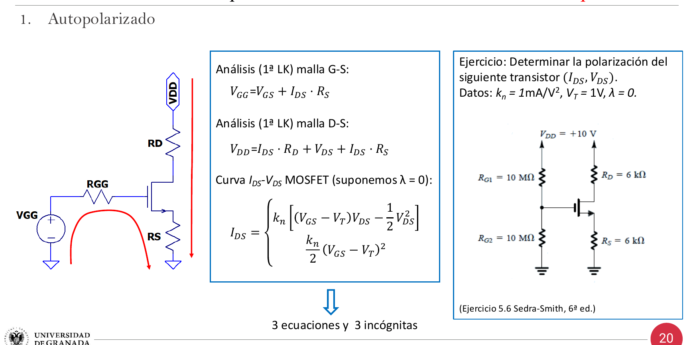

**Circuito:** $V_{DD}$ → $R_D$ → drenador; puerta alimentada por $V_{GG}$ a través de $R_{GG}$ (por la puerta no circula corriente: no hay caída en $R_{GG}$); fuente a tierra a través de $R_S$.

**Análisis (3 ecuaciones, 3 incógnitas $I_{DS}$, $V_{GS}$, $V_{DS}$):**

$$
\begin{aligned}
\text{Malla G–S:}\quad & V_{GG}=V_{GS}+I_{DS}\,R_S\\
\text{Malla D–S:}\quad & V_{DD}=I_{DS}\,R_D+V_{DS}+I_{DS}\,R_S\\
\text{Transistor } (\lambda=0):\quad & I_{DS}=\begin{cases}k_n\!\left[(V_{GS}-V_T)V_{DS}-\tfrac12V_{DS}^2\right]\\[2pt]\dfrac{k_n}{2}(V_{GS}-V_T)^2\end{cases}
\end{aligned}
$$

> Notar que **$R_S$ introduce realimentación**: si $I_{DS}$ sube, $V_{S}$ sube, $V_{GS}$ baja y la corriente se limita (esto es lo que se explorará en la diap. 27).

**Ejercicio de la diapositiva 20 (Ejercicio 5.6 Sedra–Smith):** determinar la polarización ($I_{DS}$, $V_{DS}$). Datos: $k_n=1$ mA/V², $V_T=1$ V, $\lambda=0$. Circuito: $V_{DD}=+10$ V, $R_{G1}=R_{G2}=10$ MΩ, $R_D=6$ kΩ, $R_S=6$ kΩ.

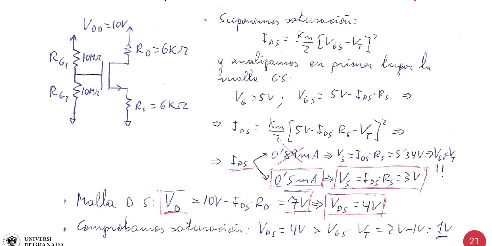

**Solución (diap. 21):**

1. **Suponemos saturación:** $I_{DS}=\dfrac{k_n}{2}(V_{GS}-V_T)^2$, y analizamos primero la **malla G–S**.
2. El divisor (10 MΩ / 10 MΩ, sin corriente de puerta) da **$V_G=5$ V**. Entonces $V_{GS}=5-I_{DS}R_S$.
3. Sustituyendo (con $I_{DS}$ en mA y $R_S$ en kΩ):
$$
I_{DS}=\frac{1}{2}\,[\,5-6\,I_{DS}-1\,]^2=\frac12\,(4-6I_{DS})^2
\;\Rightarrow\;18\,I_{DS}^2-25\,I_{DS}+8=0
$$
4. Soluciones: $I_{DS}=\dfrac{25\pm7}{36}$, es decir, **0,89 mA** o **0,5 mA**.
   - **0,89 mA (descartada):** $V_S=0{,}89\cdot6=5{,}34$ V $>V_G$ ⇒ $V_{GS}<V_T$ (el transistor estaría en corte).
   - **$I_{DS}=0{,}5$ mA ✔:** $V_S=3$ V ⇒ $V_{GS}=2$ V.
5. **Malla D–S:** $V_D=10-I_{DS}R_D=10-3=7$ V ⇒ **$V_{DS}=V_D-V_S=4$ V**.
6. **Comprobamos la saturación:** $V_{DS}=4$ V $>V_{GS}-V_T=2-1=1$ V ✔.

**Resultado:** $I_{DS}=0{,}5$ mA, $V_{DS}=4$ V.

**Caso particular: transistor en saturación sin efecto Early (diap. 22)**

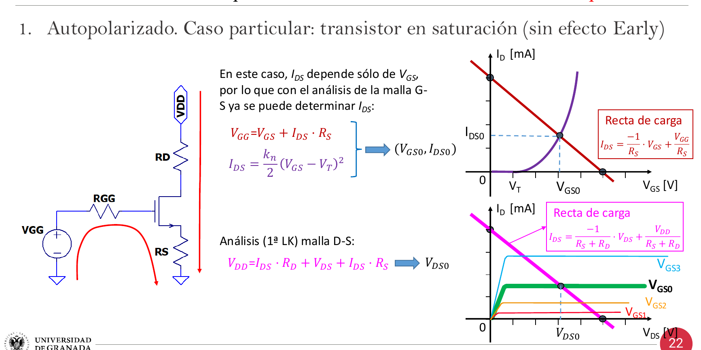

Como **en este caso $I_{DS}$ depende solo de $V_{GS}$**, con el análisis de la malla G–S ya se puede determinar $I_{DS}$:

$$
V_{GG}=V_{GS}+I_{DS}R_S,\qquad I_{DS}=\frac{k_n}{2}(V_{GS}-V_T)^2\;\Longrightarrow\;(V_{GS0},I_{DS0})
$$

- **Gráficamente:** es la **intersección** de la **parábola** $I_{DS}(V_{GS})$ (empieza en $V_T$) con la **recta de carga G–S**:
$$
I_{DS}=\frac{-1}{R_S}\,V_{GS}+\frac{V_{GG}}{R_S}
$$
- **Malla D–S** ⇒ $V_{DS0}$:
$$
V_{DD}=I_{DS}R_D+V_{DS}+I_{DS}R_S
\quad\Rightarrow\quad
I_{DS}=\frac{-1}{R_S+R_D}\,V_{DS}+\frac{V_{DD}}{R_S+R_D}
$$
  Esta recta corta la curva de $V_{GS0}$ (entre $V_{GS1},V_{GS2},V_{GS3}\dots$) en el punto de trabajo $V_{DS0}$.

**Ejemplo de diseño (diap. 23–24):** diseñe el circuito (divisor $R_{G1}$–$R_{G2}$, $R_D$, $R_S$, $V_{DD}=10$ V) de manera que $I_{DS}=1$ mA, $V_S=2$ V y $V_{DS}=5$ V. Datos: $k_n=0{,}2$ mA/V², $V_T=1$ V (saturación, sin efecto Early).

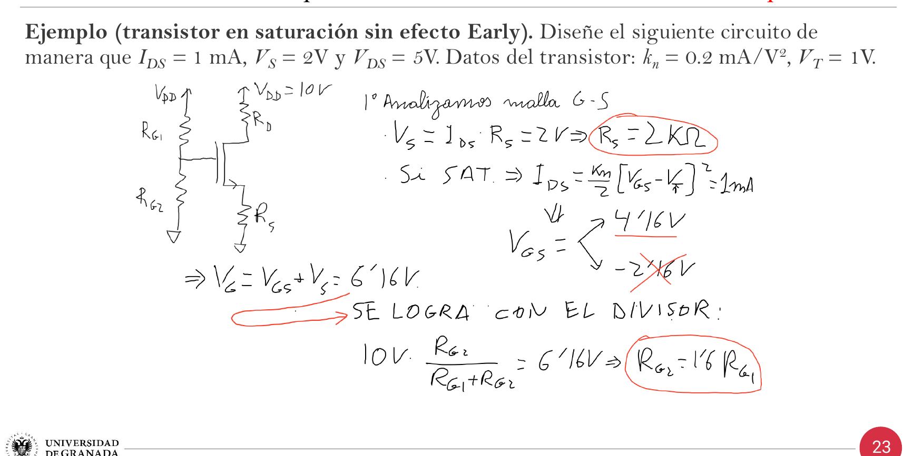
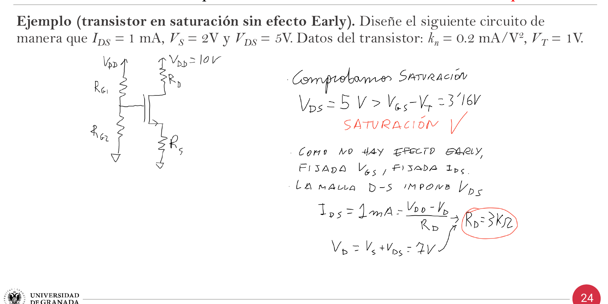

1. **Malla G–S:** $V_S=I_{DS}R_S=2$ V ⇒ **$R_S=2$ kΩ**.
2. **Si saturación:** $I_{DS}=\dfrac{k_n}{2}(V_{GS}-V_T)^2=1$ mA ⇒ $(V_{GS}-1)^2=10$ ⇒ $V_{GS}=4{,}16$ V (la otra solución, $-2{,}16$ V, se descarta).
3. $V_G=V_{GS}+V_S=6{,}16$ V. **Se logra con el divisor:**
$$
10\cdot\frac{R_{G2}}{R_{G1}+R_{G2}}=6{,}16\;\Rightarrow\;R_{G2}=1{,}6\,R_{G1}
$$
   (sólo está fijada la **relación**; las resistencias se eligen grandes para que el divisor no consuma).
4. **Comprobamos saturación:** $V_{DS}=5$ V $>V_{GS}-V_T=3{,}16$ V ✔.
5. **Como no hay efecto Early**, fijada $V_{GS}$ queda fijada $I_{DS}$; **la malla D–S impone $V_{DS}$:**
   $V_D=V_S+V_{DS}=7$ V y $I_{DS}=\dfrac{V_{DD}-V_D}{R_D}=1$ mA ⇒ **$R_D=3$ kΩ**.

### 3.5 Otros circuitos de polarización (diap. 25–26)

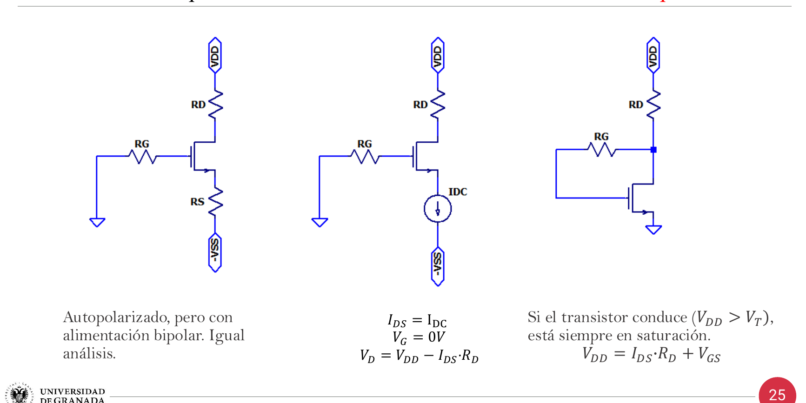

| Circuito | Descripción | Ecuaciones |
|---|---|---|
| **1** (izquierda) | **Autopolarizado, pero con alimentación bipolar** ($+V_{DD}$ y $-V_{SS}$). **Igual análisis.** | Igual que el de la diap. 20 |
| **2** (centro) | Fuente de corriente $I_{DC}$ en la fuente del transistor; puerta a tierra a través de $R_G$ | $I_{DS}=I_{DC}$, $V_G=0$ V, $V_D=V_{DD}-I_{DS}R_D$ |
| **3** (derecha) | **Realimentación drenador–puerta** ($R_G$ entre D y G, sin corriente de puerta) | **Si el transistor conduce ($V_{DD}>V_T$), está siempre en saturación**; $V_{DD}=I_{DS}R_D+V_{GS}$ |

> ➕ **¿Por qué el circuito 3 está siempre en saturación?** Como no circula corriente por $R_G$, $V_G=V_D$ y por tanto $V_{GD}=0<V_T$. Eso equivale a $V_{DS}=V_{GS}>V_{GS}-V_T$ (la condición de saturación).

**Ejercicio (diap. 26):** en el circuito, ¿qué valores deben tener $R_D$ y $R_S$ para conseguir $I_{DS}=1$ mA y $V_0=0$ V? Datos: $k_n=0{,}5$ mA/V², $V_T=2$ V.
Circuito: $V_{DD}=5$ V, $V_{SS}=-5$ V, puerta a tierra, $R_L=1$ kΩ en la salida $V_o$ (drenador).

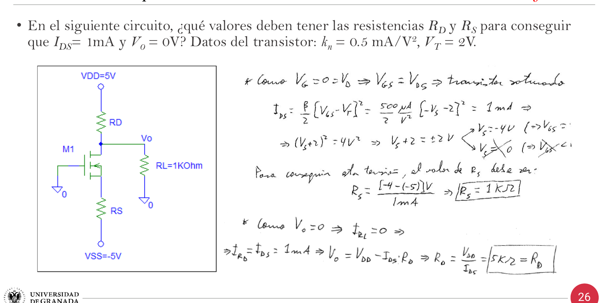

**Solución:**

1. Como $V_G=0=V_D$ ($V_0=0$) ⇒ $V_{GS}=V_{DS}$ ⇒ **el transistor está saturado**.
2. $I_{DS}=\dfrac{k_n}{2}(V_{GS}-V_T)^2$, con $V_{GS}=-V_S$:
$$
\frac{0{,}5}{2}(-V_S-2)^2=1\ \text{mA}\;\Rightarrow\;(V_S+2)^2=4\;\Rightarrow\;V_S+2=\pm2
$$
   - **$V_S=-4$ V** ($V_{GS}=4$ V) ✔
   - $V_S=0$ V ($V_{GS}=0<V_T$) ✘ (se descarta)
3. **$R_S$:** para conseguir esa tensión, $R_S=\dfrac{V_S-V_{SS}}{I_{DS}}=\dfrac{-4-(-5)}{1\ \text{mA}}=$ **1 kΩ**.
4. Como $V_0=0$ ⇒ **no circula corriente por $R_L$** ($i_{R_L}=0$) ⇒ $i_{R_D}=I_{DS}=1$ mA ⇒ $V_o=V_{DD}-I_{DS}R_D$ ⇒ **$R_D=\dfrac{V_{DD}}{I_{DS}}=5$ kΩ**.

### 3.6 Ejercicio: ¿por qué utilizar resistencia de fuente? (diap. 27)

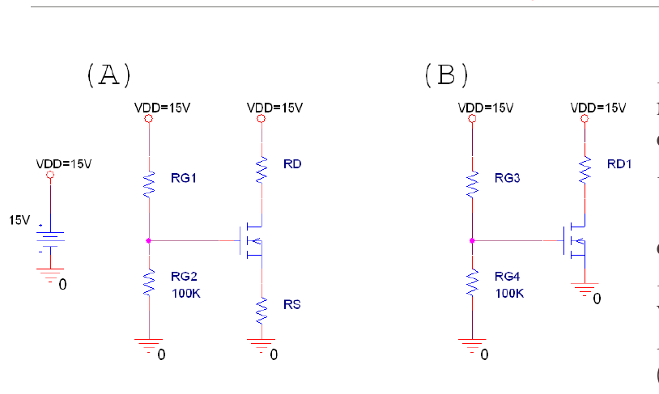

**Enunciado de la diapositiva** ($V_{DD}=15$ V; en el circuito (A) hay $R_{G1}$, $R_{G2}=100$ kΩ, $R_D$ y **$R_S$**; en el (B), $R_{G3}$, $R_{G4}=100$ kΩ y $R_{D1}$, **sin $R_S$**):

- **1.a.** Dado el circuito (A), determine $R_{G1}$, $R_D$ y $R_S$ para polarizar el transistor en saturación de manera que $I_{DS}=2{,}5$ mA, $V_S=5$ V y $V_D=10$ V. $R_{G2}=100$ kΩ. Transistor: $V_T=1$ V, $K_n=1$ mA/V², $\lambda=0$.
- **1.b.** Al montar, las resistencias son del **10 % de tolerancia**; el valor real de $R_{G2}$ es 108 kΩ. Con el resto de valores del apartado 1.a, determine los nuevos $I_{DS}$, $V_{GS}$ y $V_D$. Calcule la **variación porcentual** de $I_{DS}$ ($\Delta I_{DS}/I_{DS}\cdot100$).
- **2.a.** Diseñe el circuito (B) para el mismo transistor e iguales especificaciones que en 1.a.
- **2.b.** Igual que 1.b para el circuito (B): $R_{G4}=108$ kΩ.
- **3.** Comente los resultados obtenidos y las conclusiones que deduce.

> ➕ **Resolución (no está en la diapositiva):**
>
> **1.a (con $R_S$):**
> - $R_S=\dfrac{V_S}{I_{DS}}=\dfrac{5}{2{,}5}=$ **2 kΩ**; $R_D=\dfrac{V_{DD}-V_D}{I_{DS}}=\dfrac{15-10}{2{,}5}=$ **2 kΩ**.
> - Saturación: $2{,}5=\tfrac{1}{2}(V_{GS}-1)^2\Rightarrow V_{GS}=1+\sqrt5=3{,}236$ V.
> - $V_G=V_S+V_{GS}=8{,}236$ V ⇒ $\dfrac{R_{G2}}{R_{G1}+R_{G2}}=\dfrac{8{,}236}{15}=0{,}549\Rightarrow$ **$R_{G1}\approx82{,}1$ kΩ**.
> - Comprobación: $V_{DS}=5$ V $>V_{GS}-V_T=2{,}24$ V ✔.
>
> **1.b ($R_{G2}=108$ kΩ):**
> - $V_G=15\cdot\dfrac{108}{82{,}1+108}=8{,}52$ V.
> - $I_{DS}=\tfrac12(V_G-I_{DS}R_S-1)^2$ ⇒ $I_{DS}=2{,}617$ mA (la otra raíz, 5,40 mA, da $V_S>V_G$: se descarta).
> - **$I_{DS}=2{,}62$ mA, $V_{GS}=3{,}29$ V, $V_D=15-2{,}617\cdot2=9{,}77$ V.**
> - **$\Delta I_{DS}/I_{DS}=+4{,}7\%$.**
>
> **2.a (sin $R_S$):**
> - $V_S=0$ ⇒ $V_G=V_{GS}=3{,}236$ V ⇒ $\dfrac{R_{G4}}{R_{G3}+R_{G4}}=\dfrac{3{,}236}{15}\Rightarrow$ **$R_{G3}\approx363{,}5$ kΩ**.
> - $R_{D1}=\dfrac{15-10}{2{,}5}=$ **2 kΩ** ($V_D=10$ V). Saturación: $V_{DS}=10$ V $>2{,}24$ V ✔.
>
> **2.b ($R_{G4}=108$ kΩ):**
> - $V_G=V_{GS}=15\cdot\dfrac{108}{363{,}5+108}=3{,}436$ V.
> - $I_{DS}=\tfrac12(3{,}436-1)^2=2{,}966$ mA, $V_D=15-2{,}966\cdot2=9{,}07$ V.
> - **$\Delta I_{DS}/I_{DS}=+18{,}7\%$.**
>
> **3. Conclusión:** con la **resistencia de fuente** (circuito A) la corriente solo varía un **4,7 %** frente al **18,7 %** del circuito B. $R_S$ introduce **realimentación negativa**: si $I_{DS}$ aumenta, aumenta $V_S$, disminuye $V_{GS}$ y la corriente se corrige. Sin $R_S$, $V_{GS}$ queda fijada por el divisor y $I_{DS}$ depende **cuadráticamente** de cualquier desviación de las resistencias (o de los parámetros del transistor, $V_T$ y $k_n$). Por eso se utiliza resistencia de fuente en los circuitos de polarización. A cambio, $R_S$ reduce la excursión de tensión disponible y, en pequeña señal, la ganancia (si no se pone un condensador de desacoplo, ver apartado 4).

---

## 4. Modelo de pequeña señal (4.4)

### 4.1 Introducción: perturbar el punto de polarización (diap. 28)

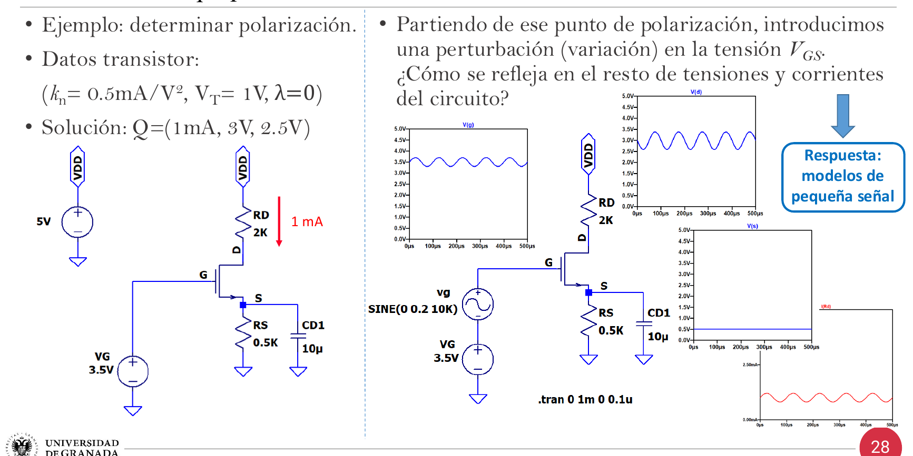

**Ejemplo:** determinar la polarización. Datos del transistor: $k_n=0{,}5$ mA/V², $V_T=1$ V, $\lambda=0$.
Circuito: $V_{DD}=5$ V, $R_D=2$ kΩ, $R_S=0{,}5$ kΩ con un **condensador $C_{D1}=10\ \mu$F en paralelo** con $R_S$, puerta a $V_G=3{,}5$ V.

**Solución de la diapositiva: $Q=(I_{DS},V_{GS},V_{DS})=(1\ \text{mA},\ 3\ \text{V},\ 2{,}5\ \text{V})$.**

> ➕ **Cómo se obtiene:** $V_{GS}=V_G-I_{DS}R_S=3{,}5-0{,}5\,I_{DS}$ e $I_{DS}=\tfrac{0{,}5}{2}(V_{GS}-1)^2$ ⇒ $I_{DS}=0{,}25\,(2{,}5-0{,}5I_{DS})^2$ ⇒ $I_{DS}^2-26I_{DS}+25=0$ ⇒ $I_{DS}=1$ mA (la otra, 25 mA, es imposible). Entonces $V_S=0{,}5$ V, $V_{GS}=3$ V, $V_D=5-1\cdot2=3$ V, $V_{DS}=2{,}5$ V. Saturación: $2{,}5>V_{GS}-V_T=2$ ✔.

**Idea:** partiendo de ese punto de polarización, **introducimos una perturbación (variación) en $V_{GS}$** (una señal sinusoidal $v_g$ de 0,2 V de amplitud y 10 kHz). ¿Cómo se refleja en el resto de tensiones y corrientes? **Respuesta: modelos de pequeña señal.**

En la simulación (`.tran 0 1m 0 0.1u`) se ven: $V(g)$ (continua + pequeño rizado), $V(d)$ (**oscila en oposición**), $V(s)$ (**constante**, gracias al condensador) e $I(R_D)$ (oscila).

### 4.2 Introducción: amplificación (diap. 29–30)

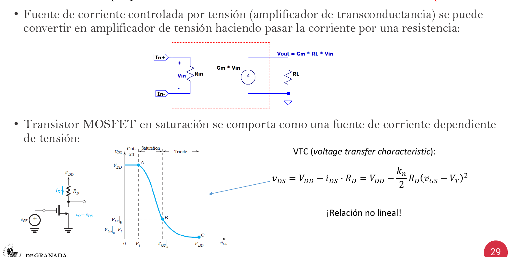

- Una **fuente de corriente controlada por tensión** (amplificador de transconductancia) **se puede convertir en amplificador de tensión** haciendo pasar la corriente por una **resistencia**: $V_{out}=G_m\cdot R_L\cdot V_{in}$.
- El **MOSFET en saturación** se comporta como una **fuente de corriente dependiente de tensión**.
- **VTC (*voltage transfer characteristic*)** del circuito de fuente común:

$$
v_{DS}=V_{DD}-i_{DS}R_D=V_{DD}-\frac{k_n}{2}R_D\,(v_{GS}-V_T)^2
$$

**¡Relación no lineal!** En la gráfica de $v_{DS}$ frente a $v_{GS}$:
  - **Corte** ($v_{GS}<V_t$): $v_{DS}=V_{DD}$ (punto A).
  - **Saturación** (de A a B): la curva baja.
  - **Triodo** (de B a C): la curva se aplana cerca de 0 V ($v_{GS}$ → $V_{DD}$).
  - El punto B cumple $v_{DS_B}=v_{GS_B}-V_t$.

**Buscamos una dependencia lineal (diap. 30).**

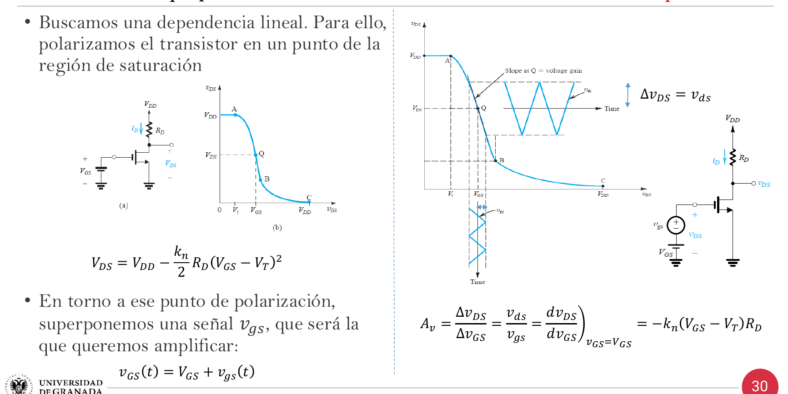

- **Polarizamos el transistor en un punto Q de la región de saturación:**
$$
V_{DS}=V_{DD}-\frac{k_n}{2}R_D(V_{GS}-V_T)^2
$$
- **En torno a ese punto superponemos una señal $v_{gs}$** (la que queremos amplificar):
$$
v_{GS}(t)=V_{GS}+v_{gs}(t)
$$
- La salida varía $\Delta v_{DS}=v_{ds}$ y la **ganancia es la pendiente de la VTC en Q**:

$$
\boxed{\,A_v=\frac{\Delta v_{DS}}{\Delta v_{GS}}=\frac{v_{ds}}{v_{gs}}=\left.\frac{dv_{DS}}{dv_{GS}}\right|_{v_{GS}=V_{GS}}=-k_n\,(V_{GS}-V_T)\,R_D\,}
$$

El signo **menos** indica que la salida está **en oposición de fase (180°)** con la entrada.

### 4.3 Modelo de pequeña señal (baja frecuencia) (diap. 31)

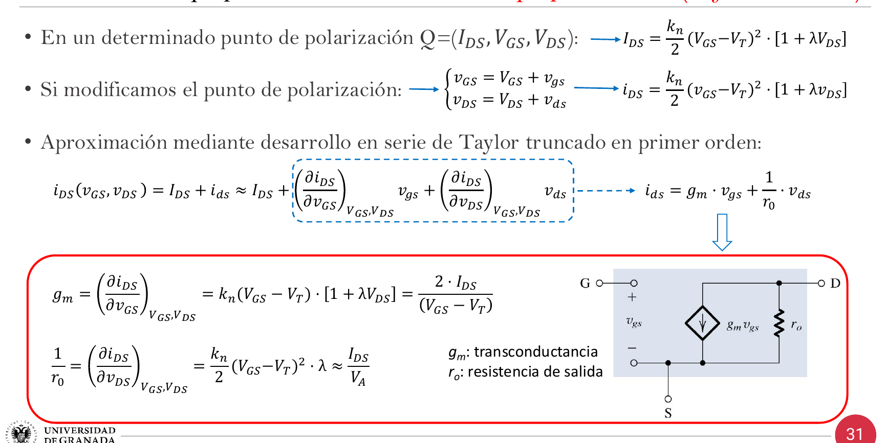

- En un punto de polarización $Q=(I_{DS},V_{GS},V_{DS})$:
$$
I_{DS}=\frac{k_n}{2}(V_{GS}-V_T)^2\,[1+\lambda V_{DS}]
$$
- Si modificamos el punto de polarización:
$$
\begin{cases}v_{GS}=V_{GS}+v_{gs}\\ v_{DS}=V_{DS}+v_{ds}\end{cases}
\;\Rightarrow\;
i_{DS}=\frac{k_n}{2}(v_{GS}-V_T)^2\,[1+\lambda v_{DS}]
$$
- **Aproximación por desarrollo en serie de Taylor truncado en primer orden:**
$$
i_{DS}(v_{GS},v_{DS})=I_{DS}+i_{ds}\approx I_{DS}+\left.\frac{\partial i_{DS}}{\partial v_{GS}}\right|_{V_{GS},V_{DS}}v_{gs}+\left.\frac{\partial i_{DS}}{\partial v_{DS}}\right|_{V_{GS},V_{DS}}v_{ds}
$$
  de donde
$$
\boxed{\,i_{ds}=g_m\,v_{gs}+\frac{1}{r_o}\,v_{ds}\,}
$$

**Parámetros:**

$$
g_m=\left.\frac{\partial i_{DS}}{\partial v_{GS}}\right|_{V_{GS},V_{DS}}=k_n\,(V_{GS}-V_T)\,[1+\lambda V_{DS}]=\frac{2\,I_{DS}}{V_{GS}-V_T}
$$

$$
\frac{1}{r_o}=\left.\frac{\partial i_{DS}}{\partial v_{DS}}\right|_{V_{GS},V_{DS}}=\frac{k_n}{2}(V_{GS}-V_T)^2\,\lambda\;\approx\;\frac{I_{DS}}{V_A}
$$

| Parámetro | Nombre | Significado |
|---|---|---|
| $g_m$ | **Transconductancia** | Cuánto cambia la corriente por cada voltio de cambio en $v_{GS}$ (mA/V) |
| $r_o$ | **Resistencia de salida** | Debida al efecto Early; $r_o\approx V_A/I_{DS}$ ($r_o\to\infty$ si $\lambda=0$) |

**Circuito equivalente (modelo en $\pi$):** entre **G** y **S** hay un circuito abierto (la puerta no consume corriente, $i_g=0$), y entre **D** y **S** una **fuente de corriente dependiente $g_m v_{gs}$ en paralelo con $r_o$**.

> ➕ Observa que $g_m=\dfrac{2I_{DS}}{V_{GS}-V_T}$ se obtiene de $g_m=k_n(V_{GS}-V_T)$ y $I_{DS}=\frac{k_n}{2}(V_{GS}-V_T)^2$ (cociente de ambas): $\dfrac{I_{DS}}{g_m}=\dfrac{V_{GS}-V_T}{2}$. Con $\lambda\ne0$ aparece el factor $[1+\lambda V_{DS}]$ en las dos.

### 4.4 Ejercicio: amplitud de salida (diap. 32)

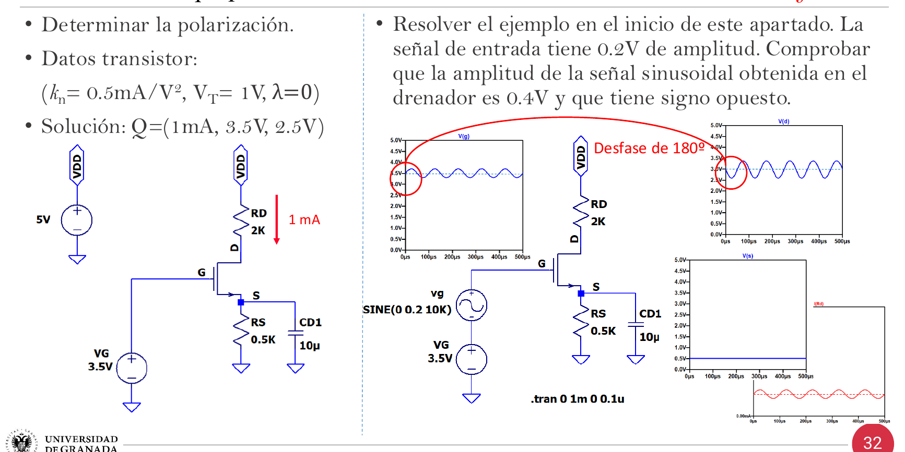

**Enunciado:** determinar la polarización (datos: $k_n=0{,}5$ mA/V², $V_T=1$ V, $\lambda=0$). Resolver el ejemplo del inicio de este apartado. La señal de entrada tiene **0,2 V de amplitud**. **Comprobar que la amplitud de la señal sinusoidal obtenida en el drenador es 0,4 V y que tiene signo opuesto** (desfase de 180°).

⚠️ La diapositiva escribe "Solución: $Q=(1\,\text{mA},\ 3{,}5\,\text{V},\ 2{,}5\,\text{V})$", pero en la diap. 28 es $V_{GS}=3$ V (3,5 V es la tensión de la fuente $V_G$). La polarización correcta es $I_{DS}=1$ mA, $V_{GS}=3$ V, $V_{DS}=2{,}5$ V.

**Resolución:**

1. **Polarización (DC):** la del apartado anterior, $Q=(1\ \text{mA},3\ \text{V},2{,}5\ \text{V})$.
2. **Parámetro de pequeña señal:**
$$
g_m=k_n(V_{GS}-V_T)=0{,}5\,(3-1)=1\ \frac{\text{mA}}{\text{V}}\quad(\lambda=0\Rightarrow r_o\to\infty)
$$
3. **Pequeña señal:** el condensador $C_{D1}$ **cortocircuita $R_S$ en alterna**, así que $v_{gs}=v_g$ y $v_d=-g_m R_D\,v_{gs}$:
$$
A_v=-g_mR_D=-1\cdot2=-2\;\Rightarrow\;|v_d|=2\cdot0{,}2\text{ V}=0{,}4\ \text{V},\ \text{en oposición de fase}
$$
4. **$V(s)$ es constante** porque $v_s=0$ en alterna.

> ➕ **Por qué se corta $R_S$ en AC:** a 10 kHz, la reactancia del condensador es $1/(2\pi\cdot10^4\cdot10^{-5})\approx1{,}6\ \Omega\ll R_S=500\ \Omega$.
> **Receta para pequeña señal:** (1) **DC**: fuentes de señal a 0 y condensadores en abierto ⇒ punto Q, $g_m$, $r_o$. (2) **AC**: fuentes DC a 0 (cortocircuito), condensadores en cortocircuito, transistor sustituido por su modelo ⇒ ganancia.

### 4.5 Observaciones (diap. 33–34)

**1. ¿Hasta qué tensión podemos admitir que es pequeña señal? (diap. 33)**

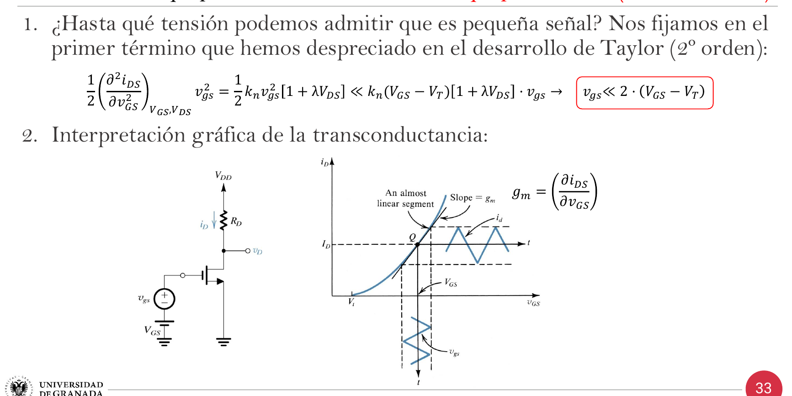

Comparamos el primer término despreciado del desarrollo de Taylor (2.º orden) con el término lineal:

$$
\frac12\left.\frac{\partial^2 i_{DS}}{\partial v_{GS}^2}\right|_{V_{GS},V_{DS}}v_{gs}^2=\frac12\,k_n\,v_{gs}^2\,[1+\lambda V_{DS}]\;\ll\;k_n(V_{GS}-V_T)[1+\lambda V_{DS}]\,v_{gs}
$$

$$
\boxed{\,v_{gs}\ll 2\,(V_{GS}-V_T)\,}
$$

(Con $V_{GS}-V_T=2$ V del ejemplo, hay que tener $v_{gs}\ll4$ V; con 0,2 V se cumple de sobra.)

**2. Interpretación gráfica de la transconductancia:** $g_m=\dfrac{\partial i_{DS}}{\partial v_{GS}}$ es la **pendiente de la tangente** a la curva $i_{DS}$–$v_{GS}$ en el punto Q (es "casi lineal" en un entorno pequeño). Una pequeña variación $v_{gs}$ alrededor de $V_{GS}$ produce una variación $i_d$ casi proporcional.

**3. Modelo equivalente en T (diap. 34)**

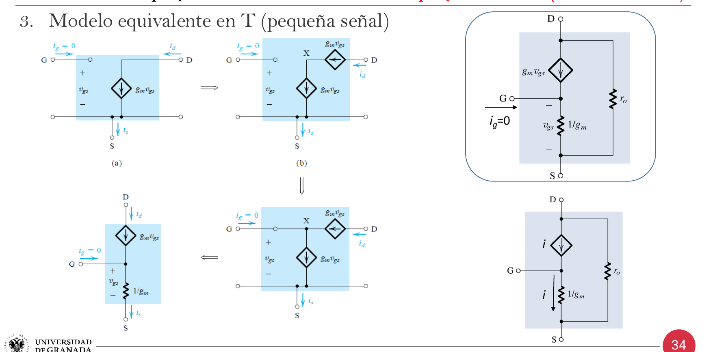

Es un modelo **equivalente** al de la fuente $g_m v_{gs}$ ($i_g=0$) que se obtiene así:

1. Partimos del modelo (a): fuente $g_m v_{gs}$ entre D y S, puerta abierta.
2. (b) **Añadimos dos fuentes de corriente idénticas, $g_mv_{gs}$**, conectadas al nodo X de la puerta (una hacia D y otra hacia S). Como en X entra y sale la misma corriente, **no cambia nada** (sigue $i_g=0$).
3. La fuente entre G y S, $g_mv_{gs}$, controlada por **su propia tensión** $v_{gs}$, se comporta como una **resistencia $1/g_m$** (ya que $i=g_m\,v_{gs}\Rightarrow v_{gs}/i=1/g_m$).

**Resultado (modelo en T):** una resistencia **$1/g_m$ entre G y S**, una **fuente de corriente $i$ (=$g_mv_{gs}$) entre D y la fuente** (por $1/g_m$ circula la misma corriente $i$) y **$r_o$ entre D y S**, con $i_g=0$.

> ➕ **Utilidad:** el modelo en T hace más sencillo el análisis con resistencia en la fuente, porque la corriente $i$ atraviesa $1/g_m$ y $R_S$ **en serie**. Además, la resistencia vista **mirando hacia la fuente** es $1/g_m$.

### 4.6 Ejercicios con resistencia de fuente (diap. 35–36)

**Repetir el ejercicio con resistencia de fuente** (sin condensador en $R_S$): $V_{DD}=5$ V, $R_D=2$ kΩ, $R_S=0{,}5$ kΩ, $V_G=3{,}5$ V con $v_g=0{,}2$ V sen ($10$ kHz). **La polarización (DC) no cambia.**

**Solución con el modelo $\pi$ (diap. 35):**

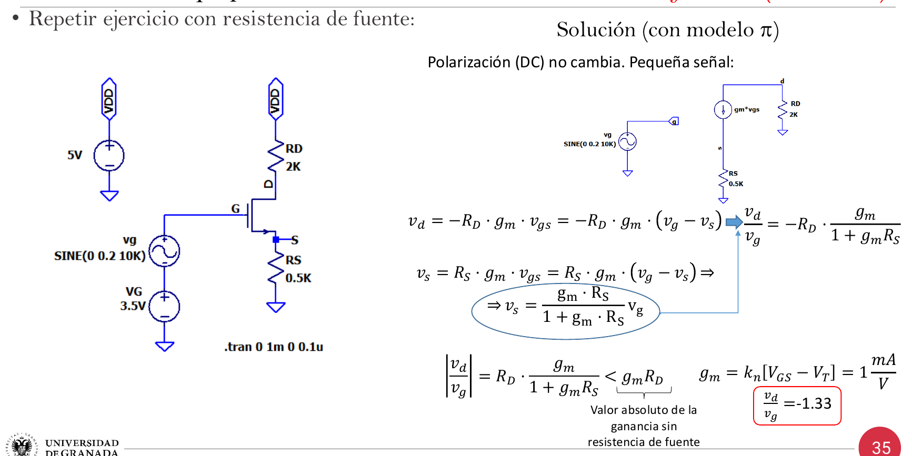

$$
v_d=-R_D\,g_m\,v_{gs}=-R_D\,g_m\,(v_g-v_s)
$$

$$
v_s=R_S\,g_m\,v_{gs}=R_S\,g_m\,(v_g-v_s)\;\Rightarrow\;v_s=\frac{g_mR_S}{1+g_mR_S}\,v_g
$$

$$
\boxed{\,\frac{v_d}{v_g}=-R_D\,\frac{g_m}{1+g_mR_S}\,}
$$

con $g_m=k_n(V_{GS}-V_T)=1$ mA/V:

$$
\frac{v_d}{v_g}=-2\cdot\frac{1}{1+1\cdot0{,}5}=-1{,}33
$$

Y su valor absoluto **es menor** que la ganancia **sin** resistencia de fuente: $\left|\dfrac{v_d}{v_g}\right|=R_D\dfrac{g_m}{1+g_mR_S}<g_mR_D$.

**Solución con el modelo T (diap. 36):**

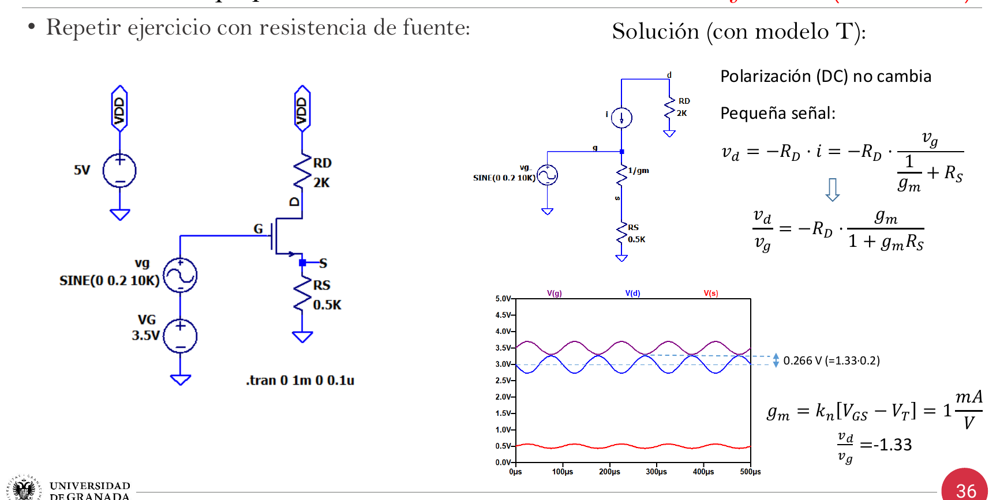

$$
v_d=-R_D\,i=-R_D\,\frac{v_g}{\dfrac{1}{g_m}+R_S}
\;\Rightarrow\;
\frac{v_d}{v_g}=-R_D\,\frac{g_m}{1+g_mR_S}=-1{,}33
$$

**Amplitud del drenador:** $1{,}33\cdot0{,}2=\mathbf{0{,}266\ V}$ (visible en la simulación: $V(d)$ oscila $\pm0{,}266$ V, en oposición a $V(g)$; $V(s)$ oscila ligeramente).

> ➕ Con el modelo $\pi$ y el modelo T se llega **al mismo resultado**: son equivalentes.

### 4.7 Modelo de pequeña señal de alta frecuencia (diap. 37)

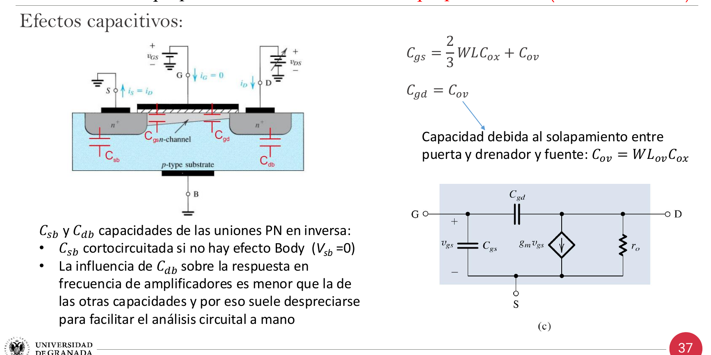

A frecuencias altas hay que considerar los **efectos capacitivos** del dispositivo:

$$
C_{gs}=\frac23\,W\,L\,C_{ox}+C_{ov},\qquad C_{gd}=C_{ov}
$$

**$C_{ov}$** = capacidad debida al **solapamiento** entre puerta y drenador y fuente:

$$
C_{ov}=W\,L_{ov}\,C_{ox}
$$

- **$C_{sb}$ y $C_{db}$** son las **capacidades de las uniones PN en inverso** (sustrato-fuente y sustrato-drenador).
  - **$C_{sb}$ está cortocircuitada si no hay efecto Body** ($V_{sb}=0$).
  - La influencia de **$C_{db}$** sobre la respuesta en frecuencia de amplificadores es **menor** que la de las otras capacidades, y por eso **suele despreciarse** para facilitar el análisis circuital a mano.
- **Modelo (c):** al de baja frecuencia se le añaden **$C_{gs}$ entre G y S** y **$C_{gd}$ entre G y D**, con la fuente $g_mv_{gs}$ y $r_o$ entre D y S.

---

## 5. Transistor PMOS (4.5)

### 5.1 Funcionamiento (diap. 38)

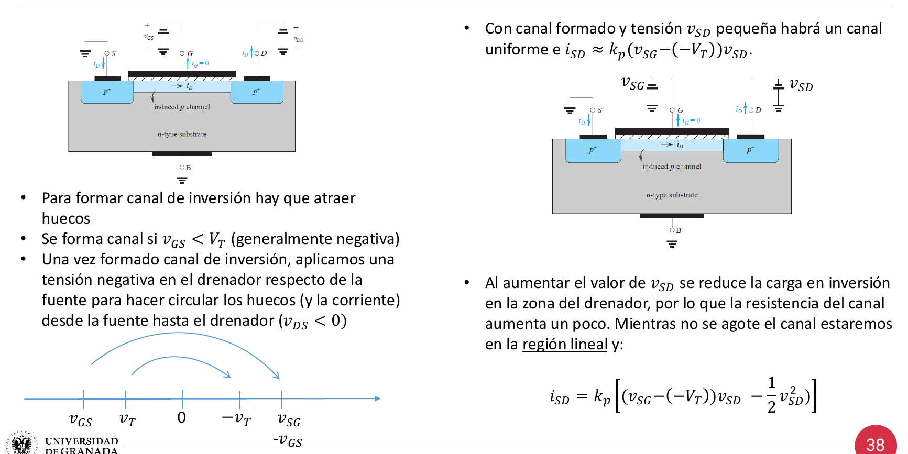

**Estructura:** substrato **tipo N** y regiones de fuente y drenador **$p^+$**. El canal que se forma es de **huecos** (*induced p channel*).

- **Para formar el canal de inversión hay que atraer huecos.**
- **Se forma canal si $v_{GS}<V_T$** (con $V_T$ generalmente negativa; en el eje: $v_{GS}$ más negativa que $V_T$, es decir, $v_{SG}>-V_T$).
- Una vez formado el canal, aplicamos una **tensión negativa en el drenador respecto de la fuente** para hacer circular los huecos (y la corriente) **desde la fuente hasta el drenador** ($v_{DS}<0$).
- **Con canal formado y $v_{SD}$ pequeña** hay un canal uniforme:
$$
i_{SD}\approx k_p\,(v_{SG}-(-V_T))\,v_{SD}
$$
- **Al aumentar $v_{SD}$** se reduce la carga en inversión en la zona del drenador, por lo que la resistencia del canal **aumenta un poco**. Mientras no se agote el canal estamos en la **región lineal**:
$$
i_{SD}=k_p\left[(v_{SG}-(-V_T))\,v_{SD}-\tfrac12v_{SD}^2\right]
$$

### 5.2 Saturación y curvas (diap. 39)

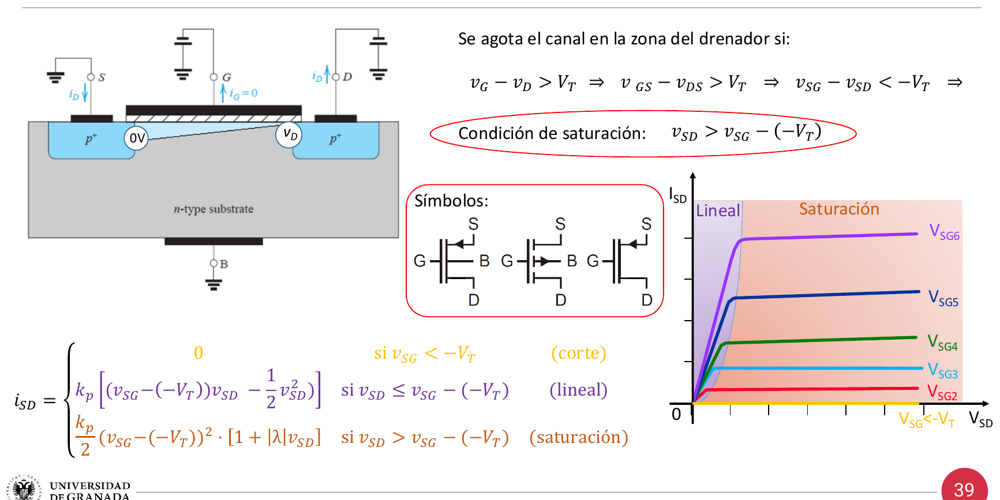

**Se agota el canal en la zona del drenador si:**

$$
v_G-v_D>V_T\;\Rightarrow\;v_{GS}-v_{DS}>V_T\;\Rightarrow\;v_{SG}-v_{SD}<-V_T
$$

$$
\boxed{\,\text{Condición de saturación:}\quad v_{SD}>v_{SG}-(-V_T)\,}
$$

$$
i_{SD}=
\begin{cases}
0 & \text{si } v_{SG}<-V_T\quad\text{(corte)}\\[4pt]
k_p\left[(v_{SG}-(-V_T))v_{SD}-\tfrac12v_{SD}^2\right] & \text{si } v_{SD}\le v_{SG}-(-V_T)\quad\text{(lineal)}\\[4pt]
\dfrac{k_p}{2}\,(v_{SG}-(-V_T))^2\,[1+|\lambda|\,v_{SD}] & \text{si } v_{SD}> v_{SG}-(-V_T)\quad\text{(saturación)}
\end{cases}
$$

- **Símbolos del PMOS** (mismas tres variantes que el NMOS, con **S arriba y D abajo**): la **flecha de la fuente apunta hacia el canal** (hacia la puerta) y, en la variante con flecha en el substrato B, esta apunta **hacia fuera**.
- Gráfica: $I_{SD}$ frente a $V_{SD}$ con curvas $V_{SG2}<V_{SG3}<\dots<V_{SG6}$ (cuanto mayor es $v_{SG}$, mayor la corriente). Para $V_{SG}<-V_T$, **corte**.

### 5.3 Ejemplo (diap. 40)

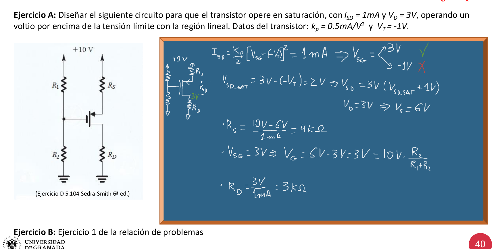

**Ejercicio A (Ejercicio D 5.104, Sedra–Smith 6.ª ed.):** diseñar el circuito (alimentación $+10$ V; divisor $R_1$–$R_2$ en la puerta; $R_S$ entre $+10$ V y la fuente; $R_D$ del drenador a tierra) para que el transistor opere **en saturación**, con **$I_{SD}=1$ mA** y **$V_D=3$ V**, **operando un voltio por encima de la tensión límite con la región lineal**. Datos: $k_p=0{,}5$ mA/V², $V_T=-1$ V.

**Solución:**

1. $I_{SD}=\dfrac{k_p}{2}\,(V_{SG}-(-V_T))^2=1$ mA ⇒ $(V_{SG}-1)^2=4$ ⇒ **$V_{SG}=3$ V** ✔ (la otra, $-1$ V, ✘).
2. $V_{SD,sat}=V_{SG}-(-V_T)=3-1=2$ V ⇒ **$V_{SD}=3$ V** ($=V_{SD,sat}+1$ V).
3. $V_D=3$ V ⇒ $V_S=V_D+V_{SD}=6$ V.
4. **$R_S=\dfrac{10-6}{1\ \text{mA}}=4$ kΩ.**
5. $V_{SG}=3$ V ⇒ $V_G=V_S-V_{SG}=6-3=3$ V $=10\cdot\dfrac{R_2}{R_1+R_2}$ (**divisor**).
6. **$R_D=\dfrac{V_D}{I_{SD}}=\dfrac{3\ \text{V}}{1\ \text{mA}}=3$ kΩ.**

> ➕ Del divisor, $R_2/(R_1+R_2)=0{,}3\Rightarrow R_1=\tfrac73R_2\approx2{,}33\,R_2$ (se elige un valor grande para $R_2$).

**Ejercicio B:** Ejercicio 1 de la relación de problemas (el enunciado no está en la diapositiva).

### 5.4 Observaciones (diap. 41)

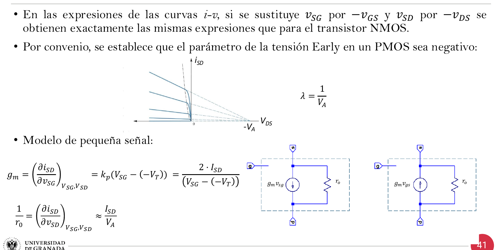

- En las expresiones de las curvas $i$–$v$, si se **sustituye $v_{SG}$ por $-v_{GS}$ y $v_{SD}$ por $-v_{DS}$**, se obtienen **exactamente las mismas expresiones que para el NMOS**.
- **Por convenio, el parámetro de la tensión de Early en un PMOS es negativo:** $\lambda=\dfrac{1}{V_A}$ con $V_A<0$ (en la gráfica, las rectas de saturación cortan el eje en $-V_A$). Por eso en las fórmulas aparece $|\lambda|$.
- **Modelo de pequeña señal:**

$$
g_m=\left.\frac{\partial i_{SD}}{\partial v_{SG}}\right|_{V_{SG},V_{SD}}=k_p\,(V_{SG}-(-V_T))=\frac{2\,I_{SD}}{V_{SG}-(-V_T)}
$$

$$
\frac{1}{r_o}=\left.\frac{\partial i_{SD}}{\partial v_{SD}}\right|_{V_{SG},V_{SD}}\approx\frac{I_{SD}}{V_A}
$$

  Circuito equivalente: fuente $g_m v_{sg}$ (o $g_mv_{gs}$, con el sentido de flecha según la variable de control) en **paralelo con $r_o$**, entre S y D.

---

## 6. MOSFET de deplexión (4.6)

### 6.1 Concepto (diap. 42)

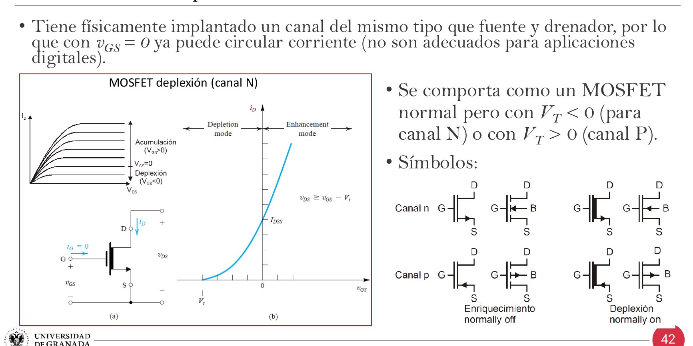

- Tiene **físicamente implantado un canal del mismo tipo que la fuente y el drenador**, por lo que **con $v_{GS}=0$ ya puede circular corriente** ⇒ **no son adecuados para aplicaciones digitales** (el transistor no está "apagado" sin tensión de puerta).
- **Se comporta como un MOSFET normal, pero con $V_T<0$ (canal N) o con $V_T>0$ (canal P).**
- En la gráfica $i_D$–$v_{GS}$ (canal N):
  - **$I_{DSS}$** es la corriente con $v_{GS}=0$.
  - $v_{GS}<0$: **modo deplexión** (se vacía el canal; la corriente baja hasta cortarse en $V_t<0$).
  - $v_{GS}>0$: **modo enriquecimiento** (se acumulan más portadores).
  - La familia de curvas $I_D$–$V_{DS}$ se organiza en: **acumulación** ($V_{GS}>0$), **$V_{GS}=0$** y **deplexión** ($V_{GS}<0$).
- **Símbolos:** cuatro variantes (canal n y canal p; con o sin conexión de substrato B). Dibujados con el **canal en línea continua** (**deplexión, *normally on***) frente a **línea discontinua** (**enriquecimiento, *normally off***).

| | **Enriquecimiento** | **Deplexión** |
|---|---|---|
| Canal en $v_{GS}=0$ | **No** (normally off) | **Sí** (normally on) |
| $V_T$ canal N | $>0$ | $<0$ |
| $V_T$ canal P | $<0$ | $>0$ |
| Uso digital | **Adecuado** | **No adecuado** |

---

## 7. Circuitos integrados y ley de Moore

### 7.1 La integración (diap. 43)

- **Invención del circuito integrado: Jack Kilby (1958)**; **Jack Kilby (1923–2005)** recibió el **Premio Nobel de Física del año 2000**.
- **Un circuito integrado** consiste en la **fabricación de un circuito dentro de una misma pastilla (chip)**, que puede contener un cierto número de **diodos, transistores, resistencias y condensadores**.
- **Ejemplos de circuitos integrados:** microprocesadores, memorias digitales, microcontrolador, amplificador operacional.

### 7.2 El circuito integrado (diap. 44)

- **Robert N. Noyce (1927–1990).**
- **La industria prefirió la invención de Fairchild sobre la de Texas Instruments** porque los transistores en los CI **planares** se interconectaban con **líneas finas depositadas en el circuito**, mientras que en el de Texas Instruments la interconexión se realizaba con **cables finos**.
- El invento de Noyce fue posible gracias a la introducción de la **fabricación planar**, desarrollada por **Jean Hoerni**.

### 7.3 Circuitos integrados (diap. 45)

- **Primer circuito integrado:** fotografía del primer CI de **Jack Kilby en Texas Instruments**. Contenía **un solo transistor y otros componentes en una lámina de germanio**. **Revolucionó la industria electrónica.**
- **Circuitos integrados actuales**: pueden contener **más de $10^{10}$ transistores**.

### 7.4 Ley de Moore (diap. 46–48)

**"The number of transistors on microchips doubles every two years."** (El número de transistores en los microchips se **duplica cada dos años**.)

- Gráfica (*Our World in Data*, datos de Wikipedia): **recuento de transistores** en escala **logarítmica** desde **1970 hasta 2020**, desde del orden de **miles** (Intel 4004, Motorola 6800, Zilog Z80…) hasta **decenas de miles de millones** (Apple A12X Bionic, A13, AMD Epyc Rome, Graviton2…).
- "La **ley de Moore** describe la regularidad empírica de que el número de transistores en circuitos integrados se **duplica aproximadamente cada dos años**. Este avance es importante para otros aspectos del progreso tecnológico en computación, como la **velocidad de proceso** o el **precio de los ordenadores**."

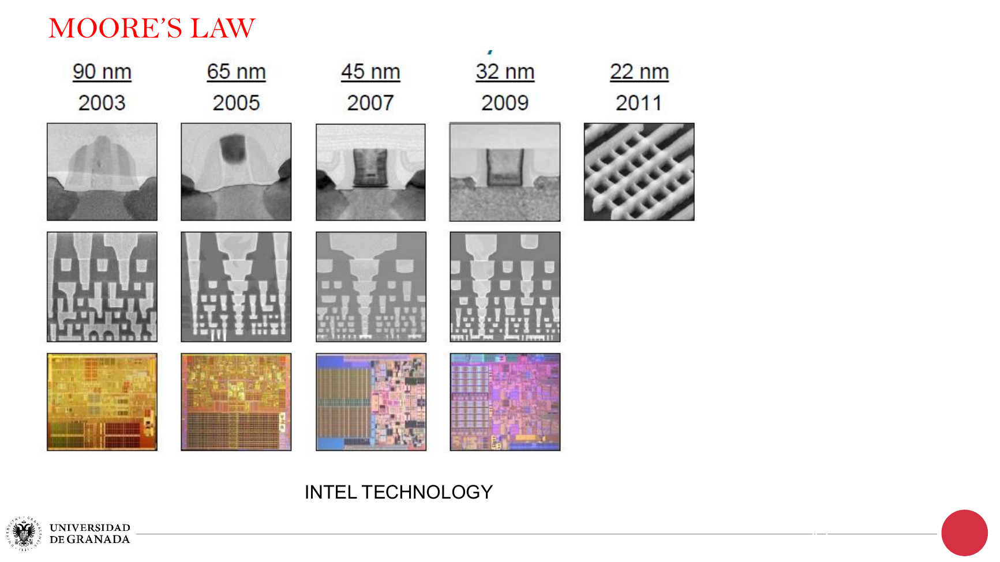

**Tecnología Intel (diap. 47):** evolución de la tecnología de fabricación y reducción de dimensiones, mostrando para cada generación la sección del transistor, las capas de interconexión y la foto del chip:

| Tecnología | Año |
|---|---|
| **90 nm** | 2003 |
| **65 nm** | 2005 |
| **45 nm** | 2007 |
| **32 nm** | 2009 |
| **22 nm** | 2011 |

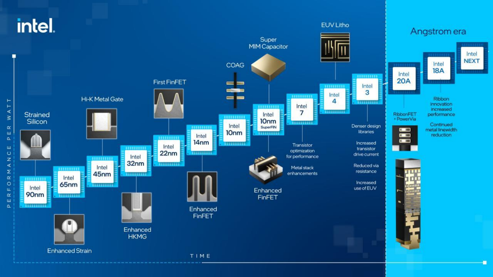

**Hoja de ruta de Intel (diap. 48)** (rendimiento por vatio frente al tiempo):

| Nodo | Innovación mostrada |
|---|---|
| Intel **90 nm** | *Strained Silicon* (silicio tensionado) |
| Intel **65 nm** | *Enhanced Strain* |
| Intel **45 nm** | *Hi-K Metal Gate* (puerta metálica con dieléctrico de alta $\kappa$) |
| Intel **32 nm** | *Enhanced HKMG* |
| Intel **22 nm** | ***First FinFET*** |
| Intel **14 nm** | *Enhanced FinFET* |
| Intel **10 nm** y **10 nm SuperFIN** | *Enhanced FinFET*, COAG, *Super MIM Capacitor* |
| Intel **7** | Optimización del transistor para rendimiento; mejoras en la pila de metal |
| Intel **4** | ***EUV Litho*** |
| Intel **3** | Librerías de diseño más densas, mayor corriente de transistor, menor resistencia de vías, mayor uso de EUV |
| **Era Angstrom:** Intel **20A** | **RibbonFET + PowerVia** |
| Intel **18A** | Innovación *Ribbon*: mayor rendimiento; continúa la reducción de ancho de línea metálico |
| Intel **NEXT** | — |

---

## 8. Bibliografía

- **A. Sedra y K. Smith**, *Microelectronic Circuits*, Oxford University Press, 6.ª edición.
- **S. Dimitrijev**, *Understanding Semiconductor Devices*, Oxford University Press, 2000.

(Los ejemplos con numeración "5.5", "5.6" y "D 5.104" corresponden a Sedra–Smith, 6.ª ed.)

---

## 9. Formulario resumen

**Estructura y canal**

| Concepto | Fórmula |
|---|---|
| Carga en inversión | $Q_I=C\,(v_{GS}-V_T)=C\,v_{ov}$ |
| Capacidad | $C=C_{ox}WL$, $C_{ox}=\dfrac{\varepsilon_{ox}}{t_{ox}}$ |
| Parámetros | $k'_n=C_{ox}\mu_n$, $k_n=k'_n\dfrac{W}{L}$ |
| Tensión de sobrecarga | $v_{ov}=v_{GS}-V_T$ |
| Efecto Body | $V_T=V_{T0}+\gamma\left[\sqrt{2\phi_f+v_{SB}}-\sqrt{2\phi_f}\right]$, $\gamma=\dfrac{\sqrt{2qN_A\varepsilon_S}}{C_{ox}}$ |

**Corriente (NMOS)**

| Región | Condición | $i_{DS}$ |
|---|---|---|
| Corte | $v_{GS}<V_T$ | $0$ |
| Lineal ($v_{DS}$ pequeña) | $v_{DS}\ll v_{ov}$ | $k_n\,v_{ov}\,v_{DS}$, con $r_{ch}=\dfrac{1}{k_nv_{ov}}$ |
| Lineal (general) | $v_{DS}\le v_{ov}$ | $k_n\left[v_{ov}v_{DS}-\tfrac12v_{DS}^2\right]$ |
| Saturación | $v_{DS}\ge v_{ov}$ | $\dfrac{k_n}{2}v_{ov}^2\,[1+\lambda v_{DS}]$, $\lambda=\dfrac1{V_A}$ |

**Pequeña señal (NMOS en saturación)**

| Magnitud | Fórmula |
|---|---|
| Transconductancia | $g_m=k_n(V_{GS}-V_T)\,[1+\lambda V_{DS}]=\dfrac{2I_{DS}}{V_{GS}-V_T}$ |
| Resistencia de salida | $\dfrac{1}{r_o}=\dfrac{k_n}{2}(V_{GS}-V_T)^2\lambda\approx\dfrac{I_{DS}}{V_A}$ |
| Modelo | $i_{ds}=g_mv_{gs}+\dfrac{v_{ds}}{r_o}$ |
| Validez | $v_{gs}\ll2(V_{GS}-V_T)$ |
| Ganancia (fuente común, $\lambda=0$) | $A_v=-g_mR_D=-k_n(V_{GS}-V_T)R_D$ |
| Ganancia con $R_S$ | $\dfrac{v_d}{v_g}=-R_D\dfrac{g_m}{1+g_mR_S}$ |
| Modelo en T | $1/g_m$ entre G y S; $i=\dfrac{v_g}{1/g_m+R_S}$ |
| Capacidades (alta frecuencia) | $C_{gs}=\tfrac23WLC_{ox}+C_{ov}$, $C_{gd}=C_{ov}=WL_{ov}C_{ox}$ |

**Polarización**

| Circuito | Ecuaciones |
|---|---|
| Recta de carga D–S | $I_{DS}=-\dfrac{V_{DS}}{R_D}+\dfrac{V_{DD}}{R_D}$ |
| Autopolarizado | $V_{GG}=V_{GS}+I_{DS}R_S$; $V_{DD}=I_{DS}(R_D+R_S)+V_{DS}$ |
| Realimentación D–G | $V_{DD}=I_{DS}R_D+V_{GS}$ (siempre en saturación si conduce) |
| Fuente de corriente en S | $I_{DS}=I_{DC}$, $V_D=V_{DD}-I_{DS}R_D$ |

---

## 10. Tabla comparativa NMOS / PMOS

| | **NMOS** | **PMOS** |
|---|---|---|
| Substrato | Tipo P | Tipo N |
| Fuente y drenador | $n^+$ | $p^+$ |
| Portadores del canal | **Electrones** | **Huecos** |
| Formar canal | $v_{GS}>V_T$ ($V_T>0$) | $v_{GS}<V_T$ ($V_T<0$), es decir $v_{SG}>-V_T$ |
| Tensión de drenador | $v_{DS}>0$ | $v_{DS}<0$, es decir $v_{SD}>0$ |
| Corriente | $i_{DS}$ (de D a S) | $i_{SD}$ (de S a D) |
| Parámetro | $k_n$ | $k_p$ |
| Lineal | $k_n[(v_{GS}-V_T)v_{DS}-\tfrac12v_{DS}^2]$ | $k_p[(v_{SG}-(-V_T))v_{SD}-\tfrac12v_{SD}^2]$ |
| Saturación (condición) | $v_{DS}\ge v_{GS}-V_T$ | $v_{SD}\ge v_{SG}-(-V_T)$ |
| Saturación (corriente) | $\tfrac{k_n}{2}(v_{GS}-V_T)^2[1+\lambda v_{DS}]$ | $\tfrac{k_p}{2}(v_{SG}-(-V_T))^2[1+\lvert\lambda\rvert v_{SD}]$ |
| Early | $V_A>0$ | $V_A<0$ (convenio) |
| $g_m$ | $k_n(V_{GS}-V_T)=\dfrac{2I_{DS}}{V_{GS}-V_T}$ | $k_p(V_{SG}-(-V_T))=\dfrac{2I_{SD}}{V_{SG}-(-V_T)}$ |

---

## 11. Errores típicos y trucos

- **Comprobar siempre la región.** Tras suponer saturación, verifica $v_{DS}\ge v_{GS}-V_T$. Si no se cumple, repetir en lineal.
- **Ecuación de segundo grado en $I_{DS}$:** hay **dos raíces** y **una suele ser física y la otra no**. Descartar la que da $V_{GS}<V_T$ (transistor en corte) o $V_S>V_G$.
- **No confundir** $V_{GS}$ (polarización, mayúsculas) con $v_{gs}$ (pequeña señal, minúsculas). La ganancia $A_v=-g_mR_D$ se calcula con **$V_{GS}$ de polarización** en $g_m$.
- **Pequeña señal:** primero DC (para $g_m$ y $r_o$), luego AC. En AC, fuentes DC a 0 y condensadores de desacoplo en cortocircuito.
- **Corriente de puerta nula:** en los divisores de puerta no hay caída en $R_G$ ($I_G=0$): $V_G=V_{DD}\dfrac{R_{G2}}{R_{G1}+R_{G2}}$.
- **Unidades:** $k_n$ en **mA/V²**, $R$ en **kΩ** ⇒ $I$ en **mA** y $V$ en **V**: coherente y sin conversiones.
- **PMOS:** las tensiones y corrientes **se definen "al revés"** ($v_{SG}$, $v_{SD}$, $i_{SD}$); con eso las fórmulas son iguales a las del NMOS. $V_T<0$ y $V_A<0$.
- **El signo menos de la ganancia:** indica **inversión de fase** (180°), no una ganancia "negativa" de magnitud.
- **Resistencia de fuente:** disminuye la ganancia ($1+g_mR_S$) pero **estabiliza la polarización** y mejora la linealidad.
- ⚠️ **Erratas de las diapositivas:** en la diap. 32 la solución se escribe $Q=(1\,\text{mA},3{,}5\,\text{V},2{,}5\,\text{V})$, pero $V_{GS}=3$ V ($3{,}5$ V es $V_G$).

---

## 12. Preguntas de repaso

1. ¿Por qué no hay corriente de puerta en un MOSFET? ¿Qué es el **efecto campo**?
2. ¿Qué es la **tensión umbral** y qué valores típicos tiene? ¿Qué es $v_{ov}$?
3. Explica por qué entre drenador y fuente no circula corriente con $v_{GS}=0$.
4. Deduce $i_{DS}=k_n(v_{GS}-V_T)v_{DS}$ para $v_{DS}$ pequeña (carga $Q_I$, tiempo de tránsito, campo $E$, movilidad $\mu_n$).
5. ¿Cuál es la diferencia entre $k_n$ y $k'_n$?
6. ¿Por qué el canal **no es uniforme** al aumentar $v_{DS}$? Deduce $i_{DS}=k_n[(v_{GS}-V_T)v_{DS}-\tfrac12v_{DS}^2]$.
7. ¿Qué ocurre en $v_{DS}=v_{GS}-V_T$? ¿Por qué la corriente **se satura**?
8. ¿Qué es el **efecto Early**? ¿Qué significan $\lambda$, $V_A$ y $r_o$?
9. ¿Qué es el **efecto Body**? ¿Por qué se cortocircuitan S y B?
10. Resume en una tabla las tres regiones del MOSFET y sus condiciones.
11. ¿Qué es **polarizar**? ¿Cuántas ecuaciones hacen falta y cuáles son?
12. Resuelve: autopolarizado con $V_{DD}=10$ V, $R_{G1}=R_{G2}=10$ MΩ, $R_D=R_S=6$ kΩ, $k_n=1$ mA/V², $V_T=1$ V.
13. ¿Por qué en el circuito con realimentación D–G el transistor está siempre en saturación?
14. ¿Qué ventaja tiene incluir **resistencia de fuente** en la polarización? (Compara el 4,7 % y el 18,7 % de variación de $I_{DS}$.)
15. Obtén $g_m$ y $r_o$ a partir de $i_{DS}$ (derivadas parciales). ¿Qué condición debe cumplir la señal para ser "pequeña señal"?
16. Deduce la ganancia del amplificador de fuente común, $A_v=-g_mR_D$. ¿Qué cambia con $R_S$?
17. Dibuja el **modelo en $\pi$ y el modelo en T** y explica cómo se pasa de uno a otro.
18. ¿Qué capacidades aparecen a alta frecuencia y cuáles se desprecian?
19. ¿En qué se diferencia un **PMOS** de un NMOS (portadores, signos, condición de saturación, convenio de $V_A$)?
20. ¿Qué es un MOSFET de **deplexión**? ¿Por qué no se usa en digital?
21. ¿Qué dice la **ley de Moore**? ¿Quién inventó el circuito integrado y quién lo hizo viable industrialmente?

### Respuestas breves (autoevaluación)

- **P1:** el óxido aísla la puerta; el **efecto campo** es el control de la carga del canal mediante un campo perpendicular al que mueve la carga.
- **P7:** en $v_{DS}=v_{ov}$ el canal se estrangula en D ($Q_I(L)=0$); más allá, el exceso de $v_{DS}$ cae en la zona de deplexión y la corriente no cambia ⇒ $i_{DS}=\frac{k_n}{2}v_{ov}^2$.
- **P12:** $I_{DS}=0{,}5$ mA, $V_{GS}=2$ V, $V_D=7$ V, $V_{DS}=4$ V (saturación).
- **P13:** como $I_G=0$, $V_G=V_D$ ⇒ $V_{GD}=0<V_T$ ⇒ $V_{DS}>V_{GS}-V_T$.
- **P14:** la corriente es mucho menos sensible a las tolerancias porque $R_S$ realimenta negativamente.
- **P16:** $A_v=-k_n(V_{GS}-V_T)R_D=-g_mR_D$; con $R_S$: $-g_mR_D/(1+g_mR_S)$.

---

## 13. Índice de figuras

> Las imágenes están en la misma carpeta que este archivo `.md`.

| Figura | Diapositiva | Contenido |
|---|---|---|
| `T4_fig01_historia_transistores.png` | 4 | Historia: válvulas, transistor, CI, µP |
| `T4_fig02_estructura_mosfet.png` | 5 | Estructura del NMOS |
| `T4_fig03_formacion_canal.png` | 6 | Formación del canal, efecto campo |
| `T4_fig04_inversion_y_carga.png` | 7 | Tensión umbral y carga en inversión |
| `T4_fig05_corriente_baja_vds.png` | 8 | Corriente con $v_{DS}$ pequeña, $k_n$ |
| `T4_fig06_region_lineal.png` | 9 | Región lineal, $r_{ch}$ |
| `T4_fig07_canal_no_uniforme.png` | 10 | Canal no uniforme |
| `T4_fig08_perfil_canal_y_corriente.png` | 11 | Perfil de tensión y corriente en el canal |
| `T4_fig09_saturacion_pinchoff.png` | 12 | Saturación (estrangulamiento) |
| `T4_fig10_curvas_triodo_saturacion.png` | 13 | Curvas $i_D$–$v_{DS}$ |
| `T4_fig11_efecto_early.png` | 14 | Efecto Early |
| `T4_fig12_resumen_regiones_iv.png` | 15 | Resumen de regiones |
| `T4_fig13_efecto_body.png` | 16 | Efecto Body |
| `T4_fig14_simbolos_y_comportamiento.png` | 17 | Símbolos y comportamiento |
| `T4_fig15_ejemplo_region_lineal.png` | 18 | Ejemplo en región lineal |
| `T4_fig16_rectas_de_carga.png` | 19 | Polarización: rectas de carga |
| `T4_fig17_autopolarizado.png` | 20 | Autopolarizado |
| `T4_fig18_autopolarizado_solucion.png` | 21 | Solución del autopolarizado |
| `T4_fig19_autopolarizado_saturacion_rectas.png` | 22 | Rectas de carga en saturación |
| `T4_fig20_diseno_autopolarizado_1.png` | 23 | Diseño (1) |
| `T4_fig21_diseno_autopolarizado_2.png` | 24 | Diseño (2) |
| `T4_fig22_otros_circuitos_polarizacion.png` | 25 | Otros circuitos de polarización |
| `T4_fig23_ejercicio_RD_RS.png` | 26 | Ejercicio con alimentación bipolar |
| `T4_fig24_circuitos_A_y_B.png` | 27 | Circuitos A y B (resistencia de fuente) |
| `T4_fig25_ejemplo_pequena_senal.png` | 28 | Ejemplo de pequeña señal |
| `T4_fig26_amplificador_y_VTC.png` | 29 | Amplificación y VTC |
| `T4_fig27_ganancia_en_Q.png` | 30 | Ganancia en el punto Q |
| `T4_fig28_modelo_pequena_senal_BF.png` | 31 | Modelo de pequeña señal (BF) |
| `T4_fig29_ejercicio_pequena_senal.png` | 32 | Ejercicio de pequeña señal |
| `T4_fig30_interpretacion_gm.png` | 33 | Validez e interpretación de $g_m$ |
| `T4_fig31_modelo_en_T.png` | 34 | Modelo en T |
| `T4_fig32_ejercicio_modelo_pi.png` | 35 | Ejercicio con modelo $\pi$ |
| `T4_fig33_ejercicio_modelo_T.png` | 36 | Ejercicio con modelo T |
| `T4_fig34_alta_frecuencia.png` | 37 | Modelo de alta frecuencia |
| `T4_fig35_PMOS_estructura_lineal.png` | 38 | PMOS: estructura y región lineal |
| `T4_fig36_PMOS_saturacion_curvas.png` | 39 | PMOS: saturación y curvas |
| `T4_fig37_PMOS_ejemplo.png` | 40 | PMOS: ejemplo |
| `T4_fig38_PMOS_Early_pequena_senal.png` | 41 | PMOS: Early y pequeña señal |
| `T4_fig39_MOSFET_deplexion.png` | 42 | MOSFET de deplexión |
| `T4_fig40_ley_de_Moore_grafica.png` | 46 | Ley de Moore |
| `T4_fig41_Intel_90nm_a_22nm.png` | 47 | Tecnología Intel 90 nm → 22 nm |
| `T4_fig42_Intel_hoja_de_ruta.png` | 48 | Hoja de ruta de Intel |

---

*Fin del esquema del Tema 4 — El transistor MOSFET.*
