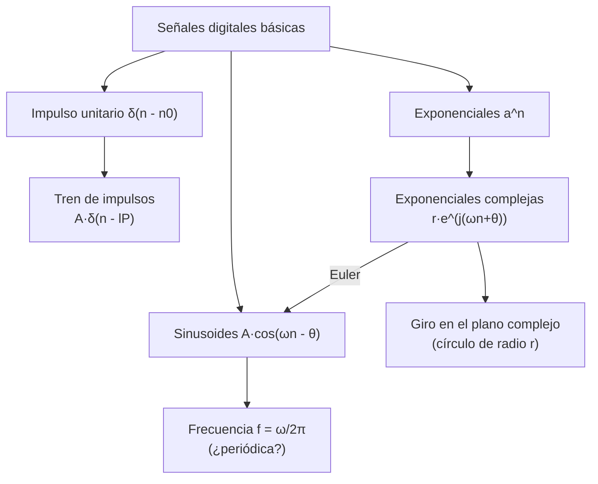

# Práctica 0 — Introducción a MATLAB®

> **Señales Digitales · Cuaderno de Prácticas** (Grado en Ingeniería de Tecnologías de Telecomunicación, ETSIIT).
>
> Resumen esquemático y completo de la práctica: señales básicas (impulso, tren de impulsos, sinusoides, exponenciales y exponenciales complejas), código MATLAB®, resultados verificados numéricamente y banco de preguntas de autoevaluación.
>
> Convención: **📝** = ampliación o matiz que no aparece literalmente en el cuaderno. **Respuesta** = respuesta a una pregunta planteada en el cuaderno.

## Índice

1. [Ficha de la práctica](#1-ficha-de-la-práctica)
2. [Mapa conceptual](#2-mapa-conceptual)
3. [Conceptos básicos de MATLAB usados](#3-conceptos-básicos-de-matlab-usados)
4. [Impulso unitario](#4-impulso-unitario)
5. [Tren de impulsos](#5-tren-de-impulsos)
6. [Señales sinusoidales](#6-señales-sinusoidales)
7. [Exponenciales](#7-exponenciales)
8. [Exponenciales complejas](#8-exponenciales-complejas)
9. [Fórmulas y reglas clave](#9-fórmulas-y-reglas-clave)
10. [Autoevaluación](#10-autoevaluación)
11. [Errores típicos](#11-errores-típicos)
12. [Conexión con el resto de la asignatura](#12-conexión-con-el-resto-de-la-asignatura)

---

## 1. Ficha de la práctica

| Campo | Contenido |
|---|---|
| **Duración** | 1 sesión |
| **Entorno** | MATLAB® (o su contrapartida libre, **OCTAVE**) |
| **Archivo a escribir** | `genexp.m` (genera una exponencial) |
| **Funciones MATLAB usadas** | `zeros`, `stem`, `plot`, `figure`, `subplot`, `sin`, `cos`, `exp`, `real`, `imag`, `error`, `pause`, `hold on`, `axis equal`, `help`, `doc`, `why` |

**Objetivos:**

1. Familiarizarse con el entorno **MATLAB**.
2. Ser capaz de **construir la representación digital** de diferentes tipos de señal.
3. **Visualizar e interpretar** señales básicas.

> 📝 MATLAB no es en sentido estricto un lenguaje de programación sino un **entorno de programación** con gran número de librerías y funciones de cálculo; junto con OCTAVE es una herramienta óptima para el **tratamiento de señales**.

---

## 2. Mapa conceptual



---

## 3. Conceptos básicos de MATLAB usados

| Concepto | Descripción | Ejemplo |
|---|---|---|
| **Vector de tiempos** | Define los instantes de cada muestra; permite representar la señal en el instante $n$ correcto | `nn = 0:(L-1);` |
| **Rango con paso** | `inicio:paso:fin` | `1:P:M*P` va de 1 a $M\cdot P$ en saltos de $P$ |
| **Vectorización** | Las funciones aceptan **vectores** y se aplican a cada elemento (evita bucles) | `sin([0 pi/4 pi/2 pi 1.5])` |
| **Operaciones elemento a elemento** | Un **punto** delante: `.^`, `.*`, `./` | `y = a.^nn` |
| **Indexado** | Acceder o asignar a varios elementos a la vez | `s(1:P:M*P) = A` |
| **Ayuda** | `help` (rápida, en consola) y `doc` (documentación detallada, más lenta) | `help stem` |
| **Funciones propias** | Se guardan en un fichero con **el mismo nombre que la función** (`genexp.m`) | `function y = genexp(a,n0,L)` |
| **Múltiples gráficas** | `subplot(filas, columnas, posición)` | `subplot(4,1,2)` |

> 📝 **Índices:** MATLAB indexa desde **1**, pero el instante $n$ puede empezar en cualquier valor. Si el vector de tiempos empieza en `nmin`, el instante $n$ está en la posición `idx = n - nmin + 1`. Resultado de `sin([0 pi/4 pi/2 pi 1.5])`: `0  0.7071  1.0000  0.0000  0.9975` (el cuarto valor es $\approx1.2\cdot10^{-16}$, no exactamente 0).

---

## 4. Impulso unitario

### 4.1 Definición

La señal digital más simple es el **impulso unidad**:

$$\delta(n-n_0)=\begin{cases}1&n=n_0\\0&n\ne n_0\end{cases}$$

### 4.2 Generación

```matlab
L   = 30;
nn  = 0:(L-1);             % instantes 0..29
imp = zeros(L,1);          % 30 ceros
imp(1) = 1;                % la primera muestra (n = 0) vale 1
stem(nn, imp);
```

Genera 30 muestras con la primera igual a 1. Gracias al vector `nn` el impulso se representa en el instante $n=0$.

### 4.3 `stem` frente a `plot`

**Enunciado:** utilizar `stem` y `plot` para visualizar la señal y comentar las diferencias; ¿por qué se prefiere `stem` en señales discretas?

**Respuesta.**

| | `stem` | `plot` |
|---|---|---|
| **Dibuja** | Cada muestra como un **palito con marcador** (círculo) | Los puntos **unidos por líneas** |
| **Aspecto** | Señal discreta (valores solo en los instantes $n$) | Parece una señal continua (el impulso se ve como un triángulo) |
| **Idoneidad** | **Preferible** para señales discretas | Engañoso: sugiere valores entre muestras que no existen |

### 4.4 Ejercicios

$$X_1(n)=0.9\,\delta(n-5),\quad0\le n\le20\qquad\qquad X_2(n)=4.5\,\delta(n+5),\quad-10\le n\le10$$

```matlab
% X1: impulso de amplitud 0.9 en n = 5
n1 = 0:20;
x1 = zeros(length(n1),1);
x1(5+1) = 0.9;                  % n = 5 → índice 6
% (equivalente vectorizado:  x1 = 0.9*(n1 == 5);)
figure;  stem(n1, x1);

% X2: impulso de amplitud 4.5 en n = -5  (δ(n+5) = 1 si n = -5)
n2 = -10:10;
x2 = zeros(length(n2),1);
x2(-5 - (-10) + 1) = 4.5;       % n = -5 → índice 6
% (equivalente:  x2 = 4.5*(n2 == -5);)
figure;  stem(n2, x2);
```

| Señal | Rango | Muestras | Impulso en | Amplitud | Índice MATLAB |
|---|---|:-:|:-:|:-:|:-:|
| $X_1$ | $0\le n\le20$ | 21 | $n=5$ | 0.9 | 6 |
| $X_2$ | $-10\le n\le10$ | 21 | $n=-5$ (desplazado a la izquierda: $n+5=0$) | 4.5 | 6 |

> 📝 Atención al signo: $\delta(n-5)$ está **desplazado a la derecha** (en $n=5$) y $\delta(n+5)$ **a la izquierda** (en $n=-5$).

---

## 5. Tren de impulsos

### 5.1 Definición

Un tren con $M$ pulsos de amplitud $A$ y periodo $P$:

$$S(n)=\sum_{l=0}^{M-1}A\,\delta(n-lP),\qquad0\le n\le M\cdot P-1$$

### 5.2 Código: bucle y versión vectorizada

Las sumatorias siempre se pueden hacer con un bucle `for`:

```matlab
s = zeros(M*P, 1);
for i = 1:P:M*P          % recorre 1, 1+P, 1+2P, ...  (intervalos de P)
    s(i) = A;
end
```

**Vectorizado** (una de las grandes ventajas de MATLAB), usando el vector del bucle como índice:

```matlab
s(1:P:M*P) = A;
```

### 5.3 Ejercicio: $A=2$, $P=5$, $M\cdot P=50$, empezando en $n=0$

Entonces $M=50/5=10$ pulsos.

```matlab
A = 2;  P = 5;  M = 10;
s = zeros(M*P, 1);
s(1:P:M*P) = A;
stem(0:M*P-1, s);
```

**Resultado:** 50 muestras ($n=0,\dots,49$) con valor 2 en $n=0,5,10,\dots,45$ (**10 impulsos**) y 0 en el resto.

---

## 6. Señales sinusoidales

### 6.1 Definición

$$x(n)=A\cos(\omega n-\theta)$$

| Símbolo | Significado | Unidades |
|---|---|---|
| $A$ | Amplitud | – |
| $\theta$ | Fase | rad |
| $\omega$ | Frecuencia | rad/muestra |
| $f=\omega/2\pi$ | Frecuencia en ciclos por muestra | ciclos/muestra |

> 📝 En esta práctica la fase aparece con signo **menos** ($\cos(\omega n-\theta)$); en la Práctica 1 aparece con signo más ($\cos(2\pi fn+\theta)$): es solo un cambio de convención.

### 6.2 Generación

MATLAB es un lenguaje **vectorial**: una función aplicada a un vector devuelve otro vector con la función aplicada a cada elemento, así que basta con definir el vector de tiempos y evaluar.

### 6.3 Ejercicio: generar y visualizar

| Señal | Expresión | Intervalo |
|---|---|---|
| $X_1(n)$ | $\sin\!\left(\dfrac{\pi}{17}n\right)$ | $0\le n\le75$ |
| $X_2(n)$ | $\sin\!\left(3\pi n+\dfrac{\pi}{2}\right)$ | $-10\le n\le10$ |
| $X_3(n)$ | $\sin\!\left(\pi n+\dfrac{\pi}{2}\right)$ | $-10\le n\le10$ |
| $X_4(n)$ | $\cos\!\left(\dfrac{\pi}{\sqrt{23}}n\right)$ | $0\le n\le50$ |

```matlab
n1 = 0:75;    x1 = sin(pi/17*n1);
n2 = -10:10;  x2 = sin(3*pi*n2 + pi/2);
n3 = -10:10;  x3 = sin(pi*n3 + pi/2);
n4 = 0:50;    x4 = cos(pi/sqrt(23)*n4);

figure();
subplot(4,1,1);  stem(n1, x1);
subplot(4,1,2);  stem(n2, x2);
subplot(4,1,3);  stem(n3, x3);
subplot(4,1,4);  stem(n4, x4);
```

`subplot(n_filas, n_columnas, posición)` coloca varias gráficas en la misma figura, para **compararlas**.

### 6.4 Frecuencias $f$ (ciclos por muestra)

$$f=\frac{\omega}{2\pi}$$

| Señal | $\omega$ (rad/muestra) | $f$ | Valor | ¿Periódica? | Periodo $N$ |
|:-:|:-:|:-:|:-:|:-:|:-:|
| $X_1$ | $\pi/17$ | $\dfrac{1}{34}$ | $\approx0.0294$ | **Sí** (racional) | **34** muestras |
| $X_2$ | $3\pi$ | $\dfrac{3}{2}$ | $1.5$ | **Sí** (racional) | **2** muestras |
| $X_3$ | $\pi$ | $\dfrac{1}{2}$ | $0.5$ | **Sí** (racional) | **2** muestras |
| $X_4$ | $\pi/\sqrt{23}$ | $\dfrac{1}{2\sqrt{23}}$ | $\approx0.1043$ | **No** (irracional) | – |

### 6.5 ¿Cuáles son periódicas y cuáles no? ¿A qué se debe?

**Respuesta.** Una sinusoide **discreta** es periódica **si y solo si su frecuencia $f$ es un número racional** $f=k/N$ (con $k,N$ enteros sin factor común); su periodo es entonces **$N$ muestras**.

- $X_1$, $X_2$, $X_3$ → $f$ racional → **periódicas**.
- $X_4$ → $f=\frac{1}{2\sqrt{23}}$ **irracional** → **no periódica**: aunque su envolvente "parece" una sinusoide, las muestras **nunca se repiten exactamente**.

> 📝 **Diferencia con el tiempo continuo:** una sinusoide continua es siempre periódica; la discreta solo si $\omega/2\pi$ es racional, porque el periodo debe ser un **número entero de muestras**.

### 6.6 ¿Por qué $X_2(n)$ y $X_3(n)$ parecen iguales?

**Respuesta.** Porque **son idénticas**: para $n$ entero,

$$X_2(n)=\sin(3\pi n+\tfrac{\pi}{2})=\cos(3\pi n)=(-1)^n\qquad X_3(n)=\sin(\pi n+\tfrac{\pi}{2})=\cos(\pi n)=(-1)^n$$

Sus frecuencias difieren en $2\pi$ rad ($f=3/2$ y $f=1/2$ difieren en **1 ciclo/muestra**), y como $e^{j2\pi n}=1$ para $n$ entero, producen **exactamente las mismas muestras** ($+1,-1,+1,-1,\dots$; la diferencia máxima entre ambas es 0).

> 📝 Es el fenómeno de las **frecuencias imagen / aliasing** de la Práctica 1: solo las frecuencias en $-\pi<\omega\le\pi$ ($-1/2<f\le1/2$) son distinguibles; $3\pi$ equivale a $\pi$.

---

## 7. Exponenciales

### 7.1 Definición

$$Y(n)=a^{n},\qquad n_0\le n\le n_0+L-1$$

> 📝 El cuaderno escribe el intervalo como $n_0\le n\le n_0+L$, pero la función `genexp` genera exactamente **$L$ muestras**: de $n_0$ a $n_0+L-1$.

### 7.2 Función `genexp.m`

```matlab
function y = genexp(a, n0, L)
    % uso:  Y = genexp(A, N0, L)
    % A  : entrada escalar (base)
    % N0 : instante de comienzo (entero)
    % L  : longitud de la señal generada (entero)
    % Y  : señal de salida Y de longitud L

    % Mostramos un error si nos dan una longitud negativa o nula
    if (L < 1)
        error('GENEXP: Longitud no positiva')
    end

    % Construimos un vector de tiempos desde n0 y longitud L
    nn = n0 + [0:L-1];    % vector de 0 a L-1 y luego se suma n0 a cada término

    % Generamos una señal exponencial con base a de longitud L comenzando en n0
    y = a .^ nn;
end
```

El operador **`.^`** (con punto) aplica la potencia **elemento a elemento** (igual con `.*`, `./`).

### 7.3 Ejercicio: exponencial de base 2 para $-8\le n\le8$

```matlab
y = genexp(2, -8, 17);          % n0 = -8, longitud 17 (n = -8..8)
stem(-8:8, y);
```

**Resultado:** 17 muestras que crecen exponencialmente de $2^{-8}=0.0039$ a $2^{8}=256$ (cada muestra es el doble de la anterior; con $a>1$ la señal **diverge**).

### 7.4 Exponencial decreciente ($\lvert a\rvert<1$)

Es una señal **extremadamente útil** en el tratamiento digital de señales. A menudo hay que sumar $a^nu(n)$; para un intervalo finito:

$$\boxed{\sum_{n=N}^{L}a^{n}=\frac{a^{N}-a^{L+1}}{1-a}}$$

> 📝 Es la **suma geométrica** (la misma que se usa en el Tema 2 para la transformada Z de $a^nu(n)$). Cuidado: aquí $N$ y $L$ son los **límites de la suma**; no confundir $L$ con la longitud de `genexp`: para sumar de $N$ a $L$ se usa `genexp(a, N, L-N+1)`.

**Verificación con tres valores de $a$** (el cuaderno pide valores distintos a los de los compañeros, con bases positivas y negativas):

```matlab
a = 0.5;   N = 0;   L = 10;
y = genexp(a, N, L-N+1);                       % n = N..L
suma_directa  = sum(y);
suma_formula  = (a^N - a^(L+1)) / (1 - a);
abs(suma_directa - suma_formula)               % ≈ 0
```

| $a$ | $N$ | $L$ | Suma directa | Fórmula |
|:-:|:-:|:-:|:-:|:-:|
| 0.5 | 0 | 10 | 1.999023 | 1.999023 |
| −0.8 | 2 | 15 | 0.339918 | 0.339918 |
| 0.9 | 3 | 20 | 6.195810 | 6.195810 |

(valores verificados numéricamente; la fórmula coincide en los tres casos).

---

## 8. Exponenciales complejas

### 8.1 Definición

Aunque las señales reales tienen valores reales, a veces conviene transformarlas en señales **complejas** para procesarlas e interpretarlas. Las **exponenciales complejas** son un caso particular muy importante por su **relación con la transformada de Fourier** y la **representación compacta de armónicos**. Por la fórmula de Euler:

$$x(n)=r\,e^{j(\omega n+\theta)}=r\left[\cos(\omega n+\theta)+j\sin(\omega n+\theta)\right],\qquad-\infty<n<\infty$$

| Parte | Expresión |
|---|---|
| **Real** | $r\cos(\omega n+\theta)$ |
| **Imaginaria** | $r\sin(\omega n+\theta)$ |
| **Módulo** | $r$ (constante) |
| **Fase** | $\omega n+\theta$ (crece linealmente con $n$) |

### 8.2 Comprobación con `real` e `imag`

```matlab
n = 0:50;                                % intervalo de tiempo [0 50]
x = exp(j*n/3);                          % exponencial compleja: r = 1, ω = 1/3, θ = 0

figure();
subplot(2,1,1);  stem(n, real(x)),  title('Parte Real')
subplot(2,1,2);  stem(n, imag(x)),  title('Parte Imaginaria')
```

**Respuesta (¿qué se observa?):**

- **Parte real:** $\cos(n/3)$, una sinusoide que empieza en **1** (valores $1,\,0.945,\,0.786,\,0.540,\dots$).
- **Parte imaginaria:** $\sin(n/3)$, otra sinusoide de **igual amplitud (1) y frecuencia**, pero que empieza en **0** (valores $0,\,0.327,\,0.618,\,0.841,\dots$): está **desfasada 90°** (un cuarto de ciclo) respecto a la real.
- Frecuencia $\omega=1/3$ rad/muestra → $f=\frac{1}{6\pi}$, **irracional** → ninguna de las dos es periódica en sentido discreto (aunque se ven $\approx$ 2.65 oscilaciones en $0\le n\le50$, pues el periodo aparente es $6\pi\approx18.85$ muestras).

### 8.3 Visualizar la rotación en el plano complejo

**Enunciado:** modificar el código para obtener una exponencial compleja con $r=3$, $\omega=\pi/10$, $\theta=0$ en $0\le n\le20$; representar la **parte real en función de la parte imaginaria** de cada punto, como animación con `pause`.

```matlab
r = 3;  w = pi/10;  theta = 0;
n = 0:20;
x = r*exp(j*(w*n + theta));              % COMPLETAR: construcción de la exponencial compleja

figure();
axis equal                               % misma proporción en ambos ejes
for i = 1:20
    plot(real(x(i)), imag(x(i)), 'o');   % COMPLETAR: muestra el i-ésimo punto
    hold on;                             % permite representar más puntos en los mismos ejes
    pause()                              % espera a que se pulse una tecla
end
```

> 📝 Se representa el punto en el **plano complejo** (eje horizontal = parte real, vertical = parte imaginaria). Si se interpreta el enunciado literalmente ("real en función de la imaginaria") basta con intercambiar los ejes: `plot(imag(x(i)), real(x(i)),'o')` (la figura es la misma, reflejada).

**Preguntas y respuestas:**

| Pregunta | Respuesta |
|---|---|
| **¿A qué forma geométrica se asemeja la figura?** | A una **circunferencia** (los 20 puntos son los vértices de un **polígono regular de 20 lados** inscrito en ella) |
| **¿A qué distancia de $(0,0)$ están todos los puntos?** | A **$r=3$**: el módulo es constante ($\lvert x(n)\rvert=r$) |
| **En polar (radio y ángulo), ¿qué relación hay entre $\omega$ y los ángulos de los puntos?** | El ángulo del punto $n$ es $\omega n+\theta$: **$\omega$ es el incremento de ángulo entre muestras consecutivas** (velocidad de giro). Aquí $\omega=\pi/10=18°$ por muestra |

> 📝 Con $\omega=\pi/10$ ($f=1/20$) el punto da **una vuelta completa cada 20 muestras** (periodo $N=20$): por eso `for i = 1:20` ($n=0,\dots,19$) recorre exactamente una vuelta. Una exponencial compleja es "un punto girando": $\omega>0$ gira en sentido antihorario; $r$ es el radio.

### 8.4 El truco final

```matlab
> why
```

Orden de MATLAB que devuelve una frase aleatoria (un *easter egg* de humor); el cuaderno propone repetirla y comentarla con los compañeros. No tiene contenido técnico.

---

## 9. Fórmulas y reglas clave

| Concepto | Expresión |
|---|---|
| **Impulso unidad** | $\delta(n-n_0)=1$ si $n=n_0$, $0$ en otro caso |
| **Tren de impulsos** | $S(n)=\sum_{l=0}^{M-1}A\delta(n-lP)$, $\;0\le n\le MP-1$ |
| **Sinusoide discreta** | $x(n)=A\cos(\omega n-\theta)$ |
| **Frecuencia en ciclos/muestra** | $f=\omega/2\pi$ |
| **Periodicidad** | Periódica $\Leftrightarrow f=k/N$ racional; periodo $N$ |
| **Exponencial** | $y(n)=a^n$ |
| **Suma geométrica finita** | $\sum_{n=N}^{L}a^n=\dfrac{a^N-a^{L+1}}{1-a}$ |
| **Exponencial compleja** | $x(n)=re^{j(\omega n+\theta)}=r\cos(\omega n+\theta)+jr\sin(\omega n+\theta)$ |
| **Módulo y ángulo** | $\lvert x(n)\rvert=r$, $\;\arg x(n)=\omega n+\theta$ |
| **Índice MATLAB** | `idx = n - nmin + 1` |

---

## 10. Autoevaluación

<details>
<summary><b>1. ¿Por qué se prefiere <code>stem</code> a <code>plot</code> para señales discretas?</b></summary>

Porque `stem` dibuja solo las muestras (palitos con marcador); `plot` las une con líneas y sugiere una señal continua con valores intermedios inexistentes.
</details>

<details>
<summary><b>2. ¿Dónde está el impulso de $4.5\,\delta(n+5)$ y en qué índice de MATLAB si $n=-10..10$?</b></summary>

En $n=-5$; índice $-5-(-10)+1=6$.
</details>

<details>
<summary><b>3. ¿Cómo generas un tren de 10 impulsos de amplitud 2 y periodo 5 de forma vectorizada?</b></summary>

`s = zeros(50,1); s(1:5:50) = 2;` (impulsos en $n=0,5,\dots,45$).
</details>

<details>
<summary><b>4. ¿Qué condición debe cumplir $f$ para que una sinusoide discreta sea periódica?</b></summary>

Ser racional, $f=k/N$; el periodo es $N$ muestras.
</details>

<details>
<summary><b>5. Calcula $f$ y decide si es periódica: $\sin(\pi n/17)$, $\sin(3\pi n+\pi/2)$, $\sin(\pi n+\pi/2)$, $\cos(\pi n/\sqrt{23})$.</b></summary>

$1/34$ (sí, $N=34$); $3/2$ (sí, $N=2$); $1/2$ (sí, $N=2$); $1/(2\sqrt{23})\approx0.104$ (no).
</details>

<details>
<summary><b>6. ¿Por qué $X_2$ y $X_3$ parecen iguales?</b></summary>

Son idénticas ($(-1)^n$): sus frecuencias difieren en $2\pi$ (un ciclo/muestra) y para $n$ entero $e^{j2\pi n}=1$.
</details>

<details>
<summary><b>7. ¿Qué hace el operador <code>.^</code> y por qué se usa en <code>genexp</code>?</b></summary>

Eleva elemento a elemento: `a .^ nn` calcula $a^{n}$ para cada $n$ del vector.
</details>

<details>
<summary><b>8. ¿Cuánto vale $\sum_{n=0}^{10}0.5^n$?</b></summary>

$\dfrac{1-0.5^{11}}{0.5}=1.999023$.
</details>

<details>
<summary><b>9. ¿Qué relación hay entre las partes real e imaginaria de $e^{jn/3}$?</b></summary>

Son $\cos(n/3)$ y $\sin(n/3)$: igual amplitud y frecuencia, desfasadas 90°.
</details>

<details>
<summary><b>10. En $3e^{j\pi n/10}$, ¿qué forma dibujan los puntos, a qué distancia del origen están y qué papel juega $\omega$?</b></summary>

Una circunferencia (polígono de 20 lados), de radio 3; $\omega$ es el ángulo girado por muestra (18°).
</details>

---

## 11. Errores típicos

- **Instante frente a índice:** olvidar que MATLAB indexa desde 1 (el instante $n=0$ está en la posición 1).
- **Longitud del vector de tiempos:** `stem(nn, x)` exige que `nn` y `x` tengan la **misma longitud**.
- **Operadores sin punto:** `a^nn` (no vale con vectores) en lugar de `a.^nn`.
- **Signo en $\delta(n+5)$:** el impulso está en $n=-5$, no en $n=+5$.
- **Periodicidad:** decir que toda sinusoide discreta es periódica (solo si $f$ es racional).
- **Frecuencia fuera de rango:** pensar que $X_2$ ($\omega=3\pi$) y $X_3$ ($\omega=\pi$) son distintas: son la misma señal (aliasing).
- **Sobreescribir `j` o `i`:** usar `i` como variable del bucle (`for i = 1:20`) y luego escribir `exp(i*...)` (la unidad imaginaria queda anulada); usar `1j` o `j` sin sobreescribir, o definir el vector de puntos antes del bucle.
- **Confundir $L$ de `genexp` (longitud) con el límite superior $L$ de la suma geométrica.**

---

## 12. Conexión con el resto de la asignatura

| Elemento de la Práctica 0 | Dónde reaparece |
|---|---|
| **Impulso unitario $\delta(n)$** | Respuesta al impulso $h(n)$ (Prácticas 2 y 3); elemento neutro de la convolución |
| **Tren de impulsos** | Modelo del muestreo (Práctica 1, Figura 1.1) |
| **Sinusoides y frecuencia $f$ / $\omega$** | Frecuencia normalizada y aliasing (Práctica 1); DTFT periódica $2\pi$ (Tema 3) |
| **Exponencial $a^nu(n)$ y su suma geométrica** | Transformada Z $\frac{1}{1-az^{-1}}$ y ROC (Tema 2); polos y respuesta de los sistemas LIT (Práctica 3) |
| **Exponencial compleja $re^{j\omega n}$** | Base de la transformada Z ($z=re^{j\omega}$), la DTFT y la DFT; autofunciones de los sistemas LIT |
