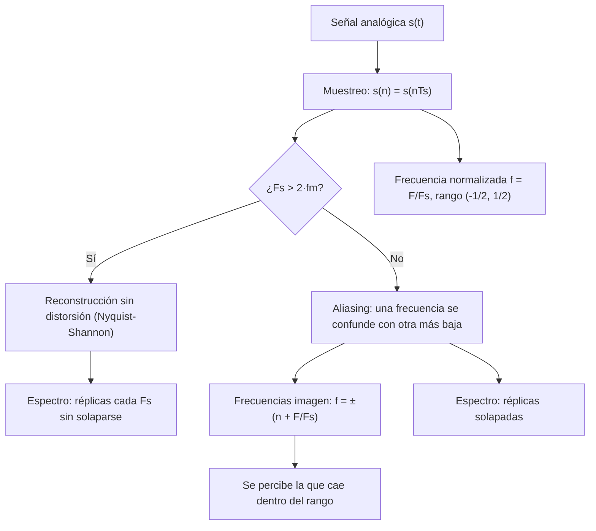
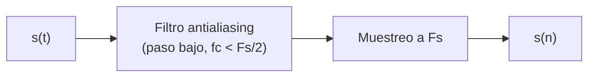

# Práctica 1 — Teorema del muestreo

> **Señales Digitales · Cuaderno de Prácticas** (Grado en Ingeniería de Tecnologías de Telecomunicación, ETSIIT).
>
> Resumen esquemático y completo de la práctica: teoría, código MATLAB®, resultados esperados (verificados numéricamente) y banco de preguntas de autoevaluación.
>
> Convención: **📝** = ampliación o matiz que no aparece literalmente en el cuaderno. Las respuestas a las preguntas del cuaderno están marcadas como **Respuesta**.

## Índice

1. [Ficha de la práctica](#1-ficha-de-la-práctica)
2. [Mapa conceptual](#2-mapa-conceptual)
3. [Introducción: señales analógicas vs digitales](#3-introducción-señales-analógicas-vs-digitales)
4. [¿Qué es el muestreo?](#4-qué-es-el-muestreo)
5. [Realización guiada 1: simular el muestreo](#5-realización-guiada-1-simular-el-muestreo)
6. [Frecuencia normalizada](#6-frecuencia-normalizada)
7. [El aliasing](#7-el-aliasing)
8. [El teorema del muestreo (Nyquist-Shannon)](#8-el-teorema-del-muestreo-nyquist-shannon)
9. [Visión espectral](#9-visión-espectral)
10. [Experiencia auditiva](#10-experiencia-auditiva)
11. [Fórmulas y reglas clave](#11-fórmulas-y-reglas-clave)
12. [Autoevaluación](#12-autoevaluación)
13. [Errores típicos](#13-errores-típicos)

---

## 1. Ficha de la práctica

| Campo | Contenido |
|---|---|
| **Duración** | 1 sesión |
| **Material** | MATLAB® (o Octave), **auriculares** (experiencia auditiva) |
| **Archivo auxiliar** | `magnitudespectra.m` (se descarga de PRADO y se copia al directorio de trabajo) |
| **Funciones MATLAB usadas** | `plot`, `stem`, `hold on/off`, `soundsc`, `magnitudespectra(x, Fs)` |

**Objetivos:**

1. Descubrir las diferencias entre señales **analógicas** y **digitales**.
2. Comprender el **teorema de muestreo** y sus implicaciones en el dominio del **tiempo** y de la **frecuencia**.
3. Experimentar el muestreo y fenómenos como el **aliasing**.

**Señal de trabajo de toda la práctica:**

$$s(t)=A\cos(2\pi Ft+\theta)\qquad A=1,\;F=3\text{ Hz},\;\theta=0$$

---

## 2. Mapa conceptual



---

## 3. Introducción: señales analógicas vs digitales

### 3.1 Pregunta de arranque: ¿qué diferencia un disco de vinilo de un CD?

El cuaderno muestra una imagen de microscopio como pista.

| | **Vinilo** | **CD** |
|---|---|---|
| Información grabada | Un surco **continuo** cuya forma reproduce la onda de sonido | Una secuencia de **marcas (pits y lands)** que codifican **números** |
| Naturaleza | **Analógica** | **Digital** |

### 3.2 Definición de señal digital

**Respuesta.** Una señal digital es una representación de una señal mediante una **secuencia de números** (muestras), tomadas en instantes discretos y con valores codificados con un número finito de bits.

Características que la diferencian de la analógica (basta con dos):

| | **Analógica** | **Digital** |
|---|---|---|
| **Tiempo** | Continuo (definida en todo instante $t$) | **Discreto** (solo en instantes $nT_s$) |
| **Amplitud** | Continua (infinitos valores posibles) | **Cuantizada** (valores de un conjunto finito, $n$ bits) |
| **Representación** | Magnitud física (surco, tensión…) | **Números** |
| **Ruido / copia** | Se acumula y degrada | Se regenera y se copia sin pérdidas |

### 3.3 ¿Por qué usar señales digitales?

Hoy casi todo el procesado de señales (sonido, imagen, ondas cerebrales…) se hace tras **digitalizar**. Añadir un paso parece complicar el proceso, pero es la opción preferida. Razones:

- **Robustez frente al ruido**: se puede regenerar la señal y detectar/corregir errores (códigos de corrección).
- **Copia y almacenamiento sin degradación**, y fácil compresión.
- **Flexibilidad**: el procesado se hace en software (programable, actualizable), no con componentes físicos fijos.
- **Reproducibilidad y estabilidad**: no dependen de tolerancias de componentes, temperatura ni envejecimiento.
- **Precisión controlable**: se elige el número de bits.
- Posibilidad de **multiplexación, cifrado**, integración en un mismo hardware, etc.

> 📝 El cuaderno deja esta pregunta abierta ("piensa y enumera algunas razones"); la lista anterior es una respuesta orientativa.

---

## 4. ¿Qué es el muestreo?

**Muestreo** = primer paso de la digitalización: tomar muestras de una señal analógica a una **frecuencia o tasa de muestreo $F_s$ constante** (periodo $T_s=1/F_s$), para **cuantificarlas** después.


### 4.1 Definición matemática

La **Figura 1.1** muestra tres señales: la analógica, un **tren de impulsos de amplitud unidad** y el resultado (impulsos cuyas alturas siguen a la señal). Por tanto, el muestreo es una **multiplicación por un tren de impulsos**:

$$\boxed{s_s(t)=s(t)\cdot\sum_{k=-\infty}^{\infty}\delta(t-kT_s)=\sum_{k=-\infty}^{\infty}s(kT_s)\,\delta(t-kT_s)}$$

### 4.2 Implicación: se descarta "una cantidad infinita de señal"

Entre dos muestras consecutivas se pierde toda la información. Surge la pregunta de qué se pierde realmente: la respuesta está en los apartados 7 y 8 (**no se pierde nada solo si se cumple el teorema del muestreo**).

> 📝 **Muestreo ≠ cuantificación.** El muestreo discretiza el **tiempo**; la cuantificación discretiza la **amplitud** (codifica cada impulso con una secuencia de $n$ bits). Esta práctica trata solo el muestreo.

---

## 5. Realización guiada 1: simular el muestreo

Se define $s(t)=A\cos(2\pi Ft+\theta)$ ($A=1$, $F=3$, $\theta=0$) y se muestrea con periodo $T_s$:

$$s(n)=s(t)\Big|_{t=nT_s}=A\cos(2\pi F\,nT_s+\theta)=A\cos(2\pi f\,n+\theta)\qquad f=F\,T_s=\frac{F}{F_s}$$

### 5.1 Pasos

| Paso | Qué hay que hacer |
|---|---|
| 1 | Definir `t1` y `t2` (de 0 a 2 s) con $T_{s1}=1$ ms y $T_{s2}=20$ ms |
| 2 | Evaluar $s(t)$ (**no confundir con $s(n)$**) en esos tiempos → `x1`, `x2` |
| 3 | Representar `x1` con `plot` y `x2` con `stem` en la misma ventana |

### 5.2 Código MATLAB

```matlab
A = 1;  F = 3;  theta = 0;
s = @(t) A*cos(2*pi*F*t + theta);        % s(t), señal analógica

Ts1 = 1e-3;   Ts2 = 20e-3;               % 1 ms y 20 ms
t1 = 0:Ts1:2;                            % 2001 puntos (Fs1 = 1000 Hz): "casi continua"
t2 = 0:Ts2:2;                            % 101 puntos  (Fs2 = 50 Hz): muestreada
x1 = s(t1);   x2 = s(t2);

figure;
plot(t1, x1, 'r');  hold on;             % "continua" (puntos muy juntos)
stem(t2, x2, 'b');  hold off;            % muestreada
xlabel('t (s)');  legend('x_1 (continua)', 'x_2 (muestreada)');
```

**Resultado:** la señal roja es una sinusoide de 3 Hz (6 ciclos en 2 s); los círculos azules ($F_{s2}=50$ Hz, ≈16.7 muestras por ciclo) la siguen con fidelidad.

> 📝 `plot` une los puntos con líneas, `stem` dibuja cada muestra como un palito: por eso **`stem` es la herramienta natural para señales discretas** (cada valor es independiente, no hay nada entre muestras).

---

## 6. Frecuencia normalizada

En la ecuación $s(n)=A\cos(2\pi f n+\theta)$ aparece:

$$\boxed{f=\frac{F}{F_s}\qquad\left(\omega=2\pi f=\frac{2\pi F}{F_s}=\Omega T_s\right)}$$

llamada **frecuencia normalizada** (en ciclos/muestra; $\omega$ en rad/muestra), con rango:

$$-\frac{1}{2}<f<\frac{1}{2}\qquad\Longleftrightarrow\qquad-\pi<\omega<\pi$$

### 6.1 Ejercicio: $F_1=2$ kHz, $F_2=3$ kHz

| $F_s$ | $f_1=F_1/F_s$ | $f_2=F_2/F_s$ |
|:-:|:-:|:-:|
| **6 kHz** | $1/3\approx0.333$ ($\omega=2\pi/3$) | $1/2$ ($\omega=\pi$, **justo en el límite**) |
| **4 kHz** | $1/2$ ($\omega=\pi$, **en el límite**) | $3/4=0.75$ ($\omega=3\pi/2$) → **fuera del rango** |

**Respuesta:**

- Al **bajar $F_s$**, la frecuencia normalizada **sube** (porque $f=F/F_s$) y puede salirse del rango $(-1/2,1/2)$.
- Lo no intuitivo: la fórmula $f=F/F_s$ da un valor (p. ej. $0.75$) que **no es el que "se ve"**: la señal discreta resultante no tiene frecuencia $0.75$, tiene otra (apartado 7).
- Fuera de rango: **$f_2=0.75$** con $F_s=4$ kHz. Las demás están dentro o en el límite (frontera $1/2$, donde ya no se cumple la desigualdad estricta).

---

## 7. El aliasing

Cuando la frecuencia normalizada **cae fuera de** $(-1/2,1/2)$ se produce un efecto no deseado: el **aliasing**.

### 7.1 Experimento: muestrear $s(t)$ a tres tasas

Se repiten los pasos 1–3 creando `x3`, `x4`, `x5` con $F_{s3}=10$ Hz, $F_{s4}=6$ Hz, $F_{s5}=3.5$ Hz (para $F=3$ Hz):

```matlab
Fs  = [10 6 3.5];                        % Fs3, Fs4, Fs5
for k = 1:3
    tk = 0:1/Fs(k):2;
    xk = s(tk);
    subplot(3,1,k);
    plot(t1, x1, 'r');  hold on;         % referencia analógica
    stem(tk, xk, 'b');  hold off;
    title(sprintf('F_s = %.1f Hz', Fs(k)));
end
% x5 sin la referencia: ¿se adivina la señal original?
t5 = 0:1/3.5:2;  x5 = s(t5);  figure;  stem(t5, x5);
```

| Señal | $F_s$ | $f=F/F_s$ | Muestras por ciclo ($F_s/F$) | Nº de muestras en 2 s | Qué se observa |
|:-:|:-:|:-:|:-:|:-:|---|
| `x3` | 10 Hz | 0.3 | 3.33 | 21 | La sinusoide aún se reconoce (aunque "angulosa") |
| `x4` | 6 Hz | 0.5 | **2** | 13 | Muestras que **alternan** $+1,-1,+1,-1\dots$ (el límite) |
| `x5` | 3.5 Hz | 0.857 | **1.17** | 8 | Aparece una sinusoide **lenta**: 1 ciclo en 2 s (**0.5 Hz**) |

**Respuesta (¿se identifica la señal original a partir de `x5`?):** **No.** Mirando solo las muestras de `x5` se ve una sinusoide de **0.5 Hz**, mucho más lenta que la original de 3 Hz. Eso es **aliasing**: la señal digital no representa la realidad.

Valores de `x5` (verificados): $1,\;0.623,\;-0.223,\;-0.901,\;-0.901,\;-0.223,\;0.623,\;1$ → un ciclo completo en 8 muestras (7 intervalos de $1/3.5$ s = 2 s).

### 7.2 ¿Por qué ocurre? Frecuencias imagen

La fórmula $f=F/F_s$ "no es del todo correcta": **cada frecuencia real produce infinitas frecuencias imagen** al muestrear:

$$\boxed{\omega=\pm2\pi\left(n+\frac{F}{F_s}\right)\quad\text{ó}\quad f=\pm\left(n+\frac{F}{F_s}\right),\qquad n\in\mathbb{Z}}$$

Todas esas frecuencias producen **exactamente las mismas muestras** (porque $e^{j2\pi n k}=1$, la sinusoide discreta es periódica en $f$ con periodo 1). Al reconstruir, se percibe la que está **dentro del rango** $(-1/2,1/2)$.

**Ejemplo del cuaderno** ($F=3$ kHz, $F_s=4$ kHz, $F/F_s=0.75$):

| Origen | Imágenes |
|---|---|
| $+0.75+n$ | $\dots,-1.25,\,-0.25,\,0.75,\,1.75,\dots$ |
| $-0.75+n$ | $\dots,-1.75,\,-0.75,\,0.25,\,1.25,\dots$ |
| **Unión** | $-1.25,\,-0.75,\,\mathbf{-0.25},\,\mathbf{0.25},\,0.75,\,1.25,\,1.75,\dots$ |

La única dentro del rango es $f=\pm0.25$, así que se percibe una frecuencia real de

$$F_a=f\cdot F_s=0.25\times4\text{ kHz}=\mathbf{1\text{ kHz}}\quad(\text{en lugar de los 3 kHz originales})$$

### 7.3 Receta práctica para calcular el alias

> 📝 Método sistemático (útil para examen):

$$f_0=\frac{F}{F_s}\;\longrightarrow\;f_a=f_0-\text{round}(f_0)\;\longrightarrow\;F_a=\lvert f_a\rvert\cdot F_s=\left\lvert F-\text{round}\!\left(\frac{F}{F_s}\right)F_s\right\rvert$$

| $F$ | $F_s$ | $f_0$ | $f_a$ | $F_a$ |
|:-:|:-:|:-:|:-:|:-:|
| 3 Hz | 3.5 Hz | 0.857 | $-0.143$ ($=-1/7$) | **0.5 Hz** |
| 3 kHz | 4 kHz | 0.75 | $-0.25$ | **1 kHz** |
| 7000 Hz | 11025 Hz | 0.635 | $-0.365$ | **4025 Hz** |
| 7000 Hz | 8000 Hz | 0.875 | $-0.125$ | **1000 Hz** |

Si $f_a<0$, además de cambiar la frecuencia **se invierte el signo de la fase**: $\cos(2\pi f_0n+\theta)\to\cos(2\pi\lvert f_a\rvert n-\theta)$ (en un coseno con $\theta=0$ no se nota; con senos o fases sí).

---

## 8. El teorema del muestreo (Nyquist-Shannon)

Es un teorema fundamental de la teoría de la información, en particular en telecomunicaciones. Surge de la **necesidad de reconstruir una señal de forma unívoca** y evitar el aliasing.

> **Enunciado.** Si una señal continua $S(t)$ tiene una banda de frecuencia tal que $f_m$ es la mayor frecuencia comprendida en ella, la señal podrá **reconstruirse sin distorsión** a partir de muestras tomadas a una frecuencia
>
> $$\boxed{f_s>2f_m}$$

| Concepto | Valor |
|---|---|
| **Frecuencia de Nyquist** (máxima frecuencia representable) | $F_s/2$ |
| **Tasa de Nyquist** (mínima tasa para una señal de ancho de banda $f_m$) | $2f_m$ |

> 📝 La desigualdad es **estricta**. En el límite $f_s=2f_m$ hay ambigüedad: por ejemplo, $\sin(2\pi\frac{F_s}{2}nT_s)=\sin(\pi n)=0$ **para todas las muestras** (se pierde la señal), mientras que un coseno sí da $(-1)^n$ pero con la amplitud/fase indeterminadas.

### 8.1 ¿Qué hacer con la señal original si queremos muestrear a una $F_s$ dada?

**Respuesta.** Limitar su ancho de banda **antes de muestrear** con un **filtro paso bajo (filtro antialiasing)** con frecuencia de corte menor que $F_s/2$, de modo que ya no queden componentes por encima de la frecuencia de Nyquist. Así se pierde algo de contenido, pero **de forma controlada**, en lugar de que esas frecuencias se "plieguen" como alias sobre las buenas.



### 8.2 ¿Qué casos respetan el teorema? ($F=3$ Hz, $f_m=3$ Hz, hace falta $F_s>6$ Hz)

| Caso | $F_s$ | ¿$F_s>6$ Hz? | **¿Respeta?** | Razón |
|---|:-:|:-:|:-:|---|
| $T_{s2}=20$ ms | 50 Hz | Sí | ✅ | $50>6$ |
| $F_{s3}$ | 10 Hz | Sí | ✅ | $10>6$ |
| $F_{s4}$ | 6 Hz | No ($6=2f_m$) | ❌ | No es **estrictamente** mayor: caso límite |
| $F_{s5}$ | 3.5 Hz | No | ❌ | $3.5<6$ → aliasing (se ve 0.5 Hz) |

> 📝 Si se muestrea a 1 kHz ($T_{s1}=1$ ms), con mucho margen: por eso `x1` parece "continua".

**Consecuencia de no respetarlo:** se obtienen señales digitales que **no representan la realidad**. El cuaderno enlaza un vídeo divertido (`youtube.com/watch?v=yr3ngmRuGUc`) y su explicación (`youtube.com/watch?v=AYQAKwCxScc`), junto a un código QR.

---

## 9. Visión espectral

Recordatorio: el **espectro** es la representación en frecuencia de la amplitud de cada componente espectral, que sumadas permiten reconstruir la señal. La transformada de Fourier (Jean-Baptiste Joseph Fourier) se estudiará con detalle más adelante (Tema 3: DTFT y DFT).

### 9.1 Herramienta

```matlab
magnitudespectra(x, Fs)
```

- `x` = señal, `Fs` = su frecuencia de muestreo.
- Calcula **numéricamente** el módulo del espectro de la señal muestreada **desde 0 hasta $F_s$** (no se entra en cómo se hace por dentro; internamente es una DFT).

### 9.2 Resultado esperado: dónde aparecen las deltas

Un coseno de frecuencia $F$ tiene espectro con deltas en $\pm F$. Como el espectro de una señal muestreada es **periódico de periodo $F_s$**, en el eje $[0,F_s]$ aparecen en

$$\boxed{F_a\quad\text{y}\quad F_s-F_a}$$

donde $F_a$ es la frecuencia alias (la de $-F_a$ "entra" por la derecha en $F_s-F_a$).

| Señal | $F_s$ | $F_a$ | **Deltas en $[0,F_s]$** | Observación |
|:-:|:-:|:-:|:-:|---|
| `x3` | 10 Hz | 3 Hz | **3 Hz y 7 Hz** | Simétricas respecto a $F_s/2=5$ Hz |
| `x4` | 6 Hz | 3 Hz | **3 Hz** (una sola) | $F_a=F_s-F_a=F_s/2$: ambas deltas **coinciden** |
| `x5` | 3.5 Hz | 0.5 Hz | **0.5 Hz y 3.0 Hz** | Ver abajo |

**Lo particular de `x5`:** las deltas aparecen en **0.5 Hz y 3.0 Hz**, que son exactamente las de un coseno de **0.5 Hz** muestreado a 3.5 Hz. **No hay forma de saber** (solo con el espectro) que la señal original era de 3 Hz: el espectro **es idéntico**; la línea de 3.0 Hz coincide con la frecuencia original por casualidad de la simetría ($3.5-0.5=3.0$), pero se interpreta como el espejo de 0.5 Hz.

```text
x3 (Fs = 10 Hz)         x4 (Fs = 6 Hz)         x5 (Fs = 3.5 Hz)
|        ║      ║       |       ║              |  ║                ║
0   3 ──────── 7  10    0       3        6     0 0.5 ──────────── 3.0 3.5
    F    F_s-F             F = F_s/2                F_a            F_s-F_a
```

> 📝 En la gráfica real los picos no caen exactamente en esos valores ni son perfectamente finos: la ventana de 2 s no contiene un número entero de ciclos y la resolución del espectro es $F_s/N$ (efecto de enventanado, que se estudiará en la DFT). Lo importante es **la posición aproximada** y la **simetría**.

### 9.3 Interpretación espectral del aliasing

Muestrear equivale a **repetir el espectro original cada $F_s$** (réplicas):

$$X(\omega)=\frac{1}{T_s}\sum_{k=-\infty}^{\infty}X_a\!\left(\frac{\omega}{T_s}-\frac{2\pi}{T_s}k\right)$$

| Caso | Qué ocurre con las réplicas |
|---|---|
| $F_s>2f_m$ | Las réplicas **no se solapan**: se puede recuperar el espectro original con un filtro paso bajo |
| $F_s<2f_m$ | Las réplicas **se solapan** (aliasing): la información queda mezclada y es **irrecuperable** |

---

## 10. Experiencia auditiva

El oído humano percibe entre **20 Hz y 20 kHz**. Estándares de calidad por medio:

| Medio | $F_s$ | Frecuencia de Nyquist ($F_s/2$) |
|---|:-:|:-:|
| **Calidad CD** | 44100 Hz | 22050 Hz |
| **Cinta de cassette** | 22050 Hz | 11025 Hz |
| **Radio de baja calidad** | 11025 Hz | 5512.5 Hz |
| **Línea telefónica** | 8000 Hz | 4000 Hz |

> 📝 Obsérvese que el estándar CD ($F_s=44.1$ kHz) cubre todo el rango audible (necesita $F_s>40$ kHz).

### 10.1 Coseno de $F=7000$ Hz: ¿qué estándares respetan Nyquist-Shannon?

Hace falta $F_s>2\cdot7000=14000$ Hz:

| Medio | $F_s$ | **¿Respeta?** |
|---|:-:|:-:|
| CD | 44100 | ✅ |
| Cassette | 22050 | ✅ |
| Radio baja calidad | 11025 | ❌ |
| Teléfono | 8000 | ❌ |

### 10.2 Reproducción

```matlab
Fsv = [44100 22050 11025 8000];
F   = 7000;   dur = 2;                           % 2 segundos
for k = 1:numel(Fsv)
    n = 0:round(dur*Fsv(k))-1;
    x = cos(2*pi*F*n/Fsv(k));                    % f = F/Fs
    soundsc(x, Fsv(k));                          % reproducir
    pause(dur + 0.5);                            % esperar a que acabe
end
```

**Respuesta (¿se oye lo mismo?):** **No.** Con CD y cassette se oye el tono de 7 kHz; con radio y teléfono se oye **otro tono más grave** (aliasing).

### 10.3 ¿A qué frecuencia se sitúa el tono en cada esquema?

| Medio | $F_s$ | $f_0=F/F_s$ | Imagen dentro del rango | **Tono percibido** |
|---|:-:|:-:|:-:|:-:|
| CD | 44100 Hz | 0.159 | 0.159 | **7000 Hz** |
| Cassette | 22050 Hz | 0.317 | 0.317 | **7000 Hz** |
| Radio baja calidad | 11025 Hz | 0.635 | $-0.365$ | **4025 Hz** ($=11025-7000$) |
| Teléfono | 8000 Hz | 0.875 | $-0.125$ | **1000 Hz** ($=8000-7000$) |

Regla rápida cuando $F_s/2<F<F_s$: $\;F_a=F_s-F$.

---

## 11. Fórmulas y reglas clave

| Concepto | Expresión |
|---|---|
| **Muestreo ideal** | $s_s(t)=s(t)\sum_k\delta(t-kT_s)$, con $T_s=1/F_s$ |
| **Señal muestreada** | $s(n)=A\cos(2\pi f n+\theta)$ |
| **Frecuencia normalizada** | $f=F/F_s$, $\;\omega=2\pi f=\Omega T_s$ |
| **Rango único de $f$** | $-1/2<f<1/2\;\Leftrightarrow\;-\pi<\omega<\pi$ |
| **Imágenes de una frecuencia** | $f=\pm(n+F/F_s)$, $n\in\mathbb{Z}$ |
| **Alias** | $F_a=\lvert F-\text{round}(F/F_s)\,F_s\rvert$ |
| **Teorema de Nyquist-Shannon** | $F_s>2f_m$ |
| **Frecuencia de Nyquist** | $F_s/2$ |
| **Deltas de un coseno en $[0,F_s]$** | $F_a$ y $F_s-F_a$ |
| **Espectro muestreado** | Réplicas del original cada $F_s$ (factor $1/T_s$) |

---

## 12. Autoevaluación

<details>
<summary><b>1. ¿Qué diferencia un vinilo de un CD, y qué dos características separan lo analógico de lo digital?</b></summary>

El vinilo guarda un surco continuo (analógico); el CD guarda marcas que codifican números (digital). Tiempo continuo vs discreto y amplitud continua vs cuantizada (también: magnitud física vs números).
</details>

<details>
<summary><b>2. Define matemáticamente el muestreo.</b></summary>

Multiplicar la señal por un tren de impulsos de amplitud unidad: $s(t)\sum_k\delta(t-kT_s)=\sum_k s(kT_s)\delta(t-kT_s)$.
</details>

<details>
<summary><b>3. Calcula $f$ para $F=2$ kHz y $F=3$ kHz con $F_s=6$ kHz y $F_s=4$ kHz.</b></summary>

$F_s=6$ kHz: $1/3$ y $1/2$. $F_s=4$ kHz: $1/2$ y $3/4$ (esta última, fuera de rango).
</details>

<details>
<summary><b>4. ¿Qué frecuencia ve un coseno de 3 kHz muestreado a 4 kHz?</b></summary>

$f_0=0.75\to f_a=-0.25$, es decir, **1 kHz**.
</details>

<details>
<summary><b>5. Una señal de 3 Hz se muestrea a 3.5 Hz. ¿Qué sinusoide aparece y dónde están las deltas del espectro en $[0,F_s]$?</b></summary>

Una de **0.5 Hz**; deltas en **0.5 Hz y 3.0 Hz**.
</details>

<details>
<summary><b>6. ¿Cuáles de $F_s$ = 50, 10, 6 y 3.5 Hz respetan Nyquist para $F=3$ Hz?</b></summary>

Solo **50 y 10 Hz** ($F_s>6$). 6 Hz es el límite (no estricto) y 3.5 Hz incumple.
</details>

<details>
<summary><b>7. ¿Qué haces con la señal si debes muestrear a una $F_s$ fija y tiene componentes por encima de $F_s/2$?</b></summary>

Filtrarla con un paso bajo (antialiasing) con corte inferior a $F_s/2$ antes de muestrear.
</details>

<details>
<summary><b>8. ¿Por qué en `x4` solo aparece una delta en el espectro?</b></summary>

Porque $F=F_s/2$: las dos deltas ($F$ y $F_s-F$) coinciden en la misma frecuencia.
</details>

<details>
<summary><b>9. ¿Qué tono se oye al muestrear 7 kHz a 8 kHz?</b></summary>

$8000-7000=$ **1 kHz**.
</details>

<details>
<summary><b>10. ¿Por qué usamos <code>stem</code> y no <code>plot</code> para señales discretas?</b></summary>

Porque la señal solo existe en los instantes de muestreo; `stem` muestra cada muestra por separado, mientras `plot` las une con líneas dando la falsa impresión de una señal continua.
</details>

---

## 13. Errores típicos

- Confundir $s(t)$ (analógica) con $s(n)$ (muestreada) al evaluar en MATLAB (en la práctica se evalúa $s(t)$ en los instantes $nT_s$).
- Olvidar que $f=F/F_s$ **solo es válida si $\lvert f\rvert<1/2$**; si no, hay que buscar el alias.
- Escribir $F_s\ge2f_m$ en lugar de $F_s>2f_m$ (el límite no garantiza reconstrucción).
- Pensar que el aliasing se "arregla" después: una vez muestreada con aliasing, **la información es irrecuperable**; hay que filtrar **antes**.
- Dar el espectro de una señal muestreada solo en $[0,F_s/2]$: las deltas aparecen en $F_a$ y $F_s-F_a$ sobre $[0,F_s]$.
- No esperar a que termine un sonido antes de lanzar el siguiente con `soundsc` (usar `pause`).
