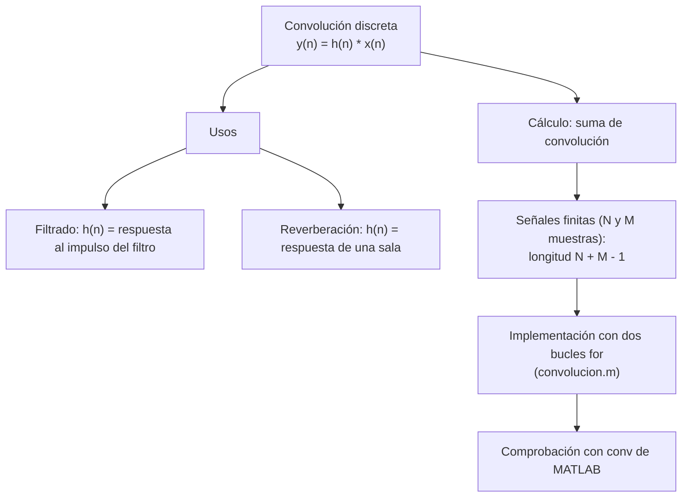
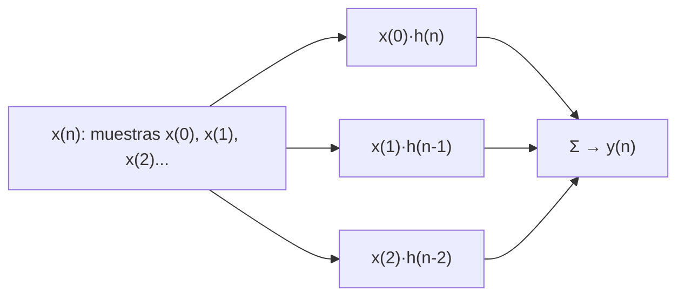

# Práctica 2 — Convolución de señales discretas

> **Señales Digitales · Cuaderno de Prácticas** (Grado en Ingeniería de Tecnologías de Telecomunicación, ETSIIT).
>
> Resumen esquemático y completo de la práctica: teoría, cálculo a mano, función `convolucion.m` completa, reverberación por convolución, resultados verificados numéricamente y banco de preguntas de autoevaluación.
>
> Convención: **📝** = ampliación o matiz que no aparece literalmente en el cuaderno. **Respuesta** = respuesta a una pregunta planteada en el cuaderno.

## Índice

1. [Ficha de la práctica](#1-ficha-de-la-práctica)
2. [Mapa conceptual](#2-mapa-conceptual)
3. [Teoría: la convolución discreta](#3-teoría-la-convolución-discreta)
4. [Realización guiada 1: visualización de la convolución](#4-realización-guiada-1-visualización-de-la-convolución)
5. [Realización guiada 2: implementar la función de convolución](#5-realización-guiada-2-implementar-la-función-de-convolución)
6. [Aplicación: reverberación por convolución](#6-aplicación-reverberación-por-convolución)
7. [Fórmulas y reglas clave](#7-fórmulas-y-reglas-clave)
8. [Autoevaluación](#8-autoevaluación)
9. [Errores típicos](#9-errores-típicos)
10. [Conexión con el resto de la asignatura](#10-conexión-con-el-resto-de-la-asignatura)

---

## 1. Ficha de la práctica

| Campo | Contenido |
|---|---|
| **Duración** | 1 sesión |
| **Material** | MATLAB® (o Octave), **auriculares** |
| **Archivos proporcionados** | `visualiza_conv.m` (visualización paso a paso), `freddy.wav` (señal original "seca"), `Hall.wav` e `Iglesia.wav` (reverberaciones) |
| **Archivo a escribir** | `convolucion.m` (debe estar en la misma carpeta que el programa que la llama) |
| **Funciones MATLAB usadas** | `zeros`, `ones`, `length`, `min`, `conv` (nativa, para comprobar), `audioread` (o `wavread`), `soundsc` |

**Objetivos:**

1. **Comprender y visualizar** el concepto de convolución.
2. **Programar** la función estudiada.
3. Desarrollar un método de **reverberación por convolución**.

---

## 2. Mapa conceptual



---

## 3. Teoría: la convolución discreta

### 3.1 Definición

La convolución entre dos señales se representa habitualmente como

$$y(n)=h(n)*x(n)$$

y en el dominio discreto equivale a la **suma de convolución**:

$$\boxed{y(n)=\sum_{k=-\infty}^{\infty}h(k)\,x(n-k)\qquad-\infty<n<\infty}$$

- A diferencia de su homóloga en **tiempo continuo**, la convolución de señales discretas **finitas** es fácilmente implementable: **no requiere resolver una integral**.
- Se utiliza ampliamente en procesado de señales, entre otras cosas para **filtrar** una señal $x(n)$ utilizando la **respuesta al impulso** de un filtro $h(n)$ (se verá en teoría y en la Práctica 3).

### 3.2 Interpretación (cómo "funciona")

> 📝 Dos formas equivalentes de entender la suma de convolución:

| Visión | Idea |
|---|---|
| **Reflejar – desplazar – multiplicar – sumar** | Para cada $n$: se refleja una señal ($h(k)\to h(-k)$), se desplaza $n$ posiciones ($h(n-k)$), se multiplica muestra a muestra por la otra y se suman los productos. Es lo que muestra `visualiza_conv.m` |
| **Suma de copias** | $y(n)=\sum_k x(k)\,h(n-k)$: cada muestra $x(k)$ "dispara" una copia de $h$, **escalada** por $x(k)$ y **retrasada** $k$ muestras; $y$ es la suma de todas esas copias |



### 3.3 Ejemplo a mano

$x=\{1,2,3\}$, $h=\{1,1\}$ (ambas desde $n=0$, $N=3$, $M=2$):

| $n$ | Productos $h(k)x(n-k)$ | $y(n)$ |
|:-:|---|:-:|
| 0 | $h(0)x(0)=1$ | **1** |
| 1 | $h(0)x(1)+h(1)x(0)=2+1$ | **3** |
| 2 | $h(0)x(2)+h(1)x(1)=3+2$ | **5** |
| 3 | $h(1)x(2)=3$ | **3** |

$$y=\{1,\,3,\,5,\,3\}\qquad(N+M-1=4\text{ muestras})$$

> 📝 **Atajo (multiplicación de polinomios):** convolucionar equivale a multiplicar los polinomios cuyos coeficientes son las muestras: $(1+2z^{-1}+3z^{-2})(1+z^{-1})=1+3z^{-1}+5z^{-2}+3z^{-3}$. Es el reflejo de que la convolución en el tiempo es un **producto** en el dominio $Z$ (Tema 2).

### 3.4 Propiedades útiles

| Propiedad | Expresión |
|---|---|
| **Conmutativa** | $x*h=h*x$ |
| **Asociativa** | $(x*h_1)*h_2=x*(h_1*h_2)$ |
| **Distributiva** | $x*(h_1+h_2)=x*h_1+x*h_2$ |
| **Elemento neutro** | $x(n)*\delta(n)=x(n)$ |
| **Desplazamiento** | $x(n)*\delta(n-n_0)=x(n-n_0)$ |
| **Longitud** (señales finitas) | $N+M-1$ |
| **Suma de muestras** | $\sum y=\left(\sum x\right)\left(\sum h\right)$ |
| **Inicio del soporte** | Si $x$ empieza en $n_x$ y $h$ en $n_h$, $y$ empieza en $n_x+n_h$ |

---

## 4. Realización guiada 1: visualización de la convolución

### 4.1 Código

```matlab
nn = -5:5;                                   % eje de tiempos (11 muestras)
cuadrada = zeros(length(nn),1);
cuadrada(5:10) = ones(6,1);                  % 6 unos
triangular = zeros(length(nn),1);
triangular(1:5)  = 1:5;                      % rampa ascendente 1..5
triangular(6:9)  = 4:-1:1;                   % rampa descendente 4..1
visualiza_conv(cuadrada, triangular, nn, None);   % avanza un paso con cada tecla
```

> 📝 En MATLAB la indexación empieza en 1, así que los índices anteriores corresponden a los instantes siguientes (porque `nn(1) = -5`):

| Señal | Índices MATLAB | Instantes $n$ | Valores |
|---|---|---|---|
| `cuadrada` | 5 a 10 | $-1,0,1,2,3,4$ | $1,1,1,1,1,1$ |
| `triangular` | 1 a 9 | $-5,-4,\dots,3$ | $1,2,3,4,5,4,3,2,1$ (pico de **5** en $n=-1$) |

### 4.2 Resultado de la convolución (verificado)

Vector de **21 muestras** ($11+11-1$) con eje $n=-10,\dots,10$; solo hay **14 no nulas** ($6+9-1$), entre $n=-6$ y $n=7$:

| $n$ | −6 | −5 | −4 | −3 | −2 | −1 | **0** | **1** | 2 | 3 | 4 | 5 | 6 | 7 |
|:-:|:-:|:-:|:-:|:-:|:-:|:-:|:-:|:-:|:-:|:-:|:-:|:-:|:-:|:-:|
| $y(n)$ | 1 | 3 | 6 | 10 | 15 | 19 | **21** | **21** | 19 | 15 | 10 | 6 | 3 | 1 |

Comprobación: $\sum y=150=\left(\sum\text{cuadrada}\right)\left(\sum\text{triangular}\right)=6\cdot25$. ✓

### 4.3 Preguntas del cuaderno

**¿Dónde está el máximo de la convolución?**

**Respuesta.** Valor máximo **21**, alcanzado en dos muestras consecutivas, **$n=0$ y $n=1$** (una pequeña meseta; la señal es simétrica respecto a $n=0.5$).

Por ejemplo, en $n=0$ la ventana de seis unos cubre los valores del triángulo en $n=-4,\dots,1$ (es decir, $2,3,4,5,4,3$): $y(0)=\text{tri}(1)+\text{tri}(0)+\text{tri}(-1)+\text{tri}(-2)+\text{tri}(-3)+\text{tri}(-4)=3+4+5+4+3+2=21$.

**¿Qué ocurre con las funciones cuando se produce el máximo? ¿Qué implicaciones puede tener?**

**Respuesta.**

- Cuando una señal (reflejada y desplazada) está **máximamente solapada** con la otra, es decir, la ventana cuadrada **cubre la parte central y más alta del triángulo** (el pico de 5 queda justo en medio de la ventana), la suma de productos es la mayor posible.
- **Implicación:** la convolución alcanza su máximo donde ambas señales mejor **coinciden / se parecen** (mayor solapamiento). La posición del máximo informa de **dónde** una señal se asemeja a la otra, idea que se usa en detección de patrones (filtros adaptados, correlación).
- 📝 Como `cuadrada` es una ventana de seis unos, la convolución calcula una **suma móvil de 6 muestras** del triángulo: el resultado es una versión **suavizada y más ancha** (14 muestras no nulas frente a 9) de la señal triangular, es decir, la cuadrada actúa como un **filtro paso bajo**.
- 📝 La amplitud de salida (21) es mayor que la de cada entrada (1 y 5): depende del **área** de ambas señales ($\sum y=\sum x\cdot\sum h$). Por eso, en audio hay que **normalizar** para no saturar.

---

## 5. Realización guiada 2: implementar la función de convolución

### 5.1 Simplificación de la ecuación

Se consideran dos señales **finitas** $x(n)$ (longitud $N$) y $h(n)$ (longitud $M$), ambas **comenzando en $n=0$**; fuera de ese rango valen 0.

**Respuesta (ecuación simplificada).** En la suma solo contribuyen los $k$ con $0\le k\le M-1$ (donde $h(k)\ne0$) y $0\le n-k\le N-1$ (donde $x(n-k)\ne0$):

$$\boxed{y(n)=\sum_{k=0}^{M-1}h(k)\,x(n-k)\qquad0\le n\le N+M-2}$$

(con $x(n-k)=0$ si $n-k<0$ o $n-k\ge N$). Es decir, para cada $n$ el rango efectivo de $k$ es

$$\max(0,\,n-N+1)\;\le\;k\;\le\;\min(n,\,M-1)$$

**¿Qué longitud tendrá el vector final?**

**Respuesta.** $\boxed{N+M-1}$ muestras ($n=0,\dots,N+M-2$): la primera salida no nula es $y(0)=h(0)x(0)$ y la última $y(N+M-2)=h(M-1)x(N-1)$.

### 5.2 Completando el pseudocódigo

Los huecos `????` del cuaderno se rellenan así:

| Hueco | Valor |
|---|---|
| `y = zeros(????, 1)` | `zeros(N+M-1, 1)` |
| `for n = 0: ???` | `for n = 0:N+M-2` |
| `for k = 0: min(???,???)` | `for k = 0:min(n, M-1)` |
| `if (n-k < ????)` | `if (n-k < N)` |

> 📝 En el pseudocódigo del cuaderno el `if/else` **no tiene su propio `end`**; hay que cerrarlo para que el código funcione. Además, como el `else` solo suma 0, se puede **eliminar**.

### 5.3 Función completa (`convolucion.m`)

```matlab
function y = convolucion(h, x)
    % CONVOLUCION  Convolución discreta de dos señales finitas que comienzan en n = 0.
    %   y = convolucion(h, x)   (h(n) de longitud M, x(n) de longitud N)
    %   y(n) = sum_{k=0}^{M-1} h(k) x(n-k),   n = 0..N+M-2
    N = length(x);
    M = length(h);
    y = zeros(N+M-1, 1);              % N+M-1 componentes
    for n = 0:N+M-2                   % para cada n de salida
        sumatoria = 0;
        for k = 0:min(n, M-1)         % k válidos de h
            if (n-k < N)              % x(n-k) existe (n-k >= 0 ya está garantizado)
                sumatoria = sumatoria + h(k+1) * x(n-k+1);   % +1: índices desde 1
            end
        end
        y(n+1) = sumatoria;           % se guarda en la posición n (MATLAB: n+1)
    end
end
```

**Versión optimizada** (sin `if` y con la suma vectorizada):

```matlab
function y = convolucion(h, x)
    x = x(:);  h = h(:);              % ambos columna
    N = length(x);  M = length(h);
    y = zeros(N+M-1, 1);
    for n = 0:N+M-2
        k = max(0, n-N+1) : min(n, M-1);        % rango válido de k
        y(n+1) = sum( h(k+1) .* x(n-k+1) );     % producto elemento a elemento
    end
end
```

> 📝 **Por qué `+1`:** la fórmula usa índices desde 0 ($h(0)$, $x(0)$) y MATLAB indexa desde 1, así que $h(k)\to$ `h(k+1)`, $x(n-k)\to$ `x(n-k+1)`, $y(n)\to$ `y(n+1)`.

### 5.4 Comprobación

Se convoluciona la señal rectangular (`cuadrada`) con la triangular, y se compara con la función nativa `conv`:

```matlab
yc = convolucion(cuadrada, triangular);      % 21 x 1
yr = conv(cuadrada, triangular);             % referencia de MATLAB
max(abs(yc - yr))                            % debe dar 0
nout = nn(1)+nn(1) + (0:length(yc)-1);       % eje temporal real: -10 ... 10
stem(nout, yc);
```

**Resultado esperado:** error 0; la señal de la tabla del apartado 4.2 (máximo 21 en $n=0,1$).

Prueba rápida con el ejemplo a mano: `convolucion([1 1],[1 2 3])` $\to\{1,3,5,3\}$.

> 📝 **Atención al eje de tiempos:** `conv` (y `convolucion`) trabajan solo con **vectores**, sin conocer los instantes. El instante de la primera muestra de la salida es la **suma de los instantes iniciales** de las entradas (aquí $-5+(-5)=-10$ porque las dos señales están representadas con ceros desde $n=-5$).

---

## 6. Aplicación: reverberación por convolución

### 6.1 Concepto

- La **reverberación** se produce cuando escuchamos una señal original, **seca**, reflejada en numerosas paredes; las reflexiones llegan en **tiempos diferentes** (normalmente **menores de 100 ms**).
- Se puede "transformar" una señal con otra mediante la convolución: una señal que represente la **"reverberación" de una sala** (su respuesta al impulso, teoría posterior) da forma a la señal original al convolucionarlas.

$$y(n)=\underbrace{x(n)}_{\text{señal seca}}\;*\;\underbrace{h(n)}_{\text{reverberación de la sala}}$$

> 📝 Si $h(n)=\delta(n)+0.5\,\delta(n-n_1)+0.25\,\delta(n-n_2)+\dots$ (sonido directo + reflexiones retrasadas y atenuadas), $y(n)$ es la señal original **más copias suyas retrasadas y atenuadas**: el eco que percibimos. Una sala real tiene miles de reflexiones, por lo que $h(n)$ se obtiene **grabando** la sala.

### 6.2 Archivos

| Archivo | Contenido |
|---|---|
| `freddy.wav` | Señal original "seca" ($x(n)$, la voz) |
| `Hall.wav` | Reverberación de un salón/sala ($h_1(n)$) |
| `Iglesia.wav` | Reverberación de la **iglesia de Schellingwoude (Alemania)** (Figura 2.1) ($h_2(n)$) |

### 6.3 Código

```matlab
% Cargar: devuelve el vector de la señal y su frecuencia de muestreo
[senal,   Fs  ] = audioread('freddy.wav');   % si no existe audioread: wavread (misma sintaxis)
[hall,    Fs_h] = audioread('Hall.wav');
[iglesia, Fs_i] = audioread('Iglesia.wav');

% Escuchar cada señal por separado
soundsc(senal,   Fs);
soundsc(hall,    Fs_h);
soundsc(iglesia, Fs_i);

% Meter a Freddie Mercury en cada ambiente
y1 = convolucion(senal, hall);
y2 = convolucion(senal, iglesia);

% Escuchar los resultados
soundsc(y1, Fs);
soundsc(y2, Fs);
```

> 📝 **Consejos prácticos:**
> - Si un `.wav` es **estéreo**, `audioread` devuelve una matriz $N\times2$: usar un solo canal (`senal(:,1)`).
> - Todos los archivos deben tener la **misma $F_s$** (si no, la convolución carece de sentido físico).
> - `convolucion` con doble bucle es **muy lenta** con audio real ($N$ y $M$ del orden de $10^4$–$10^6$ muestras → $N\cdot M$ productos). Para audio real conviene la nativa `conv` o `fftfilt` (convolución mediante FFT, apoyada en la DFT con *zero padding*, Tema 3).
> - `soundsc` **escala automáticamente** la señal al rango del reproductor, evitando que la mayor amplitud de $y$ sature.
> - Usar `pause` entre llamadas a `soundsc` para que no se solapen.

### 6.4 Pregunta del cuaderno

**¿Qué diferencias encuentras entre la señal original y las señales procesadas?**

**Respuesta (cualitativa; depende de lo que se oiga con los archivos):**

| Aspecto | Señal original | Señales procesadas |
|---|---|---|
| **Ambiente** | Seca, sin eco | Se percibe el **espacio** (sala u iglesia): sonido más "envolvente" |
| **Cola de reverberación** | Ninguna | Hay una **cola** que decae tras cada sonido; la voz se **solapa** con sus propias reflexiones, menos nítida |
| **Duración** | $N$ muestras | $N+M-1$ muestras: **más larga** (se alarga con la duración de $h$) |
| **Hall vs Iglesia** | – | Se espera mayor tiempo de reverberación en la iglesia (gran volumen, superficies duras) |
| **Nivel** | – | Mayor energía total (área de $h$); depende de $\sum h$ |

---

## 7. Fórmulas y reglas clave

| Concepto | Expresión |
|---|---|
| **Suma de convolución** | $y(n)=\sum_{k=-\infty}^{\infty}h(k)\,x(n-k)$ |
| **Señales finitas desde $n=0$** | $y(n)=\sum_{k=0}^{M-1}h(k)\,x(n-k)$, $\;0\le n\le N+M-2$ |
| **Rango efectivo de $k$** | $\max(0,n-N+1)\le k\le\min(n,M-1)$ |
| **Longitud de $y$** | $N+M-1$ |
| **Primer instante de $y$** | $n_x+n_h$ |
| **Neutro** | $x*\delta=x$ |
| **Suma de muestras** | $\sum y=\sum x\cdot\sum h$ |
| **Dominio $Z$** | $x*h\;\leftrightarrow\;X(z)H(z)$ |
| **Dominio de la frecuencia** | $x*h\;\leftrightarrow\;X(\omega)H(\omega)$ |
| **Índices MATLAB** | $x(n)\to$ `x(n+1)` |

---

## 8. Autoevaluación

<details>
<summary><b>1. Escribe la suma de convolución e indica en qué se diferencia de la convolución en tiempo continuo.</b></summary>

$y(n)=\sum_k h(k)x(n-k)$. En discreto con señales finitas es una suma implementable directamente; en continuo es una integral.
</details>

<details>
<summary><b>2. ¿Cuántas muestras tiene la convolución de una señal de 100 muestras con otra de 10?</b></summary>

$100+10-1=109$.
</details>

<details>
<summary><b>3. Calcula a mano $\{1,2,3\}*\{1,1\}$.</b></summary>

$\{1,3,5,3\}$.
</details>

<details>
<summary><b>4. En la práctica, ¿dónde está el máximo de <code>cuadrada*triangular</code> y cuánto vale?</b></summary>

Vale 21, en $n=0$ y $n=1$ (con los instantes reales). La salida completa tiene 21 muestras, 14 no nulas ($n=-6\ldots7$).
</details>

<details>
<summary><b>5. ¿Qué rango de $k$ hay que recorrer para cada $n$ en la función <code>convolucion</code>?</b></summary>

$\max(0,n-N+1)\le k\le\min(n,M-1)$ (en el pseudocódigo: $k$ de 0 a `min(n,M-1)` y la condición `n-k < N`).
</details>

<details>
<summary><b>6. ¿Por qué aparece <code>+1</code> en <code>h(k+1)</code>, <code>x(n-k+1)</code> e <code>y(n+1)</code>?</b></summary>

Porque la fórmula indexa desde 0 y MATLAB desde 1.
</details>

<details>
<summary><b>7. ¿Cómo se comprueba que la función propia es correcta?</b></summary>

Comparando con `conv` nativa: `max(abs(yc - yr))` debe ser 0.
</details>

<details>
<summary><b>8. ¿Qué papel juegan $x(n)$ y $h(n)$ en la reverberación?</b></summary>

$x$ es la señal seca (la voz) y $h$ la respuesta de la sala (reflexiones retrasadas y atenuadas). La salida es la voz "dentro de la sala".
</details>

<details>
<summary><b>9. ¿Por qué la salida reverberada dura más que la original?</b></summary>

Porque su longitud es $N+M-1$ muestras, $M-1$ más (la cola de la reverberación).
</details>

<details>
<summary><b>10. ¿Por qué no conviene usar la función de doble bucle con los archivos de audio?</b></summary>

Porque requiere $N\cdot M$ operaciones dentro de bucles interpretados (lentísimo); mejor `conv` o `fftfilt`.
</details>

---

## 9. Errores típicos

- Olvidar que la longitud de la salida es **$N+M-1$** (y no $N$).
- Fallos de índice: no sumar el **+1** de MATLAB, o acceder a `x(n-k+1)` con $n-k<0$ (índices no válidos) o $n-k\ge N$.
- Confundir el vector de resultados con el **eje temporal**: la salida no empieza en el mismo instante que las entradas.
- Olvidar cerrar el `if` del pseudocódigo.
- Mezclar vectores fila y columna al restar/multiplicar (`h(k+1).*x(n-k+1)` exige la misma orientación).
- Convolucionar audios con distinta $F_s$ o estéreo sin separar canales.
- Escuchar sin normalizar y saturar: la amplitud de $y$ depende del área de $h$.

---

## 10. Conexión con el resto de la asignatura

| Práctica / Tema | Relación |
|---|---|
| **Práctica 3 (sistemas LIT)** | $y(n)=\sum_k x(k)h(n-k)$: la salida de un sistema LIT es la convolución de la entrada con su **respuesta al impulso** |
| **Tema 2 (transformada Z)** | $x*h\;\leftrightarrow\;X(z)H(z)$ (ROC: intersección) |
| **Tema 3 (DTFT/DFT)** | $x*h\;\leftrightarrow\;X(\omega)H(\omega)$; la **convolución circular** (DFT de $N$ puntos) coincide con la lineal si $N\ge N_x+N_h-1$ (*zero padding*) |
| **Prácticas 4 y 5 (filtros)** | Filtrar es convolucionar con la respuesta al impulso del filtro (FIR) |
