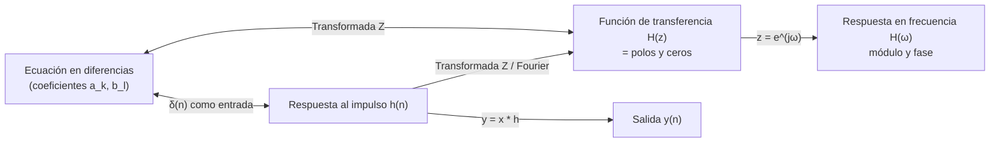

# Práctica 3 — Sistemas Lineales e Invariantes en Tiempo Discreto (LIT)

> **Señales Digitales · Cuaderno de Prácticas** (Grado en Ingeniería de Tecnologías de Telecomunicación, ETSIIT).
>
> Resumen esquemático y completo de la práctica: teoría, código MATLAB®, resultados esperados (verificados numéricamente) y banco de preguntas de autoevaluación.
>
> Convención: **📝** = ampliación o matiz que no aparece literalmente en el cuaderno. **Respuesta** = respuesta a una pregunta planteada en el cuaderno.

## Índice

1. [Ficha de la práctica](#1-ficha-de-la-práctica)
2. [Mapa conceptual](#2-mapa-conceptual)
3. [Teoría: descripción de un sistema LIT](#3-teoría-descripción-de-un-sistema-lit)
4. [Realización guiada: el sistema bajo estudio](#4-realización-guiada-el-sistema-bajo-estudio)
5. [Opcional: otros dos sistemas](#5-opcional-otros-dos-sistemas)
6. [Fórmulas y reglas clave](#6-fórmulas-y-reglas-clave)
7. [Autoevaluación](#7-autoevaluación)
8. [Errores típicos](#8-errores-típicos)
9. [Conexión con el resto de la asignatura](#9-conexión-con-el-resto-de-la-asignatura)

---

## 1. Ficha de la práctica

| Campo | Contenido |
|---|---|
| **Duración** | 1 sesión |
| **Archivo a escribir** | `sistema.m` (implementa la ecuación en diferencias) |
| **Funciones MATLAB usadas** | `filter(b,a,x)`, `zplane`, `tf2zp`, `zp2tf`, `freqz`, `stem`, `plot`, `abs`, `angle` |

**Objetivos:**

1. Estudiar los sistemas LIT a partir de su **transformada Z**.
2. Estudiar los parámetros fundamentales de un sistema LIT discreto: **función de transferencia**, **respuesta en frecuencia** y **respuestas al impulso y al escalón**.

---

## 2. Mapa conceptual

Un mismo sistema LIT admite **cuatro descripciones equivalentes**:



| Descripción | Función MATLAB asociada |
|---|---|
| Ecuación en diferencias → salida | `sistema.m` (propia) o `filter(b,a,x)` |
| Polos y ceros | `zplane(b,a)`, `tf2zp(b,a)`, `zp2tf(z,p,k)` |
| Respuesta en frecuencia | `freqz(b,a,N)` |

---

## 3. Teoría: descripción de un sistema LIT

### 3.1 Sistema LIT

> 📝 Un sistema es **lineal** (respuesta a una combinación lineal de entradas = misma combinación de las respuestas) e **invariante en el tiempo** (un desplazamiento de la entrada produce el mismo desplazamiento de la salida). Los sistemas LIT quedan completamente caracterizados por su respuesta al impulso.

### 3.2 Ecuación en diferencias (dominio del tiempo)

Los sistemas lineales de **coeficientes constantes** se describen por su ecuación en diferencias (E.D.):

$$\sum_{k=0}^{N}a_k\,y[n-k]=\sum_{l=0}^{M}b_l\,x[n-l]\qquad a_0=1$$

Despejando la salida actual (forma útil para el ordenador):

$$y(n)=-\sum_{k=1}^{N}a_k\,y(n-k)+\sum_{l=0}^{M}b_l\,x(n-l)$$

> 📝 Si todos los $a_k$ ($k\ge1$) son 0, el sistema es **FIR** (no recursivo); si no, es **IIR** (recursivo).

### 3.3 Respuesta al impulso (dominio del tiempo)

Alternativamente, el sistema queda descrito por su respuesta al impulso $h(n)$:

$$y(n)=\sum_{k=-\infty}^{\infty}x(k)\,h(n-k)=x(n)*h(n)$$

(la convolución estudiada en la Práctica 2). **$h(n)$ se obtiene introduciendo $\delta(n)$ como entrada**: si $x(n)=\delta(n)$, entonces $y(n)=h(n)$.

### 3.4 Función de transferencia $H(z)$ (dominio transformado)

Aplicando la transformada Z a la ecuación en diferencias se obtiene la **función de transferencia**:

$$\boxed{H(z)=\frac{\sum_{l=0}^{M}b_l\,z^{-l}}{\sum_{k=0}^{N}a_k\,z^{-k}}}$$

Queda **caracterizada por sus polos y ceros** (junto con una ganancia).

> 📝 **Estabilidad:** un sistema causal es estable si y solo si **todos los polos están dentro de la circunferencia unidad** ($\lvert p_k\rvert<1$). Los ceros no influyen en la estabilidad, pero sí en la forma de la respuesta en frecuencia: un cero **sobre** la circunferencia unidad produce un **nulo** en esa frecuencia.

### 3.5 Respuesta en frecuencia $H(\omega)$

Particularizando $H(z)$ en la **circunferencia de radio unidad** ($z=e^{j\omega}$):

$$\boxed{H(\omega)=\frac{\sum_{l=0}^{M}b_l\,e^{-jl\omega}}{\sum_{k=0}^{N}a_k\,e^{-jk\omega}}}$$

- $H(\omega)$ es una función **periódica cada $2\pi$**.
- La evaluación de la T.Z. sobre la circunferencia unidad equivale a la **transformada de Fourier de tiempo discreto** ($H(\omega)$ es la DTFT de $h(n)$).
- Para **coeficientes reales**, basta con $[0,\pi]$ para caracterizar el filtro ($\lvert H(-\omega)\rvert=\lvert H(\omega)\rvert$ y fase impar).

### 3.6 Respuesta al escalón

> 📝 La respuesta al escalón es la suma acumulada de la respuesta al impulso: $s(n)=\sum_{k=0}^{n}h(k)$. Como el escalón equivale a una señal en **continua** ($\omega=0$), su respuesta permite **intuir la naturaleza del filtro**:
>
> | La salida en régimen permanente… | Tipo de filtro |
> |---|---|
> | Es **distinta de 0** | **Paso bajo** (pasa la continua) |
> | **Tiende a 0** | **Paso alto** (bloquea la continua) |
>
> Valor del régimen permanente: $y_{perm}=H(\omega=0)=H(z=1)=\dfrac{\sum b_l}{\sum a_k}$ (si el sistema es estable). La parte variable previa es la **respuesta transitoria**.

---

## 4. Realización guiada: el sistema bajo estudio

Ecuación en diferencias del sistema:

$$\boxed{y(n)-1.52\,y(n-1)+0.8\,y(n-2)=x(n)+1.2\,x(n-1)+x(n-2)}$$

Es de **orden 2** con coeficientes:

```matlab
b = [1  1.2  1];          % coeficientes del numerador (entrada)
a = [1 -1.52 0.8];        % coeficientes del denominador (salida), a0 = 1
```

$$H(z)=\frac{1+1.2z^{-1}+z^{-2}}{1-1.52z^{-1}+0.8z^{-2}}$$

### 4.1 Implementar `sistema.m`

**Enunciado:** función con entrada un vector `x` (señal $x(n)$) y salida un vector `y` ($y(n)$), ambos con $n=0,\dots,N-1$ (vectores de 1 a $N$); $x(n)$ es **causal** ($x(n)=0$ para $n<0$).

Se usa la forma recursiva:

$$y(n)=1.52\,y(n-1)-0.8\,y(n-2)+x(n)+1.2\,x(n-1)+x(n-2)$$

que da la salida actual a partir de las **salidas anteriores** y de las **entradas actual y anteriores**.

```matlab
function y = sistema(x)
    % SISTEMA  Salida del sistema LIT para una entrada causal x(n), n = 0..N-1
    % y(n) = 1.52 y(n-1) - 0.8 y(n-2) + x(n) + 1.2 x(n-1) + x(n-2)
    x = x(:);
    N = length(x);
    y = zeros(N,1);
    for n = 0:N-1
        yn = x(n+1);                                   % x(n)
        if n >= 1
            yn = yn + 1.52*y(n)   + 1.2*x(n);          % y(n-1) y x(n-1)
        end
        if n >= 2
            yn = yn - 0.8*y(n-1)  + x(n-1);           % y(n-2) y x(n-2)
        end
        y(n+1) = yn;                                   % se guarda en y(n)
    end
end
```

> 📝 **Índices:** $x(n)\to$ `x(n+1)`, $x(n-1)\to$ `x(n)`, $x(n-2)\to$ `x(n-1)` (MATLAB indexa desde 1). Las condiciones `n>=1` y `n>=2` imponen **condiciones iniciales nulas** (señal causal, sistema inicialmente en reposo): las muestras anteriores a $n=0$ valen 0.

### 4.2 Respuesta al impulso

**Enunciado:** crear un impulso unidad de longitud 128, obtener los 128 primeros puntos de $h(n)$ con `sistema.m` y representarlos. ¿Qué ocurre? Comprobar con `filter` que sale lo mismo.

```matlab
imp = [1; zeros(127,1)];                 % delta(n), 128 muestras
h1  = sistema(imp);                      % con la función propia
h2  = filter(b, a, imp);                 % con la función nativa
max(abs(h1 - h2))                        % ≈ 0 (idénticas)
stem(0:127, h1);  xlabel('n');  ylabel('h(n)');
```

**Cálculo a mano de las primeras muestras:**

| $n$ | Cálculo | $h(n)$ |
|:-:|---|:-:|
| 0 | $x(0)=1$ | **1** |
| 1 | $1.52\cdot1+1.2$ | **2.72** |
| 2 | $1.52\cdot2.72-0.8\cdot1+1$ | **4.3344** |
| 3 | $1.52\cdot4.3344-0.8\cdot2.72$ | **4.4123** |

**Primeras muestras (verificadas):** $1,\;2.72,\;4.334,\;4.412,\;3.239,\;1.394,\;-0.473,\;-1.834,\;-2.409,\;-2.195,\dots$

**Respuesta (¿qué ocurre?):**

- La respuesta al impulso es una **oscilación amortiguada**: crece hasta un máximo de **4.41 en $n=3$**, cruza a valores negativos en $n=6$ y sigue **oscilando con amplitud decreciente** (periodo ≈ 11.3 muestras).
- Es de duración **infinita** (sistema **IIR**, por la realimentación de la salida), aunque a efectos prácticos **tiende a 0**: $\lvert h(127)\rvert\approx4\cdot10^{-6}$. Por tanto, 128 muestras recogen prácticamente toda la respuesta.
- La oscilación se debe a los **polos complejos conjugados** y el decaimiento a que están **dentro** de la circunferencia unidad (la envolvente es $\lvert p\rvert^n=0.894^n$).
- Con `filter` se obtiene la **misma salida** (diferencia $\approx0$).

> 📝 Suma de la respuesta al impulso: $\sum h(n)=H(0)=11.4286$ (se verá como el valor en régimen permanente del escalón).

### 4.3 Respuesta al escalón

**Enunciado:** crear un escalón de longitud 128, calcular la respuesta, representarla. ¿Qué le ocurre al escalón inicial? ¿Qué valor tiene la salida cuando alcanza un valor constante (régimen permanente)? Visualizar la respuesta transitoria $y_{trans}=y(n)-y_{perm}$ y determinar su longitud. ¿Por qué ocurre esto?

```matlab
u  = ones(128,1);                        % escalón u(n), 128 muestras
ys = sistema(u);                         % (equivale a filter(b,a,u))
stem(0:127, ys);

yperm  = sum(b)/sum(a);                  % 3.2/0.28 = 80/7 = 11.4286
ytrans = ys - yperm;
stem(0:127, ytrans);

idx  = find(abs(ytrans) > 0.01*yperm, 1, 'last');   % último n fuera del 1 %
ntr  = idx - 1                           % instante n (MATLAB indexa desde 1) → 40
```

**Respuesta:**

| Pregunta | Resultado |
|---|---|
| **¿Qué le ocurre al escalón inicial?** | Sale **amplificado y deformado**: la salida **sube** desde $y(0)=1$ con una oscilación amortiguada (**sobreoscilación** hasta un máximo de **17.1 en $n=5$**, ≈ 150 % del valor final) y **converge** a un valor constante |
| **Valor en régimen permanente** | $y_{perm}=H(\omega=0)=\dfrac{1+1.2+1}{1-1.52+0.8}=\dfrac{3.2}{0.28}=\dfrac{80}{7}\approx\mathbf{11.43}$ (≈ 21.2 dB de ganancia en continua) |
| **Longitud del transitorio** | Depende del criterio: ≈ **24 muestras** (5 %), ≈ **35** (2 %), ≈ **41** (1 %), es decir, **unas 40 muestras** (en $n=128$ el transitorio ha desaparecido por completo) |

**¿Por qué?**

- El escalón (señal en continua) pasa **sin anularse** y **amplificado ×11.43**: indica que el filtro **deja pasar las frecuencias bajas ⇒ filtro paso bajo** (un paso alto daría salida permanente 0).
- El transitorio dura lo que tarda en extinguirse la **respuesta natural** del sistema, proporcional a $\lvert p\rvert^n=(0.894)^n$. Para reducirla al 1 %: $n\approx\dfrac{\ln0.01}{\ln0.894}\approx41$ muestras, que coincide con lo observado. **Cuanto más cerca de la circunferencia unidad estén los polos, más largo es el transitorio.**

### 4.4 Polos y ceros

**Enunciado:** determinar los polos y ceros de $H(z)$ y representarlos. ¿Es estable el sistema?

```matlab
[z, p, k] = tf2zp(b, a)                  % valores numéricos
zplane(b, a);                            % diagrama de polos y ceros
% inversa: [b2, a2] = zp2tf(z, p, k);    % z y p deben ser columnas
```

> 📝 `b` y `a` tienen la misma longitud, así que `tf2zp` da directamente las raíces de $z^2+1.2z+1$ y $z^2-1.52z+0.8$.

**Resultado (verificado):**

| | Valor | Módulo | Ángulo |
|---|---|:-:|:-:|
| **Ceros** | $z=-0.6\pm0.8j$ | **1** | $\pm2.214$ rad $(\pm0.705\pi)$ |
| **Polos** | $p=0.76\pm0.4716j$ | **0.894** ($=\sqrt{0.8}$) | $\pm0.555$ rad $(\pm0.177\pi)$ |
| **Ganancia** | $k=1$ | | |

**Respuesta (¿estable?):** **Sí.** El sistema es causal y los dos polos tienen $\lvert p\rvert=0.894<1$ (dentro de la circunferencia unidad). Es coherente con que $h(n)\to0$.

**Lectura del diagrama:**

- Los **polos complejos conjugados** (con ángulo ≈ 0.555 rad) cerca de la circunferencia unidad producen un **pico (resonancia) a bajas frecuencias** y una $h(n)$ oscilatoria.
- Los **ceros sobre la circunferencia unidad** ($\lvert z\rvert=1$) producen un **nulo exacto** en $\omega=\pm2.214$ rad.

### 4.5 Respuesta en frecuencia

**Enunciado:** calcular la respuesta en frecuencia y representar su módulo y fase. ¿Cuáles son las características del filtro? ¿De qué tipo es?

```matlab
[H, W] = freqz(b, a, 512);               % 512 frecuencias equidistantes en [0, π]
% Para toda la circunferencia [0, 2π): [H,W] = freqz(b, a, 512, 'whole');
subplot(2,1,1); plot(W/pi, abs(H));            xlabel('\omega/\pi');  ylabel('|H(\omega)|');
subplot(2,1,2); plot(W/pi, unwrap(angle(H)));  xlabel('\omega/\pi');  ylabel('fase (rad)');
% En dB:  plot(W/pi, 20*log10(abs(H)))
```

- `[H,W] = freqz(b,a,N)` devuelve en `H` las $N$ muestras de la respuesta en frecuencia y en `W` los $N$ valores equidistantes de $\omega$.
- **Sin** la opción `'whole'` solo se evalúa la mitad superior de la circunferencia (de $0$ a $\pi$), **suficiente para filtros con coeficientes reales**.

**Resultado (verificado):**

| $\omega$ (rad) | 0 | 0.2 | **0.54** | 0.8 | 1.0 | 1.5 | 2.0 | **2.214** | 2.5 | 3.0 | $\pi$ |
|:-:|:-:|:-:|:-:|:-:|:-:|:-:|:-:|:-:|:-:|:-:|:-:|
| $\lvert H\rvert$ | 11.43 | 12.78 | **27.62** | 8.58 | 3.98 | 0.95 | 0.16 | **0** | 0.14 | 0.24 | 0.24 |
| (dB) | 21.2 | 22.1 | **28.8** | 18.7 | 12.0 | −0.4 | −15.8 | **−∞** | −17.3 | −12.5 | −12.4 |
| Fase (°) | 0 | −9 | −77 | −152 | −163 | −172 | −175 | salto | (+2) | (+1) | 0 |

> 📝 Dato analítico: el numerador vale $1+1.2e^{-j\omega}+e^{-j2\omega}=e^{-j\omega}(2\cos\omega+1.2)$, que se anula cuando $\cos\omega=-0.6$, es decir $\omega=2.214$ rad. La **fase** salta ±180° al cruzar ese cero (el signo de $2\cos\omega+1.2$ cambia).

**Respuesta (características y tipo):**

- **Ganancia alta en bajas frecuencias:** 11.43 en continua, con un **máximo de resonancia de 27.6 (≈ 28.8 dB) en $\omega\approx0.54$ rad ($0.17\pi$)**, justo en el ángulo de los polos.
- A partir de ahí **cae** (−3 dB respecto a la continua en $\omega\approx0.26\pi\approx0.81$ rad) hasta un **nulo en $\omega=2.214$ rad $(0.705\pi)$** (ceros) y se mantiene muy atenuada (≈ −12 dB en $\omega=\pi$).
- **Tipo: filtro paso bajo** (de segundo orden, **IIR**, con pico de resonancia). Fase **no lineal**.

> 📝 Regla de diseño que se observa: un **polo cerca de la circunferencia unidad** en el ángulo $\omega_0$ → **pico** en $\omega_0$ (más estrecho cuanto más cerca); un **cero sobre la circunferencia** en $\omega_1$ → **nulo** en $\omega_1$.

---

## 5. Opcional: otros dos sistemas

Repetir los apartados anteriores con otras dos ecuaciones en diferencias. Cálculo de polos, ceros y respuesta en frecuencia verificados:

### 5.1 Sistema 1

$$y(n)+1.02\,y(n-1)+0.64\,y(n-2)=0.64\,x(n)+1.02\,x(n-1)+x(n-2)$$

```matlab
b = [0.64 1.02 1];   a = [1 1.02 0.64];
```

| | Valor | Módulo | Ángulo |
|---|---|:-:|:-:|
| **Polos** | $-0.51\pm0.616j$ | **0.8** | $\pm2.262$ rad $(\pm0.72\pi)$ |
| **Ceros** | $-0.797\pm0.963j$ | **1.25** | $\pm2.262$ rad |

- Los coeficientes del numerador son los del denominador **en orden inverso** ($b=[0.64,1.02,1]$ y $a=[1,1.02,0.64]$): los ceros son los **inversos de los polos** ($1/0.8=1.25$, mismo ángulo).
- Resultado: $\lvert H(\omega)\rvert=1$ **para todo $\omega$**.
- **Tipo: filtro paso todo (all-pass)**; solo modifica la **fase** (decrece $2\pi$ en total, de 0 a $\pi$).
- **Estable** ($\lvert p\rvert=0.8<1$). Respuesta al escalón: empieza en $0.64$, oscila y converge a $1$ ($=\sum b/\sum a=2.66/2.66$).
- 📝 Los ceros están **fuera** de la circunferencia unidad (no es de fase mínima), cosa habitual en los filtros paso todo.

### 5.2 Sistema 2

$$y(n)-0.66\,y(n-1)+0.8\,y(n-2)=x(n)-0.74\,x(n-1)+x(n-2)$$

```matlab
b = [1 -0.74 1];   a = [1 -0.66 0.8];
```

| | Valor | Módulo | Ángulo |
|---|---|:-:|:-:|
| **Polos** | $0.33\pm0.831j$ | **0.894** | $\pm1.193$ rad $(\pm0.380\pi)$ |
| **Ceros** | $0.37\pm0.929j$ | **1** | $\pm1.192$ rad |

- Ceros **sobre la circunferencia unidad** y polos **casi en el mismo ángulo** (≈ 1.19 rad): se **cancelan** casi por completo salvo un **nulo muy estrecho**.
- Respuesta en frecuencia: $\lvert H\rvert\approx1.1$ en casi todo el eje ($H(0)=1.105$, $H(\pi)=1.114$) y cae a ≈ 0 en $\omega\approx1.19$ rad.
- **Tipo: filtro rechazo de banda estrecha (notch)**.
- **Estable** ($\lvert p\rvert=0.894<1$). Régimen permanente del escalón: $1.26/1.14=1.105$.

| Sistema | Tipo | Estable | Rasgo distintivo |
|---|---|:-:|---|
| **Principal** | Paso bajo (resonante) | Sí | Polos cerca de $\omega\approx0.55$ rad, nulo en 2.214 rad |
| **Opcional 1** | Paso todo | Sí | $\lvert H\rvert=1$; ceros = inversos de polos |
| **Opcional 2** | Rechazo de banda (notch) | Sí | Ceros en la circunferencia, nulo en ≈ 1.19 rad |

---

## 6. Fórmulas y reglas clave

| Concepto | Expresión |
|---|---|
| **Ecuación en diferencias** | $\sum_{k=0}^{N}a_ky(n-k)=\sum_{l=0}^{M}b_lx(n-l)$, $a_0=1$ |
| **Forma recursiva** | $y(n)=-\sum_{k\ge1}a_ky(n-k)+\sum_lb_lx(n-l)$ |
| **Salida con $h(n)$** | $y(n)=\sum_kx(k)h(n-k)$ |
| **Respuesta al impulso** | $x=\delta\;\Rightarrow\;y=h$ |
| **Función de transferencia** | $H(z)=\dfrac{\sum b_lz^{-l}}{\sum a_kz^{-k}}$ |
| **Respuesta en frecuencia** | $H(\omega)=H(z)\big|_{z=e^{j\omega}}$ (periodo $2\pi$) |
| **Régimen permanente del escalón** | $y_{perm}=H(0)=\sum b/\sum a$ |
| **Estabilidad (causal)** | Todos los polos con $\lvert p\rvert<1$ |
| **MATLAB** | `filter(b,a,x)`, `zplane(b,a)`, `tf2zp`, `zp2tf`, `freqz(b,a,N)` |
| **Índices MATLAB** | $x(n)\to$ `x(n+1)` |

---

## 7. Autoevaluación

<details>
<summary><b>1. ¿Cómo se obtiene la respuesta al impulso de un sistema?</b></summary>

Introduciendo $\delta(n)$ como entrada: la salida es $h(n)$.
</details>

<details>
<summary><b>2. Escribe $H(z)$ y $H(\omega)$ a partir de la ecuación en diferencias.</b></summary>

$H(z)=\dfrac{\sum_lb_lz^{-l}}{\sum_ka_kz^{-k}}$; $H(\omega)$ se obtiene con $z=e^{j\omega}$.
</details>

<details>
<summary><b>3. ¿Por qué se ordena la E.D. como $y(n)=1.52y(n-1)-\dots$ en el código?</b></summary>

Porque así se calcula la salida actual a partir de las salidas anteriores y las entradas actual y anteriores.
</details>

<details>
<summary><b>4. ¿Qué valor alcanza el escalón en régimen permanente en el sistema principal y por qué?</b></summary>

$80/7\approx11.43=H(0)=\sum b/\sum a$.
</details>

<details>
<summary><b>5. ¿Qué indica el escalón sobre la naturaleza del filtro?</b></summary>

Si la salida permanente es distinta de 0, el filtro deja pasar la continua (paso bajo); si es 0, es paso alto.
</details>

<details>
<summary><b>6. ¿Cuánto dura aproximadamente el transitorio y de qué depende?</b></summary>

≈ 40 muestras (criterio 1 %). Depende del módulo del polo más cercano a la circunferencia unidad: $\lvert p\rvert^n$.
</details>

<details>
<summary><b>7. ¿Es estable el sistema principal? Justifícalo.</b></summary>

Sí: polos $0.76\pm0.47j$ con módulo $0.894<1$.
</details>

<details>
<summary><b>8. ¿Qué efecto tienen los ceros en $\omega=\pm2.214$ rad?</b></summary>

Están sobre la circunferencia unidad: producen un nulo exacto de la respuesta en frecuencia.
</details>

<details>
<summary><b>9. ¿Qué hace la opción <code>'whole'</code> en <code>freqz</code>?</b></summary>

Evalúa toda la circunferencia ($0$ a $2\pi$) en lugar de solo $0$ a $\pi$ (que basta para coeficientes reales).
</details>

<details>
<summary><b>10. ¿Qué tipo de filtros son los dos sistemas opcionales?</b></summary>

El 1 es paso todo (módulo constante 1) y el 2 es un rechazo de banda estrecha (notch).
</details>

---

## 8. Errores típicos

- **Condiciones iniciales:** olvidar que `sistema.m` supone señal causal (muestras previas a $n=0$ nulas).
- **Índices:** confundir `y(n)` con `y(n+1)`, o acceder a `y(0)` (índice no válido en MATLAB).
- **Signos de $a_k$:** en la forma recursiva los $a_k$ cambian de signo ($-1.52\to+1.52$, $+0.8\to-0.8$).
- **Vectores `b` y `a`:** `filter(b,a,x)` recibe primero el numerador (entrada) y luego el denominador (salida).
- **Fase:** interpretar la fase sin `unwrap`, que aparece "a saltos" de $\pm\pi$ (y saltos reales en los ceros de la circunferencia).
- **Régimen permanente:** calcular $\sum b/\sum a$ cuando el sistema **no es estable** o hay un polo en $z=1$ (el escalón no converge).
- **Frecuencias:** `freqz` devuelve $\omega$ en rad/muestra: al dibujar usar `W/pi` (normalizada a $\pi$) o convertir a Hz con $F_s$.

---

## 9. Conexión con el resto de la asignatura

| Práctica / Tema | Relación |
|---|---|
| **Práctica 2 (convolución)** | $y=x*h$: la salida es la convolución de la entrada con $h(n)$ |
| **Tema 2 (transformada Z)** | $H(z)$ racional con polos y ceros; la ROC contiene la circunferencia unidad si es estable |
| **Tema 3 (DTFT)** | $H(\omega)=H(z)\big|_{z=e^{j\omega}}$ es la DTFT de $h(n)$; periodicidad $2\pi$ |
| **Prácticas 4 y 5 (filtros)** | Diseño y uso de filtros FIR/IIR; FDATool muestra estos mismos conceptos (polos y ceros, respuesta al impulso, en frecuencia…) |
