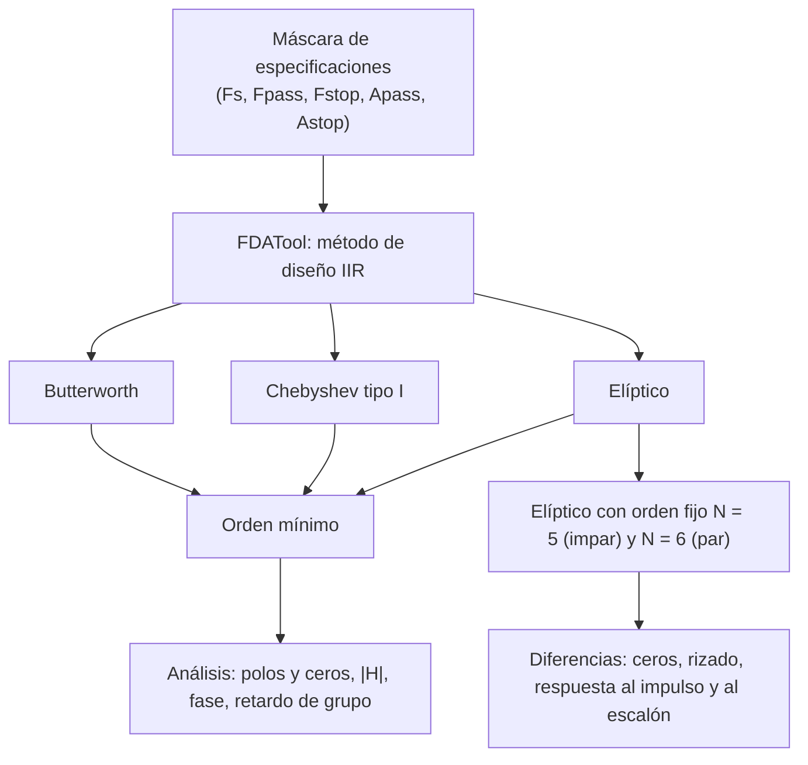

# Práctica 4 — Estudio de filtros digitales mediante FDATool

> **Señales Digitales · Cuaderno de Prácticas** (Grado en Ingeniería de Tecnologías de Telecomunicación, ETSIIT).
>
> Resumen esquemático y completo de la práctica: manejo de FDATool, diseño de un filtro paso bajo con tres aproximaciones IIR, análisis de todas sus respuestas y estudio del filtro elíptico de orden 5 y 6. Todos los números (órdenes, polos, ceros, rizados, retardos de grupo…) se han **calculado y verificado numéricamente**.
>
> Convención: **📝** = ampliación o matiz que no aparece literalmente en el cuaderno. **Respuesta** = respuesta a una pregunta planteada en el cuaderno.

## Índice

1. [Ficha de la práctica](#1-ficha-de-la-práctica)
2. [Mapa conceptual](#2-mapa-conceptual)
3. [Teoría previa: aproximaciones de filtros IIR](#3-teoría-previa-aproximaciones-de-filtros-iir)
4. [FDATool: la herramienta](#4-fdatool-la-herramienta)
5. [Parte 1: diseño del filtro paso bajo con tres aproximaciones](#5-parte-1-diseño-del-filtro-paso-bajo-con-tres-aproximaciones)
6. [Parte 2: filtro elíptico de orden fijo (N=5 y N=6)](#6-parte-2-filtro-elíptico-de-orden-fijo-n5-y-n6)
7. [Réplica por código MATLAB](#7-réplica-por-código-matlab)
8. [Fórmulas y reglas clave](#8-fórmulas-y-reglas-clave)
9. [Autoevaluación](#9-autoevaluación)
10. [Errores típicos](#10-errores-típicos)
11. [Conexión con el resto de la asignatura](#11-conexión-con-el-resto-de-la-asignatura)

---

## 1. Ficha de la práctica

| Campo | Contenido |
|---|---|
| **Duración** | 1 sesión |
| **Herramienta** | **FDATool** (*Filter Design & Analysis Tool*), se ejecuta escribiendo `fdatool` en la ventana de órdenes de MATLAB® |
| **Qué hace FDATool** | Interfaz gráfica que ayuda al **diseño y caracterización** de filtros digitales a partir de sus parámetros de diseño (banda de paso, frecuencia de corte, rizado de la banda de paso, atenuación de la banda de rechazo…) |
| **Cómo funciona** | Ejecuta internamente las **funciones y rutinas de diseño** de la librería de procesado de señal de MATLAB®, simplificando su complejidad |

**Objetivos:**

1. Aprender el **manejo de FDATool** para el diseño y estudio de filtros digitales.
2. Estudiar todos los **parámetros relevantes** de un filtro digital: polos, ceros, respuesta al impulso, respuesta en frecuencia, etc.

**Qué se obtiene al estudiar cada filtro:** respuesta en frecuencia (módulo), respuesta en fase, diagrama de polos y ceros, respuesta al impulso, respuesta al escalón, retardo de grupo…

---

## 2. Mapa conceptual



---

## 3. Teoría previa: aproximaciones de filtros IIR

Un filtro paso bajo ideal (pasa $\omega<\omega_c$ y corta el resto) **no es realizable**. Se aproxima con una **máscara** (tolerancias):

| Parámetro | Significado |
|---|---|
| **Banda de paso** $[0,F_{pass}]$ | Frecuencias que deben pasar; la atenuación **no puede superar** $A_{pass}$ |
| **Banda de transición** $[F_{pass},F_{stop}]$ | Zona de caída |
| **Banda atenuada (de rechazo)** $[F_{stop},F_s/2]$ | Frecuencias a rechazar; la atenuación debe ser **al menos** $A_{stop}$ |

> 📝 **Comparativa de las tres aproximaciones** (para una misma máscara):

| | **Butterworth** | **Chebyshev tipo I** | **Elíptico (Cauer)** |
|---|---|---|---|
| **Banda de paso** | Máximamente plana (monótona) | **Rizado** (equiripple) | **Rizado** (equiripple) |
| **Banda atenuada** | Monótona | Monótona | **Rizado** (equiripple) con ceros de transmisión |
| **Ceros** | Todos en $z=-1$ | Todos en $z=-1$ | **Sobre la circunferencia unidad** (en la banda atenuada) |
| **Selectividad por orden** | La menor | Media | **La mayor** (menor orden para la misma máscara) |
| **Fase / retardo de grupo** | La menos no lineal | Más no lineal | Muy no lineal cerca del borde de la banda de paso |

---

## 4. FDATool: la herramienta

La ventana (Figura 4.1 del cuaderno) se organiza en estos bloques:

| Bloque | Qué contiene |
|---|---|
| **Current Filter Information** | Estructura (*Direct-Form…*), **orden**, estabilidad (*Stable*), origen (*Designed*) |
| **Filter Specifications** | Dibujo de la **máscara** ($A_{pass}$, $A_{stop}$, $F_{pass}$, $F_{stop}$, $F_s/2$) |
| **Response Type** | Lowpass, Highpass, Bandpass, Bandstop, Differentiator |
| **Design Method** | **IIR** (Butterworth, Chebyshev I, Chebyshev II, Elliptic…) o **FIR** (Equiripple, Window…) |
| **Filter Order** | *Specify order* (se fija $N$) o *Minimum order* (orden mínimo que cumple la máscara) |
| **Frequency Specifications** | Unidades (Hz, kHz…), $F_s$, $F_{pass}$, $F_{stop}$ |
| **Magnitude Specifications** | Unidades (dB), $A_{pass}$, $A_{stop}$ |
| **Design Filter** | Botón que calcula el filtro |

**Pasos para la práctica:**

1. `fdatool`.
2. *Response Type*: **Lowpass**. *Design Method*: **IIR** y el tipo que toque (Butterworth / Chebyshev Type I / Elliptic).
3. *Filter Order*: **Minimum order**.
4. *Frequency Specifications*: unidades **kHz**, $F_s=10$, $F_{pass}=2.4$, $F_{stop}=3$.
5. *Magnitude Specifications*: $A_{pass}=1.5$ dB, $A_{stop}=40$ dB.
6. **Design Filter**.
7. Analizar con el menú de análisis (respuesta en magnitud, fase, retardo de grupo, respuesta al impulso, al escalón, diagrama de polos y ceros, información del filtro).

> 📝 Los nombres exactos de los menús pueden variar un poco según la versión de MATLAB®.

---

## 5. Parte 1: diseño del filtro paso bajo con tres aproximaciones

### 5.1 La máscara

| Parámetro | Valor | En frecuencia normalizada |
|---|---|---|
| Frecuencia de muestreo $F_s$ | **10 kHz** | – |
| Frecuencia de corte de la banda de paso $F_{pass}$ | **2.4 kHz** | $f=0.24$ ($\omega=0.48\pi$) |
| Frecuencia de corte de la banda atenuada $F_{stop}$ | **3 kHz** | $f=0.30$ ($\omega=0.6\pi$) |
| Máxima atenuación en la banda de paso $A_{pass}$ | **1.5 dB** | $\lvert H\rvert\ge0.841$ |
| Mínima atenuación en la banda atenuada $A_{stop}$ | **40 dB** | $\lvert H\rvert\le0.01$ |

Banda de transición muy estrecha (600 Hz, el 6 % de $F_s$) con 40 dB de atenuación: es una máscara **exigente**.

### 5.2 ¿Qué filtro tiene el menor orden?

**Respuesta.**

| Aproximación | **Orden mínimo** | Atenuación real en $F_{stop}$ |
|---|:-:|:-:|
| **Butterworth** | **14** | 42.6 dB |
| **Chebyshev tipo I** | **7** | 46.7 dB |
| **Elíptico** | **4** ✅ | 41.9 dB (en la frontera de 40 dB) |

El **filtro elíptico** proporciona el **menor orden** (**4**), seguido de Chebyshev I (7) y, a mucha distancia, Butterworth (14). Todos cumplen la máscara.

> 📝 Es el resultado esperable: a cambio de permitir rizado en la banda de paso y/o atenuada, se consigue mayor selectividad por unidad de orden.

### 5.3 ¿Qué implicaciones tiene que el orden sea cada vez mayor?

**Respuesta.** Un orden mayor implica:

| Aspecto | Efecto |
|---|---|
| **Coste computacional** | Más coeficientes ($\approx2N+1$ multiplicaciones en forma directa) y más operaciones por muestra de salida |
| **Memoria** | Más registros de retardo ($N$) |
| **Retardo** | Mayor **retardo de grupo** y **transitorio más largo** |
| **Sensibilidad numérica** | Polos más próximos entre sí y a la circunferencia unidad: **mayor sensibilidad a la cuantificación de coeficientes** (riesgo de **inestabilidad** o de deformar la respuesta); por eso los filtros de orden alto se implementan en **secciones de segundo orden** (SOS) |
| **Complejidad de diseño/implementación** | Mayor, y mayor coste de hardware o de consumo |

Es decir: lo ideal es el **menor orden que cumpla la máscara**.

### 5.4 Diagrama de polos y ceros

**Respuesta (¿dónde están, cuántos hay y qué implica?):**

| Filtro | Nº polos | Nº ceros | Polos | Ceros |
|---|:-:|:-:|---|---|
| **Butterworth** ($N=14$) | 14 | 14 | **Dentro** de la circunferencia unidad, 7 pares conjugados; radios de 0.06 a 0.89 y ángulos agrupados cerca del borde de la banda de paso (≈ 2.0–2.45 kHz) | **Todos en $z=-1$** (multiplicidad 14) |
| **Chebyshev I** ($N=7$) | 7 | 7 | Dentro; 1 real (radio 0.72) + 3 pares conjugados (radios 0.77, 0.88, 0.96); los más próximos a la circunferencia unidad están en el borde de la banda de paso (≈ 2.4 kHz) | **Todos en $z=-1$** (multiplicidad 7) |
| **Elíptico** ($N=4$) | 4 | 4 | Dentro; 2 pares conjugados (radios 0.61 y 0.915; el segundo, a ≈ 2.4 kHz, **muy cerca de la circunferencia unidad**) | **Sobre la circunferencia unidad**: 2 pares conjugados en $\approx\pm3.07$ kHz y $\pm4.02$ kHz (banda atenuada) |

**Qué implica:** en estos diseños el **número de polos = número de ceros = orden $N$** del filtro (el grado del polinomio del denominador, que fija el orden). Todos los polos están dentro de la circunferencia unidad: **filtros estables**.

### 5.5 Módulo de la respuesta en frecuencia

**Respuesta (efecto de ceros y polos en el módulo):**

| Elemento | Efecto en $\lvert H(\omega)\rvert$ |
|---|---|
| **Ceros** | **Atenúan** en las proximidades de su frecuencia (el módulo tiende a 0). Un cero **sobre la circunferencia unidad** crea un **nulo exacto**; los ceros en $z=-1$ hacen decaer la respuesta hacia $\omega=\pi$ (Butterworth y Cheby I: caída monótona sin nulos intermedios); los ceros del elíptico en la banda atenuada crean **nulos que dan el rizado de rechazo** |
| **Polos** | **Aumentan** el módulo en las proximidades de su ángulo (**picos / resonancias**), tanto más cuanto más cerca de la circunferencia unidad. Los polos cerca del borde de la banda de paso sostienen la banda de paso y definen la pendiente de la caída |

### 5.6 Rizado en la banda de paso

**Respuesta.**

- **Butterworth:** **sin rizado** (respuesta monótona, máximamente plana).
- **Chebyshev I y elíptico:** **rizado** de amplitud $A_{pass}=1.5$ dB (entre 0 y −1.5 dB) en la banda de paso.

**Relación entre extremos del rizado y orden $N$** (verificada): en la banda de paso $[0,F_{pass}]$ la curva toca alternativamente los dos límites del rizado, con

$$\text{nº de extremos interiores (máximos + mínimos)}=N-1\quad\Longleftrightarrow\quad N+1\text{ contando los extremos }0\text{ y }F_{pass}$$

| Filtro | Orden | Extremos interiores observados | Total contando $0$ y $F_{pass}$ |
|---|:-:|:-:|:-:|
| **Chebyshev I** | 7 | **6** (3 máximos + 3 mínimos) | 8 |
| **Elíptico** | 4 | **3** | 5 |

> 📝 Según cómo se cuenten los bordes la regla se enuncia "$N-1$ extremos interiores" o "$N+1$ en total"; en ambos casos **el número de oscilaciones del rizado crece linealmente con el orden**. Además: en los filtros de **orden impar** la banda de paso empieza en un **máximo** (0 dB) y en los de **orden par** en un **mínimo** ($-A_{pass}$).

### 5.7 Fase de la respuesta en frecuencia

**Respuesta.**

- **Efecto de los ceros en la fase:** cada cero $z_k$ aporta a la fase el ángulo $\arg(e^{j\omega}-z_k)$. Un cero **sobre la circunferencia unidad** (módulo 0 a esa frecuencia) provoca un **salto** en la fase; los ceros en $z=-1$ aportan fase lineal suave ($-\omega/2$ cada uno).
- **¿En qué filtro presenta discontinuidades?** En el **elíptico**, cuyos ceros están **sobre la circunferencia unidad** (en $\approx3.07$ kHz y $\approx4.02$ kHz para $N=4$). En Butterworth y Chebyshev I la fase es continua (los ceros están en $z=-1$, en el extremo $\omega=\pi$).
- **Valor del salto:** **$\pi$ rad (180°)**.
- **¿Por qué?** Al cruzar $\omega_0$ (frecuencia del cero) el factor $\left(e^{j\omega}-e^{j\omega_0}\right)$ **cambia de signo** (pasa por 0 en la recta real tras desfasarse): $H(\omega)$ pasa por cero y a continuación aparece con signo contrario, es decir, con **fase invertida (±π)**.

> 📝 Si la gráfica de fase está "envuelta" entre $-\pi$ y $\pi$ aparecen además saltos de $2\pi$ que **no** son discontinuidades reales (artefacto del envuelto); se distinguen porque desaparecen al desenvolver la fase.

### 5.8 Retardo de grupo

**Fórmula:**

$$\boxed{\tau_g(\omega)=-\frac{d\,\varphi(\omega)}{d\omega}}$$

donde $\varphi(\omega)=\arg H(\omega)$. Se mide en **muestras** (o en segundos al dividir por $F_s$).

- Si la fase es **lineal** ($\varphi=-\omega\tau_0$), $\tau_g=\tau_0$ es **constante**: todas las frecuencias se retrasan igual y **no hay distorsión de fase**. Por eso el retardo de grupo sirve para **evaluar la linealidad de la fase**: cuanto más constante, mejor.

**Resultados en la banda de paso** (muestras):

| Filtro | Retardo en continua | Mínimo | Máximo | Variación (máx − mín) | Posición del máximo |
|---|:-:|:-:|:-:|:-:|:-:|
| **Butterworth** ($N=14$) | 9.2 | 9.2 | 35.7 | **26.4** | ≈ 2.45 kHz |
| **Chebyshev I** ($N=7$) | 8.0 | 5.8 | 56.5 | **50.8** | ≈ 2.38 kHz |
| **Elíptico** ($N=4$) | 2.3 | 2.3 | 24.5 | **22.2** | ≈ 2.38 kHz |

**Respuesta (¿cuál es el menos "no lineal"?):** El **Butterworth** es el de comportamiento **más suave** (curva monótona creciente hacia el borde de la banda de paso, sin oscilaciones), mientras que **Chebyshev I** presenta la mayor variación y **oscilaciones** (unidas a su rizado) y el **elíptico** los picos más abruptos en relación con su retardo medio (retardo de 2.3 a 24.5, es decir, multiplicado por ≈ 10). En valor absoluto, el elíptico tiene el menor retardo por ser de orden bajo.

**¿Qué relación hay entre el retardo de grupo y el módulo?** El **retardo de grupo presenta su máximo cerca del borde de la banda de paso / banda de transición**, justo donde el módulo **cae bruscamente** (donde están los polos más cercanos a la circunferencia unidad). Cuanto **más selectivo** es el filtro (caída más rápida), **mayor** es el pico de retardo; y el **rizado del módulo** (Cheby I, elíptico) va acompañado de **oscilaciones del retardo**.

---

## 6. Parte 2: filtro elíptico de orden fijo (N=5 y N=6)

Se elige un filtro **elíptico fijando el orden** en $N=5$ (impar) y $N=6$ (par) con los mismos parámetros ($F_s=10$ kHz, $F_{pass}=2.4$ kHz, $A_{pass}=1.5$ dB, $A_{stop}=40$ dB), pero ahora **$F_{stop}$ lo calcula MATLAB®** (en FDATool: *Specify order*).

| | **N = 5 (impar)** | **N = 6 (par)** |
|---|:-:|:-:|
| **$F_{stop}$ calculada** (40 dB) | **≈ 2.67 kHz** | **≈ 2.53 kHz** |
| **Ganancia en continua** | **0 dB** (1.000) | **−1.5 dB** (0.841) |
| **Nº de polos** | 5 | 6 |
| **Nº de ceros** | 5 | 6 |

### 6.1 Módulo y diagrama de polos y ceros

**Respuesta (diferencias y efecto):**

| | **N = 5 (impar)** | **N = 6 (par)** |
|---|---|---|
| **Polos** | 1 **real** (radio 0.52) + 2 pares conjugados (radios 0.79 y 0.96) | 3 pares conjugados (radios 0.64, 0.90 y 0.98); **ninguno real** |
| **Ceros** | **1 en $z=-1$** + 2 pares conjugados sobre la circunferencia unidad (≈ 2.72 y 3.22 kHz) | 3 pares conjugados sobre la circunferencia unidad (≈ 2.55, 2.79 y 3.86 kHz); **ninguno en $z=-1$** |
| **Rizado en la banda de paso** | Empieza en **máximo** (0 dB) y acaba en el borde con el mínimo (−1.5 dB); 4 extremos interiores | Empieza en **mínimo** (−1.5 dB); 5 extremos interiores |
| **Respuesta en $\omega=\pi$** | **Nula** (cero en $z=-1$) | No nula: la atenuación de rechazo se mantiene en torno a −40 dB (rizado) |
| **Transición** | Más ancha ($F_{stop}\approx2.67$ kHz) | **Más estrecha** ($F_{stop}\approx2.53$ kHz): más orden = más selectividad |

**Efecto en el comportamiento:**

- El orden **impar** garantiza ganancia 1 (0 dB) en continua y un nulo en Nyquist; el **par** tiene ganancia $-A_{pass}$ en continua.
- El orden **par** con el mismo $A_{pass}$ da una transición más aguda, pero con **polos más cerca de la circunferencia unidad** (radio 0.981 frente a 0.960): más resonante, respuesta temporal más larga.

### 6.2 Respuesta al impulso

**Resultados** (umbral de amplitud $\lvert h\rvert>0.03$ en el eje lineal de FDATool):

| | **N = 5** | **N = 6** |
|---|:-:|:-:|
| **Polos dominantes (mayor radio)** | $r=0.960$ a $\omega=0.478\pi$ ($\approx2.39$ kHz) | $r=0.981$ a $\omega=0.479\pi$ ($\approx2.40$ kHz) |
| **Constante de tiempo** $1/(-\ln r)$ | ≈ 24 muestras | ≈ 52 muestras |
| **Tiempo hasta $\lvert h\rvert<0.03$** | $n=16$ → **1.6 ms** | $n=23$ → **2.3 ms** |
| **Cruces por cero hasta ese instante** | 6 (≈ 3 oscilaciones completas) | 9 (≈ 4.5 oscilaciones) |
| **Pico de $h$** | $0.386$ en $n=2$ | $0.366$ en $n=2$ |

> 📝 El enunciado dice "0.03 dB de amplitud"; se ha interpretado como el umbral de **0.03 en la escala de amplitud** del gráfico de FDATool (si fuese en dB equivaldría a un valor mucho más cercano a 1; la comparación entre ambos filtros es cualitativamente la misma).

**Respuesta (relación con la posición de los polos):**

- **Duración del transitorio:** la respuesta natural decae como $r^n$. Cuanto **más cerca de la circunferencia unidad** está el polo dominante (**radio mayor**), **más dura el transitorio**: $N=6$ ($r=0.981$) dura más que $N=5$ ($r=0.960$) y tiene más oscilaciones antes de atenuarse.
- **Rapidez de oscilación:** la fija el **ángulo** de los polos ($\omega_0$): una oscilación por cada $2\pi/\omega_0$ muestras. En ambos filtros el polo dominante tiene prácticamente el mismo ángulo (≈ $0.48\pi$, periodo ≈ 4.2 muestras), por lo que **oscilan a la misma rapidez** (cerca del borde de la banda de paso); la diferencia es el **número** de oscilaciones (la envolvente).

### 6.3 Respuesta al escalón

**Respuesta (valor final y causa):**

| | **N = 5** | **N = 6** |
|---|:-:|:-:|
| **Valor de la salida en régimen permanente** | **1.000** (0 dB) | **0.841** (−1.5 dB) |
| **Sobreoscilación máxima** | 1.093 → ≈ 9 % | 1.086 sobre 0.841 → ≈ 29 % |
| **Tiempo de asentamiento (2 %)** | ≈ 25 muestras | ≈ 28 muestras |

**¿A qué se debe el distinto comportamiento?** Un escalón es una señal en **continua** ($\omega=0$), así que la salida permanente es $\lvert H(\omega=0)\rvert$:

- **$N=5$ (impar):** en continua la respuesta está en un **máximo del rizado** (0 dB) → salida final **1**. En el diagrama de polos y ceros hay un cero en $z=-1$ y un polo real.
- **$N=6$ (par):** en continua la respuesta está en un **mínimo del rizado** ($-A_{pass}=-1.5$ dB) → salida final $10^{-1.5/20}=0.841$. Sin cero en $z=-1$ ni polo real: el patrón de rizado de un elíptico/Chebyshev de orden **par** empieza abajo.

> 📝 Es el mismo resultado de la Práctica 3: $y_{perm}=H(z=1)=\sum b/\sum a$.

---

## 7. Réplica por código MATLAB

FDATool es una interfaz para estas funciones (con la máscara anterior):

```matlab
Fs = 10e3;  Fp = 2.4e3;  Fst = 3e3;  Ap = 1.5;  As = 40;
Wp = Fp/(Fs/2);  Ws = Fst/(Fs/2);                 % frecuencias normalizadas a Fs/2

% ---- Orden mínimo y diseño de las tres aproximaciones ----
[Nb, Wnb] = buttord(Wp, Ws, Ap, As);   [zb, pb, kb] = butter(Nb, Wnb);            % N = 14
[Nc, Wnc] = cheb1ord(Wp, Ws, Ap, As);  [zc, pc, kc] = cheby1(Nc, Ap, Wnc);        % N = 7
[Ne, Wne] = ellipord(Wp, Ws, Ap, As);  [ze, pe, ke] = ellip(Ne, Ap, As, Wne);     % N = 4
% (usar la salida 'zpk' o 'sos' para órdenes altos evita problemas numéricos;
%  [sos,g] = zp2sos(z,p,k) )

% ---- Análisis ----
zplane(ze, pe);                                    % diagrama de polos y ceros
[H, W] = freqz(b, a, 1024);                        % módulo y fase (b, a: coeficientes del filtro)
grpdelay(b, a, 1024);                              % retardo de grupo (muestras)
impz(b, a);                                        % respuesta al impulso
stepz(b, a);                                       % respuesta al escalón

% ---- Elíptico con orden fijo ----
[b5, a5] = ellip(5, Ap, As, Wp);                   % N = 5
[b6, a6] = ellip(6, Ap, As, Wp);                   % N = 6
```

> 📝 En el código, `Wp` ya está normalizada a $F_s/2$ (rango 0–1 donde 1 equivale a $\pi$). Atención: con órdenes altos como el Butterworth de orden 14, la forma $[b,a]$ puede ser numéricamente inestable; FDATool trabaja con **secciones de segundo orden** (SOS).

---

## 8. Fórmulas y reglas clave

| Concepto | Expresión / regla |
|---|---|
| **Máscara** | $A_{pass}$ (máx. en paso), $A_{stop}$ (mín. en rechazo), $F_{pass}$, $F_{stop}$, $F_s$ |
| **Frecuencia normalizada** | $f=F/F_s$, $\;\omega=2\pi F/F_s$; en MATLAB $W=F/(F_s/2)$ |
| **Orden mínimo** | Elíptico < Chebyshev I < Butterworth (para la misma máscara) |
| **Nº de polos y ceros** | $N$ polos y $N$ ceros para un filtro de orden $N$ |
| **Ceros** | Butterworth y Cheby I: en $z=-1$; elíptico: sobre la circunferencia unidad |
| **Rizado** | Extremos interiores en la banda de paso $=N-1$ (Cheby I, elíptico) |
| **Retardo de grupo** | $\tau_g=-d\varphi/d\omega$ |
| **Fase lineal** | $\tau_g$ constante $\Leftrightarrow$ sin distorsión de fase |
| **Ganancia en continua** | Orden impar (elíptico/Cheby I): $0$ dB; orden par: $-A_{pass}$ |
| **Escalón en régimen permanente** | $\lvert H(0)\rvert$ |
| **Transitorio** | Dura más cuanto más cerca de $\lvert z\rvert=1$ está el polo dominante ($r^n$) |
| **Oscilación de $h(n)$** | Frecuencia = ángulo de los polos dominantes |

---

## 9. Autoevaluación

<details>
<summary><b>1. ¿Qué orden necesita cada aproximación para la máscara de la práctica?</b></summary>

Butterworth 14, Chebyshev I 7, elíptico 4.
</details>

<details>
<summary><b>2. ¿Por qué el elíptico tiene el menor orden?</b></summary>

Permite rizado tanto en la banda de paso como en la de rechazo (ceros de transmisión sobre la circunferencia unidad), lo que da la caída más abrupta por unidad de orden.
</details>

<details>
<summary><b>3. ¿Qué inconvenientes tiene aumentar el orden?</b></summary>

Más coste computacional y memoria, mayor retardo y transitorio, y mayor sensibilidad a la cuantificación de coeficientes (riesgo de inestabilidad).
</details>

<details>
<summary><b>4. ¿Dónde están los ceros de Butterworth, Chebyshev I y elíptico?</b></summary>

Butterworth y Chebyshev I: todos en $z=-1$; elíptico: sobre la circunferencia unidad en la banda atenuada.
</details>

<details>
<summary><b>5. ¿Qué efecto tienen los polos y los ceros en el módulo?</b></summary>

Los ceros atenúan (nulos); los polos elevan la respuesta (picos), más cuanto más cerca de la circunferencia unidad.
</details>

<details>
<summary><b>6. ¿Cuántos extremos interiores tiene el rizado de un filtro de orden $N$ en la banda de paso?</b></summary>

$N-1$ ($N+1$ contando los extremos $0$ y $F_{pass}$).
</details>

<details>
<summary><b>7. ¿Qué filtro presenta discontinuidades de fase y de qué valor?</b></summary>

El elíptico (ceros sobre la circunferencia unidad), de $\pi$ rad (180°), por el cambio de signo de $H$ al pasar por el cero.
</details>

<details>
<summary><b>8. Escribe la fórmula del retardo de grupo y su interpretación.</b></summary>

$\tau_g=-d\varphi/d\omega$; constante ⇒ fase lineal ⇒ sin distorsión de fase.
</details>

<details>
<summary><b>9. ¿Por qué el escalón de un elíptico $N=5$ acaba en 1 y el de $N=6$ en 0.841?</b></summary>

Porque la salida permanente es $\lvert H(0)\rvert$: en orden impar la respuesta empieza en un máximo del rizado (0 dB) y en orden par en un mínimo ($-1.5$ dB $=0.841$).
</details>

<details>
<summary><b>10. ¿Cómo influye la posición de los polos en la respuesta al impulso?</b></summary>

El radio (cercanía a $\lvert z\rvert=1$) fija la duración del transitorio ($r^n$); el ángulo fija la rapidez de oscilación.
</details>

---

## 10. Errores típicos

- Interpretar las **frecuencias de la máscara** en Hz sin comprobar las unidades ($F_s$ en kHz, $F_{pass}$ y $F_{stop}$ en kHz) en FDATool.
- Elegir *Specify order* en lugar de *Minimum order* en la primera parte (o al revés en la segunda).
- Confundir **orden** con número de **polos y ceros**: ambos coinciden con el orden $N$.
- Esperar rizado en Butterworth o en la banda atenuada de Chebyshev I.
- Tomar los **saltos de $2\pi$** de una fase envuelta por discontinuidades reales (solo los de $\pi$ en los ceros de la circunferencia unidad lo son).
- Olvidar que en orden **par** la ganancia en continua es $-A_{pass}$ (y no 0 dB).
- No comparar a igualdad de criterio (por ejemplo, el umbral de amplitud) los transitorios de dos filtros.

---

## 11. Conexión con el resto de la asignatura

| Práctica / Tema | Relación |
|---|---|
| **Práctica 3 (sistemas LIT)** | Las mismas herramientas (polos y ceros, `freqz`, respuestas al impulso/escalón); aquí se aplican a filtros diseñados |
| **Tema 2 (transformada Z)** | Polos y ceros determinan estabilidad y respuesta; estabilidad ⇔ polos dentro de la circunferencia unidad |
| **Tema 3 (DTFT)** | La respuesta en frecuencia es $H(z)$ evaluada en $z=e^{j\omega}$ |
| **Práctica 5 (filtrado digital)** | Diseño de filtros FIR e IIR (paso banda) y su uso en una señal de audio real |
