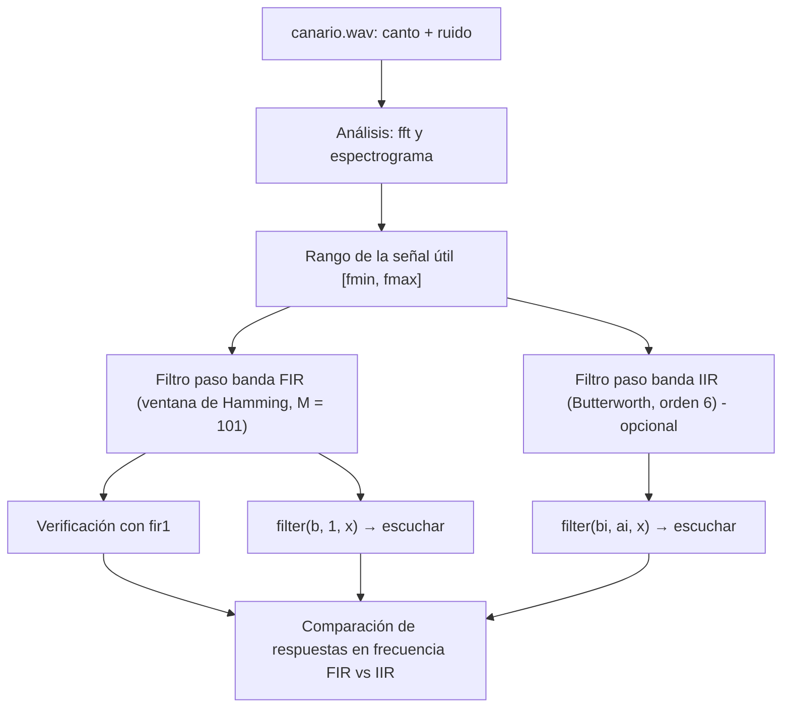

# Práctica 5 — Filtrado digital

> **Señales Digitales · Cuaderno de Prácticas** (Grado en Ingeniería de Tecnologías de Telecomunicación, ETSIIT).
>
> Resumen esquemático y completo de la práctica: análisis de una señal de audio real (espectro y espectrograma), diseño de un filtro **FIR paso banda por ventanas** (a mano y con `fir1`), diseño opcional de un **IIR Butterworth paso banda** y comparación entre ambos.
>
> Convención: **📝** = ampliación o matiz que no aparece literalmente en el cuaderno. **Respuesta** = respuesta a una pregunta planteada en el cuaderno.
>
> ⚠️ **Importante:** esta práctica trabaja sobre `canario.wav`, un archivo que no se incluye en el material que he podido leer. Por tanto, los **valores concretos** ($F_s$, $[f_{min},f_{max}]$ de la señal, lo que se oye) los obtienes tú al ejecutar el código. Aquí tienes el procedimiento completo, el código para obtenerlos y las respuestas **conceptuales**. Las cifras de los apartados de diseño (comparaciones FIR/IIR) se han verificado numéricamente con una **banda de ejemplo ilustrativa** ($f_{min}=0.10$, $f_{max}=0.25$ ciclos/muestra), que **no** corresponde al canario.

## Índice

1. [Ficha de la práctica](#1-ficha-de-la-práctica)
2. [Mapa conceptual](#2-mapa-conceptual)
3. [Teoría previa](#3-teoría-previa)
4. [Realización guiada 1: la señal de audio](#4-realización-guiada-1-la-señal-de-audio)
5. [Realización guiada 2: diseño del filtro FIR](#5-realización-guiada-2-diseño-del-filtro-fir)
6. [Realización guiada 3 (opcional): diseño del filtro IIR](#6-realización-guiada-3-opcional-diseño-del-filtro-iir)
7. [Comparación FIR frente a IIR](#7-comparación-fir-frente-a-iir)
8. [Fórmulas y reglas clave](#8-fórmulas-y-reglas-clave)
9. [Autoevaluación](#9-autoevaluación)
10. [Errores típicos](#10-errores-típicos)
11. [Conexión con el resto de la asignatura](#11-conexión-con-el-resto-de-la-asignatura)

---

## 1. Ficha de la práctica

| Campo | Contenido |
|---|---|
| **Duración** | 1 sesión |
| **Material** | MATLAB® (o Octave), **auriculares** |
| **Archivo proporcionado** | `canario.wav`: audio del canto de un canario registrado con **ruido de ambiente** |
| **Funciones MATLAB usadas** | `wavread` (o `audioread`), `sound`, `fft`, `subplot`, `spectrogram`, `hamming`, `freqz`, `fir1`, `filter`, `butter` |

**Objetivos:**

1. Estudiar el **diseño de filtros FIR e IIR**.
2. Emplear dichos filtros para el **filtrado de una señal de audio real**.

**Planteamiento:** la señal de canario tiene componentes frecuenciales **útiles (el canto)** en un rango de frecuencias determinado; el resto corresponde al **ruido de ambiente**. Por ello, un **filtrado paso banda** reduce de forma considerable el ruido.

---

## 2. Mapa conceptual



---

## 3. Teoría previa

### 3.1 Filtros selectivos en frecuencia: FIR frente a IIR

Los sistemas **LIT** pueden funcionar como **filtros selectivos en frecuencia**:

| | **FIR** (respuesta impulsiva finita) | **IIR** (respuesta impulsiva infinita) |
|---|---|---|
| **Implementación** | Mediante **convolución** con $b(n)$ | **Ecuación en diferencias recursiva** |
| **Función MATLAB** | `filter(b, 1, x)` (o `conv`) | `filter(b, a, x)` |
| **Estabilidad** | Siempre estable (no hay polos salvo en $z=0$) | Depende de los polos |
| **Fase** | Puede ser **exactamente lineal** | No lineal |
| **Orden necesario** | Alto | Bajo |

### 3.2 FIR por el método de las ventanas

Los coeficientes del filtro se obtienen como

$$\boxed{b(n)=w(n)\,h_d(n),\qquad0\le n\le M-1}$$

- $w(n)$: **ventana** de longitud $M$ (se emplea la de **Hamming**).
- $h_d(n)$: **respuesta impulsiva ideal** del filtro (transformada de Fourier inversa de la respuesta en frecuencia ideal).

> 📝 **Por qué hace falta la ventana:** la respuesta ideal es de **duración infinita** (tipo $\sin(n\omega_c)/n$); truncarla de golpe (ventana rectangular) produce un fuerte rizado (fenómeno de Gibbs); la ventana de Hamming la suaviza.
>
> | Ventana de Hamming de longitud $M$ | |
> |---|---|
> | Expresión | $w(n)=0.54-0.46\cos\!\left(\dfrac{2\pi n}{M-1}\right)$, $0\le n\le M-1$ |
> | Anchura de transición aprox. | $\Delta\omega\approx\dfrac{6.6\pi}{M}$ (≈ 0.033 ciclos/muestra para $M=101$) |
> | Atenuación mínima en rechazo | ≈ 53 dB |

### 3.3 Respuesta impulsiva ideal de un filtro paso banda

Un paso banda ideal con banda $[\omega_{min},\omega_{max}]$ es la **diferencia de dos pasos bajos ideales** (de cortes $\omega_{max}$ y $\omega_{min}$). Con cada paso bajo ideal $\frac{\omega_c}{\pi}\frac{\sin n\omega_c}{n\omega_c}$ resulta:

$$\boxed{h_d(n)=\begin{cases}\dfrac{\omega_{max}}{\pi}\dfrac{\sin(n\omega_{max})}{n\omega_{max}}-\dfrac{\omega_{min}}{\pi}\dfrac{\sin(n\omega_{min})}{n\omega_{min}}&n\ne0\\[3mm]\dfrac{\omega_{max}-\omega_{min}}{\pi}&n=0\end{cases}}\qquad(5.1)$$

> 📝 Simplificando: para $n\ne0$, $h_d(n)=\dfrac{\sin(n\omega_{max})-\sin(n\omega_{min})}{n\pi}$. El valor en $n=0$ es el **límite** de la expresión ($\sin x/x\to1$).

Se calcula para $n=-\frac{M-1}{2},\dots,\frac{M-1}{2}$ (con $M=101$: $n=-50,\dots,50$), es decir, **simétrica respecto al origen** ($h_d(-n)=h_d(n)$). Tras multiplicar por la ventana, $b(n)$ conserva la **simetría**, lo que da **fase exactamente lineal** con un retardo constante de $\frac{M-1}{2}=50$ muestras.

### 3.4 IIR por transformación bilineal

Para el filtro IIR se parte de un **filtro analógico de Butterworth paso banda** y se convierte en digital mediante la **transformación bilineal**:

$$s=\frac{2}{T}\,\frac{1-z^{-1}}{1+z^{-1}}\qquad\Longrightarrow\qquad\Omega=\frac{2}{T}\tan\frac{\omega}{2}$$

La función `butter()` realiza el diseño analógico y la transformación.

> 📝 La relación $\Omega\leftrightarrow\omega$ no es lineal (**alabeo de frecuencias**) y comprime el eje de frecuencias analógico en $(-\pi,\pi)$; `butter` precompensa las frecuencias de corte. La bilineal **mantiene la estabilidad** (el semiplano izquierdo se transforma en el interior de la circunferencia unidad).

### 3.5 Espectrograma

El **espectrograma** muestra cómo **evoluciona el contenido en frecuencias de una señal con el tiempo**:

1. Se toman **segmentos cortos** de la señal.
2. A cada uno se le calcula la **DFT**.
3. Se muestra solo la **magnitud (en dB)** mediante **colores** en una imagen: ejes = tiempo y frecuencia; **fríos = magnitud pequeña**, **cálidos = valor alto**.

> 📝 Es una **transformada de Fourier de tiempo corto (STFT)**. Compromiso: segmentos más cortos dan mejor resolución temporal pero peor resolución en frecuencia.

---

## 4. Realización guiada 1: la señal de audio

### 4.1 Cargar, identificar $F_s$ y reproducir

```matlab
[x, Fs] = audioread('canario.wav');     % en el cuaderno: wavread('canario.wav')
x = x(:,1);                             % si el archivo es estéreo, un solo canal
sound(x, Fs);                           % reproducir
```

`Fs` es la **frecuencia de muestreo** del archivo (valor que devuelve la función, se anota al ejecutar).

> 📝 `wavread` es la función antigua de MATLAB; en versiones recientes se usa `audioread` (devuelve la señal y $F_s$ igual). `sound` reproduce **sin normalizar** (la señal debe estar entre −1 y 1; `soundsc` la escala).

### 4.2 Dominio del tiempo y de la frecuencia

**Enunciado:** crear el **vector de tiempo** (a partir de $F_s$) y el vector de **frecuencia normalizada**; aplicar `fft` y visualizar con `subplot` la secuencia temporal y el **módulo** de su transformada.

```matlab
N = length(x);
t = (0:N-1)/Fs;                         % t = nT
f = (0:N-1)/N;                          % frecuencia normalizada (ciclos/muestra), 0..1
X = fft(x);

subplot(2,1,1);  plot(t, x);              xlabel('t (s)');                 ylabel('x(t)');
subplot(2,1,2);  plot(f(1:floor(N/2)), abs(X(1:floor(N/2))));
                 xlabel('f (ciclos/muestra)');  ylabel('|X(f)|');
```

> 📝 La `fft` devuelve $N$ muestras de la DTFT en $f=k/N$, $k=0,\dots,N-1$. Para señal real el espectro es **simétrico** (la segunda mitad $f\in[0.5,1)$ equivale a frecuencias negativas), así que basta con $0\le f\le0.5$ ($0$ a $F_s/2$).
>
> Conversión: $F=f\cdot F_s$ (Hz), $\omega=2\pi f$ (rad/muestra).

### 4.3 Identificar el rango de frecuencias de la señal

**Enunciado:** ¿Puedes identificar el rango de frecuencias de la señal y distinguirlo del ruido? Indica $[f_{min},f_{max}]$ y $[F_{min},F_{max}]$.

**Respuesta (procedimiento):**

1. En el módulo de la FFT, el **canto** aparece como una **zona con energía claramente superior** al "suelo" de ruido (que se extiende de forma más uniforme por todo el espectro).
2. Se leen los extremos de esa zona: $[f_{min},f_{max}]$ (ciclos/muestra).
3. Se pasan a Hz con la frecuencia de muestreo: $\boxed{F=f\,F_s}$, es decir, $[F_{min},F_{max}]=[f_{min}F_s,\;f_{max}F_s]$.
4. Para el diseño: $\omega_{min}=2\pi f_{min}$, $\omega_{max}=2\pi f_{max}$.

Ayuda opcional para estimar los extremos (criterio **propio**; conviene confirmarlo mirando la gráfica):

```matlab
mag = abs(X(1:floor(N/2)));    fh = f(1:floor(N/2));
idx = find(mag > 0.1*max(mag));              % umbral del 10 % del máximo (ajustable)
fmin = fh(idx(1));   fmax = fh(idx(end));    % ciclos/muestra
Fmin = fmin*Fs;      Fmax = fmax*Fs;         % Hz
wmin = 2*pi*fmin;    wmax = 2*pi*fmax;       % rad/muestra
```

### 4.4 Espectrograma

**Enunciado:** estudiar `spectrogram()` y aplicarla con: segmentos de **64** muestras, **48** muestras solapadas, **64** puntos en frecuencia.

```matlab
spectrogram(x, 64, 48, 64, Fs);          % ventana 64, solape 48, nfft 64
% spectrogram(x, 64, 48, 64, Fs, 'yaxis')  → tiempo en el eje horizontal
```

| Parámetro | Valor | Consecuencia |
|---|:-:|---|
| Longitud del segmento | 64 muestras | Resolución temporal ≈ $64/F_s$ s |
| Solape | 48 muestras | Desplazamiento entre segmentos = $64-48=16$ muestras ($16/F_s$ s) |
| Puntos en frecuencia (`nfft`) | 64 | Resolución en frecuencia $F_s/64$ |

**Resultado esperado (según el cuaderno):** se **identifica la señal de audio** en el espectrograma: **ahora se distingue muy bien la señal del resto del ruido**, y el contenido en frecuencia del canto se sitúa en el **rango determinado previamente** ($[F_{min},F_{max}]$). Los **colores cálidos** marcan el canto (trinos/notas que evolucionan con el tiempo) y los **fríos** el ruido de fondo.

> 📝 Ventaja frente a la FFT global: la FFT solo dice *qué* frecuencias hay en toda la señal; el espectrograma dice *cuándo* aparece cada una.

---

## 5. Realización guiada 2: diseño del filtro FIR

Filtro FIR de **fase lineal paso banda**, diseñado por **ventanas**, con **101 coeficientes** y ventana de **Hamming**.

### 5.1 Pasos

| Paso | Qué hacer |
|---|---|
| 1 | Identificar las **frecuencias angulares de corte** $[\omega_{min},\omega_{max}]=2\pi[f_{min},f_{max}]$ |
| 2 | Generar $h_d(n)$ para $M=101$ muestras ($n=-50,\dots,50$) con la ecuación (5.1) |
| 3 | Multiplicar por una ventana de Hamming de igual longitud: $b(n)=w(n)h_d(n)$ (función `hamming()`) |
| 4 | Obtener la respuesta en frecuencia $H_{FIR}(\omega)$ con `freqz()` |

### 5.2 Código

```matlab
M  = 101;
n  = -(M-1)/2 : (M-1)/2;                        % -50 ... 50
hd = zeros(1, M);
nz = (n ~= 0);
hd(nz)  = (wmax/pi)*sin(n(nz)*wmax)./(n(nz)*wmax) ...
        - (wmin/pi)*sin(n(nz)*wmin)./(n(nz)*wmin);
hd(~nz) = (wmax - wmin)/pi;                      % límite en n = 0

w = hamming(M).';                                % hamming devuelve columna → traspuesta
b = w .* hd;                                     % coeficientes del filtro FIR

[H, W] = freqz(b, 1, 1024);                      % respuesta en frecuencia (0..π)

figure;
subplot(2,1,1);  stem(0:M-1, b);               xlabel('n');            title('Respuesta impulsiva b(n)');
subplot(2,1,2);  plot(W/pi, abs(H));             xlabel('\omega/\pi');   title('|H_{FIR}(\omega)|');
```

### 5.3 Qué se espera ver

- **$b(n)$:** señal **simétrica** respecto a $n=50$ (en $0\le n\le100$), oscilante, con amplitud máxima en el centro y que se atenúa hacia los extremos por la ventana.
- **$\lvert H_{FIR}(\omega)\rvert$:** **paso banda** con ganancia ≈ 1 (0 dB) entre $\omega_{min}$ y $\omega_{max}$, **≈ 0.5 (−6 dB)** justo en los bordes de corte, y gran atenuación fuera de la banda.

Con la banda de ejemplo ($f_{min}=0.10$, $f_{max}=0.25$), se verifica:

| Propiedad | Valor |
|---|---|
| Simetría de $b(n)$ | Sí (fase lineal) |
| Retardo de grupo | **50 muestras** (constante) |
| Ganancia en los bordes $f_{min}$, $f_{max}$ | **−6.0 dB** |
| Rizado en la banda de paso | ≈ 0.013 dB |
| Atenuación fuera de banda (más allá de la transición) | ≈ −53 dB o mejor |

### 5.4 Verificación con `fir1`

**Enunciado:** calcular la respuesta impulsiva con `fir1()` (diseño automático por ventanas), obtener su respuesta en frecuencia, superponerla a la propia. ¿Son idénticos?

```matlab
b2 = fir1(M-1, 2*[fmin fmax]);                   % orden M-1 = 100; Hamming por defecto
[H2, W2] = freqz(b2, 1, 1024);

figure;  plot(W/pi, abs(H), W2/pi, abs(H2), '--');
legend('Diseño propio', 'fir1');
max(abs(b - b2))                                 % diferencia entre coeficientes
```

> 📝 **Atención a los argumentos de `fir1`:**
> - El primer argumento es el **orden** ($=M-1=100$, no 101).
> - `Wn` se da **normalizado a la frecuencia de Nyquist** (1 ↔ $F_s/2$), es decir, **$2f$**, no $f$: de ahí `2*[fmin fmax]`.
> - Con dos frecuencias, `fir1` diseña por defecto un **paso banda** con ventana de **Hamming**.

**Respuesta (¿son idénticos?):** **Prácticamente sí.** Las dos respuestas en frecuencia se superponen y son indistinguibles. La única diferencia es un **pequeño factor de escala**: `fir1` **normaliza** los coeficientes para que la ganancia en el centro de la banda de paso sea exactamente 1 (0 dB). En el ejemplo, el factor es 0.99994 y la diferencia máxima entre coeficientes es del orden de $10^{-5}$ (con `fir1(...,'noscale')` coinciden hasta el error numérico).

### 5.5 Filtrar la señal de audio

```matlab
y = filter(b, 1, x);                             % filtrado FIR
sound(y, Fs);
% (opcional) compensar el retardo de 50 muestras:  y = y(51:end);
```

**Enunciado:** ¿qué diferencias percibes con respecto a la señal original?

**Respuesta (esperable; hay que comprobarla con el archivo):**

| Aspecto | Observación esperada |
|---|---|
| **Ruido de ambiente** | **Reducción considerable**: el fondo suena mucho más limpio, pues se eliminan las componentes fuera de $[F_{min},F_{max}]$ |
| **Canto del canario** | Se conserva (queda en la banda de paso), con el mismo timbre esencial |
| **Posible pérdida** | Si había contenido útil (armónicos graves/agudos) fuera de la banda, suena algo "más apagado/estrecho" |
| **Retardo** | La salida se retrasa 50 muestras ($50/F_s$ s, imperceptible) por la fase lineal |
| **Ruido dentro de la banda** | No se elimina: el ruido que coincide en frecuencia con el canto permanece |

---

## 6. Realización guiada 3 (opcional): diseño del filtro IIR

### 6.1 Diseño con `butter`

**Enunciado:** diseñar el IIR paso banda con `butter()`, cortes $[f_{min},f_{max}]$, **orden 6**; representar $\lvert H_{IIR}(\omega)\rvert$.

```matlab
[bi, ai] = butter(3, 2*[fmin fmax]);             % paso banda: orden total = 2·3 = 6
[Hi, Wi] = freqz(bi, ai, 1024);
plot(Wi/pi, abs(Hi));  xlabel('\omega/\pi');  title('|H_{IIR}(\omega)|');
```

> 📝 **Detalle de `butter`:** para un **paso banda** (`Wn` de dos elementos) el **orden $n$ que se pasa se duplica**: `butter(3, Wn)` devuelve un filtro de **orden 6** (7 coeficientes en $b$ y 7 en $a$); `butter(6, Wn)` devolvería un filtro de **orden 12**. Si en las instrucciones del laboratorio se usó `butter(6,...)`, el orden resultante es 12. Como el enunciado pide "orden 6", aquí se usa $n=3$.

Con la banda de ejemplo: ganancia en los bordes ≈ **−3 dB**, en el centro 0 dB, y caída gradual (≈ −21 dB a 0.04 ciclos/muestra por debajo de $f_{min}$ y ≈ −11.5 dB a 0.04 por encima de $f_{max}$; asimétrica por el alabeo de la bilineal).

### 6.2 Filtrado

```matlab
yi = filter(bi, ai, x);
sound(yi, Fs);
```

**Enunciado:** ¿qué diferencias percibes respecto a la señal original y a la filtrada con el FIR?

**Respuesta (esperable):**

- **Frente a la original:** también se **reduce el ruido** de ambiente, pero de forma **menos drástica** si la caída del IIR (orden 6) es más suave que la del FIR de 101 coeficientes (queda algo más de ruido cerca de los bordes de la banda).
- **Frente al FIR:** tras un IIR de orden bajo la señal puede sonar ligeramente **distinta (fase no lineal)**: los diferentes componentes del canto se retrasan de forma distinta (retardo de grupo variable: 7.6 a 16.9 muestras en la banda de ejemplo, frente a los 50 **constantes** del FIR), lo que suaviza o "colorea" los ataques. A cambio, es un filtro **mucho más barato**.

---

## 7. Comparación FIR frente a IIR

**Enunciado:** representar en una misma gráfica $\lvert H_{IIR}(\omega)\rvert$ y $\lvert H_{FIR}(\omega)\rvert$ y explicar las diferencias.

```matlab
figure;
plot(W/pi, abs(H), Wi/pi, abs(Hi));
legend('FIR (101 coef., Hamming)', 'IIR (Butterworth, orden 6)');
xlabel('\omega/\pi');  ylabel('|H(\omega)|');
```

| Característica | **FIR** (Hamming, $M=101$) | **IIR** (Butterworth, orden 6) |
|---|---|---|
| **Nº de coeficientes** | **101** | **13** (7 + 6, con $a_0=1$) |
| **Coste computacional** | Alto (≈ 101 multiplicaciones por muestra; 51 aprovechando la simetría) | **Bajo** (≈ 13) |
| **Retardo de grupo** | **Constante: 50 muestras** (fase lineal) | **Variable** (7.6–16.9 muestras en la banda de ejemplo) |
| **Fase** | **Lineal** (sin distorsión de fase) | **No lineal** |
| **Banda de paso** | Casi plana (rizado ≈ 0.013 dB) | **Máximamente plana** (sin rizado) |
| **Ganancia en los bordes** | **−6 dB** | **−3 dB** |
| **Transición / rechazo** | Muy selectivo (≈ −53 dB a 0.04 de la banda) | Más gradual (≈ −11 a −21 dB a 0.04 de la banda) |
| **Estabilidad** | **Siempre estable** | Estable por diseño (polos dentro del círculo) |
| **Estructura** | No recursiva | Recursiva (realimentación) |
| **Simetría** | Banda de paso simétrica (en frecuencia lineal) | Asimétrica (alabeo de la bilineal) |

**Respuesta (resumen):** el **FIR** consigue una banda de paso casi plana, fase lineal y mucho mayor atenuación fuera de banda, a costa de **muchos más coeficientes** (cálculo y retardo). El **IIR** logra una respuesta aceptable con **muy pocos coeficientes** (bajo coste), pero con **fase no lineal** y una caída más suave. Para audio donde importa la fidelidad temporal, suele preferirse el FIR; con recursos limitados, el IIR.

---

## 8. Fórmulas y reglas clave

| Concepto | Expresión |
|---|---|
| **Frecuencias** | $F=f\,F_s$, $\;\omega=2\pi f$ |
| **FIR por ventanas** | $b(n)=w(n)h_d(n)$, $0\le n\le M-1$ |
| **Paso banda ideal** | $h_d(n)=\dfrac{\sin n\omega_{max}-\sin n\omega_{min}}{n\pi}$ $(n\ne0)$; $\;h_d(0)=\dfrac{\omega_{max}-\omega_{min}}{\pi}$ |
| **Ventana de Hamming** | $w(n)=0.54-0.46\cos\frac{2\pi n}{M-1}$ |
| **Retardo de un FIR simétrico** | $\dfrac{M-1}{2}$ muestras |
| **`fir1`** | `fir1(orden, 2*[fmin fmax])` (Wn normalizado a Nyquist) |
| **Filtrado FIR / IIR** | `filter(b,1,x)` / `filter(b,a,x)` |
| **Transformación bilineal** | $s=\frac{2}{T}\frac{1-z^{-1}}{1+z^{-1}}$, $\;\Omega=\frac{2}{T}\tan\frac{\omega}{2}$ |
| **`butter` paso banda** | Orden resultante $=2n$ |
| **Espectrograma** | STFT: DFT de segmentos cortos; colores = magnitud en dB |
| **`spectrogram(x,64,48,64,Fs)`** | Ventana 64, solape 48 (paso 16), nfft 64 |

---

## 9. Autoevaluación

<details>
<summary><b>1. ¿Para qué sirve el espectrograma y cómo se calcula?</b></summary>

Para ver cómo evoluciona el contenido en frecuencia a lo largo del tiempo: se divide la señal en segmentos cortos, se calcula la DFT de cada uno y se muestra el módulo (dB) como color.
</details>

<details>
<summary><b>2. ¿Cómo se pasa de frecuencia normalizada a Hz y a rad/muestra?</b></summary>

$F=fF_s$ y $\omega=2\pi f$.
</details>

<details>
<summary><b>3. ¿Cómo se obtienen los coeficientes de un FIR por ventanas?</b></summary>

$b(n)=w(n)h_d(n)$, con $h_d$ la respuesta impulsiva ideal (de $-\frac{M-1}{2}$ a $\frac{M-1}{2}$) y $w$ la ventana (Hamming).
</details>

<details>
<summary><b>4. ¿Por qué se resta en la ecuación (5.1) y qué vale $h_d(0)$?</b></summary>

El paso banda es la diferencia de dos pasos bajos (cortes $\omega_{max}$ y $\omega_{min}$); $h_d(0)=(\omega_{max}-\omega_{min})/\pi$.
</details>

<details>
<summary><b>5. ¿Qué retardo introduce el FIR de 101 coeficientes y por qué es constante?</b></summary>

50 muestras; los coeficientes son simétricos y eso da fase lineal.
</details>

<details>
<summary><b>6. ¿Por qué se pasa <code>2*[fmin fmax]</code> a <code>fir1</code>?</b></summary>

Porque `fir1` normaliza respecto a $F_s/2$ (Nyquist), no a $F_s$.
</details>

<details>
<summary><b>7. ¿Son idénticos el filtro propio y el de <code>fir1</code>?</b></summary>

Prácticamente: `fir1` solo añade un escalado para que la ganancia en el centro de la banda sea 1.
</details>

<details>
<summary><b>8. ¿Qué orden devuelve <code>butter(3,[w1 w2])</code>?</b></summary>

Orden 6 (en un paso banda el orden se duplica).
</details>

<details>
<summary><b>9. ¿Qué ventajas e inconvenientes tiene el IIR frente al FIR?</b></summary>

Mucho menos coste (13 frente a 101 coeficientes), pero fase no lineal y caída más suave.
</details>

<details>
<summary><b>10. ¿Cuánto vale la ganancia en el borde de la banda en cada filtro?</b></summary>

FIR por ventanas: ≈ −6 dB; Butterworth: −3 dB.
</details>

---

## 10. Errores típicos

- **`fir1` con $f$ en lugar de $2f$** (o con frecuencias en Hz sin normalizar).
- **Orden de `fir1`:** pasar $M$ (101) en vez de $M-1$ (100).
- **`butter(6,...)` para paso banda** y obtener un filtro de orden 12.
- **Olvidar la traspuesta de `hamming(M)`** (devuelve columna) al multiplicar por `hd` fila.
- Dividir por $n=0$ al evaluar (5.1) (producirá `NaN`): tratar $n=0$ aparte.
- Usar `wavread` en versiones nuevas (usar `audioread`).
- Reproducir con `sound` una señal fuera del rango $[-1,1]$ (saturación): usar `soundsc` o normalizar.
- **Confundir los ejes del espectrograma** (por defecto la frecuencia va en el eje horizontal y el tiempo en el vertical, como indica el cuaderno; la opción `'yaxis'` los intercambia).
- Representar la FFT completa $0..1$ y creer que hay dos bandas de señal (la segunda mitad es la simétrica).
- No tener en cuenta el **retardo** del FIR al comparar señal original y filtrada.

---

## 11. Conexión con el resto de la asignatura

| Práctica / Tema | Relación |
|---|---|
| **Práctica 2 (convolución)** | El FIR se implementa con la convolución $y=x*b$ |
| **Práctica 3 (sistemas LIT)** | `filter(b,a,x)` implementa la ecuación en diferencias; respuesta en frecuencia con `freqz` |
| **Práctica 4 (FDATool)** | El mismo diseño (FIR por ventanas, Butterworth) se puede hacer con FDATool; análisis de fase lineal y retardo de grupo |
| **Tema 3 (DTFT/DFT)** | La `fft` calcula la DFT; el espectrograma es una DFT de tiempo corto; el enventanado deforma el espectro por convolución |
| **Tema 2 (transformada Z)** | Un FIR solo tiene polos en $z=0$ (siempre estable); en un IIR la estabilidad depende de los polos |
