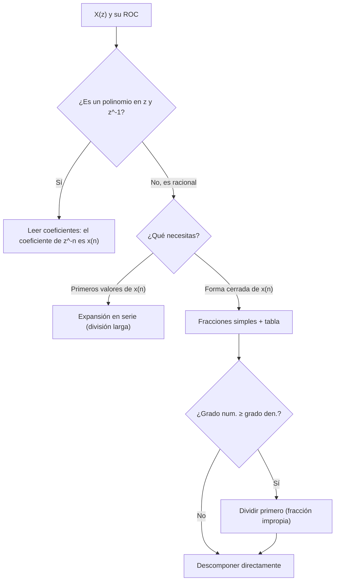

# Transformada Z

> **Señales Digitales · Tema 2** — Resumen esquemático con teoría, propiedades, tablas y ejercicios resueltos.
>
> Las fórmulas están escritas en LaTeX (GitHub las renderiza automáticamente). En los apartados marcados con 📝 se añaden matices o ampliaciones que no aparecen literalmente en las diapositivas.

## Índice

1. [Definición](#1-definición)
2. [Ejemplos de cálculo](#2-ejemplos-de-cálculo)
3. [Región de convergencia (ROC)](#3-región-de-convergencia-roc)
4. [Propiedades](#4-propiedades)
5. [Transformadas Z relevantes](#5-transformadas-z-relevantes)
6. [Transformadas racionales](#6-transformadas-racionales)
7. [Transformada Z inversa](#7-transformada-z-inversa)
8. [Transformada Z unilateral](#8-transformada-z-unilateral)
9. [Ejercicios del tema (T2.1 – T2.8) resueltos](#9-ejercicios-del-tema-t21--t28-resueltos)
10. [Errores típicos](#10-errores-típicos)

---

## 1. Definición

La transformada Z es a las señales **discretas** lo que la transformada de Laplace es a las **analógicas**.

$$X(z)=\sum_{n=-\infty}^{+\infty}x(n)\,z^{-n}$$

- $z$ es un **número complejo**: $z=r\,e^{j\theta}$ (módulo $r$, fase $\theta$).
- Al ser una **suma infinita**, la T.Z. no tiene por qué converger para cualquier $z$. El conjunto de puntos $z$ donde sí converge es la **región de convergencia (ROC)**.
- Notación: $x(n)\;\overset{\mathcal{Z}}{\longleftrightarrow}\;X(z)$.

> 📝 **Relación con otras transformadas**
> - **Laplace** ($z=e^{sT}$): el eje imaginario del plano $s$ se transforma en la **circunferencia unidad** del plano $z$, y el semiplano izquierdo en el **interior** de dicha circunferencia.
> - **Fourier de tiempo discreto**: $X(e^{j\omega})=X(z)\big|_{z=e^{j\omega}}$, y existe cuando la ROC **contiene la circunferencia unidad** $\lvert z\rvert=1$.

---

## 2. Ejemplos de cálculo

### 2.1 Señal finita

Se lee directamente: cada muestra $x(n)$ multiplica a $z^{-n}$.

$$x(n)=\{3,-1,\underset{\uparrow}{10},-5,8,0,-1\}\qquad(\uparrow\;\text{indica}\;n=0)$$

| $n$ | −2 | −1 | 0 | 1 | 2 | 3 | 4 |
|:---:|:--:|:--:|:-:|:-:|:-:|:-:|:-:|
| $x(n)$ | 3 | −1 | 10 | −5 | 8 | 0 | −1 |

$$X(z)=3z^{2}-z+10-5z^{-1}+8z^{-2}-z^{-4}$$

(la muestra nula en $n=3$ no aporta término).

### 2.2 Señal infinita causal (Ejercicios T2.1 y T2.2)

$$x(n)=a^{n}u(n)\qquad(\lvert a\rvert<1)$$

Se usa la **suma geométrica**:

$$\sum_{n=M}^{N}a^{n}=\frac{a^{M}-a^{N+1}}{1-a}$$

$$X(z)=\sum_{n=-\infty}^{\infty}a^{n}u(n)z^{-n}=\sum_{n=0}^{\infty}a^{n}z^{-n}=\sum_{n=0}^{\infty}\left(az^{-1}\right)^{n}\quad\text{converge si}\;\left\lvert\frac{a}{z}\right\rvert<1$$

$$\boxed{X(z)=\frac{1}{1-az^{-1}}=\frac{z}{z-a}\qquad ROC:\ \lvert z\rvert>\lvert a\rvert}$$

> 📝 La condición $\lvert a\rvert<1$ de la diapositiva garantiza una señal decreciente (y que la ROC contenga la circunferencia unidad), pero la fórmula es válida para cualquier $a$ con $\lvert z\rvert>\lvert a\rvert$.

### 2.3 Señal infinita anticausal: la ROC importa

$$x(n)=-b^{n}u(-n-1)=\begin{cases}0 & n\ge 0\\-b^{n} & n<0\end{cases}\qquad(\lvert b\rvert>1)$$

Con el cambio $m=-n$:

$$X(z)=-\sum_{n=-\infty}^{-1}b^{n}z^{-n}=-\sum_{m=1}^{\infty}\left(b^{-1}z\right)^{m}=-\frac{b^{-1}z}{1-b^{-1}z}=\frac{z}{z-b}=\frac{1}{1-bz^{-1}}$$

$$\boxed{ROC:\ \lvert z\rvert<\lvert b\rvert}$$

> ⚠️ **Idea fundamental:** la T.Z. queda determinada **tanto por su expresión como por su ROC**. Las señales $a^{n}u(n)$ y $-a^{n}u(-n-1)$ tienen la **misma expresión** $\frac{1}{1-az^{-1}}$ pero **distinta ROC**, y por tanto son señales distintas.

---

## 3. Región de convergencia (ROC)

### 3.1 Por tipo de secuencia

| Tipo de secuencia | ROC | Forma geométrica |
|---|---|---|
| **Longitud finita** | $0<\lvert z\rvert<\infty$ | Todo el plano (salvo, quizá, $z=0$ y/o $z=\infty$) |
| **Longitud infinita** (si converge) | $R_1<\lvert z\rvert<R_2$ | Determinada por **radios** |
| **Causal** ($x(n)=0$ para $n<0$) | $\lvert z\rvert>R$ | **Exterior** de una circunferencia |
| **Anticausal** ($x(n)=0$ para $n\ge 0$) | $\lvert z\rvert<R$ | **Interior** de una circunferencia |
| **Bilateral** | $R_1<\lvert z\rvert<R_2$ | **Anillo** |

> 📝 **Finitas, casos concretos:** si hay muestras en $n>0$ aparecen potencias $z^{-n}$, que no están definidas en $z=0$ (se excluye el origen); si hay muestras en $n<0$ aparecen potencias positivas de $z$, que no están definidas en $z=\infty$. Así, una finita causal tiene ROC $\lvert z\rvert>0$ y una finita anticausal $\lvert z\rvert<\infty$. Ejemplo: $\delta(n-m)\leftrightarrow z^{-m}$, con ROC todo $z$ salvo $0$ (si $m>0$) o $\infty$ (si $m<0$).

### 3.2 ¿Por qué la ROC se define con radios?

Con $z=re^{j\theta}$:

$$X(z)=\sum_{n=-\infty}^{\infty}x(n)z^{-n}=\sum_{n=-\infty}^{\infty}x(n)\,r^{-n}e^{-j\theta n}\qquad\Rightarrow\qquad\left\lvert X(z)\right\rvert\le\sum_{n=-\infty}^{\infty}\lvert x(n)\rvert\,r^{-n}$$

La cota solo depende de $r=\lvert z\rvert$, no de $\theta$. Por tanto, si converge para un punto, converge para **toda la circunferencia** de ese radio: la ROC está formada por **circunferencias concéntricas** (discos, exteriores de disco o anillos).

> 📝 En la diapositiva la desigualdad se escribe sin valores absolutos; el criterio correcto utiliza $\lvert x(n)\rvert$.

### 3.3 Causales, anticausales y bilaterales

Se trabaja con la serie en $r$:

- **Bilaterales:** se separa en dos mitades, que deben converger **ambas**:
  $$\sum_{n=-\infty}^{\infty}x(n)r^{-n}=\sum_{n=-\infty}^{-1}x(n)r^{-n}+\sum_{n=0}^{\infty}x(n)r^{-n}$$
- **Causales:** solo existe la parte $n\ge 0$:
  $$\sum_{n=0}^{\infty}x(n)r^{-n}=\sum_{n=0}^{\infty}\frac{x(n)}{r^{n}}\qquad\Rightarrow\qquad ROC:\ \lvert z\rvert>R$$
  (la serie converge para $r$ **grande**).
- **Anticausales:** solo existe la parte $n<0$:
  $$\sum_{n=-\infty}^{-1}x(n)r^{-n}=\sum_{n=1}^{\infty}x(-n)\,r^{n}\qquad\Rightarrow\qquad ROC:\ \lvert z\rvert<R$$
  (la serie converge para $r$ **pequeño**).

### 3.4 Resumen visual

| Señal | Plano $z$ (ROC sombreada) |
|---|---|
| **Causal** | Exterior de la circunferencia de radio $r_1$ (el disco de radio $r_1$ queda excluido) |
| **Anticausal** | Interior de la circunferencia de radio $r_2$ (disco de radio $r_2$) |
| **Bilateral** | Anillo entre $r_1$ y $r_2$ ($r_1<\lvert z\rvert<r_2$) |

> 📝 **La ROC nunca contiene polos** (la transformada diverge en ellos). Por eso en las racionales sus fronteras están marcadas por los polos (apartado 6.5).

---

## 4. Propiedades

| Propiedad | Dominio temporal ↔ dominio Z | ROC |
|---|---|---|
| **Linealidad** | $a\,x_1(n)+b\,x_2(n)\;\leftrightarrow\;a\,X_1(z)+b\,X_2(z)$ | $ROC_{x_1}\cap ROC_{x_2}$ |
| **Desplazamiento temporal** | $x(n-n_0)\;\leftrightarrow\;z^{-n_0}X(z)$ | $ROC_x$ |
| **Inversión temporal** | $x(-n)\;\leftrightarrow\;X(1/z)$ | $ROC=1/ROC_x$, es decir, $R'_{min}=1/R_{max}$ y $R'_{max}=1/R_{min}$ |
| **Convolución** | $x(n)*y(n)\;\leftrightarrow\;X(z)Y(z)$ | $ROC_x\cap ROC_y$ |
| **Escalado** | $a^{n}x(n)\;\leftrightarrow\;X(z/a)$ | $ROC=\lvert a\rvert\,ROC_x$, es decir, $R'_{min}=\lvert a\rvert R_{min}$ y $R'_{max}=\lvert a\rvert R_{max}$ |
| **Correlación** | $r_{xy}(l)=x(-l)*y(l)\;\leftrightarrow\;R_{xy}(z)=X(z^{-1})Y(z)$ | $ROC_x\cap ROC_y$ (ver nota) |
| **Diferenciación** | $n\,x(n)\;\leftrightarrow\;-z\,X'(z)$ | $ROC_x$ |

**Teoremas (solo señales causales):**

| Teorema | Expresión |
|---|---|
| **Valor inicial** | $\displaystyle x(0)=\lim_{z\to\infty}X(z)$ |
| **Valor final** | $\displaystyle\lim_{n\to\infty}x(n)=\lim_{z\to 1}\frac{z-1}{z}\,X(z)$ |

> 📝 **Matices**
> - En linealidad y convolución la ROC es **al menos** la intersección; puede ser mayor si hay cancelaciones polo-cero.
> - En el desplazamiento, la ROC puede perder o ganar los puntos $z=0$ o $z=\infty$.
> - En la correlación, como aparece $X(z^{-1})$, estrictamente la ROC es $\left(1/ROC_x\right)\cap ROC_y$ (aplicando la inversión temporal).
> - El teorema del valor final solo es válido si el límite **existe**: todos los polos de $X(z)$ deben estar dentro de la circunferencia unidad, admitiendo como mucho un polo simple en $z=1$. El factor $\frac{z-1}{z}=1-z^{-1}$ cancela precisamente ese polo.

**Ejemplos de uso de las propiedades:**

- *Escalado:* como $u(n)\leftrightarrow\frac{1}{1-z^{-1}}$, entonces $a^{n}u(n)\leftrightarrow\frac{1}{1-(z/a)^{-1}}=\frac{1}{1-az^{-1}}$, con ROC $\lvert z\rvert>\lvert a\rvert$.
- *Diferenciación:* $n\,a^{n}u(n)\leftrightarrow -z\frac{d}{dz}\frac{1}{1-az^{-1}}=\frac{az^{-1}}{(1-az^{-1})^{2}}$.

---

## 5. Transformadas Z relevantes

Las filas marcadas con ⭐ son las resaltadas en rojo en las diapositivas (las que conviene saber de memoria).

| # | Secuencia | Transformada | ROC |
|:-:|---|---|---|
| 1 ⭐ | $\delta[n]$ | $1$ | Todo $z$ |
| 2 ⭐ | $u[n]$ | $\dfrac{1}{1-z^{-1}}$ | $\lvert z\rvert>1$ |
| 3 | $-u[-n-1]$ | $\dfrac{1}{1-z^{-1}}$ | $\lvert z\rvert<1$ |
| 4 | $\delta[n-m]$ | $z^{-m}$ | Todo $z$ salvo $0$ (si $m>0$) o $\infty$ (si $m<0$) |
| 5 ⭐ | $a^{n}u[n]$ | $\dfrac{1}{1-az^{-1}}$ | $\lvert z\rvert>\lvert a\rvert$ |
| 6 | $-a^{n}u[-n-1]$ | $\dfrac{1}{1-az^{-1}}$ | $\lvert z\rvert<\lvert a\rvert$ |
| 7 ⭐ | $n\,a^{n}u[n]$ | $\dfrac{az^{-1}}{(1-az^{-1})^{2}}$ | $\lvert z\rvert>\lvert a\rvert$ |
| 8 | $-n\,a^{n}u[-n-1]$ | $\dfrac{az^{-1}}{(1-az^{-1})^{2}}$ | $\lvert z\rvert<\lvert a\rvert$ |
| 9 | $\cos(\omega_0 n)\,u[n]$ | $\dfrac{1-\cos\omega_0\,z^{-1}}{1-2\cos\omega_0\,z^{-1}+z^{-2}}$ | $\lvert z\rvert>1$ |
| 10 | $\sin(\omega_0 n)\,u[n]$ | $\dfrac{\sin\omega_0\,z^{-1}}{1-2\cos\omega_0\,z^{-1}+z^{-2}}$ | $\lvert z\rvert>1$ |
| 11 ⭐ | $r^{n}\cos(\omega_0 n)\,u[n]$ | $\dfrac{1-r\cos\omega_0\,z^{-1}}{1-2r\cos\omega_0\,z^{-1}+r^{2}z^{-2}}$ | $\lvert z\rvert>r$ |
| 12 | $r^{n}\sin(\omega_0 n)\,u[n]$ | $\dfrac{r\sin\omega_0\,z^{-1}}{1-2r\cos\omega_0\,z^{-1}+r^{2}z^{-2}}$ | $\lvert z\rvert>r$ |
| 13 | $\begin{cases}a^{n}&0\le n\le N-1\\0&\text{resto}\end{cases}$ | $\dfrac{1-a^{N}z^{-N}}{1-az^{-1}}$ | $\lvert z\rvert>0$ |

> 📝 Truco útil: $\dfrac{1}{(1-az^{-1})^{2}}\;\leftrightarrow\;(n+1)\,a^{n}u(n)$ (para ROC $\lvert z\rvert>\lvert a\rvert$). Se obtiene sumando las filas 5 y 7: $\frac{az^{-1}}{(1-az^{-1})^{2}}+\frac{1}{1-az^{-1}}=\frac{1}{(1-az^{-1})^{2}}$.

---

## 6. Transformadas racionales

### 6.1 Definición

Una transformada **racional** es la que tiene forma de **división entre dos polinomios en $z^{-1}$**:

$$X(z)=\frac{B(z)}{A(z)}=\frac{b_0+b_1z^{-1}+b_2z^{-2}+\dots+b_Mz^{-M}}{a_0+a_1z^{-1}+a_2z^{-2}+\dots+a_Nz^{-N}}=\frac{\sum_{k=0}^{M}b_kz^{-k}}{\sum_{k=0}^{N}a_kz^{-k}}$$

La transformada del escalón unitario, $\frac{1}{1-z^{-1}}$, es un ejemplo sencillo de transformada racional.

### 6.2 Notación alternativa en $z$

Trabajar con polinomios en $z^{-1}$ puede resultar confuso. Sacando factor común $b_0z^{-M}$ y $a_0z^{-N}$ se obtiene una notación en $z$ más clara:

$$X(z)=\frac{b_0}{a_0}\cdot z^{-M+N}\cdot\frac{z^{M}+(b_1/b_0)z^{M-1}+(b_2/b_0)z^{M-2}+\dots+(b_M/b_0)}{z^{N}+(a_1/a_0)z^{N-1}+(a_2/a_0)z^{N-2}+\dots+(a_N/a_0)}$$

Y ambos polinomios se pueden expresar por sus **raíces**:

$$\prod_{k=1}^{M}(z-z_k)=z^{M}+\frac{b_1}{b_0}z^{M-1}+\dots+\frac{b_M}{b_0}\qquad\qquad\prod_{k=1}^{N}(z-p_k)=z^{N}+\frac{a_1}{a_0}z^{N-1}+\dots+\frac{a_N}{a_0}$$

### 6.3 Polos y ceros

| | Qué son | Comportamiento | Cantidad |
|---|---|---|---|
| **Ceros** $z_k$ | Raíces del **numerador** | Si $z$ se acerca a un cero, $X(z)\to 0$ | Grado del numerador ($M$) |
| **Polos** $p_k$ | Raíces del **denominador** | Si $z$ se acerca a un polo, $X(z)\to\infty$ | Grado del denominador ($N$) |

> 📝 El factor $z^{-M+N}$ añade $N-M$ ceros en $z=0$ (si $N>M$) o $M-N$ polos en $z=0$ (si $M>N$).

### 6.4 Expresión unívoca: ganancia + polos + ceros

La transformada racional queda expresada **unívocamente** por una **ganancia** $G$ junto a sus polos y ceros:

$$X(z)=G\cdot z^{-M+N}\cdot\frac{\prod_{k=1}^{M}(z-z_k)}{\prod_{k=1}^{N}(z-p_k)}$$

O, en una formulación más propia de $z^{-1}$ (con $G=b_0/a_0$):

$$X(z)=G\cdot\frac{\prod_{k=1}^{M}\left(1-z_kz^{-1}\right)}{\prod_{k=1}^{N}\left(1-p_kz^{-1}\right)}$$

> 📝 En la diapositiva 17 el producto del denominador aparece con límite $M$; el correcto es $N$ (el de la diapositiva 22).

### 6.5 Diagrama de polos y ceros

Las transformadas racionales se pueden representar gráficamente en el plano $z$ (con la circunferencia unidad como referencia):

- **✕** → polos
- **○** → ceros

### 6.6 Relevancia de los polos

Los polos suelen tener **más relevancia** que los ceros porque:

1. Determinan la **estabilidad**.
2. Determinan la **ROC**.

**Estabilidad** (ejemplo $x(n)=a^{n}u(n)$, $X(z)=\frac{1}{1-az^{-1}}$, ROC $\lvert z\rvert>a$). Posición del polo $z=a$ y comportamiento de la señal causal:

| Polo $a$ | Comportamiento de $x(n)$ | ¿Estable? |
|---|---|---|
| $0<a<1$ | Decrece exponencialmente | ✅ |
| $-1<a<0$ | Decrece alternando signo | ✅ |
| $a=1$ | Constante | ❌ (marginal) |
| $a=-1$ | Constante alternando signo | ❌ (marginal) |
| $a>1$ | Crece exponencialmente | ❌ |
| $a<-1$ | Crece alternando signo | ❌ |

> 📝 **Criterio general:** una señal/sistema **causal** es estable si y solo si **todos sus polos están dentro de la circunferencia unidad**, es decir, si la ROC contiene la circunferencia unidad. Los polos complejos conjugados producen oscilaciones cuya envolvente evoluciona como $\lvert p\rvert^{n}$.

### 6.7 ROC de una función racional con $N$ polos $p_k$

| Señal | ROC | Con |
|---|---|---|
| **Causal** | $\lvert z\rvert>p_{max}$ | $p_{max}=\max_k\lvert p_k\rvert$ (polo de mayor módulo) |
| **Anticausal** | $\lvert z\rvert<p_{min}$ | $p_{min}=\min_k\lvert p_k\rvert$ (polo de menor módulo) |
| **Bilateral** | Según la diapositiva, su ROC estará vacía | Ver nota |

> 📝 **Nota sobre el caso bilateral:** al ser la ROC la intersección de las ROC de cada factor, para una señal bilateral con transformada racional se tiene un **anillo** delimitado por polos (si existe) o, si las condiciones son incompatibles (p. ej. $\lvert z\rvert>2$ y $\lvert z\rvert<1$), una ROC vacía. Conviene recordarlo con el criterio de tu profesor.

### 6.8 ¿Por qué es así?

Cada factor $\frac{1}{1-p_kz^{-1}}$ es una transformada elemental con su propia ROC, y el producto de transformadas tiene como ROC la **intersección**:

$$X_1(z)\cdot X_2(z)\;\Longrightarrow\;ROC_1\cap ROC_2$$

Si todos los factores son causales, la intersección de los exteriores $\lvert z\rvert>\lvert p_k\rvert$ es $\lvert z\rvert>p_{max}$; si todos son anticausales, la de los interiores es $\lvert z\rvert<p_{min}$.

---

## 7. Transformada Z inversa

### 7.1 Definición general

Se obtiene con el **teorema integral de Cauchy** (contorno cerrado dentro de la ROC, recorrido en sentido antihorario):

$$x(n)=\frac{1}{2\pi j}\oint X(z)\,z^{n-1}\,dz$$

Afortunadamente, **rara vez** se emplea esta expresión.

### 7.2 Métodos habituales

Interesan especialmente dos casos:

1. **Polinomios** (inversión directa).
2. **Transformadas racionales**: **expansión en serie de términos** o **expansión en fracciones simples**.

### 7.3 Inversión de polinomios

El coeficiente que multiplica a $z^{-n}$ es $x(n)$:

$$X(z)=3z^{2}-z+10-5z^{-1}+8z^{-2}-z^{-4}\quad\Longrightarrow\quad x(n)=\{3,-1,\underset{\uparrow}{10},-5,8,0,-1\}$$

(el término $0\cdot z^{-3}$ no aparece, pero la muestra en $n=3$ vale $0$).

### 7.4 Expansión en serie de términos

Es **trivial**, aunque no suele dar forma cerrada:

1. **En base a la ROC**, se decide si la señal es causal (exterior de círculo), anticausal (interior de círculo) o bilateral (anillo).
2. Se **reordenan** los polinomios en consecuencia:
   - **Causal:** potencias de $1$ a $z^{-n}$ (**ascendentes en $z^{-1}$**).
   - **Anticausal:** potencias de $z^{-n}$ a $1$ (**ascendentes en $z$**).
3. Se **dividen** ambos polinomios (división larga).

⚠️ **Inconveniente:** salvo excepciones, no se obtiene una **forma cerrada** del cociente (hay que identificar el patrón).

> 📝 **Misma $X(z)$, distinta ROC, distinta señal.** Para $X(z)=\dfrac{z}{z-a}$:
> - Si $\lvert z\rvert>a$ (causal): $\;\dfrac{1}{1-az^{-1}}=1+az^{-1}+a^{2}z^{-2}+\dots\;\Rightarrow\;x(n)=a^{n}u(n)$.
> - Si $\lvert z\rvert<a$ (anticausal): $\;\dfrac{z}{z-a}=\dfrac{-z/a}{1-z/a}=-\left[\tfrac{z}{a}+\left(\tfrac{z}{a}\right)^{2}+\dots\right]\;\Rightarrow\;x(n)=-a^{n}u(-n-1)$.

### 7.5 Expansión en fracciones simples

**Bases:**

1. Se comprueba si es **divisible** (fracción **impropia**).
2. Si lo es, se **divide** y la función racional se convierte en **propia**.
3. La fracción propia se **descompone en fracciones simples**.
4. Cada fracción simple se **busca en la tabla** (apartado 5) y se invierte.
5. Aprovechando la **linealidad**, se compone la transformada inversa.

#### a) Fracción propia e impropia

**Propia:** el orden del numerador es **inferior** al del denominador ($M<N$, con $a_N\ne 0$):

$$X(z)=\frac{b_0+b_1z^{-1}+\dots+b_Mz^{-M}}{a_0+a_1z^{-1}+\dots+a_Nz^{-N}}$$

Si **no** lo cumple, se descompone:

$$X(z)=\frac{N(z)}{D(z)}=c_0+c_1z^{-1}+\dots+c_{M-N}\,z^{-(M-N)}+\frac{N_1(z)}{D(z)}$$

donde $N_1(z)/D(z)$ ya es propia.

> 📝 La diapositiva indica "grado num. > grado den.", pero el caso $M=N$ también requiere división (da una constante $c_0$). Ver ejercicio T2.7.

#### b) Polos de multiplicidad uno

$$X(z)=\frac{A_1}{z-p_1}+\frac{A_2}{z-p_2}+\dots+\frac{A_N}{z-p_N}$$

Para un polo cualquiera $p_k$, se multiplica por $(z-p_k)$:

$$(z-p_k)X(z)=(z-p_k)\frac{A_1}{z-p_1}+\dots+\cancel{(z-p_k)}\frac{A_k}{\cancel{z-p_k}}+\dots+(z-p_k)\frac{A_N}{z-p_N}$$

y se evalúa en $z=p_k$ (todos los demás sumandos se anulan):

$$\boxed{A_k=\left.(z-p_k)X(z)\right|_{z=p_k}}$$

#### c) Polos de multiplicidad mayor que uno

Si $p_k$ tiene multiplicidad $l$:

$$X(z)=\frac{A_1}{z-p_1}+\dots+\frac{A_{k1}}{z-p_k}+\frac{A_{k2}}{(z-p_k)^{2}}+\dots+\frac{A_{kl}}{(z-p_k)^{l}}+\dots+\frac{A_N}{z-p_N}$$

$$\boxed{A_{kj}=\frac{1}{(l-j)!}\left.\frac{d^{\,l-j}\left[(z-p_k)^{l}X(z)\right]}{dz^{\,l-j}}\right|_{z=p_k}}$$

> 📝 **Consejo práctico:** como la tabla está escrita en $z^{-1}$, suele ser más cómodo descomponer directamente en fracciones del tipo $\frac{A}{1-pz^{-1}}$ y $\frac{A}{(1-pz^{-1})^{2}}$ (así se leen directamente de las filas 5 y 7, y del truco $(n+1)a^{n}u(n)$). Si se usa la forma $\frac{A_k}{z-p_k}=\frac{A_kz^{-1}}{1-p_kz^{-1}}$, la inversa causal es $A_k\,p_k^{\,n-1}u(n-1)$ (por el desplazamiento temporal).
>
> Cada fracción se invierte con **la ROC** (causal: $\lvert z\rvert>\lvert p_k\rvert$; anticausal: $\lvert z\rvert<\lvert p_k\rvert$).

---

## 8. Transformada Z unilateral

Es una modificación de la T.Z. con una definición prácticamente idéntica, salvo por los **extremos de la sumatoria**:

$$X^{+}(z)=\sum_{n=\mathbf{0}}^{\infty}x(n)\,z^{-n}$$

**Características:**

- **No contiene información** acerca de la señal para **índices negativos**.
- Es **única para señales causales**.
- Es **equivalente a la T.Z. de** $x(n)u(n)$.

> 📝 Es la herramienta natural para resolver **ecuaciones en diferencias con condiciones iniciales**. Su ROC siempre es el exterior de una circunferencia.

### 8.1 Propiedades

Cumple **TODAS** las propiedades de la T.Z. **EXCEPTO**:

- **Inversión temporal** (carece de sentido).
- **Desplazamiento temporal** (**¡OJO!**).

### 8.2 Desplazamiento temporal en la unilateral

$$x(n-n_0)\;\leftrightarrow\;z^{-n_0}\left[X^{+}(z)+\sum_{n=1}^{n_0}x(-n)\,z^{n}\right]\qquad(n_0>0)$$

$$x(n+n_0)\;\leftrightarrow\;z^{n_0}\left[X^{+}(z)-\sum_{n=0}^{n_0-1}x(n)\,z^{-n}\right]\qquad(n_0>0)$$

La descripción matemática es **mucho más enrevesada que la realidad**. Se explica con la señal bilateral de ejemplo (la unilateral solo "ve" la ventana $n\ge 0$):

| Desplazamiento | Qué ocurre | Resultado |
|---|---|---|
| **Retardo** $x(n-n_0)$ (a la derecha) | Entran en la ventana $n\ge 0$ las **$n_0$ muestras de índices negativos** $x(-n_0),\dots,x(-1)$ (zona roja) | $X^{+}(z)z^{-n_0}+x(-n_0)+\dots+x(-1)z^{-n_0+1}$ |
| **Adelanto** $x(n+n_0)$ (a la izquierda) | **Salen** de la ventana las **$n_0$ primeras muestras** $x(0),\dots,x(n_0-1)$ (zona roja tachada con una X) | $X^{+}(z)z^{n_0}-x(n_0-1)z-\dots-x(0)z^{n_0}$ |

> 📝 Si la señal es causal, $x(-n)=0$ y el retardo se reduce a $z^{-n_0}X^{+}(z)$ (igual que en la bilateral). El adelanto **siempre** requiere restar las muestras que salen.

---

## 9. Ejercicios del tema (T2.1 – T2.8) resueltos

### T2.1 y T2.2 — Transformada Z y ROC de $a^{n}u(n)$

Resueltos en el apartado [2.2](#22-señal-infinita-causal-ejercicios-t21-y-t22):
$X(z)=\frac{1}{1-az^{-1}}=\frac{z}{z-a}$, con ROC $\lvert z\rvert>\lvert a\rvert$ (la serie geométrica converge si $\lvert a/z\rvert<1$).

---

### T2.3 — Demuestre los teoremas del valor inicial y del valor final

**Valor inicial** (señal causal). Al ser causal, $x(n)=0$ para $n<0$:

$$X(z)=x(0)+x(1)z^{-1}+x(2)z^{-2}+\dots$$

Cuando $z\to\infty$, todos los términos $z^{-n}$ con $n\ge 1$ tienden a $0$:

$$\boxed{x(0)=\lim_{z\to\infty}X(z)}$$

**Valor final** (señal causal, $x(-1)=0$). Se considera la señal diferencia $x(n)-x(n-1)$, cuya transformada es $(1-z^{-1})X(z)$:

$$(1-z^{-1})X(z)=\sum_{n=0}^{\infty}\left[x(n)-x(n-1)\right]z^{-n}$$

Se toma el límite $z\to 1$ y la suma **telescópica** (se cancelan los términos intermedios):

$$\lim_{z\to 1}(1-z^{-1})X(z)=\lim_{N\to\infty}\sum_{n=0}^{N}\left[x(n)-x(n-1)\right]=\lim_{N\to\infty}\left[x(N)-x(-1)\right]=\lim_{N\to\infty}x(N)$$

Como $1-z^{-1}=\frac{z-1}{z}$:

$$\boxed{\lim_{n\to\infty}x(n)=\lim_{z\to 1}\frac{z-1}{z}X(z)}\qquad\text{(si el límite existe)}$$

---

### T2.4 — Transformada Z y ROC de $x(n)=\cos(\omega_0 n)\,u(n)$

Por Euler, $\cos(\omega_0 n)=\tfrac{1}{2}\left(e^{j\omega_0 n}+e^{-j\omega_0 n}\right)$. Cada exponencial es del tipo $a^{n}u(n)$ con $a=e^{\pm j\omega_0}$ ($\lvert a\rvert=1$):

$$X(z)=\frac{1}{2}\left[\frac{1}{1-e^{j\omega_0}z^{-1}}+\frac{1}{1-e^{-j\omega_0}z^{-1}}\right]=\frac{1}{2}\cdot\frac{2-2\cos\omega_0\,z^{-1}}{1-2\cos\omega_0\,z^{-1}+z^{-2}}$$

$$\boxed{X(z)=\frac{1-\cos\omega_0\,z^{-1}}{1-2\cos\omega_0\,z^{-1}+z^{-2}}\qquad ROC:\ \lvert z\rvert>1}$$

(coincide con la fila 9 de la tabla). La ROC es la intersección de dos ROC iguales, $\lvert z\rvert>1$.

- **Polos:** $z=e^{\pm j\omega_0}$ (sobre la circunferencia unidad).
- **Ceros:** $z=0$ y $z=\cos\omega_0$.

---

### T2.5 — Transformada Z, ROC y diagrama de polos y ceros

$$x(n)=\begin{cases}a^{n}&0\le n\le M-1\\0&\text{resto}\end{cases}\qquad a>0$$

Señal finita; se aplica la suma geométrica (fila 13 de la tabla):

$$X(z)=\sum_{n=0}^{M-1}\left(az^{-1}\right)^{n}=\frac{1-a^{M}z^{-M}}{1-az^{-1}}=\frac{z^{M}-a^{M}}{z^{M-1}\,(z-a)}$$

**ROC:** $\lvert z\rvert>0$ (señal finita causal: todo el plano salvo el origen).

**Polos y ceros:**

- **Ceros:** $z^{M}=a^{M}\Rightarrow z_k=a\,e^{j2\pi k/M}$, con $k=0,1,\dots,M-1$ ($M$ puntos equiespaciados sobre una circunferencia de radio $a$).
- **Polos:** $z=a$ y $z=0$ (con multiplicidad $M-1$).
- El cero $k=0$ ($z=a$) **cancela** el polo $z=a$.

Resultado: **$M-1$ ceros** ($k=1,\dots,M-1$) y **un polo de multiplicidad $M-1$ en el origen** (coherente con un polinomio de grado $M-1$ en $z^{-1}$).

**Particularizado para $M=8$:** 7 ceros en $z_k=a\,e^{j\pi k/4}$ y un polo de multiplicidad 7 en $z=0$.

| $k$ | 1 | 2 | 3 | 4 | 5 | 6 | 7 |
|:-:|:-:|:-:|:-:|:-:|:-:|:-:|:-:|
| Cero $z_k$ | $a\,e^{j\pi/4}$ | $ja$ | $a\,e^{j3\pi/4}$ | $-a$ | $a\,e^{j5\pi/4}$ | $-ja$ | $a\,e^{j7\pi/4}$ |

En el diagrama: 7 círculos (○) equiespaciados 45° sobre la circunferencia de radio $a$ (faltando el punto $z=a$, ángulo 0°) y una cruz (✕, multiplicidad 7) en el origen.

---

### T2.6 — Inversa por expansión en serie

$$X(z)=\frac{z}{z-a}\qquad ROC:\ \lvert z\rvert>a,\quad 0<a<1$$

La ROC es el exterior de un círculo, luego $x(n)$ es **causal** y se ordena en potencias crecientes de $z^{-1}$:

$$X(z)=\frac{1}{1-az^{-1}}=1+az^{-1}+a^{2}z^{-2}+a^{3}z^{-3}+\dots$$

$$x(n)=\{1,a,a^{2},a^{3},\dots\}\qquad\Rightarrow\qquad\boxed{x(n)=a^{n}u(n)}$$

(la forma cerrada se identifica por el patrón de los coeficientes; coincide con la fila 5 de la tabla).

---

### T2.7 — Inversa por fracciones simples (señal causal)

$$X(z)=\frac{-2-z^{-1}-2z^{-2}}{1-3z^{-1}+2z^{-2}}$$

**1. Polos y ROC.** El denominador factoriza como $1-3z^{-1}+2z^{-2}=(1-z^{-1})(1-2z^{-1})$, con polos $p_1=1$ y $p_2=2$. Al ser causal:

$$ROC:\ \lvert z\rvert>2\quad(\text{módulo del polo mayor})$$

> La ROC **no** contiene la circunferencia unidad, luego la señal es **inestable** (el polo $z=2$ hace crecer $2^{n}$).

**2. Fracción impropia** ($M=N=2$): se divide, con $w=z^{-1}$:

$$\frac{-2-w-2w^{2}}{1-3w+2w^{2}}=-1+\frac{-1-4w}{1-3w+2w^{2}}$$

**3. Fracciones simples:**

$$\frac{-1-4w}{(1-w)(1-2w)}=\frac{A}{1-w}+\frac{B}{1-2w}$$

$$A=\left.\frac{-1-4w}{1-2w}\right|_{w=1}=5\qquad B=\left.\frac{-1-4w}{1-w}\right|_{w=1/2}=-6$$

$$X(z)=-1+\frac{5}{1-z^{-1}}-\frac{6}{1-2z^{-1}}$$

**4. Inversa** (tabla, filas 1, 2 y 5, con ROC causal):

$$\boxed{x(n)=-\delta(n)+\left(5-6\cdot 2^{n}\right)u(n)}$$

Comprobación: $x(0)=-1+5-6=-2$ (coincide con el teorema del valor inicial, $\lim_{z\to\infty}X(z)=-2$) y $x(1)=-7$ (coincide con el desarrollo en serie).

---

### T2.8 — Inversa por fracciones simples con polo múltiple (señal causal)

$$X(z)=\frac{z^{-2}}{1-5z^{-1}+8z^{-2}-4z^{-3}}$$

**1. Polos y ROC.** $z^{-1}=1$ es raíz del denominador, y dividiendo:

$$1-5w+8w^{2}-4w^{3}=(1-w)(1-2w)^{2}\qquad(w=z^{-1})$$

Polos: $p=1$ (simple) y $p=2$ (**doble**). Al ser causal:

$$ROC:\ \lvert z\rvert>2$$

(señal inestable: el polo doble en $z=2$ queda fuera de la circunferencia unidad).

**2. Fracción propia** ($M=2<N=3$). Descomposición:

$$\frac{w^{2}}{(1-w)(1-2w)^{2}}=\frac{A}{1-w}+\frac{B}{1-2w}+\frac{C}{(1-2w)^{2}}$$

$$A=\left.\frac{w^{2}}{(1-2w)^{2}}\right|_{w=1}=1\qquad C=\left.\frac{w^{2}}{1-w}\right|_{w=1/2}=\frac{1}{2}$$

Evaluando en $w=0$: $0=A+B+C\Rightarrow B=-\frac{3}{2}$.

**3. Inversa** (filas 5 y truco $(n+1)a^{n}u(n)$, ROC causal):

$$x(n)=\left[1-\frac{3}{2}2^{n}+\frac{1}{2}(n+1)2^{n}\right]u(n)=\boxed{\left[1+(n-2)\,2^{\,n-1}\right]u(n)}$$

Comprobación: $x(0)=0$, $x(1)=0$, $x(2)=1$, $x(3)=5$, $x(4)=17$, coherente con el desarrollo en serie $X(z)=z^{-2}+5z^{-3}+17z^{-4}+\dots$ (y con $x(0)=\lim_{z\to\infty}X(z)=0$).

---

## 10. Errores típicos

- **Olvidar la ROC:** sin ella, $\frac{1}{1-az^{-1}}$ puede ser $a^{n}u(n)$ o $-a^{n}u(-n-1)$.
- **Confundir causal con anticausal:** causal ⇒ **exterior** de círculo ($\lvert z\rvert>R$); anticausal ⇒ **interior** ($\lvert z\rvert<R$).
- **Dividir sin reordenar los polinomios** en la expansión en serie, o no dividir primero una fracción **impropia** en fracciones simples.
- **Aplicar el teorema del valor final** sin comprobar que el límite existe (polos fuera o sobre la circunferencia unidad, salvo un polo simple en $z=1$).
- **Usar la propiedad de desplazamiento de la bilateral en la unilateral:** hay que añadir (retardo) o restar (adelanto) las muestras que entran o salen de la ventana $n\ge 0$.
- **Confundir la ROC con los polos:** la ROC nunca incluye polos; sus fronteras son los polos de mayor y menor módulo (según el tipo de señal).
