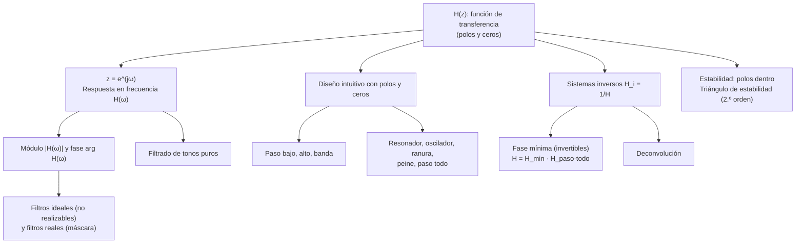
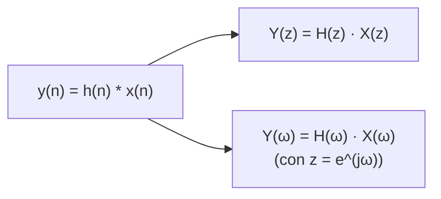
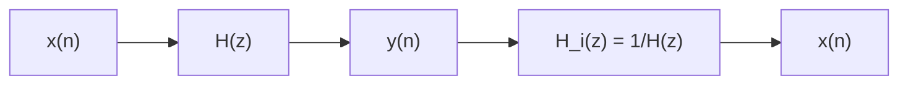

# Tema 5 — Los sistemas LTI como filtros en frecuencia

> **Señales Digitales · Tema 5** — Apuntes completos con teoría, demostraciones, figuras de las diapositivas, ejercicios resueltos (T5.1–T5.4) y autoevaluación. Todas las cifras y fórmulas se han comprobado numéricamente.
>
> **Estructura de carpeta para GitHub:** este archivo y la carpeta `T5_Filtros_Digitales_img/` (9 figuras) deben estar en el mismo directorio.
>
> Convención: **📝** = ampliación o matiz que no aparece literalmente en las diapositivas. Las figuras proceden de las diapositivas del tema.

## Índice

1. [Mapa del tema](#1-mapa-del-tema)
2. [Respuesta en frecuencia](#2-respuesta-en-frecuencia)
3. [Filtros ideales y filtros reales](#3-filtros-ideales-y-filtros-reales)
4. [Diseño intuitivo de filtros](#4-diseño-intuitivo-de-filtros)
5. [Filtros tipo adicionales](#5-filtros-tipo-adicionales)
6. [Sistemas inversos y filtros de fase mínima](#6-sistemas-inversos-y-filtros-de-fase-mínima)
7. [Estabilidad](#7-estabilidad)
8. [Filtrado de tonos puros](#8-filtrado-de-tonos-puros)
9. [Deconvolución](#9-deconvolución)
10. [Ejercicios resueltos (T5.1 – T5.4)](#10-ejercicios-resueltos-t51--t54)
11. [Fórmulas y reglas clave](#11-fórmulas-y-reglas-clave)
12. [Autoevaluación](#12-autoevaluación)
13. [Errores típicos](#13-errores-típicos)
14. [Conexión con el resto de la asignatura](#14-conexión-con-el-resto-de-la-asignatura)

---

## 1. Mapa del tema



---

## 2. Respuesta en frecuencia

### 2.1 Relación entre la transformada Z y la de Fourier

La transformada de Fourier (DTFT) de una señal discreta es su transformada Z evaluada sobre la **circunferencia unidad**:

$$X(z)\Big|_{z=e^{j\omega}}=X(\omega)$$

Por eso se puede obtener **rápidamente la respuesta en frecuencia** de un sistema LTI a partir de $H(z)$:

$$\boxed{H(\omega)=H(z)\Big|_{z=e^{j\omega}}}$$

Ambas transformadas "coinciden" en $z=e^{j\omega}$:



Es decir: filtrar es **multiplicar espectros** ($Y(\omega)=H(\omega)X(\omega)$); $H(\omega)$ dice cuánto se amplifica o atenúa (**módulo**) y cuánto se desfasa (**fase**) cada frecuencia.

> 📝 La evaluación sobre la circunferencia unidad solo es válida si la **ROC contiene $\lvert z\rvert=1$** (sistema estable, apartado 7).

### 2.2 Módulo y fase

$$H(\omega)=\lvert H(\omega)\rvert\,e^{j\arg H(\omega)}$$

- Si $h(n)$ es **real** (coeficientes de $H(z)$ reales): **los polos y ceros son reales o aparecen en parejas complejas conjugadas**. Consecuencias: $\lvert H(-\omega)\rvert=\lvert H(\omega)\rvert$ (módulo par) y $\arg H(-\omega)=-\arg H(\omega)$ (fase impar), así que basta estudiar $\omega\in[0,\pi]$.
- $H(\omega)$ es **periódica de periodo $2\pi$**.

### 2.3 Interpretación geométrica: polos y ceros

Se puede formar una idea de la respuesta en frecuencia a partir de la **distribución de polos y ceros**:

| Elemento | Comportamiento de $H(z)$ | Imagen mental |
|---|---|---|
| **Polo** | $H(z)\to\infty$ | **Monte** |
| **Cero** | $H(z)\to0$ | **Valle** |

La circunferencia unidad se puede ver como **"una carretera" que discurre por $H(z)$ de forma circular**: la respuesta en frecuencia es la **altura del terreno** que se va encontrando al recorrer esa carretera (de $\omega=0$ a $2\pi$). Cerca de un polo, la carretera sube (pico en $\lvert H(\omega)\rvert$); cerca de un cero, baja (valle o nulo).

**Ejemplo de la diapositiva** (mapa de $\lvert H(z)\rvert$ sobre el plano complejo, con la circunferencia unidad en rojo, y respuesta resultante):


Lectura de la figura:

- Hay **dos polos complejos conjugados** cerca de la circunferencia unidad (zonas "rojas" del mapa), en ángulo $\pm\approx0.31\pi$, y **ceros reales** sobre la circunferencia en $z=\pm1$ (zonas "azules").
- **Módulo (dB):** picos de unos 20 dB en $\omega\approx0.31\pi$ (y su simétrico $1.69\pi$, es decir $-0.31\pi$) y **nulos** en $\omega=0$ y $\omega=\pi$ (cerca de $-40$ dB): es un filtro de tipo **paso banda**.
- **Fase:** cae unos 180° (de $\approx+90^\circ$ a $\approx-90^\circ$) al atravesar la frecuencia del polo.
- Los polos y ceros están en **parejas conjugadas** porque $h(n)$ es real.

### 2.4 Cálculo geométrico del módulo

Con $H(z)=G\dfrac{\prod_k(z-z_k)}{\prod_k(z-p_k)}$ (en la diapositiva, con $M$ ceros y $N$ polos):

$$\boxed{\lvert H(z)\rvert=G\,\frac{\lvert z-z_0\rvert\,\lvert z-z_1\rvert\cdots\lvert z-z_M\rvert}{\lvert z-p_0\rvert\,\lvert z-p_1\rvert\cdots\lvert z-p_N\rvert}}$$

**La magnitud en un punto $z$ cualquiera viene dada por el producto de las distancias a los ceros dividido por el producto de las distancias a los polos.**


En la figura, para el punto $z$ marcado: $\lvert H(z)\rvert=G\dfrac{d_1\,d_2}{d_3\,d_4}$, con $d_1,d_2$ las distancias a los ceros $q_1,q_2$ y $d_3,d_4$ las distancias a los polos $p_1,p_2$.

**Regla práctica:** al recorrer la circunferencia, $\lvert H\rvert$ **crece al acercarse a un polo** (denominador pequeño) y **decrece al acercarse a un cero** (numerador pequeño). Si el cero está *sobre* la circunferencia, $\lvert H\rvert=0$ en esa frecuencia.

### 2.5 Cálculo geométrico de la fase

$$\boxed{\arg H(z)=\Big(\arg(z-z_0)+\dots+\arg(z-z_M)\Big)-\Big(\arg(z-p_0)+\dots+\arg(z-p_N)\Big)}$$

**La fase en un punto $z$ es la suma de las fases (ángulos) _desde_ los ceros menos las fases _desde_ los polos.** Cada ángulo $\theta_k$ es el que forma, con la horizontal, el vector que va **del cero (o polo) al punto $z$**.


> 📝 Si $G>0$ no aporta fase; si $G<0$ añade $\pi$.

---

## 3. Filtros ideales y filtros reales

### 3.1 Filtro paso bajo ideal

Los **filtros ideales no son físicamente realizables** (ni causales ni causalizables). Ejemplo, paso bajo ideal con frecuencia de corte $\omega_c$:

$$H(\omega)=\begin{cases}1&\lvert\omega\rvert\le\omega_c\\0&\omega_c<\lvert\omega\rvert<\pi\end{cases}\qquad\Longleftrightarrow\qquad h(n)=\begin{cases}\dfrac{\omega_c}{\pi}&n=0\\[3mm]\dfrac{\sin(\omega_cn)}{\pi n}&n\ne0\end{cases}$$

**¿Por qué no es realizable?** Su respuesta impulsiva (tipo sinc) es **no nula para $n<0$** (no es causal) y de **duración infinita** hacia ambos lados, por lo que ni siquiera retrasándola ni truncándola se obtiene exactamente el filtro (**no es causalizable**).

> 📝 **Cálculo de $h(n)$:** $h(n)=\frac{1}{2\pi}\int_{-\omega_c}^{\omega_c}e^{j\omega n}d\omega=\frac{\sin(\omega_cn)}{\pi n}$ y, en $n=0$, $\frac{\omega_c}{\pi}$ (límite).

### 3.2 Teorema de Paley-Wiener

> **La función de magnitud $\lvert H(\omega)\rvert$ puede ser cero para algunas frecuencias, pero no en cualquier banda finita de frecuencias.**

Es la razón teórica de que un sistema causal no pueda tener una banda de rechazo con atenuación infinita en un intervalo: los filtros reales **no pueden ser ideales**.

> 📝 Formalmente, para un sistema causal debe cumplirse $\int_{-\pi}^{\pi}\ln\lvert H(\omega)\rvert\,d\omega>-\infty$.

### 3.3 Filtros reales: máscara de especificaciones

En la práctica los filtros cuentan con un **ancho de banda de transición** y un **rizado** en las bandas de paso y de supresión:


| Elemento | Significado |
|---|---|
| **Banda de paso** $[0,\omega_p]$ | La ganancia debe estar entre $1-\delta_1$ y $1+\delta_1$ (rizado $\delta_1$) |
| **Banda de transición** $[\omega_p,\omega_s]$ | Zona de caída, sin requisitos |
| **Banda de rechazo (stopband)** $[\omega_s,\pi]$ | La ganancia debe ser como mucho $\delta_2$ |

$$1-\delta_1\le\lvert H(\omega)\rvert\le1+\delta_1\quad(0\le\omega\le\omega_p),\qquad\lvert H(\omega)\rvert\le\delta_2\quad(\omega_s\le\omega\le\pi)$$

Cuanto **más estrechas** son las tolerancias ($\delta_1,\delta_2$ pequeños y transición corta), **mayor** es el orden necesario del filtro.

### 3.4 Tipos de filtros según su banda de paso

> 📝 Respuestas ideales (en $[0,\pi]$) y relaciones entre ellas:

| Tipo | Deja pasar | Respuesta impulsiva ideal |
|---|---|---|
| **Paso bajo** | $\lvert\omega\rvert<\omega_c$ | $h_{LP}(n)=\dfrac{\sin\omega_cn}{\pi n}$ |
| **Paso alto** | $\omega_c<\lvert\omega\rvert\le\pi$ | $h_{HP}(n)=\delta(n)-h_{LP}(n)$ |
| **Paso banda** | $\omega_1<\lvert\omega\rvert<\omega_2$ | $h_{BP}(n)=\dfrac{\sin\omega_2n-\sin\omega_1n}{\pi n}$ |
| **Rechazo de banda** | Todo salvo $[\omega_1,\omega_2]$ | $h_{BS}(n)=\delta(n)-h_{BP}(n)$ |

---

## 4. Diseño intuitivo de filtros

**Idea general:** colocar **polos cerca de la circunferencia unidad en las frecuencias que se quieren dejar pasar** (montes) y **ceros sobre o cerca de la circunferencia en las frecuencias que se quieren eliminar** (valles). Los polos deben estar **dentro** de la circunferencia (estabilidad). Para un filtro real, siempre **conjugados**.

> Las diapositivas remiten a scripts de la asignatura (`Pasobaja.m`, `Pasobaja2.m`, `PasoAlta.m`, `PasoBanda.m`); aquí se recogen los diseños equivalentes con su fórmula y comprobación numérica.

### 4.1 Filtro paso bajo sencillo

Un **polo real cerca de $z=1$** (graves) y un **cero en $z=-1$** (elimina la frecuencia de Nyquist):

$$H_{LP}(z)=\frac{1-a}{2}\;\frac{1+z^{-1}}{1-a\,z^{-1}},\qquad0<a<1$$

Ganancia en continua $H_{LP}(1)=\frac{1-a}{2}\cdot\frac{2}{1-a}=1$ (0 dB). Frecuencia de corte a $-3$ dB $\approx1-a$ rad (para $a=0.9$: $\omega_c\approx0.105$ rad $=0.033\pi$, verificado). Cuanto más cerca de 1 está el polo, **más estrecha** la banda de paso.

### 4.2 Filtro paso alto

Un **cero en $z=1$** (elimina la continua) y un **polo real** (cerca de $z=-1$ para dejar pasar los agudos, o en $a$ cerca de 1 para una banda de paso ancha):

$$H_{HP}(z)=\frac{1+a}{2}\;\frac{1-z^{-1}}{1-a\,z^{-1}}$$

Ganancia en $\omega=\pi$: $H_{HP}(-1)=\frac{1+a}{2}\cdot\frac{2}{1+a}=1$. Corte $\approx1-a$ rad (para $a=0.9$: $0.034\pi$, verificado).

### 4.3 Filtro paso banda

**Pareja de polos conjugados** en $re^{\pm j\omega_0}$ (cerca de la circunferencia, $r<1$) y **ceros en $z=\pm1$** (eliminan continua y Nyquist):

$$H_{BP}(z)=G\,\frac{1-z^{-2}}{1-2r\cos\omega_0\,z^{-1}+r^{2}z^{-2}}$$

Con $G=\dfrac{(1-r)\lvert1-re^{-j2\omega_0}\rvert}{2\sin\omega_0}$ la ganancia en $\omega_0$ es 1. Ejemplo $r=0.9$, $\omega_0=\pi/4$: $G\approx0.095$, pico en $\approx\omega_0$ y ancho de banda a $-3$ dB $\approx0.21$ rad (verificado) $\approx2(1-r)$.

### 4.4 Conversión entre filtros

| Transformación | Efecto |
|---|---|
| **$H(z)\to H(-z)$** (modulación $h(n)\to(-1)^nh(n)$) | Desplaza la respuesta $\pi$ en frecuencia: **paso bajo $\leftrightarrow$ paso alto**, con $\omega_c'=\pi-\omega_c$. Los polos y ceros giran 180° |
| **$H_{HP}=1-H_{LP}$** | Complemento: convierte el paso bajo en paso alto (misma frecuencia de corte) |
| **$h_{BP}(n)=2h_{LP}(n)\cos(\omega_0n)$** 📝 | Modulación: traslada el paso bajo a una banda centrada en $\pm\omega_0$ |

Esta conversión es la que se usa en el **ejercicio T5.1** (apartado 10).

### 4.5 Cómo construirlo en MATLAB

```matlab
r = 0.9;  w0 = pi/4;
z = [0; 0];                                   % ceros (resonador: doble en el origen)
p = [r*exp(1j*w0); r*exp(-1j*w0)];            % polos conjugados
[b, a] = zp2tf(z, p, 1);                      % función de transferencia
[H, W] = freqz(b, a, 1024);                   % respuesta en frecuencia
zplane(b, a);                                 % diagrama de polos y ceros
```

---

## 5. Filtros tipo adicionales

Resumen: **resonadores, osciladores, filtros ranura (*notch*), filtros peine (*comb*) y filtros paso todo.**

| Filtro | Idea en polos y ceros | Respuesta típica | Scripts de la asignatura |
|---|---|---|---|
| **Resonador** | Par de polos conjugados cerca de la circunferencia | Paso banda estrecho | `Resonador.m`, `Resonador2.m` |
| **Oscilador** | Polos **sobre** la circunferencia (caso límite) | Genera una sinusoide | `oscilador.m` |
| **Ranura (notch)** | Ceros conjugados **sobre** la circunferencia | Elimina una frecuencia | `Ranura.m`, `Ranura2.m` |
| **Peine (comb)** | Ceros y polos a la misma frecuencia, para varias frecuencias | Nulos periódicos | `Peine.m`, `Peine2.m`, `peine3.m` |
| **Paso todo** | Polos y ceros recíprocos | $\lvert H\rvert=1$ | `PasaTodo.m` |

### 5.1 Resonadores digitales

**Filtros paso banda estrechos que tienen un par de polos complejos conjugados situados cerca de la circunferencia unidad.**

$$H(z)=G\,\frac{z^{2}}{\left(z-re^{j\omega_0}\right)\left(z-re^{-j\omega_0}\right)}=\frac{G}{1-2r\cos\omega_0\,z^{-1}+r^{2}z^{-2}}$$

- **Polos:** $re^{\pm j\omega_0}$. **Ceros:** dobles en $z=0$ (no influyen en el módulo).
- **Frecuencia de resonancia** $\approx\omega_0$; **ancho de banda** a $-3$ dB $\approx2(1-r)$ rad: cuanto más cerca de 1 está $r$, **más estrecho y alto** el pico.
- **Respuesta impulsiva** (oscilación amortiguada de frecuencia $\omega_0$ y envolvente $r^n$):

$$h(n)=G\,r^{n}\,\frac{\sin\big((n+1)\omega_0\big)}{\sin\omega_0}\,u(n)$$

- 📝 **Ganancia unidad en el pico:** $G=(1-r)\sqrt{1-2r\cos2\omega_0+r^2}$. Con $r=0.9$ y $\omega_0=\pi/4$, $G\approx0.1345$; $h(0)=0.1345$, $h(1)=0.171$ (el máximo de la figura).


**Lectura de la figura:** el diagrama muestra el par de polos en $0.9e^{\pm j\pi/4}$ y el cero doble en el origen (el "2"); el módulo tiene un **pico de 1 en $\omega=0.25\pi$** (en la figura el eje va de 0 a 1 en unidades de $\pi$); la fase cae bruscamente alrededor de $\omega_0$; la respuesta impulsiva es una **sinusoide amortiguada** que se apaga con $0.9^n$.

### 5.2 Osciladores digitales

**Caso límite de resonadores cuyos polos se encuentran sobre la circunferencia unidad** ($r=1$):

$$H(z)=G\,\frac{z^{2}}{\left(z-e^{j\omega_0}\right)\left(z-e^{-j\omega_0}\right)}=\frac{G}{1-2\cos\omega_0\,z^{-1}+z^{-2}}$$

- Los polos sobre la circunferencia dan una respuesta impulsiva **sinusoidal sostenida** (no se amortigua): $h(n)=G\frac{\sin((n+1)\omega_0)}{\sin\omega_0}u(n)$.
- Es el sistema **marginalmente estable**: genera una sinusoide de frecuencia $\omega_0$ a partir de un impulso. Con $G=\sin\omega_0$, $h(n)=\sin((n+1)\omega_0)$.
- 📝 **Implementación (ecuación en diferencias):** $y(n)=2\cos\omega_0\,y(n-1)-y(n-2)+G\,x(n)$.

### 5.3 Filtros ranura (*notch*)

**Idealmente, tienen un nulo perfecto a determinada frecuencia** (eliminan una frecuencia puntual) ⇒ **ceros complejos conjugados sobre la circunferencia unidad a esa frecuencia.** Para que el resto del espectro no se vea afectado, se pone un **par de polos conjugados al mismo ángulo, justo dentro de la circunferencia**:

$$H(z)=G\,\frac{\left(1-e^{j\omega_0}z^{-1}\right)\left(1-e^{-j\omega_0}z^{-1}\right)}{\left(1-re^{j\omega_0}z^{-1}\right)\left(1-re^{-j\omega_0}z^{-1}\right)}=G\,\frac{1-2\cos\omega_0\,z^{-1}+z^{-2}}{1-2r\cos\omega_0\,z^{-1}+r^{2}z^{-2}}$$

- **Ceros** en $e^{\pm j\omega_0}$ (módulo 1): nulo exacto en $\omega_0$. **Polos** en $re^{\pm j\omega_0}$: **cancelan** el efecto de los ceros fuera de las proximidades de $\omega_0$, dejando la respuesta casi plana.
- **Anchura de la ranura** a $-3$ dB $\approx2(1-r)$ rad (más estrecha cuanto más cerca de 1 está $r$).
- 📝 **Ganancia:** $G=\dfrac{1-2r\cos\omega_0+r^2}{2-2\cos\omega_0}$ da $\lvert H(0)\rvert=1$ ($G\approx0.92$ para $r=0.9$, $\omega_0=\pi/4$).


**Lectura de la figura:** los ceros (○) están sobre la circunferencia y los polos (×) justo detrás, al mismo ángulo; el módulo es $\approx1$ en casi todo el eje y presenta un **nulo estrecho en $\omega=0.25\pi$**; la fase tiene un salto en esa frecuencia; la respuesta impulsiva es $\approx\delta(n)$ más una pequeña cola oscilante que decae.

> 📝 Aplicación típica: eliminar una interferencia de frecuencia fija (por ejemplo, el zumbido de red).

### 5.4 Filtros peine (*comb*)

**Se obtienen concatenando ceros y polos colocados a la misma frecuencia, muy próximos entre sí, para varias frecuencias:**

$$H(z)=\frac{\prod_{k=1}^{M}\left(1-e^{j\omega_k}z^{-1}\right)}{\prod_{k=1}^{M}\left(1-re^{j\omega_k}z^{-1}\right)}$$

Es un notch replicado en $M$ frecuencias $\omega_k$: la respuesta tiene **nulos periódicos** (como los dientes de un peine).


> 📝 **Forma cerrada del ejemplo de la figura** (deducida de ella y comprobada): los 10 ceros y polos están en $\omega_k=(2k-1)\pi/10$ (ángulos 18°, 54°, 90°, 126°, 162° y sus conjugados), las raíces décimas de $-1$. El producto se simplifica:
>
> $$H(z)=\frac{1+z^{-10}}{1+r^{10}z^{-10}}\quad(r=0.9)$$
>
> - **Nulos** en $\omega=\pi/10,\,3\pi/10,\dots$ (en la figura, en $0.1,0.3,0.5,\dots$ de $\pi$).
> - **Picos** de $\frac{2}{1+r^{10}}=1.48$ (la figura marca ≈ 1.5), entre nulos.
> - **Respuesta impulsiva** solo no nula en múltiplos de 10: $h(0)=1$, $h(10)=1-r^{10}=0.651$, $h(20)=-r^{10}(1-r^{10})=-0.227$, $h(30)=0.079$… (coincide con los palitos de la figura).
> - Si los ceros se colocan en $\omega_k=2\pi k/M$ (incluido $z=1$) resulta $H(z)=\dfrac{1-z^{-M}}{1-r^Mz^{-M}}$, con nulos en $0,\,2\pi/M,\,4\pi/M,\dots$

### 5.5 Filtros paso todo

**Son filtros con una respuesta en módulo igual a la unidad para todas las frecuencias. Únicamente modifican la fase de la señal de entrada.**

**Regla:** a cada **polo $z=a$** le corresponde un **cero $z=\dfrac1a$** (el recíproco; para polos complejos, el recíproco conjugado $1/p^*$).


En la figura, los polos (×) están en $0.5$ y $0.4\pm0.6j$ (dentro de la circunferencia) y los ceros (○) en $2$ y $\approx0.77\pm1.15j$ (los inversos, fuera): el **módulo es exactamente 1** y solo cambia la **fase**.

**Justificación (ejemplo de primer orden):**

$$H(z)=\frac{a-z^{-1}}{1-a\,z^{-1}}=\frac{az-1}{z-a}=a\,\frac{z-\frac1a}{z-a}$$

- **Polo** en $z=a$ y **cero** en $z=\frac1a$.
- 📝 **Demostración de $\lvert H\rvert=1$** (para $a$ real): $\lvert a-e^{-j\omega}\rvert=\lvert e^{-j\omega}\rvert\lvert ae^{j\omega}-1\rvert=\lvert1-ae^{j\omega}\rvert=\lvert1-ae^{-j\omega}\rvert$ (conjugado), luego el cociente vale 1.
- Caso general: $H_{ap}(z)=\prod_k\dfrac{p_k^{*}-z^{-1}}{1-p_kz^{-1}}$.

> 📝 **Uso:** ecualizar la fase o el retardo de grupo sin alterar el módulo; y en la descomposición fase mínima × paso todo (apartado 6.3).

---

## 6. Sistemas inversos y filtros de fase mínima

### 6.1 Sistema inverso

Un sistema es **inverso** de otro si convierte la salida de aquel en su entrada, y **ambos son estables**:

$$y(n)*h_i(n)=x(n)\qquad\Longleftrightarrow\qquad\boxed{H_i(z)=\frac{1}{H(z)}}$$



(en cascada, $H(z)H_i(z)=1$, es decir $h*h_i=\delta$.)

### 6.2 ¿Qué sistemas son invertibles? Fase mínima

> **En la práctica solo son invertibles los sistemas de FASE MÍNIMA** (**polos y ceros en el interior de la circunferencia unidad**).

**Por qué:** los **ceros** de $H(z)$ pasan a ser los **polos** de $H_i(z)$, y los polos de $H$ pasan a ser sus ceros. Para que $H_i$ sea **causal y estable**, sus polos (los ceros de $H$) deben estar **dentro** de la circunferencia unidad. Y $H$ también debe ser causal y estable: sus polos dentro. Por tanto, **todos los polos y ceros de $H$ deben estar dentro**.

### 6.3 Descomposición fase mínima × paso todo

A veces interesa **descomponer un filtro en dos partes**: de **fase mínima** (invertible) y **paso todo** (no afecta al módulo, solo a la fase):

$$\boxed{H(z)=H_{min}(z)\cdot H_{paso\_todo}(z)}$$

Esto permite la **conversión a sistemas causales estables** (polos dentro de la circunferencia unidad) y mantener el módulo.

**Procedimiento** (para cada factor con un **cero fuera** $z_k$, $\lvert z_k\rvert>1$):

1. Se escribe $1-z_kz^{-1}$ como producto de un factor de fase mínima y un paso todo, usando $p=\dfrac{1}{z_k^{*}}$ (cero reflejado al interior):

$$\boxed{1-z_kz^{-1}=z_k\,\big(1-p\,z^{-1}\big)\cdot\frac{p^{*}-z^{-1}}{1-p\,z^{-1}}}$$

2. El primer factor $z_k(1-pz^{-1})$ tiene el cero **dentro** ($\lvert p\rvert<1$) y la misma magnitud que el original en la circunferencia (ganancia $\lvert z_k\rvert$).
3. El segundo es un **paso todo** de primer orden (polo en $p$, cero en $z_k$).

> 📝 **Comprobación del paso 1:** $z_k(p^*-z^{-1})=z_k\left(\frac1{z_k}-z^{-1}\right)=1-z_kz^{-1}$ ✓.

Regla resumen: **se refleja cada cero exterior a su recíproco conjugado (interior), se compensa la ganancia con $\lvert z_k\rvert$ y el factor paso todo recoge el cambio de fase.** (La misma operación sobre un polo exterior produce un polo interior.) Se aplica en el ejercicio T5.4.

---

## 7. Estabilidad

**Sistemas causales estables ⇔ polos dentro de la circunferencia unidad.**

### 7.1 Sistemas con polos de segundo orden: triángulo de estabilidad

Sea un denominador de segundo orden con polos $p_1,p_2$:

$$1+a_1z^{-1}+a_2z^{-2}=(1-p_1z^{-1})(1-p_2z^{-1})$$

Identificando coeficientes: $\boxed{a_2=p_1p_2,\qquad a_1=-(p_1+p_2)}$.


**El sistema es estable ⇔ $(a_1,a_2)$ está dentro del triángulo** de vértices $(-2,1)$, $(0,-1)$ y $(2,1)$, limitado por tres rectas:

| Recta | Condición de estabilidad |
|---|---|
| $a_2=1$ | $a_2<1$ |
| $a_1=1+a_2$ | $a_1<1+a_2$ |
| $-a_1=1+a_2$ | $a_1>-(1+a_2)$ |

$$\boxed{\lvert a_1\rvert<1+a_2\quad\text{y}\quad a_2<1}$$

**La parábola $4a_2=a_1^2$** (discriminante cero) separa el tipo de polos **dentro** del triángulo:

| Región | Polos |
|---|---|
| **Por encima** de la parábola ($a_1^2<4a_2$) | **Complejos conjugados** (con $\lvert p\rvert=\sqrt{a_2}$) |
| **Por debajo** ($a_1^2>4a_2$) | **Reales** |
| **Sobre** la parábola | Real **doble** |

> 📝 **Por qué esas rectas:**
> - **Complejos:** $\lvert p\rvert^2=p_1p_2=a_2$; estables si $a_2<1$.
> - **Reales:** $\lvert p_k\rvert<1$ equivale a $A(1)=1+a_1+a_2>0$ y $A(-1)=1-a_1+a_2>0$ (con $A(z)=1+a_1z^{-1}+a_2z^{-2}$) y $\lvert a_2\rvert<1$. Esas dos desigualdades son las rectas oblicuas.
> - **Vértices:** $(-2,1)$: polo doble en $z=1$; $(2,1)$: polo doble en $z=-1$; $(0,-1)$: polos en $z=\pm1$ (todos sobre la circunferencia: el límite).
> - Comprobado por muestreo aleatorio de 40 000 pares $(a_1,a_2)$: **0 discrepancias** entre "polos dentro" y "dentro del triángulo".

**Utilidad:** relaciona los coeficientes del denominador con la ubicación de los polos. Un resonador con polos $re^{\pm j\omega_0}$ tiene $a_1=-2r\cos\omega_0$ y $a_2=r^2$.

---

## 8. Filtrado de tonos puros

Se introduce una **sinusoide pura** $x(n)=\cos(2\pi f_0n)$ en un sistema LTI $H(z)$ real.

**Dominio de la frecuencia** ($f=\omega/2\pi$):

$$y(n)=h(n)*x(n),\qquad Y(f)=H(f)X(f)=H(f)\cdot\frac12\Big[\delta(f+f_0)+\delta(f-f_0)\Big]$$

$$Y(f)=\frac12\Big(\lvert H(-f_0)\rvert\,\delta(f+f_0)\,e^{j\arg H(-f_0)}+\lvert H(f_0)\rvert\,\delta(f-f_0)\,e^{j\arg H(f_0)}\Big)$$

Como $h$ es real, $\lvert H(-f_0)\rvert=\lvert H(f_0)\rvert$ y $\arg H(-f_0)=-\arg H(f_0)$:

$$Y(f)=\frac{\lvert H(f_0)\rvert}{2}\Big(\delta(f+f_0)\,e^{-j\arg H(f_0)}+\delta(f-f_0)\,e^{j\arg H(f_0)}\Big)$$

$$\boxed{y(n)=\lvert H(f_0)\rvert\,\cos\!\Big(2\pi f_0n+\arg H(f_0)\Big)}$$

**Conclusión:** un sistema LTI **no cambia la frecuencia** de una sinusoide: solo **escala su amplitud por $\lvert H(f_0)\rvert$** y **desplaza su fase en $\arg H(f_0)$**. Las sinusoides (exponenciales complejas) son las **autofunciones** de los sistemas LTI.

> 📝 **Demostración rápida en el tiempo:** $e^{j\omega_0n}*h=\sum_kh(k)e^{j\omega_0(n-k)}=e^{j\omega_0n}\sum_kh(k)e^{-j\omega_0k}=H(\omega_0)\,e^{j\omega_0n}$. Aplicado a $\frac12(e^{j\omega_0n}+e^{-j\omega_0n})$ da el resultado. Es válido en **régimen permanente** (tras el transitorio) y si el sistema es estable.

---

## 9. Deconvolución

**Dadas una señal de entrada y otra de salida de un sistema causal, representadas de forma explícita, se puede calcular la respuesta impulsiva** del sistema.

Con $x(n)$ y $h(n)$ causales:

$$y(n)=x(n)*h(n)=\sum_{k=0}^{n}x(k)\,h(n-k)=x(0)\,h(n)+\sum_{k=1}^{n}x(k)\,h(n-k)$$

Despejando $h(n)$ (y suponiendo $x(0)\ne0$):

$$\boxed{h(n)=\frac{y(n)-\sum_{k=1}^{n}x(k)\,h(n-k)}{x(0)}\quad(n>0)}\qquad h(0)=\frac{y(0)}{x(0)},\quad h(1)=\frac{y(1)-x(1)h(0)}{x(0)},\dots$$

Es una **recursión**: cada $h(n)$ se calcula con los $h$ anteriores.

**Ejemplo:** $x=\{2,1,0.5\}$ y $y=\{2,2,1.5,0.7,0.225,0.05\}$ ($=x*h$ con $h=\{1,0.5,0.25,0.1\}$):

| $n$ | Cálculo | $h(n)$ |
|:-:|---|:-:|
| 0 | $y(0)/x(0)=2/2$ | **1** |
| 1 | $\big(y(1)-x(1)h(0)\big)/x(0)=(2-1)/2$ | **0.5** |
| 2 | $\big(y(2)-x(1)h(1)-x(2)h(0)\big)/x(0)=(1.5-0.5-0.5)/2$ | **0.25** |
| 3 | $\big(0.7-1\cdot0.25-0.5\cdot0.5\big)/2$ | **0.1** |

### 9.1 Respuesta impulsiva del sistema inverso

De forma similar, para el sistema inverso:

$$h_i(n)*h(n)=\delta(n)\;\Longrightarrow\;h_i(n)=\frac{\delta(n)-\sum_{k=1}^{n}h(k)\,h_i(n-k)}{h(0)}$$

$$\boxed{h_i(0)=\frac1{h(0)},\qquad h_i(n)=\frac{-\sum_{k=1}^{n}h(k)\,h_i(n-k)}{h(0)}\quad(n>0)}$$

**Ejemplos:**

- $h=\{1,0.5\}$ (cero en $z=-0.5$, **dentro**): $h_i(n)=(-0.5)^n$, que **decae** ⇒ inverso estable.
- $h=\{1,2\}$ (cero en $z=-2$, **fuera**: fase no mínima): $h_i(n)=(-2)^n$, que **diverge** ⇒ el inverso causal es inestable.

> 📝 Es la confirmación numérica de que **solo los sistemas de fase mínima tienen inverso causal y estable** (apartado 6). Además, la recursión es **sensible al ruido** y requiere $x(0)\ne0$ (o $h(0)\ne0$).

---

## 10. Ejercicios resueltos (T5.1 – T5.4)

### T5.1 — Respuesta impulsiva del paso alto ideal con $\omega_c=3\pi/4$

**Enunciado:** considere el filtro paso alto ideal con frecuencia de corte $\omega_c=3\pi/4$. Encuentre su respuesta al impulso unidad $h(n)$.

**Paso 1: respuesta en frecuencia.**

$$H(\omega)=\begin{cases}0&\lvert\omega\rvert<3\pi/4\\1&3\pi/4\le\lvert\omega\rvert\le\pi\end{cases}$$

**Paso 2: transformada inversa.** $h(n)=\dfrac1{2\pi}\displaystyle\int_{-\pi}^{\pi}H(\omega)e^{j\omega n}d\omega$. Solo contribuyen las dos bandas $[3\pi/4,\pi]$ y $[-\pi,-3\pi/4]$, simétricas:

$$h(n)=\frac{1}{2\pi}\cdot2\int_{3\pi/4}^{\pi}\cos(\omega n)\,d\omega=\frac1\pi\left[\frac{\sin\omega n}{n}\right]_{3\pi/4}^{\pi}=\frac{\sin(\pi n)-\sin(3\pi n/4)}{\pi n}\quad(n\ne0)$$

Como $\sin(\pi n)=0$ para $n$ entero, y en $n=0$ la integral vale $\frac1\pi\left(\pi-\frac{3\pi}{4}\right)$:

$$\boxed{h(n)=\begin{cases}\dfrac14&n=0\\[3mm]-\dfrac{\sin(3\pi n/4)}{\pi n}&n\ne0\end{cases}\;=\;\delta(n)-\frac{\sin(3\pi n/4)}{\pi n}\ \ (\text{con }h(0)=1-\tfrac34)}$$

**Forma alternativa (por conversión de filtros).** $\sin\!\left(\frac{3\pi n}{4}\right)=\sin\!\left(\pi n-\frac{\pi n}{4}\right)=-(-1)^n\sin\frac{\pi n}{4}$, luego

$$h(n)=(-1)^n\,\frac{\sin(\pi n/4)}{\pi n}\quad(n\ne0),\qquad h(0)=\frac14$$

Es decir, es un **paso bajo ideal de corte $\pi-3\pi/4=\pi/4$ modulado por $(-1)^n$** (que desplaza la respuesta $\pi$ en frecuencia): $H_{HP}(\omega)=H_{LP}(\omega-\pi)$.

**Comprobación:** las dos formas coinciden numéricamente (error $\sim10^{-17}$). Valor en el origen: $h(0)=1-\omega_c/\pi=0.25$ (la fracción del espectro que se deja pasar).

---

### T5.2 — Respuesta en frecuencia de la media móvil de orden $L$

**Enunciado:** $y(n)=\dfrac1{L+1}\displaystyle\sum_{k=0}^{L}x(n-k)$. Encuentre la respuesta en frecuencias.

**Paso 1: respuesta impulsiva.** Con $x=\delta$: $h(n)=\dfrac1{L+1}$ para $0\le n\le L$ (un "rectángulo").

**Paso 2: $H(\omega)$ como suma geométrica** (razón $e^{-j\omega}$, $L+1$ términos):

$$H(\omega)=\frac1{L+1}\sum_{k=0}^{L}e^{-j\omega k}=\frac1{L+1}\cdot\frac{1-e^{-j\omega(L+1)}}{1-e^{-j\omega}}$$

**Paso 3: sacar factor común** $e^{-j\omega(L+1)/2}$ del numerador y $e^{-j\omega/2}$ del denominador, y usar $1-e^{-j\theta}=e^{-j\theta/2}\,2j\sin(\theta/2)$:

$$\boxed{H(\omega)=\frac{1}{L+1}\;e^{-j\omega L/2}\;\frac{\sin\!\big(\omega(L+1)/2\big)}{\sin(\omega/2)}}$$

**Interpretación:**

| Elemento | Resultado |
|---|---|
| **Módulo** | $\lvert H(\omega)\rvert=\dfrac{1}{L+1}\left\lvert\dfrac{\sin(\omega(L+1)/2)}{\sin(\omega/2)}\right\rvert$ (núcleo de Dirichlet) |
| **Fase** | $-\dfrac{\omega L}{2}$ (**lineal**) más saltos de $\pi$ donde el cociente de senos cambia de signo |
| **Retardo de grupo** | $L/2$ muestras (constante) |
| **Ganancia en continua** | $H(0)=1$ |
| **Ceros** | $\omega=\dfrac{2\pi k}{L+1}$, $k=1,\dots,L$ (los $(L+1)$-ésimos raíces de la unidad, salvo $z=1$) |
| **Tipo** | **Paso bajo** (lóbulo principal hasta $2\pi/(L+1)$, lóbulos laterales pequeños) |

**En el plano $Z$:** $H(z)=\dfrac{1}{L+1}\dfrac{1-z^{-(L+1)}}{1-z^{-1}}$ tiene $L$ **ceros** en las raíces $(L+1)$-ésimas de la unidad (excepto $z=1$) y $L$ **polos en el origen**.

> 📝 Cuanto **mayor $L$**, más estrecha la banda de paso ($\omega_c\approx2.78/(L+1)$ rad a $-3$ dB) y más suavizado. Fórmula comprobada numéricamente para $L=3$ y $L=7$ (error $\sim10^{-16}$).

---

### T5.3 — Fase mínima de $y(n)=\alpha^nx(n)$

**Enunciado:** una secuencia causal de fase no mínima $x(n)$ tiene

$$X(z)=\frac{\left(1-\frac32z^{-1}\right)\left(1+\frac13z^{-1}\right)\left(1+\frac53z^{-1}\right)}{\left(1-z^{-1}\right)^{2}\left(1-\frac14z^{-1}\right)}$$

¿Para qué valores de la constante $\alpha$ podría la secuencia $y(n)=\alpha^nx(n)$ ser de fase mínima?

**Paso 1: polos y ceros de $X(z)$.**

| | Valores | Módulos |
|---|---|---|
| **Ceros** | $\frac32,\;-\frac13,\;-\frac53$ | $1.5,\;0.33,\;1.67$ |
| **Polos** | $1$ (doble), $\frac14$ | $1,\;0.25$ |

No es de fase mínima: hay **ceros fuera** ($\frac32$ y $-\frac53$) y un polo doble **sobre** la circunferencia.

**Paso 2: efecto de multiplicar por $\alpha^n$.** Por la propiedad de **escalado**, $\alpha^nx(n)\leftrightarrow X(z/\alpha)$: se sustituye $z\to z/\alpha$, es decir, $z^{-1}\to\alpha z^{-1}$. **Todos los polos y ceros se multiplican por $\alpha$**:

$$Y(z)=\frac{\left(1-\frac32\alpha z^{-1}\right)\left(1+\frac13\alpha z^{-1}\right)\left(1+\frac53\alpha z^{-1}\right)}{\left(1-\alpha z^{-1}\right)^{2}\left(1-\frac\alpha4z^{-1}\right)}$$

| | Posición | Módulo |
|---|---|---|
| **Ceros** | $\frac32\alpha,\;-\frac\alpha3,\;-\frac53\alpha$ | $1.5\lvert\alpha\rvert,\;\frac{\lvert\alpha\rvert}3,\;\frac53\lvert\alpha\rvert$ |
| **Polos** | $\alpha$ (doble), $\frac\alpha4$ | $\lvert\alpha\rvert,\;\frac{\lvert\alpha\rvert}4$ |

**Paso 3: condición de fase mínima.** Todos los polos y ceros **estrictamente dentro** de la circunferencia unidad:

- Polos: $\lvert\alpha\rvert<1$.
- Ceros: $1.5\lvert\alpha\rvert<1\Rightarrow\lvert\alpha\rvert<\frac23$; $\;\frac53\lvert\alpha\rvert<1\Rightarrow\boxed{\lvert\alpha\rvert<\frac35}$; $\;\frac{\lvert\alpha\rvert}{3}<1$ (se cumple).

La más restrictiva es la del cero de mayor módulo:

$$\boxed{0<\lvert\alpha\rvert<\tfrac35=0.6}$$

(con $\alpha\ne0$; si $\lvert\alpha\rvert=\frac35$ el cero $-\frac53\alpha$ queda **sobre** la circunferencia, límite que no es de fase mínima estricta.) Comprobado numéricamente: para $\alpha=0.59$ todos los módulos son $<1$; para $\alpha=0.6$ el mayor cero vale exactamente 1.

---

### T5.4 — Factorización $H(z)=H_{min}(z)\,H_{ap}(z)$

**Enunciado:** un sistema LTI causal tiene

$$H(z)=\frac{(1-2z^{-2})(1+0.4z^{-1})}{1-0.85z^{-1}}$$

Encuentre una factorización $H(z)=H_{min}(z)H_{ap}(z)$ con $H_{min}$ de fase mínima y $H_{ap}$ paso todo.

**Paso 1: ceros y polos.**

- $1-2z^{-2}=0\Rightarrow z^{2}=2\Rightarrow z=\pm\sqrt2$ (**módulo 1.414 > 1: fuera**).
- $1+0.4z^{-1}=0\Rightarrow z=-0.4$ (dentro).
- Polo: $z=0.85$ (dentro).

Los dos ceros $\pm\sqrt2$ impiden la fase mínima.

**Paso 2: separar los factores del numerador.** $1-2z^{-2}=(1-\sqrt2z^{-1})(1+\sqrt2z^{-1})$.

**Paso 3: reflejar cada cero exterior** ($z_k=\sqrt2$ y $z_k=-\sqrt2$, con $p=1/z_k^{*}=\pm\frac1{\sqrt2}$), usando la fórmula del apartado 6.3:

$$1-\sqrt2z^{-1}=\sqrt2\left(1-\tfrac{1}{\sqrt2}z^{-1}\right)\frac{\frac1{\sqrt2}-z^{-1}}{1-\frac1{\sqrt2}z^{-1}}$$

$$1+\sqrt2z^{-1}=-\sqrt2\left(1+\tfrac{1}{\sqrt2}z^{-1}\right)\frac{-\frac1{\sqrt2}-z^{-1}}{1+\frac1{\sqrt2}z^{-1}}$$

**Paso 4: multiplicar.** Las constantes dan $\sqrt2\cdot(-\sqrt2)=-2$ y los factores paso todo se combinan:

$$\frac{\left(\frac1{\sqrt2}-z^{-1}\right)\left(-\frac1{\sqrt2}-z^{-1}\right)}{\left(1-\frac{z^{-1}}{\sqrt2}\right)\left(1+\frac{z^{-1}}{\sqrt2}\right)}=\frac{-\left(\frac12-z^{-2}\right)}{1-\frac12z^{-2}}$$

El signo menos se absorbe en la constante ($-2\cdot-1=+2$). Resultado:

$$\boxed{H_{ap}(z)=\frac{0.5-z^{-2}}{1-0.5\,z^{-2}}}\qquad\boxed{H_{min}(z)=\frac{2\,(1-0.5z^{-2})(1+0.4z^{-1})}{1-0.85z^{-1}}}$$

**Comprobación:**

- **Producto:** $H_{min}H_{ap}=\dfrac{2(0.5-z^{-2})(1+0.4z^{-1})}{1-0.85z^{-1}}=\dfrac{(1-2z^{-2})(1+0.4z^{-1})}{1-0.85z^{-1}}=H(z)$ ✓ (verificado numéricamente, error $\sim10^{-16}$).
- **$H_{ap}$ es paso todo:** polos en $z=\pm\frac1{\sqrt2}$ y ceros en $\pm\sqrt2$ (recíprocos), y $\lvert H_{ap}(\omega)\rvert=1$ (comprobado).
- **$H_{min}$ es de fase mínima:** ceros en $z=\pm\frac1{\sqrt2}=\pm0.707$ y $-0.4$, polo en $0.85$: **todos dentro** ✓.
- **El módulo se conserva:** $\lvert H(\omega)\rvert=\lvert H_{min}(\omega)\rvert$.

---

## 11. Fórmulas y reglas clave

| Concepto | Expresión |
|---|---|
| **Respuesta en frecuencia** | $H(\omega)=H(z)\big|_{z=e^{j\omega}}$ |
| **Filtrado** | $Y(\omega)=H(\omega)X(\omega)$ |
| **Módulo geométrico** | $\lvert H\rvert=G\dfrac{\prod\text{dist. a ceros}}{\prod\text{dist. a polos}}$ |
| **Fase geométrica** | $\arg H=\sum\arg(\text{desde ceros})-\sum\arg(\text{desde polos})$ |
| **Paso bajo ideal** | $h(n)=\dfrac{\sin\omega_cn}{\pi n}$, $h(0)=\dfrac{\omega_c}{\pi}$ |
| **Paley-Wiener** | $\lvert H\rvert$ no puede ser 0 en una banda finita |
| **Conversión LP↔HP** | $H(z)\to H(-z)$, $\omega_c\to\pi-\omega_c$ |
| **Resonador** | $\dfrac{G}{1-2r\cos\omega_0z^{-1}+r^2z^{-2}}$, ancho $\approx2(1-r)$ |
| **Oscilador** | Resonador con $r=1$ |
| **Ranura** | $G\dfrac{1-2\cos\omega_0z^{-1}+z^{-2}}{1-2r\cos\omega_0z^{-1}+r^2z^{-2}}$ |
| **Peine** | $\prod\dfrac{1-e^{j\omega_k}z^{-1}}{1-re^{j\omega_k}z^{-1}}$ |
| **Paso todo** | $\dfrac{a-z^{-1}}{1-az^{-1}}$: polo $a$, cero $1/a$; $\lvert H\rvert=1$ |
| **Inverso** | $H_i=1/H$; invertible ⇔ fase mínima |
| **Descomposición** | $H=H_{min}H_{ap}$ |
| **Estabilidad (2.º orden)** | $\lvert a_1\rvert<1+a_2$ y $a_2<1$ |
| **Tono puro** | $\cos(\omega_0n)\to\lvert H(\omega_0)\rvert\cos(\omega_0n+\arg H(\omega_0))$ |
| **Deconvolución** | $h(n)=\dfrac{y(n)-\sum_{k=1}^{n}x(k)h(n-k)}{x(0)}$ |
| **Inverso por recursión** | $h_i(0)=\dfrac1{h(0)}$, $h_i(n)=-\dfrac{\sum_{k=1}^{n}h(k)h_i(n-k)}{h(0)}$ |

---

## 12. Autoevaluación

<details>
<summary><b>1. ¿Cómo se obtiene la respuesta en frecuencia a partir de $H(z)$?</b></summary>

Evaluando $H(z)$ sobre la circunferencia unidad: $H(\omega)=H(z)\big|_{z=e^{j\omega}}$ (válido si la ROC la contiene).
</details>

<details>
<summary><b>2. ¿Qué pasa con $\lvert H\rvert$ cerca de un polo y cerca de un cero?</b></summary>

Cerca de un polo sube (monte); cerca de un cero baja (valle). Con un cero sobre la circunferencia, $\lvert H\rvert=0$ en esa frecuencia.
</details>

<details>
<summary><b>3. ¿Cómo se calculan el módulo y la fase en un punto $z$?</b></summary>

Módulo: producto de distancias a los ceros dividido por el de distancias a los polos. Fase: suma de ángulos desde los ceros menos suma de ángulos desde los polos.
</details>

<details>
<summary><b>4. ¿Por qué no es realizable un paso bajo ideal?</b></summary>

Su $h(n)$ (sinc) es no nula para $n<0$ y de duración infinita: no es causal ni causalizable. Además, Paley-Wiener impide un módulo nulo en una banda finita.
</details>

<details>
<summary><b>5. ¿Qué diferencia hay entre un resonador y un oscilador?</b></summary>

Resonador: polos conjugados dentro, cerca de la circunferencia (paso banda estrecho, respuesta amortiguada). Oscilador: polos sobre la circunferencia (respuesta sinusoidal sostenida, marginalmente estable).
</details>

<details>
<summary><b>6. ¿Cómo se construye un filtro ranura? ¿Y uno peine?</b></summary>

Ranura: ceros conjugados sobre la circunferencia a $\omega_0$ y polos cerca, al mismo ángulo. Peine: lo mismo repetido en varias frecuencias.
</details>

<details>
<summary><b>7. ¿Qué es un filtro paso todo y qué relación hay entre sus polos y ceros?</b></summary>

$\lvert H\rvert=1$ para todo $\omega$; solo cambia la fase. A cada polo $a$ le corresponde un cero $1/a$ (recíproco conjugado en complejos).
</details>

<details>
<summary><b>8. ¿Qué sistemas son invertibles en la práctica y por qué?</b></summary>

Los de fase mínima: los ceros de $H$ son los polos de $H_i=1/H$, y deben estar dentro de la circunferencia unidad para que $H_i$ sea causal y estable.
</details>

<details>
<summary><b>9. ¿Cuándo es estable un sistema de segundo orden $1+a_1z^{-1}+a_2z^{-2}$?</b></summary>

Cuando $(a_1,a_2)$ está dentro del triángulo: $\lvert a_1\rvert<1+a_2$ y $a_2<1$.
</details>

<details>
<summary><b>10. ¿Qué sale al filtrar $\cos(\omega_0n)$ con $H(z)$?</b></summary>

$\lvert H(\omega_0)\rvert\cos(\omega_0n+\arg H(\omega_0))$: misma frecuencia, amplitud escalada y fase desplazada.
</details>

<details>
<summary><b>11. ¿Cómo se calcula $h(n)$ conociendo $x(n)$ e $y(n)$ causales?</b></summary>

Por la recursión $h(n)=[y(n)-\sum_{k=1}^{n}x(k)h(n-k)]/x(0)$, con $h(0)=y(0)/x(0)$.
</details>

<details>
<summary><b>12. ¿Qué valores de $\alpha$ hacen de fase mínima a $\alpha^nx(n)$ en T5.3?</b></summary>

$\lvert\alpha\rvert<\frac35$ (el cero de mayor módulo, $\frac53$, multiplicado por $\alpha$ debe quedar dentro).
</details>

---

## 13. Errores típicos

- **Confundir qué se evalúa:** la respuesta en frecuencia es $H(z)$ **sobre la circunferencia unidad**, no en todo el plano.
- **Distancias y ángulos:** en la fase, los ángulos se miden **desde el cero/polo hasta el punto $z$** y los de los polos **restan**.
- **Cero fuera ≠ cero dentro:** dos filtros con ceros recíprocos tienen **el mismo módulo** (salvo ganancia) pero **distinta fase**; solo el de ceros dentro es de fase mínima.
- **Ganancia al reflejar un cero:** olvidar el factor $\lvert z_k\rvert$ al pasar $1-z_kz^{-1}$ a $1-pz^{-1}$ (T5.4: la constante 2).
- **Ranura sin polos:** un cero sobre la circunferencia sin polos cercanos elimina la frecuencia pero también distorsiona mucho el resto; los polos "equilibran" la respuesta.
- **Estabilidad:** polos **sobre** la circunferencia (oscilador, polo doble en $z=1$) no son estables en sentido estricto.
- **Triángulo de estabilidad:** olvidar que $(a_1,a_2)$ son los coeficientes del **denominador** con $a_0=1$ y signo $+$ en $1+a_1z^{-1}+a_2z^{-2}$.
- **Tono puro:** aplicar la fórmula antes de que acabe el transitorio o con un sistema inestable.
- **Deconvolución:** olvidar que exige $x(0)\ne0$ y que la recursión del inverso diverge si $H$ no es de fase mínima.

---

## 14. Conexión con el resto de la asignatura

| Tema / Práctica | Relación |
|---|---|
| **Tema 2 (transformada Z)** | Polos, ceros, ROC y estabilidad; escalado $\alpha^nx(n)\leftrightarrow X(z/\alpha)$ (T5.3) |
| **Tema 3 (DTFT)** | $H(\omega)$ es la DTFT de $h(n)$; propiedad de desplazamiento en frecuencia (conversión LP↔HP) |
| **Tema 4 (sistemas LTI)** | $H(z)=Y/X$, polos y ceros, estabilidad, ecuación en diferencias; T4.3 ($(-1)^nh(n)$) es la conversión de T5.1 |
| **Práctica 3** | Polos, ceros, `freqz`, respuesta al impulso y al escalón |
| **Práctica 4 (FDATool)** | Diseño de filtros IIR (Butterworth, Chebyshev, elíptico): orden, rizado, fase y retardo de grupo |
| **Práctica 5 (filtrado digital)** | Filtros paso banda FIR (ventanas) e IIR (Butterworth) sobre una señal real |
