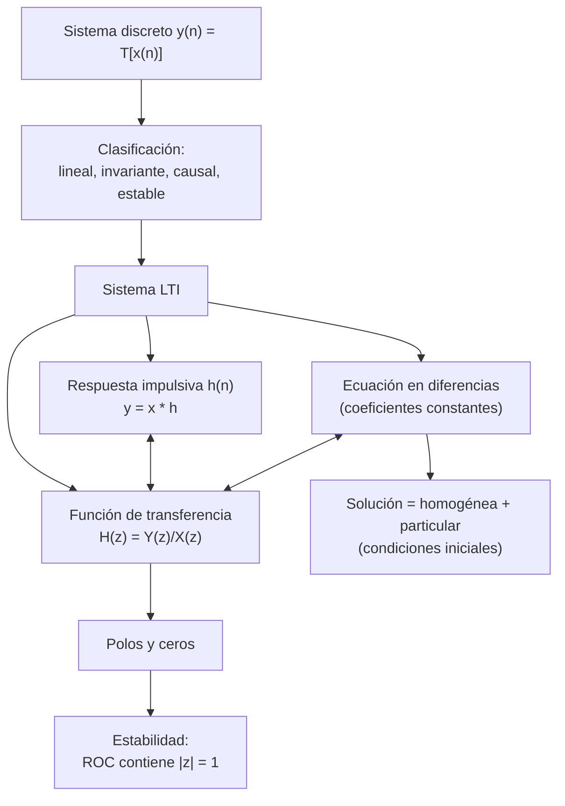
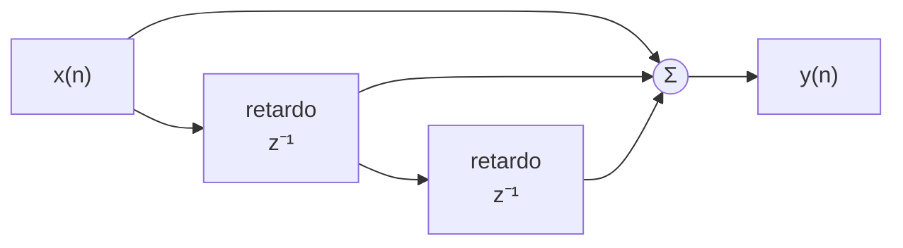
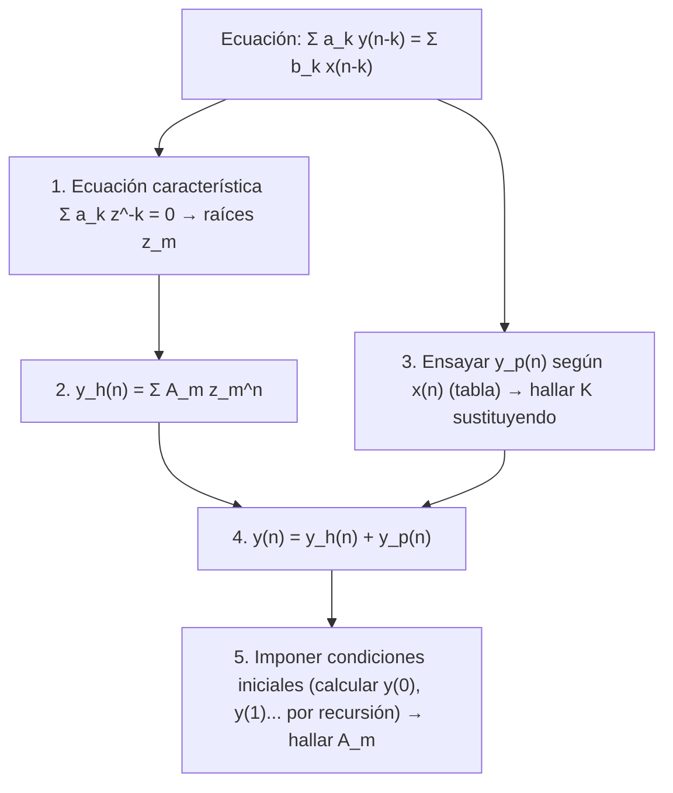

# Tema 4 — Sistemas discretos lineales e invariantes en el tiempo (LTI)

> **Señales Digitales · Tema 4** — Resumen esquemático con teoría, demostraciones, métodos de resolución y los ejercicios del tema (T4.1–T4.3) resueltos y comprobados numéricamente.
>
> Fórmulas en LaTeX (GitHub las renderiza). Convención: **📝** = ampliación o matiz que no aparece literalmente en las diapositivas.

## Índice

1. [Mapa del tema](#1-mapa-del-tema)
2. [¿Qué es un sistema en tiempo discreto?](#2-qué-es-un-sistema-en-tiempo-discreto)
3. [Representación mediante diagramas de bloques](#3-representación-mediante-diagramas-de-bloques)
4. [Clasificación de los sistemas discretos](#4-clasificación-de-los-sistemas-discretos)
5. [Sistemas LTI](#5-sistemas-lti)
6. [Sistemas LTI: ecuación en diferencias](#6-sistemas-lti-ecuación-en-diferencias)
7. [Sistemas LTI: función de transferencia](#7-sistemas-lti-función-de-transferencia)
8. [Estabilidad en el dominio Z](#8-estabilidad-en-el-dominio-z)
9. [Ejercicios del tema resueltos (T4.1 – T4.3)](#9-ejercicios-del-tema-resueltos-t41--t43)
10. [Fórmulas y reglas clave](#10-fórmulas-y-reglas-clave)
11. [Autoevaluación](#11-autoevaluación)
12. [Errores típicos](#12-errores-típicos)
13. [Conexión con el resto de la asignatura](#13-conexión-con-el-resto-de-la-asignatura)

---

## 1. Mapa del tema

Un sistema LTI tiene **tres descripciones equivalentes**: respuesta impulsiva $h(n)$, ecuación en diferencias y función de transferencia $H(z)$.

---

## 2. ¿Qué es un sistema en tiempo discreto?

$$y(n)\equiv\mathcal{T}\big[x(n)\big]$$

Un **sistema en tiempo discreto** es un dispositivo que opera sobre una señal de entrada (o **excitación**) discreta, según una **regla pre-establecida**, para generar otra señal discreta llamada **salida** (o **respuesta**).

**Ejemplos del tema:**

| Sistema | Qué hace | Tipo de operación |
|---|---|---|
| $y(n)=x(n)$ | Identidad: la salida es la entrada | Trivial |
| $y(n)=x(n-1)$ | **Retardo** de una muestra | Desplazamiento |
| $y(n)=5x(n)+2x(n-1)$ | Combinación lineal de muestra actual y anterior | Lineal con memoria |
| $y(n)=\tfrac12\big(x(n)+x(n-1)+x(n-2)\big)$ | **Media móvil** de 3 muestras (suaviza) | Lineal con memoria |
| $y(n)=\sqrt{x(n)}+\sin\big(x(n)\cdot x(n-2)\big)$ | Raíz y seno de productos | **No lineal** |

---

## 3. Representación mediante diagramas de bloques

Un sistema se puede dibujar como una interconexión de **bloques elementales**:

| Bloque | Símbolo | Ecuación |
|---|---|---|
| **Sumador** | $\oplus$ con entradas $x_1[n]$, $x_2[n]$ | $y[n]=x_1[n]+x_2[n]$ |
| **Multiplicador por constante** | $\otimes$ con constante $A$ | $y[n]=A\,x[n]$ |
| **Retardo** | Caja *delay* | $y[n]=x[n-d]$ (en el dominio $Z$: $z^{-d}$) |

**Interconexiones de sistemas:**

| Interconexión | Descripción | Resultado equivalente |
|---|---|---|
| **Serie** | La salida de uno es la entrada del siguiente | $h=h_1*h_2$, $\;H(z)=H_1(z)\,H_2(z)$ |
| **Paralelo** | Misma entrada; las salidas se suman | $h=h_1+h_2$, $\;H(z)=H_1(z)+H_2(z)$ |
| **Realimentación** | Parte de la salida vuelve a la entrada (con signo −) | $H(z)=\dfrac{G(z)}{1+G(z)F(z)}$ ($G$ camino directo, $F$ camino de vuelta) |

> 📝 La fórmula de la realimentación no aparece en las diapositivas; es el resultado estándar para el diagrama con un sumador de signo negativo.

**Ejemplo:** el sistema $y(n)=x(n)+x(n-1)+x(n-2)$ se construye con dos retardos y un sumador:

---

## 4. Clasificación de los sistemas discretos

| Propiedad | Definición | Cómo se comprueba |
|---|---|---|
| **Lineal** | $\mathcal{T}[a\,x_1(n)+b\,x_2(n)]=a\,\mathcal{T}[x_1(n)]+b\,\mathcal{T}[x_2(n)]$ | Comparar la respuesta a una **combinación** con la combinación de las respuestas (**superposición**: aditividad + homogeneidad) |
| **Invariante en el tiempo** | $y(n)\equiv\mathcal{T}[x(n)]\Longrightarrow\mathcal{T}[x(n-t)]=y(n-t)$ | Comparar *retardar la entrada y luego pasar por el sistema* con *pasar por el sistema y luego retardar la salida* |
| **Causal** | $y(n)\equiv\mathcal{F}\big[x(n),x(n-1),x(n-2),\dots\big]$ | La salida en $n$ depende **solo del presente y del pasado** de la entrada (no del futuro) |
| **Estable** (BIBO) | $\lvert x(n)\rvert\le M_x<\infty\Longrightarrow\lvert y(n)\rvert\le M_y<\infty$ | Entrada **acotada** ⇒ salida **acotada**; para refutar basta **un** contraejemplo |

> 📝 **Sistemas estáticos / dinámicos:** un sistema es **estático** (sin memoria) si $y(n)$ depende solo de $x(n)$ (p. ej. $y=x^2$) y **dinámico** (con memoria) si depende de muestras pasadas o futuras.

**Receta para clasificar un sistema:**

1. *Linealidad:* probar con $a\,x_1+b\,x_2$. Cualquier **no linealidad** (cuadrados, exponenciales, constantes sumadas, productos de muestras) la rompe.
2. *Invarianza:* buscar **dependencia explícita de $n$** (como $u(n)$ multiplicando, coeficientes que dependen de $n$, límites fijos de una suma, $x(-n)$, $x(2n)$); si la hay, normalmente no es invariante. Comprobarlo con un desplazamiento concreto.
3. *Causalidad:* mirar los índices de $x$ (¿aparece $x(n+k)$ con $k>0$ o $x(-n)$?).
4. *Estabilidad:* acotar $\lvert y\rvert$; si no se puede, buscar una entrada acotada (constante, escalón) que dé salida no acotada.

---

## 5. Sistemas LTI

### 5.1 Representación completa por la respuesta impulsiva

Los sistemas **lineales e invariantes** quedan **completamente representados** por su **respuesta impulsiva**:

$$h(n)=\mathcal{T}\big[\delta(n)\big]$$

**Demostración** (descomponiendo la entrada en impulsos):

$$x(n)=\sum_{k=-\infty}^{\infty}x(k)\,\delta(n-k)$$

$$y(n)=\mathcal{T}[x(n)]=\mathcal{T}\!\left[\sum_{k}x(k)\,\delta(n-k)\right]\overset{\text{lineal}}{=}\sum_{k}x(k)\,\mathcal{T}[\delta(n-k)]\overset{\text{invariante}}{=}\sum_{k}x(k)\,h(n-k)$$

$$\boxed{y(n)=\sum_{k=-\infty}^{\infty}x(k)\,h(n-k)=x(n)*h(n)}$$

- **Linealidad** permite sacar $x(k)$ (constantes) fuera del sistema.
- **Invarianza** convierte la respuesta a $\delta(n-k)$ en $h(n-k)$ (la respuesta a $\delta(n)$ retardada).

En el dominio $Z$: $y=h*x\;\leftrightarrow\;Y(z)=H(z)X(z)$, de donde

$$H(z)=\frac{Y(z)}{X(z)}$$

### 5.2 Propiedades de la convolución y su significado en sistemas

| Propiedad | Expresión | Significado para sistemas |
|---|---|---|
| **Conmutativa** | $y=h*x=x*h$ | La respuesta puede obtenerse pasando la entrada por el sistema **o el sistema por la entrada** (por raro que suene) |
| **Asociativa** | $y=h_2*[h_1*x]=[h_2*h_1]*x$ | **Dos sistemas en serie** equivalen a **un único sistema** (convolución de los anteriores) |
| **Distributiva** | $y=h_1*x+h_2*x=[h_1+h_2]*x$ | **Dos sistemas en paralelo** equivalen a un único sistema (suma de los anteriores) |

### 5.3 Causalidad

Un sistema LTI es **causal si su respuesta impulsiva es cero para índices temporales negativos** ($h(n)=0$ para $n<0$). Entonces

$$y(n)=\underbrace{\sum_{k=-\infty}^{-1}h(k)\,x(n-k)}_{=0}+\sum_{k=0}^{\infty}h(k)\,x(n-k)=\sum_{k=0}^{\infty}h(k)\,x(n-k)$$

Los términos con $k<0$ multiplicarían a $x(n-k)=x(n+|k|)$ (entradas **futuras**); su anulación equivale a no mirar el futuro.

### 5.4 Estabilidad

Un sistema LTI es **estable si su respuesta impulsiva es absolutamente sumable**:

$$\boxed{\sum_{k=-\infty}^{\infty}\lvert h(k)\rvert<\infty}$$

**Por qué basta (condición suficiente):** si $\lvert x(n)\rvert\le M_x$,

$$\lvert y(n)\rvert\le\sum_{k}\lvert h(k)\rvert\,\lvert x(n-k)\rvert\le M_x\sum_{k}\lvert h(k)\rvert<\infty$$

> 📝 **Por qué también es necesaria:** si $\sum\lvert h\rvert=\infty$, la entrada acotada $x(n)=\operatorname{sgn}\big(h(-n)\big)$ da $y(0)=\sum_k\lvert h(k)\rvert=\infty$.

### 5.5 FIR frente a IIR

| | **FIR** (respuesta impulsiva finita) | **IIR** (respuesta impulsiva infinita) |
|---|---|---|
| $h(n)$ | Nula fuera de un intervalo finito | Dura indefinidamente |
| Convolución | Suma **finita** de términos | Suma de **infinitos** términos |
| Estabilidad | **Siempre estable** (suma finita) | Depende de los polos |
| En la práctica | – | La aparición de respuestas IIR **no es algo inusual** |

---

## 6. Sistemas LTI: ecuación en diferencias

### 6.1 Motivación: calcular con la convolución no siempre es práctico

Aunque cualquier LTI se puede representar mediante una función de las muestras de entrada, $y=h*x$, **en muchos casos no es práctico**: si el sistema es **IIR**, la convolución implica **sumar infinitos términos**.

**Ejemplo ("velocidad media" de un velocímetro).** Se quiere un sistema que dé la velocidad media hasta el instante $n$:

$$y(n)=\frac{1}{n+1}\sum_{k=0}^{n}x(k)$$

**¿Cuánta memoria haría falta?** Con la definición directa, **todas** las muestras pasadas (crece sin límite). **¿Cómo lo hacen los aparatos comerciales?** Aislando el último término y reutilizando la salida anterior:

$$y(n)=\frac{1}{n+1}\left(\sum_{k=0}^{n-1}x(k)+x(n)\right)=\frac{n}{n+1}\underbrace{\frac1n\sum_{k=0}^{n-1}x(k)}_{y(n-1)}+\frac{1}{n+1}x(n)$$

$$\boxed{y(n)=\frac{n}{n+1}\,y(n-1)+\frac{1}{n+1}\,x(n)}$$

Basta guardar **un único valor** ($y(n-1)$) y el contador $n$.

> 📝 Este ejemplo ilustra la **idea** (reutilizar la salida anterior). Como los coeficientes dependen de $n$ ($\frac{n}{n+1}$), el sistema es lineal pero **no invariante**: no es un LTI de coeficientes constantes.

### 6.2 Forma general (coeficientes constantes)

Cualquier sistema LTI puede expresarse mediante una **ecuación en diferencias con coeficientes constantes**:

$$y(n)=-\sum_{k=1}^{N}a_k\,y(n-k)+\sum_{k=0}^{M}b_k\,x(n-k)\qquad\Longleftrightarrow\qquad\sum_{k=0}^{N}a_k\,y(n-k)=\sum_{k=0}^{M}b_k\,x(n-k)\quad(a_0=1)$$

- **Ventaja:** forma **eficiente** de representar/implementar el sistema (pocos coeficientes, aun siendo IIR).
- **Contrapartida:** es **inherentemente recursiva** (la salida depende de salidas anteriores). **Problema:** ¿cómo se empieza? → hacen falta **condiciones iniciales**.

### 6.3 La recursividad y las condiciones iniciales

Ejemplo de primer orden, $y(n)=a\,y(n-1)+x(n)$. Se desarrolla paso a paso:

$$y(0)=a\,y(-1)+x(0)$$
$$y(1)=a\,y(0)+x(1)=a^{2}y(-1)+a\,x(0)+x(1)$$
$$y(2)=a\,y(1)+x(2)=a^{3}y(-1)+a^{2}x(0)+a\,x(1)+x(2)$$

$$\boxed{y(n)=a^{n+1}y(-1)+\sum_{k=0}^{n}a^{k}\,x(n-k)}$$

Se distinguen **dos contribuciones**:

| Término | Depende de | Nombre |
|---|---|---|
| $a^{n+1}y(-1)$ | Solo de la condición inicial | **Respuesta natural** (a entrada cero) |
| $\sum_{k=0}^{n}a^{k}x(n-k)$ | Solo de la entrada | **Respuesta forzada** (con condiciones iniciales nulas) |

### 6.4 Dos descomposiciones de la solución (no confundir)

La solución de una ecuación en diferencias se puede escribir como suma de dos maneras distintas:

$$y(n)=y_{n}(n)+y_{f}(n)\qquad\longleftrightarrow\qquad y(n)=y_{h}(n)+y_{p}(n)$$

| Descomposición | Qué separa | Se determina por… |
|---|---|---|
| **Natural + forzada** ($y_n+y_f$) | Efecto de las **condiciones iniciales** frente al efecto de la **entrada** | $y_n$: entrada cero. $y_f$: condiciones iniciales nulas |
| **Homogénea + particular** ($y_h+y_p$) | **Forma matemática** de la solución: parte "libre" frente a parte "que imita la entrada" | $y_h$: ecuación con entrada 0. $y_p$: una solución cualquiera con la entrada |

> 📝 Con **condiciones iniciales nulas**: $y_n=0$ y $y=y_f$; pero $y_f$ **contiene** una parte homogénea y otra particular (se verá en T4.2c).

### 6.5 Solución homogénea: suma de exponenciales

Se resuelve $\displaystyle\sum_{k=0}^{N}a_k\,y_h(n-k)=0$. Se ensaya una suma de exponenciales:

$$y_h(n)=\sum_{m=1}^{P}A_m\,(z_m)^{n}$$

Sustituyendo en la ecuación:

$$0=\sum_{k=0}^{N}a_k\sum_{m=1}^{P}A_m\,(z_m)^{n-k}=\sum_{m=1}^{P}A_m\,(z_m)^{n}\left[\sum_{k=0}^{N}a_k\,(z_m)^{-k}\right]$$

Se anula si cada $z_m$ es raíz de la **ecuación característica**:

$$\boxed{\sum_{k=0}^{N}a_k\,z^{-k}=0}$$

(las raíces $z_m$ son los **polos** del sistema).

> 📝 Si una raíz $z_m$ se repite $r$ veces, aparecen además los términos $n\,z_m^{\,n},\dots,n^{r-1}z_m^{\,n}$. Las constantes $A_m$ se ajustan con las **condiciones iniciales** (sobre la solución **total**, no sobre $y_h$ sola).

### 6.6 Solución particular: se ensaya "algo parecido" a la entrada

| Entrada $x(n)$ | Ensayo para $y_p(n)$ |
|---|---|
| $A$ (constante) | $K$ (constante) |
| $A\,a^{n}$ | $K\,a^{n}$ |
| $A\,n^{M}$ | $K_0n^{M}+K_1n^{M-1}+\dots+K_M$ |
| $a^{n}n^{M}$ | $a^{n}\big(K_0n^{M}+K_1n^{M-1}+\dots+K_M\big)$ |
| $A\cos\omega_0n$ ó $A\sin\omega_0n$ | $K_1\cos\omega_0n+K_2\sin\omega_0n$ |

> 📝 Si el ensayo **coincide con un modo homogéneo** (la base $a$ es raíz característica), se multiplica por $n$ (resonancia).

### 6.7 Procedimiento completo

---

## 7. Sistemas LTI: función de transferencia

La **función de transferencia** es la forma básica de describir sistemas LTI. En el dominio $Z$:

$$H(z)=\frac{Y(z)}{X(z)}\qquad\Longleftrightarrow\qquad Y(z)=H(z)\cdot X(z)$$

Indica cómo se "transfiere" o convierte la entrada en la salida. A partir de las propiedades de la T.Z.: $h(n)*x(n)\leftrightarrow H(z)X(z)$, luego **$H(z)$ es la transformada Z de la respuesta impulsiva**.

### 7.1 Es una transformada racional

Aplicando la T.Z. a la ecuación en diferencias (el retardo $k$ se convierte en $z^{-k}$):

$$\sum_{k=0}^{N}a_k\,y(n-k)=\sum_{k=0}^{M}b_k\,x(n-k)\;\Longrightarrow\;H(z)=\frac{Y(z)}{X(z)}=\frac{\sum_{k=0}^{M}b_kz^{-k}}{\sum_{k=0}^{N}a_kz^{-k}}=\frac{b_0+b_1z^{-1}+b_2z^{-2}+\dots+b_Mz^{-M}}{a_0+a_1z^{-1}+a_2z^{-2}+\dots+a_Nz^{-N}}$$

Por tanto se aplican **todas las propiedades de las transformadas racionales** (Tema 2): polos, ceros, convergencia, estabilidad e inversión.

### 7.2 Tres tipos de sistemas según su función de transferencia

| Tipo | $H(z)$ | Ecuación en diferencias | Comentario |
|---|---|---|---|
| **Todo polos** | $\dfrac{b_0}{\sum_{k=0}^{N}a_kz^{-k}}=G_0\dfrac{1}{\prod_{k=1}^{N}(1-p_kz^{-1})}$ | $y(n)=\sum_{k=1}^{N}a_ky(n-k)+b_0x(n)$ | Recursivo (IIR) |
| **Todo ceros** | $\sum_{k=0}^{M}b_kz^{-k}=G_0\prod_{k=1}^{M}(1-z_kz^{-1})$ | $y(n)=\sum_{k=0}^{M}b_kx(n-k)=h(n)*x(n)$ con $h(k)=b_k$ | **FIR**: $h(n)$ se lee directamente de los coeficientes |
| **Polos y ceros** | $\dfrac{\sum b_kz^{-k}}{\sum a_kz^{-k}}$ | Caso general | IIR, con polos y ceros |

> 📝 En la diapositiva del sistema todo polos, la ecuación se escribe con $+\sum a_ky(n-k)$; con el convenio de la forma general (§6.2, donde $a_0=1$ y el término lleva signo menos) los $a_k$ cambiarían de signo. Es una diferencia de **convenio**, no de contenido.

---

## 8. Estabilidad en el dominio Z

**Un sistema LTI es estable si la ROC de $H(z)$ contiene la circunferencia unidad.**

**Traducción:** un sistema LTI **causal** es estable si **todos los polos de $H(z)$ están dentro de la circunferencia unidad**.

ROC de transformadas racionales causales:

$$\lvert z\rvert>p_{max},\qquad p_{max}=\max_k\lvert p_k\rvert$$

(causal estable $\iff p_{max}<1$, porque entonces la ROC incluye $\lvert z\rvert=1$).

### 8.1 Ejemplo de referencia: $h(n)=a^{n}u(n)$

$$H(z)=\frac{1}{1-az^{-1}},\qquad ROC:\ \lvert z\rvert>\lvert a\rvert$$

| Polo $a$ | Comportamiento de $h(n)$ | ¿Estable? (¿$\sum\lvert h\rvert<\infty$?) |
|:-:|---|:-:|
| $0<a<1$ | Decrece monótonamente | ✅ |
| $-1<a<0$ | Decrece alternando signo | ✅ |
| $a=1$ | Constante (escalón) | ❌ |
| $a=-1$ | Constante alternando signo | ❌ |
| $a>1$ | Crece exponencialmente | ❌ |
| $a<-1$ | Crece alternando signo | ❌ |

### 8.2 Sistemas con varios polos: descomposición en fracciones simples

> **"Recuerda la descomposición en fracciones simples."** Cada polo $p_k$ aporta un término $A_k\,p_k^{\,n}\,u(n)$ a $h(n)$ (si es doble, además $n\,p_k^{\,n}$, etc.).

- El sistema es estable **si y solo si cada término decae**, es decir, **todos los polos cumplen $\lvert p_k\rvert<1$**.
- Un solo polo con $\lvert p\rvert>1$ **domina** y hace inestable al conjunto (T4.2).
- 📝 Polos **sobre** la circunferencia unidad: respuesta que no decae (constante u oscilante, o creciente linealmente si el polo es doble): el sistema es **marginalmente estable**, no estable en el sentido BIBO.
- 📝 Un FIR (todo ceros) solo tiene polos en $z=0$: **siempre estable**.

> 📝 La condición "la ROC contiene $\lvert z\rvert=1$" es la misma que garantiza que exista la **respuesta en frecuencia** $H(\omega)=H(z)\big|_{z=e^{j\omega}}$ (DTFT de $h$).

---

## 9. Ejercicios del tema resueltos (T4.1 – T4.3)

### T4.1 — Clasificar los sistemas (lineal, invariante, estable, causal)

**Enunciado:** indique si cada sistema es lineal, invariante en el tiempo, estable y causal:

a) $y(n)=x(n)+x(n-1)+x(n-2)$ b) $y(n)=x^{2}(n)\,u(n)$ c) $y(n)=\dfrac{\exp(x(n))}{x(n-1)}$

d) $y(n)=x(n)+x(-n)$ e) $y(n)=\displaystyle\sum_{k=0}^{n}x(k)$ f) $y(n)=\displaystyle\sum_{k=n-n_0}^{n+n_0}x(k)$ (con $n_0>0$)

**Resultado:**

| | Lineal | Invariante | Estable | Causal | Memoria |
|:-:|:-:|:-:|:-:|:-:|:-:|
| **a** | ✅ | ✅ | ✅ | ✅ | Dinámico |
| **b** | ❌ | ❌ | ✅ | ✅ | Estático |
| **c** | ❌ | ✅ | ❌ | ✅ | Dinámico |
| **d** | ✅ | ❌ | ✅ | ❌ | Dinámico |
| **e** | ✅ | ❌ | ❌ | ✅ | Dinámico |
| **f** | ✅ | ✅ | ✅ | ❌ | Dinámico |

**Justificación, sistema a sistema:**

**a) $y(n)=x(n)+x(n-1)+x(n-2)$.**
- *Lineal:* suma de operaciones lineales (retardos y sumas): $T[ax_1+bx_2]=aT[x_1]+bT[x_2]$ ✓.
- *Invariante:* no hay dependencia explícita de $n$; retardar la entrada $t$ muestras retarda la salida $t$ muestras ✓.
- *Causal:* usa $x(n),x(n-1),x(n-2)$ (presente y pasado) ✓.
- *Estable:* $\lvert y\rvert\le3M_x$ ✓ (es un FIR: $h=\delta(n)+\delta(n-1)+\delta(n-2)$).

**b) $y(n)=x^{2}(n)\,u(n)$.**
- *No lineal:* con $x_1=x_2=\delta(n)$: $T[x_1+x_2]=(2\delta)^2=4\delta(n)$, pero $T[x_1]+T[x_2]=2\delta(n)$.
- *No invariante:* aparece $u(n)$, que depende **explícitamente** de $n$. Contraejemplo: $x(n)=\delta(n+1)\Rightarrow y(n)=0$ (porque $u(-1)=0$); con la entrada retardada, $x(n-1)=\delta(n)\Rightarrow y=\delta(n)\ne y(n-1)=0$.
- *Causal:* depende solo de $x(n)$ ✓ (estático).
- *Estable:* $\lvert y(n)\rvert\le M_x^{2}$ ✓.

**c) $y(n)=\exp(x(n))/x(n-1)$.**
- *No lineal:* $\exp$ y división. Por ejemplo, al duplicar la entrada, $\frac{e^{2x(n)}}{2x(n-1)}\ne2\frac{e^{x(n)}}{x(n-1)}$.
- *Invariante:* no hay $n$ explícito; $T[x(n-t)]=\frac{e^{x(n-t)}}{x(n-t-1)}=y(n-t)$ ✓.
- *Causal:* usa $x(n)$ y $x(n-1)$ ✓.
- *No estable:* si $x(n-1)$ se acerca a 0 (entrada **acotada**), $y(n)\to\infty$; y para $x(n-1)=0$ ni siquiera está definida.

**d) $y(n)=x(n)+x(-n)$.**
- *Lineal:* ✓.
- *No invariante:* $T[x(n-t)]=x(n-t)+x(-n-t)$, mientras que $y(n-t)=x(n-t)+x(-n+t)$: **no coinciden** (la inversión $n\to-n$ no conmuta con el retardo).
- *No causal:* para $n=-1$, $y(-1)=x(-1)+x(1)$ depende de $x(1)$, una muestra **futura**.
- *Estable:* $\lvert y\rvert\le2M_x$ ✓.

**e) $y(n)=\sum_{k=0}^{n}x(k)$ (acumulador desde $k=0$).**
- *Lineal:* ✓ (suma finita de términos lineales).
- *No invariante:* el límite inferior $k=0$ está **fijo**. Contraejemplo: $x_1(n)=\delta(n+1)$ da $y_1(n)=0$ (la muestra $k=-1$ no se suma); con la entrada retardada, $x_1(n-1)=\delta(n)$ da $u(n)\ne y_1(n-1)=0$.
- *Causal:* usa $x(0),\dots,x(n)$ ✓.
- *No estable:* con la entrada acotada $x(n)=u(n)$ resulta $y(n)=n+1\to\infty$.

**f) $y(n)=\sum_{k=n-n_0}^{n+n_0}x(k)$.**
- *Lineal:* ✓.
- *Invariante:* una **ventana móvil** de límites relativos a $n$: $T[x(n-t)]=\sum_{k=n-n_0}^{n+n_0}x(k-t)=\sum_{m=n-t-n_0}^{n-t+n_0}x(m)=y(n-t)$ ✓.
- *No causal:* usa hasta $x(n+n_0)$, muestras **futuras** (si $n_0=0$ sería causal).
- *Estable:* suma de $2n_0+1$ términos: $\lvert y\rvert\le(2n_0+1)M_x$ ✓.

> Los contraejemplos de lineal/invariante/causal de b, c, d, e y f se han comprobado numéricamente.

---

### T4.2 — Resolver $y(n)-y(n-1)-6y(n-2)=x(n)$

Se escribe de forma recursiva: $y(n)=y(n-1)+6\,y(n-2)+x(n)$.

**Paso previo: polos y estabilidad.** Ecuación característica:

$$1-z^{-1}-6z^{-2}=0\;\Longrightarrow\;z^{2}-z-6=0\;\Longrightarrow\;(z-3)(z+2)=0\;\Longrightarrow\;z=3,\;z=-2$$

$$H(z)=\frac{1}{1-z^{-1}-6z^{-2}}=\frac{1}{(1-3z^{-1})(1+2z^{-1})}$$

Solución homogénea: $y_h(n)=A\,3^{n}+B\,(-2)^{n}$. **Ambos polos tienen módulo $>1$** ⇒ el sistema (causal) es **inestable**.

#### a) Respuesta impulsiva con $y(-1)=y(-2)=0$

Entrada $x(n)=\delta(n)$. Para $n\ge1$ la entrada es 0, así que la ecuación es homogénea: $h(n)=A\,3^{n}+B(-2)^{n}$. Se fijan $A,B$ con los dos primeros valores, calculados por recursión:

$$h(0)=h(-1)+6h(-2)+\delta(0)=1,\qquad h(1)=h(0)+6h(-1)+0=1$$

$$\begin{cases}A+B=1\\3A-2B=1\end{cases}\Longrightarrow\;A=\tfrac35,\quad B=\tfrac25$$

$$\boxed{h(n)=\left[\tfrac35\,3^{n}+\tfrac25\,(-2)^{n}\right]u(n)}$$

**Comprobación** (por la recursión): $h=1,\;1,\;7,\;13,\;55,\dots$ — y con la fórmula, $h(2)=\frac{27}{5}+\frac85=7$ ✓, $h(3)=\frac{81}5-\frac{16}5=13$ ✓.

**Verificación con $Z$:** $H(z)=\dfrac{3/5}{1-3z^{-1}}+\dfrac{2/5}{1+2z^{-1}}$ ⇒ el mismo resultado.

#### b) Respuesta a la entrada cero con condiciones iniciales nulas

La respuesta a **entrada cero** depende **solo de las condiciones iniciales** (es la respuesta natural). Con $y(-1)=y(-2)=0$ no hay ninguna excitación: nada "arranca" el sistema. Por recursión, $y(0)=y(-1)+6y(-2)+0=0$, $y(1)=0$, … 

$$\boxed{y(n)=0\ \text{ para todo }n}$$

> 📝 **Ampliación (para entender la respuesta natural):** con entrada cero y condiciones **no nulas**, p. ej. $y(-1)=1$, $y(-2)=0$, se obtiene $y(0)=1$, $y(1)=7$, $y(2)=13,\dots$, y se ajusta $A+B=1$, $3A-2B=7\Rightarrow y_n(n)=\frac95\,3^{n}-\frac45(-2)^{n}$ (comprobado). Ese sería el efecto de las condiciones iniciales; en el apartado b) son nulas y el efecto es nulo.

#### c) Respuesta a $x(n)=(0.25)^{n}u(n)$ con condiciones iniciales nulas

**Paso 1 — solución particular.** La entrada es $a^n$ con $a=0.25$ (no es raíz característica), así que se ensaya $y_p(n)=K\,(0.25)^{n}$. Se sustituye en la ecuación (notar que $(0.25)^{n-1}=4(0.25)^{n}$ y $(0.25)^{n-2}=16(0.25)^{n}$):

$$K(0.25)^{n}\big[1-4-6\cdot16\big]=(0.25)^{n}\;\Longrightarrow\;K\cdot(-99)=1\;\Longrightarrow\;K=-\tfrac{1}{99}$$

**Paso 2 — solución total.** Para $n\ge0$:

$$y(n)=A\,3^{n}+B\,(-2)^{n}-\tfrac{1}{99}(0.25)^{n}$$

**Paso 3 — condiciones iniciales** (se imponen a la solución **total**). Por recursión con $y(-1)=y(-2)=0$:

$$y(0)=x(0)=1,\qquad y(1)=y(0)+6y(-1)+x(1)=1+0.25=1.25$$

$$\begin{cases}A+B-\frac{1}{99}=1\\[1mm]3A-2B-\frac{1}{99}\cdot\frac14=\frac54\end{cases}\Longrightarrow\begin{cases}A+B=\frac{100}{99}\\[1mm]3A-2B=\frac{124}{99}\end{cases}\Longrightarrow\;A=\tfrac{36}{55},\;B=\tfrac{16}{45}$$

$$\boxed{y(n)=\left[\tfrac{36}{55}\,3^{n}+\tfrac{16}{45}\,(-2)^{n}-\tfrac{1}{99}\,(0.25)^{n}\right]u(n)}$$

**Comprobación:**

| $n$ | 0 | 1 | 2 | 3 |
|:-:|:-:|:-:|:-:|:-:|
| Recursión | 1 | 1.25 | 7.3125 | 14.828 |
| Fórmula | 1 | 1.25 | 7.3125 | 14.828 |

**Método alternativo (transformada Z)**, mucho más corto: $Y(z)=H(z)X(z)=\dfrac{1}{(1-3z^{-1})(1+2z^{-1})(1-0.25z^{-1})}$. Los residuos en cada polo son $A=\frac{36}{55}$ (polo 3), $B=\frac{16}{45}$ (polo $-2$) y $K=-\frac1{99}$ (polo 0.25).

**Lectura del resultado:** el término $-\frac1{99}(0.25)^n$ es la parte **particular** (sigue la forma de la entrada) y los otros dos son la parte **homogénea** (los polos del sistema). Con condiciones iniciales nulas, $y=y_f$ (forzada), que incluye ambas. Como los polos $3$ y $-2$ están fuera de la circunferencia unidad, **la salida crece sin límite aunque la entrada se apague**.

---

### T4.3 — Filtro modulado: $g(n)=(-1)^{n}h(n)$

**Enunciado:** $h(n)$ es la respuesta impulsiva de un filtro **paso bajo** de frecuencia de corte $\omega_c$. (1) ¿Qué tipo de filtro tiene respuesta impulsiva $g(n)=(-1)^{n}h(n)$? (2) Si $h$ se implementa con $y(n)=-\sum_{k=1}^{p}a(k)y(n-k)+\sum_{k=0}^{q}b(k)x(n-k)$, ¿cómo debe modificarse esta ecuación para implementar $g$?

#### (1) Tipo de filtro

**Paso 1.** $(-1)^n=e^{j\pi n}$ (porque $e^{j\pi n}=\cos\pi n+j\sin\pi n=\cos\pi n=(-1)^n$ para $n$ entero).

**Paso 2: propiedad de desplazamiento en frecuencia de la DTFT:** $e^{j\omega_0n}x(n)\leftrightarrow X(\omega-\omega_0)$. Con $\omega_0=\pi$:

$$G(\omega)=H(\omega-\pi)$$

**Paso 3:** la respuesta en frecuencia de $H$ se **desplaza $\pi$**. La banda de paso de $H$, $\lvert\omega\rvert<\omega_c$ (alrededor de $\omega=0$), pasa a ser $\lvert\omega-\pi\rvert<\omega_c$, es decir, **alrededor de $\omega=\pi$** (frecuencias más altas).

$$\boxed{g(n)\text{ es un filtro paso alto, con frecuencia de corte }\omega_c'=\pi-\omega_c}$$

En el dominio $Z$: $G(z)=\sum(-1)^nh(n)z^{-n}=H(-z)$: **todos los polos y ceros giran 180°** ($p\to-p$, $z_k\to-z_k$); lo que estaba cerca de $z=1$ (graves) pasa a estar cerca de $z=-1$ (agudos).

#### (2) Modificación de la ecuación en diferencias

**Paso 1.** La función de transferencia de $h$ es $H(z)=\dfrac{B(z)}{A(z)}=\dfrac{\sum_{k=0}^{q}b(k)z^{-k}}{1+\sum_{k=1}^{p}a(k)z^{-k}}$.

**Paso 2.** $G(z)=H(-z)$ equivale a sustituir $z^{-k}\to(-z)^{-k}=(-1)^{k}z^{-k}$ en cada coeficiente:

$$\boxed{a'(k)=(-1)^{k}\,a(k),\qquad b'(k)=(-1)^{k}\,b(k)}$$

**Ecuación modificada:**

$$y(n)=-\sum_{k=1}^{p}(-1)^{k}a(k)\,y(n-k)+\sum_{k=0}^{q}(-1)^{k}b(k)\,x(n-k)$$

Es decir, **se cambia el signo de los coeficientes de índice impar** ($k=1,3,5,\dots$) y se dejan igual los de índice par.

**Comprobación con un ejemplo:** $h(n)=0.8^{n}u(n)$ (paso bajo) se implementa con $y(n)=0.8\,y(n-1)+x(n)$, es decir, $a(1)=-0.8$, $b(0)=1$. Con la regla, $a'(1)=(-1)^{1}(-0.8)=+0.8$, $b'(0)=1$: $y(n)=-0.8\,y(n-1)+x(n)$, cuya respuesta impulsiva es $(-0.8)^{n}u(n)=(-1)^{n}0.8^{n}u(n)=g(n)$ ✓ (polo en $z=-0.8$: paso alto).

> Comprobado numéricamente también con un Butterworth de orden 3: la respuesta impulsiva con los coeficientes modificados coincide **exactamente** con $(-1)^nh(n)$, y la ganancia en $\omega=\pi$ de $G$ es igual a la de $H$ en $\omega=0$.

---

## 10. Fórmulas y reglas clave

| Concepto | Expresión |
|---|---|
| **Sistema** | $y(n)=\mathcal{T}[x(n)]$ |
| **Respuesta impulsiva** | $h(n)=\mathcal{T}[\delta(n)]$ |
| **Salida de un LTI** | $y(n)=x(n)*h(n)=\sum_kx(k)h(n-k)$ |
| **Serie / paralelo** | $h_1*h_2$ / $h_1+h_2$ (en $Z$: producto / suma) |
| **Causal (LTI)** | $h(n)=0$ para $n<0$ |
| **Estable (LTI)** | $\sum\lvert h(k)\rvert<\infty$ ⇔ ROC contiene $\lvert z\rvert=1$ |
| **Ecuación en diferencias** | $\sum_{k=0}^{N}a_ky(n-k)=\sum_{k=0}^{M}b_kx(n-k)$, $a_0=1$ |
| **Ecuación característica** | $\sum a_kz^{-k}=0$; raíces = polos |
| **Solución** | $y=y_h+y_p$ (constantes con las condiciones iniciales) |
| **Función de transferencia** | $H(z)=Y(z)/X(z)=\sum b_kz^{-k}/\sum a_kz^{-k}$ |
| **Todo ceros** | FIR, $h(k)=b_k$, siempre estable |
| **Causal estable** | Todos los polos con $\lvert p\rvert<1$ |
| **Modulación por $(-1)^n$** | $H(z)\to H(-z)$; paso bajo ↔ paso alto; $a(k),b(k)\to(-1)^ka(k),(-1)^kb(k)$ |

---

## 11. Autoevaluación

<b>1. ¿Por qué un LTI queda completamente descrito por $h(n)$?</b>

Porque cualquier entrada es una suma de impulsos; por linealidad la salida es la suma de las respuestas a cada impulso, y por invarianza cada una es $h$ desplazada: $y=\sum x(k)h(n-k)$.

<b>2. ¿Qué equivale a conectar dos sistemas en serie? ¿Y en paralelo?</b>

Serie: convolución de las respuestas impulsivas ($H_1H_2$). Paralelo: suma ($H_1+H_2$).

<b>3. ¿Cuándo es causal un LTI? ¿Y estable?</b>

Causal: $h(n)=0$ para $n<0$. Estable: $\sum\lvert h\rvert<\infty$ (equivalente: ROC con $\lvert z\rvert=1$; en causal, polos dentro del círculo).

<b>4. ¿Qué diferencia hay entre natural+forzada y homogénea+particular?</b>

La primera separa el efecto de las condiciones iniciales del efecto de la entrada; la segunda separa la parte "libre" (polos) de la que imita a la entrada. Con condiciones nulas, la respuesta es solo forzada, pero contiene partes homogénea y particular.

<b>5. Raíces características de $y(n)-y(n-1)-6y(n-2)=x(n)$ y estabilidad.</b>

$z=3$ y $z=-2$; fuera de la circunferencia unidad ⇒ inestable.

<b>6. ¿Por qué $y(n)=\sum_{k=0}^nx(k)$ no es estable ni invariante?</b>

Con $x=u(n)$ da $n+1\to\infty$ (no estable). El límite inferior fijo hace que $\delta(n+1)$ no se acumule pero $\delta(n)$ (su versión retardada) sí (no invariante).

<b>7. ¿Cómo se convierte un paso bajo en paso alto con $(-1)^n$?</b>

$g(n)=(-1)^nh(n)\Rightarrow G(\omega)=H(\omega-\pi)$, $G(z)=H(-z)$. En la ecuación en diferencias se cambia el signo de los coeficientes de índice impar.

---

## 12. Errores típicos

- **Linealidad:** olvidar que sumar una **constante** o elevar al cuadrado rompe la linealidad.
- **Invarianza:** no ver las dependencias ocultas de $n$ ($u(n)$ multiplicando, límites de suma fijos, $x(-n)$).
- **Causalidad:** juzgar solo por $x(n)$ y olvidar $x(-n)$ o ventanas que miran hacia $n+n_0$.
- **Estabilidad:** concluir "estable" porque la fórmula "parece acotada": probar siempre con una entrada acotada concreta (constante, escalón).
- **Condiciones iniciales:** imponerlas solo a $y_h$ en lugar de a la solución **total** $y_h+y_p$.
- **Particular:** ensayar una forma que coincide con un modo homogéneo (hay que multiplicar por $n$).
- **Respuesta a entrada cero:** pensar que es siempre cero (lo es solo si las condiciones iniciales son nulas).
- **Signos:** confundir $y(n)=\pm\sum a_ky(n-k)$ según el convenio de $a_k$.

---

## 13. Conexión con el resto de la asignatura

| Tema / Práctica | Relación |
|---|---|
| **Tema 2 (transformada Z)** | $H(z)$ es una transformada racional; ROC, polos y ceros, inversión por fracciones simples |
| **Tema 3 (DTFT)** | $H(\omega)=H(z)\big|_{z=e^{j\omega}}$; desplazamiento en frecuencia ($T4.3$) |
| **Práctica 2** | Convolución: $y=x*h$ |
| **Práctica 3 (sistemas LIT)** | Implementación de ecuaciones en diferencias (`filter`), respuesta al impulso y al escalón, polos y ceros, `freqz` |
| **Prácticas 4 y 5** | Diseño y uso de filtros FIR/IIR |
