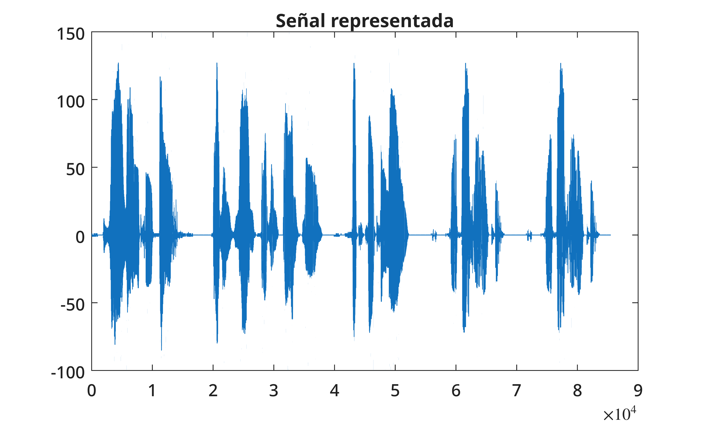
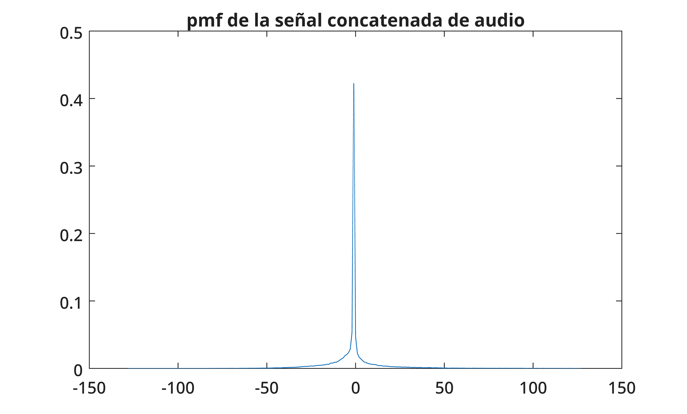
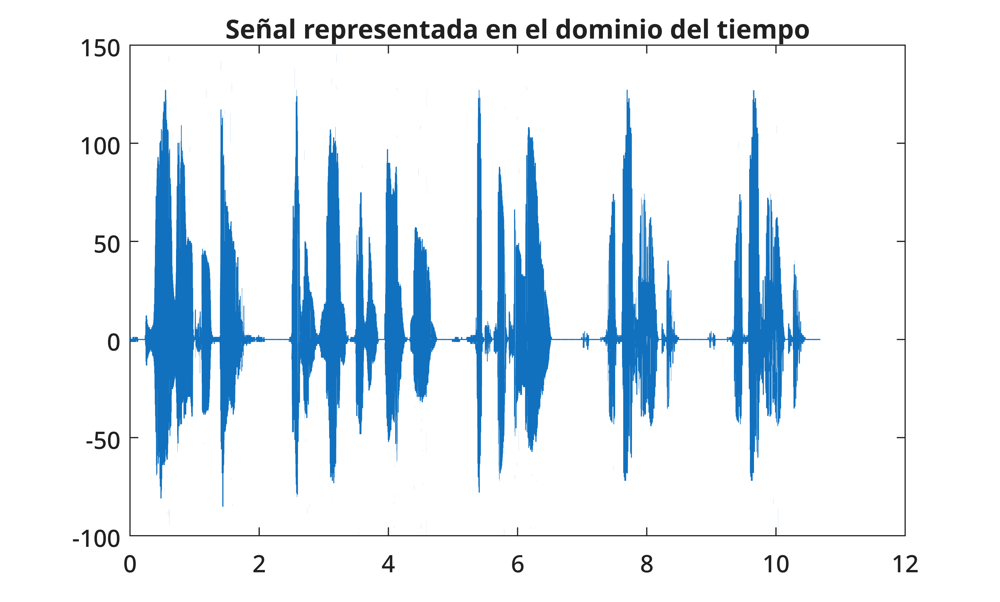
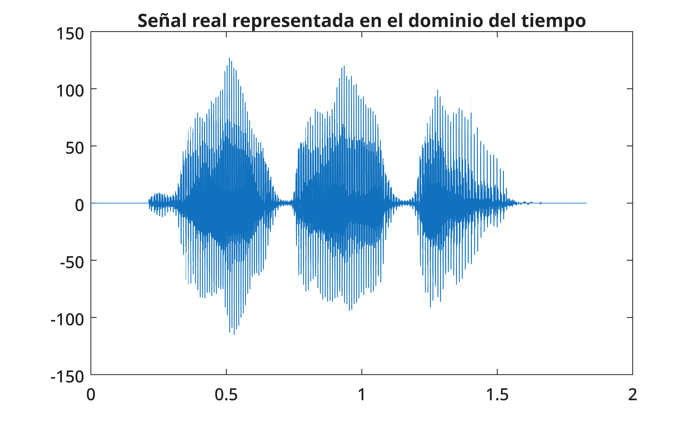
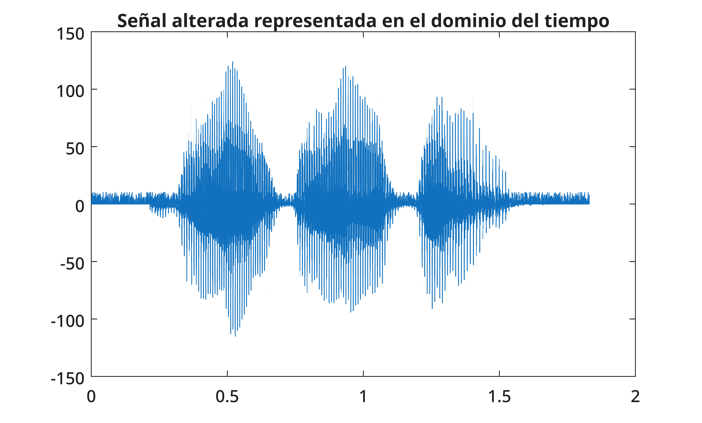
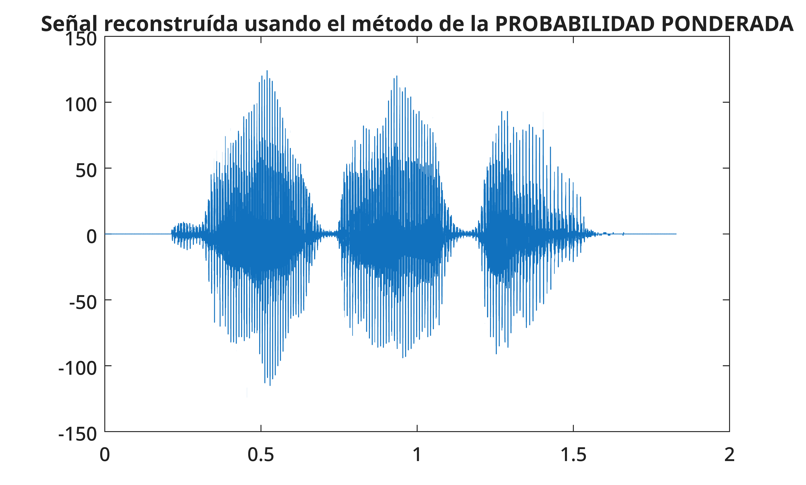

# Guía de estudio — Práctica 2
## Modelado de la señal de voz como un proceso aleatorio y su aplicación en la transmisión sobre un canal con pérdidas (modelo 1)

> Documento fuente: `practica_2_parte_1_v3_0_preparado_para_claude.md` (autoría original: Alexandru Theodor Muntenaş).
> Esta guía **no** sustituye al original: lo explica, lo ordena y lo contrasta con las matemáticas.

---

## 0. Cómo leer esta guía

Para separar lo que dice la práctica de lo que añado yo, uso tres etiquetas:

| Etiqueta | Significado |
|---|---|
| 📄 **DOCUMENTO** | Lo que afirma o hace el material original (código, valores, texto). |
| 🧑‍🏫 **ACLARACIÓN** | Explicación o razonamiento didáctico mío; no figura en el original. |
| ⚠️ **DISCREPANCIA (Dn)** | Inconsistencia entre texto, fórmula y/o código. Se documenta, **no** se corrige en silencio. |

**Limitaciones de partida (importante):**
- No dispongo de los archivos `.wav` ni del PDF original, ni de las gráficas (solo marcadores con nombre y título). Por tanto **no puedo describir la forma exacta de las gráficas** más allá de lo que el documento indica; deduzco lo razonable y lo marco como 🧑‍🏫.
- No he ejecutado el código. Todos los valores numéricos (0.4225, 128, −1, −0.0019, 9.8253, 9.8361, 85502, 16998) son los que figuran en el documento.
- Las salidas de MATLAB están truncadas en el original (solo se ven las primeras columnas/filas).

### 0.1. Índice de discrepancias detectadas

Léelo primero: varias afectan a cómo interpretar los resultados.

| ID | Dónde | Resumen | Gravedad |
|---|---|---|---|
| **D1** | Carga de señales | `s4` y `s5` leen **el mismo archivo** (`dm1_cln.wav`). Además el texto dice "8 señales" y solo se cargan 5. | Media |
| **D2** | Decodificación | El texto dice "multiplicar por **128**"; el código multiplica por **256**. | Media |
| **D3** | Tabla de conteo | Índice `S + 128` frente a cabecera `-128:127` (la columna correcta sería `S + 129`). Con `S = -128` daría error. | **Alta** |
| **D4** | Moda | `trendPosition - 129` es coherente con la cabecera, **no** con el índice usado al contar (D3). Probable error de ±1 en la moda. | **Alta** |
| **D5** | Prob. ponderada | Vector `[-127:128]` frente a la definición teórica $s=-128,\dots,127$. | **Alta** |
| **D6** | Probabilidad 0 | El original atribuye los ceros a "aproximaciones de las operaciones"; en realidad son valores **que no aparecen** en los datos. | Baja |
| **D7** | Figuras | `grafica_senal_real.png` es el identificador de **dos** figuras distintas. | Baja |
| **D8** | Pérdidas | El "valor perdido" se simula con `randi([1,10])`, es decir, un número aleatorio en 1–10 (no 0, no ruido de amplitud comparable a la señal). | Baja (aclarar) |
| **D9** | `sound()` | Se llama con señales en escala $\pm128$ (MATLAB espera $\pm1$) y, en las últimas líneas, sin frecuencia. | Baja |
| **D10** | Texto/formato | "medios sin pérdidas" (casi seguro "con pérdidas"); instrucciones MATLAB partidas en varias líneas sin `...`; fórmulas con delimitadores rotos por la conversión. | Baja |

---

## A. Introducción y objetivos

### A.1. Qué se pretende estudiar

📄 **DOCUMENTO.** Se parte de una señal de voz digitalizada a **8 kHz** con **8 bits** por muestra, que se transmite por un canal **con pérdidas**. El objetivo es **modelar la señal** de modo que se pueda **estimar el valor de las muestras que no llegan al receptor** y usar esa estimación para **reconstruir** la señal.

### A.2. El problema

Un canal con pérdidas pierde parte de las muestras. En esta práctica:

- Se pierde **1 muestra de cada 10** (un 10 % de las muestras).
- El receptor sabe en qué posiciones se perdió (la pérdida es periódica: posiciones 1, 11, 21, …).
- Hay que rellenar esos huecos con un valor estimado, **sin** acceso a la muestra original.

### A.3. Por qué se modela la voz como proceso aleatorio

🧑‍🏫 **ACLARACIÓN.** No podemos predecir exactamente cuánto valdrá una muestra concreta de voz, pero sí podemos observar **con qué frecuencia** aparece cada valor en muchas grabaciones. Si tratamos cada muestra como una **variable aleatoria** $S$ que toma valores en $\{-128,\dots,127\}$, y la secuencia de muestras como un **proceso aleatorio** discreto en el tiempo, podemos:

1. Estimar su distribución (PMF) a partir de datos de entrenamiento.
2. Elegir, con criterio estadístico, un valor "razonable" para sustituir una muestra perdida.

Este es el **"modelo 1"**: se usa **solo la distribución de probabilidad de un valor aislado**, sin tener en cuenta la relación entre muestras vecinas (ver limitaciones en E.4).

### A.4. Esquema general del experimento

```
Señales de entrenamiento (5 .wav) ──► supervector S ──► PMF estimada
                                                           │
                                       ┌───────────────────┴──────────────────┐
                                       ▼                                      ▼
                                  Moda (arg max)                    Valor esperado (media ponderada)
                                       │                                      │
test.wav ─► realSignal ─► pérdida 1 de cada 10 ─► lossySignal ─► reconstrucción con cada estimador
                                                                              │
                                                              SNR1 (moda)   SNR2 (ponderada)
```

---

## B. Fundamentos teóricos

### B.1. Señal discreta de voz

**Qué es.** Una señal de voz muestreada es una secuencia $x[n]$, $n=1,\dots,N$, tomada cada $T_s = 1/f_s$ segundos.

**En la práctica:** $f_s = 8000$ Hz (`frequency = 8000`). Entonces la muestra $n$ corresponde al instante $t_n = n/f_s$. Por eso el eje temporal se construye con `[1:length(S)]/frequency`.

Ejemplo: 16998 muestras (longitud de `s1`) $\Rightarrow$ $16998/8000 \approx 2.12$ s. 🧑‍🏫

### B.2. Cuantificación y representación de muestras

**Qué es.** Con $b$ bits hay $2^b$ niveles. Con $b=8$: $2^8 = 256$ valores.

En complemento a dos con signo: $\{-128,-127,\dots,0,\dots,126,127\}$ (📄 el documento lo indica así: intervalo $[-128,127]$, 256 números).

**Variables.** $b$ = profundidad en bits; $S$ = valor entero de una muestra.

**En la práctica.** El archivo se guarda como 16 bits, pero se sabe que el contenido "real" es de 8 bits. `audioread` devuelve números en $[-1,1)$ (🧑‍🏫 normalizados dividiendo por $2^{15}=32768$ para 16 bits), y hay que **reescalarlos a enteros de 8 bits** (ver C.2 y la discrepancia D2).

### B.3. Función de masa de probabilidad (PMF)

**Qué es.** Para una variable aleatoria discreta $S$, la PMF asigna a cada valor posible su probabilidad:

$$
p_S(s) = P(S=s), \qquad s\in\{-128,\dots,127\}
$$

Propiedades: $p_S(s)\ge 0$ y $\displaystyle\sum_{s=-128}^{127} p_S(s)=1$.

**En la práctica.** La PMF es el vector `probabilityMatrix` (1×256) y se representa en la figura `grafica_pmf.png`.

### B.4. Estimación de probabilidades por frecuencias relativas

**Qué es.** Si en $N$ muestras el valor $s$ aparece $n_s$ veces, estimamos:

$$
\hat p_S(s)=\frac{n_s}{N}, \qquad \sum_{s} n_s = N
$$

**Variables.** $n_s$ = nº de apariciones de $s$ (la tabla `howManyTimesDoesItAppear`, fila 2); $N$ = nº total de muestras (`length(S)` = 85502 según el documento).

**Cuándo se usa.** Cuando no conocemos la distribución teórica y disponemos de muchos datos (ley de los grandes números 🧑‍🏫). Cuantas más muestras de entrenamiento, mejor el estimador.

**En MATLAB:** `probabilityMatrix = howManyTimesDoesItAppear(2, :) / length(S)`.

### B.5. Moda

**Qué es.** El valor más probable:

$$
s_{\text{moda}}=\arg\max_{s}\ \hat p_S(s)
$$

**En la práctica.** `[trendProbability, trendPosition] = max(probabilityMatrix)` devuelve el **máximo** (`trendProbability`) y la **posición (columna)** donde ocurre (`trendPosition`). Hay que convertir la columna en valor de señal (ver D4).

**Propiedad útil.** La moda es el estimador constante que **maximiza la probabilidad de acertar exactamente** el valor perdido (criterio de "acierto"), no el que minimiza el error cuadrático (🧑‍🏫).

### B.6. Valor esperado (media ponderada)

**Qué es.** La media de $S$ ponderando cada valor por su probabilidad:

$$
E[S]=\sum_{s=-128}^{127} s\cdot P(S=s)
$$

**Variables.** $s$ = valor posible; $P(S=s)$ = su probabilidad.

**En MATLAB (📄 original):** `weightProbabilityPosition = [-127:128]*probabilityMatrix'` — producto de un vector fila de valores por el vector columna de probabilidades, que equivale al sumatorio. **Ver D5**: el vector de valores es $[-127,\dots,128]$ y no $[-128,\dots,127]$.

**Por qué es un buen estimador (🧑‍🏫, desarrollo propio).** Si sustituimos la muestra perdida por una constante $c$, el error cuadrático medio es:

$$
E\big[(S-c)^2\big]
= E\big[(S-\mu + \mu - c)^2\big]
= \underbrace{E[(S-\mu)^2]}_{\sigma^2}
+ 2(\mu-c)\underbrace{E[S-\mu]}_{=0}
+ (\mu-c)^2
$$

con $\mu=E[S]$. Es decir:

$$
E\big[(S-c)^2\big]=\sigma^2+(\mu-c)^2
$$

Es mínimo cuando $c=\mu$. **Conclusión:** la media es el mejor estimador constante en sentido de error cuadrático, y la SNR (que mide error cuadrático) debería favorecerla frente a la moda. Esto encaja con el resultado de la práctica (SNR2 > SNR1).

### B.7. Modelo de canal con pérdidas

**Qué es.** Un canal que, para ciertas muestras, no entrega el valor transmitido.

**En la práctica (📄).** Se pierde una muestra de cada 10. En MATLAB se simula **sobrescribiendo** las posiciones `1:10:length(...)`:

$$
n \in \mathcal{L}=\{1,11,21,\dots\}, \qquad |\mathcal{L}|=M=\left\lceil \frac{N}{10}\right\rceil
$$

> ⚠️ **D8.** La muestra "perdida" no se pone a 0 ni se marca como ausente: se sustituye por `randi([1,10])`, un entero aleatorio entre 1 y 10. Para este experimento da igual **qué** valor se ponga, porque después esas posiciones se **sobrescriben** con la estimación (ver C.12 y C.15). La pérdida es además **determinista y periódica**, no aleatoria.

### B.8. Reconstrucción de muestras perdidas

**Qué es.** Rellenar cada posición $n\in\mathcal L$ con una estimación $\hat x[n]$; las demás posiciones se dejan intactas:

$$
\hat x[n]=
\begin{cases}
c, & n\in\mathcal L\\[2pt]
x[n], & n\notin\mathcal L
\end{cases}
$$

con $c = s_{\text{moda}}$ (método de la moda) o $c = E[S]$ (método de la probabilidad ponderada).

### B.9. Relación señal-ruido (SNR)

**Qué es.** Cociente (en dB) entre la energía de la señal y la energía del error de reconstrucción:

$$
\mathrm{SNR(dB)}=10\log_{10}\left(\frac{\displaystyle\sum_{n=1}^{N}x[n]^2}{\displaystyle\sum_{n=1}^{N}\big(x[n]-\hat x[n]\big)^2}\right)
$$

**Variables.**
- $x[n]$: señal original enviada (`realSignal`).
- $\hat x[n]$: señal reconstruida (`trend_reconstructedSignal` o `weightProbability_reconstructedSignal`).
- $N$: número total de muestras.

**Relación con MATLAB.** Para vectores columna, $\sum x[n]^2$ es el producto escalar `realSignal'*realSignal`, y $\sum (x-\hat x)^2$ es `(realSignal-rec)'*(realSignal-rec)`. Son expresiones equivalentes (siempre que `realSignal` sea un vector columna, es decir, mono).

**Desarrollo útil (🧑‍🏫).** Como $\hat x[n]=x[n]$ fuera de $\mathcal L$, el error solo existe en las posiciones perdidas:

$$
\sum_{n=1}^{N}(x[n]-\hat x[n])^2=\sum_{n\in\mathcal L}(x[n]-c)^2
$$

**Interpretación.** SNR > 0 dB: más energía de señal que de error. Cada +10 dB = error con 10 veces menos energía. Ojo: $10^{\mathrm{SNR}/10}$ es relación de **potencias** (no de amplitudes).

---

## C. Desarrollo de la práctica paso a paso

Cada bloque sigue el esquema **Objetivo → Fundamento → Código → Explicación → Resultado**. El código es el original, sin modificar (📄).

### C.0. Parámetros iniciales

**Objetivo.** Definir las constantes globales.

**Fundamento.** $f_s=8000$ Hz; constante para sustituir probabilidades nulas.

```matlab
frequency = 8000; % 8kHz
quasicero = 1e-15
```
```text
quasicero =

    1.0000e-15
```

**Explicación.** `frequency` se usará para construir el eje temporal. `quasicero` ($10^{-15}$) sustituirá las probabilidades iguales a cero (ver C.7).

**Resultado.** Solo se muestra el valor de `quasicero`.

---

### C.1. Carga de las señales de entrenamiento

**Objetivo.** Construir la "base de datos" con la que se estimará la PMF.

**Fundamento.** Los datos de entrenamiento determinan el modelo; cuantos más datos, mejor la estimación de $\hat p_S(s)$.

```matlab
[s1] = audioread('df1_cln.wav');
[s2] = audioread('df2_cln.wav');
[s3] = audioread('df3_cln.wav');
[s4] = audioread('dm1_cln.wav');
[s5] = audioread('dm1_cln.wav');
```

**Explicación.** `audioread` lee un `.wav` y devuelve un vector con las muestras, normalizadas a $[-1,1)$. Aquí solo se usa la primera salida (la frecuencia de muestreo no se captura; se asume 8 kHz mediante `frequency`).

> ⚠️ **D1.** `s4` y `s5` leen **el mismo archivo** (`dm1_cln.wav`). Es probable un error de copiado (quizá `s5` debía ser otro archivo, p. ej. `dm2_cln.wav`, **pero no se puede saber** con el documento). Consecuencia: ese audio cuenta **doble** en la PMF y se pierde la aportación de otro. Además el enunciado dice "Nos dan **8** señales" y solo se cargan **5**: no hay explicación en el documento.

**Resultado.** Se muestra `s1 = 16998×1` (primeras muestras: 0.0013, 0.0019, 0.0004, 0.0006, 0.0013, 0, −0.0014, −0.0013, −0.0006, −0.0013, −0.0018, −0.0009, −0.0003, −0.0009, −0.0021), valores muy pequeños, típicos de un inicio en silencio. 🧑‍🏫

---

### C.2. Decodificación a enteros de 8 bits

**Objetivo.** Pasar de valores normalizados en $[-1,1)$ a enteros en $[-128,127]$.

**Fundamento.** Cuantificación a 8 bits (B.2).

```matlab
s1=double(int8(s1*256));
s2=double(int8(s2*256));
s3=double(int8(s3*256));
s4=double(int8(s4*256));
s5=double(int8(s5*256));
```

**Explicación del código.**
- `s*256`: reescalado.
- `int8(...)`: **redondea al entero más cercano y satura** en $[-128,127]$ (no da la vuelta como un desbordamiento).
- `double(...)`: devuelve a tipo `double` para poder operar con él (índices, productos, SNR).

> ⚠️ **D2.** El texto dice: "multiplicando cada muestra por **128**, logramos decodificar los datos". El código multiplica por **256**.
>
> 🧑‍🏫 *Qué se puede comprobar con los datos del propio documento:*
> - Las primeras muestras de `s1` por 256 dan: $0.0013\cdot256\approx0.33$, $0.0019\cdot256\approx 0.49$, …, $-0.0021\cdot256\approx-0.54$. Tras redondear: 14 ceros y un $-1$ en la 15.ª muestra. **Coincide exactamente** con la salida de `S` mostrada (14 ceros y luego $-1$).
> - Con ×128 la 15.ª muestra sería $-0.27\to0$, y no saldría $-1$. Es decir, **la salida mostrada corresponde a ×256, no a ×128**: la explicación textual está desactualizada respecto al código.
> - **Consecuencia matemática de ×256 con archivo de 16 bits:** el valor entero resultante es $\mathrm{round}(v_{16}/128)$, donde $v_{16}$ es el entero de 16 bits. El rango $[-128,127]$ se alcanza ya en $|x|\ge 0.5$ (la mitad de la escala), y las muestras más fuertes **saturan**. No se puede saber con el documento si esto es intencionado.

**Resultado.** Cada `s_k` queda como vector columna de enteros (en formato `double`).

---

### C.3. Construcción del supervector $S$

**Objetivo.** Unir todas las señales en un único vector para estimar la PMF global.

**Fundamento.** Para estimar $\hat p_S(s)=n_s/N$ conviene tener el mayor número de muestras posible, todas con la misma codificación.

```matlab
S = [s1;s2;s3;s4;s5]
```
```text
S = 85502×1
     0
     0
     0
     0
     0
     0
     0
     0
     0
     0
     0
     0
     0
     0
    -1
```

**Explicación.** `;` dentro de corchetes separa filas: apila los vectores columna uno debajo de otro. $N=85502$ muestras ⇒ $85502/8000\approx 10.69$ s de audio (🧑‍🏫).

**Resultado.** Las 14 primeras muestras valen 0 y la 15.ª vale −1 (consistente con la decodificación de `s1`; ver D2).

---

### C.4. Representación gráfica de $S$

**Objetivo.** Visualizar el supervector (primero por índice y luego en tiempo).

```matlab
figure;
plot(S)
title("Señal representada")
```

📄 **[Figura 1 — `grafica_senal_concatenada.png`]** Título: *Señal representada*. Representación del vector concatenado $S$; eje horizontal = índice de muestra.



```matlab
figure;
plot([1:length(S)]/frequency, S)
title("Señal representada en el dominio del tiempo")
```

📄 **[Figura 2 — `grafica_senal_real.png`]** Título: *Señal representada en el dominio del tiempo*. Representación de $S$ frente al tiempo.



> ⚠️ **Aviso sobre D7 y el repositorio:** al existir un único archivo `grafica_senal_real.png`, la misma imagen aparece aquí (Figura 2) y en la Figura 5. Solo una de las dos coincide con lo que dice su título: si la imagen del repositorio es la de `realSignal`, esta Figura 2 (que debería ser $S$, la señal concatenada de entrenamiento) no estará mostrando su contenido real, y viceversa. Para resolverlo basta con subir una imagen con otro nombre (p. ej. `grafica_senal_concatenada_tiempo.png`) y cambiar la ruta de esta figura.

**Explicación.** `length(S)` es $N$; `[1:length(S)]` genera los índices $n$; dividir entre `frequency` da $t_n=n/f_s$ en segundos. La forma de la curva es la misma que en la Figura 1; solo cambia la escala del eje horizontal (muestras → segundos).

> ⚠️ **D7.** El identificador `grafica_senal_real.png` se reutiliza en el original para **dos figuras diferentes**: esta (Figura 2, señal concatenada $S$ de entrenamiento) y la señal `realSignal` del apartado de evaluación (Figura 5). **No son la misma gráfica.**

**Resultado.** No se dispone de la imagen; 🧑‍🏫 cabe esperar una señal con zonas de amplitud pequeña (silencio) y ráfagas de mayor amplitud (voz), y con "saltos" entre las zonas donde se concatenan archivos distintos.

---

### C.5. Tabla de conteo (histograma)

**Objetivo.** Contar cuántas veces aparece cada valor posible de $S$ ($n_s$).

**Fundamento.** Frecuencias absolutas (B.4).

```matlab
howManyTimesDoesItAppear = [-128:127; zeros(1,256)]
```
```text
howManyTimesDoesItAppear = 2×256
  -128  -127  -126  -125  -124  -123  -122  -121  -120  -119  -118  -117  -116
     0     0     0     0     0     0     0     0     0     0     0     0     0
```

**Explicación.** Matriz 2×256: **fila 1** = valores posibles (cabecera, de −128 a 127); **fila 2** = contadores, inicialmente 0. Con este diseño, la **columna $c$** corresponde al valor $c-129$ (columna 1 → −128, columna 256 → 127).

```matlab
for row_index = 1:length(S)
    howManyTimesDoesItAppear(2, S(row_index, 1) + 128) =
(howManyTimesDoesItAppear(2, S(row_index, 1) + 128) + 1);
    % Observa que "S(row_index, 1) + 128" es el índice que referencia la
    % columna.
end
```
```matlab
howManyTimesDoesItAppear
```
```text
howManyTimesDoesItAppear = 2×256
  -128  -127  -126  -125  -124  -123  -122  -121  -120  -119  -118  -117  -116
     0     0     0     0     0     0     0     0     0     0     0     0     0
```

**Explicación del código.** Para cada muestra `S(row_index,1)` se incrementa en 1 el contador de su columna. El comentario del original dice que `S + 128` es el índice de columna.

> ⚠️ **D3 (la más importante).** Hay dos convenciones de indexado en el documento:
>
> | | Convención **A** (cabecera) | Convención **B** (bucle de conteo) |
> |---|---|---|
> | Columna de un valor $v$ | $v+129$ | $v+128$ |
> | Valor de una columna $c$ | $c-129$ | $c-128$ |
> | Rango representable | −128 … 127 | −127 … 128 |
>
> El bucle usa **B**; la cabecera de la tabla (fila 1) usa **A**.
>
> **Consecuencias:**
> 1. Si alguna muestra vale **−128**, el índice sería $-128+128=0$ y MATLAB daría error (los índices empiezan en 1). Como el documento muestra que el código se ejecutó, **probablemente ninguna muestra vale −128** (🧑‍🏫 deducción, no confirmable).
> 2. Los conteos quedan **desplazados una columna** respecto a la cabecera: el contador de la columna $c$ cuenta realmente el valor $c-128$, aunque la cabecera diga $c-129$.
> 3. Un valor 127 iría a la columna 255 y un hipotético 128 a la 256, pero 128 no existe en 8 bits.
>
> La "nota" original ("`S(row_index,1) + 128` es el índice que referencia la columna") es **correcta solo con la convención B**.

> ⚠️ **D10 (formato).** En el original, la asignación aparece partida en dos líneas sin `...` (continuación de línea). En MATLAB, una instrucción partida así sin `...` produciría error de sintaxis; es muy probable que sea un artefacto de la conversión a Markdown y no del script original. Se conserva tal cual, pero conviene saberlo si se copia el código.

**Resultado.** La salida solo muestra las primeras 13 columnas (conteos 0), de modo que no hay información sobre los valores centrales.

---

### C.6. Cálculo de la PMF

**Objetivo.** Convertir conteos en probabilidades.

**Fundamento.** $\hat p_S(s)=n_s/N$ (B.4).

```matlab
probabilityMatrix = howManyTimesDoesItAppear(2, :) / length(S)
```
```text
probabilityMatrix = 1×256
         0         0         0         0         0         0         0         0
```

**Explicación.** `howManyTimesDoesItAppear(2,:)` es la fila de contadores (1×256); se divide cada elemento entre $N=85502$.

**Resultado.** Vector de probabilidades (1×256) que, por construcción, suma 1.

---

### C.7. Sustitución de probabilidades nulas por `quasicero`

**Objetivo.** Evitar probabilidades exactamente nulas.

```matlab
probabilityMatrix(probabilityMatrix==0) = quasicero
```
```text
probabilityMatrix = 1×256
    0.0000    0.0000    0.0000    0.0000    0.0000    0.0000    0.0000    0.0000
```

**Explicación.** `probabilityMatrix==0` crea una máscara lógica; la asignación con esa máscara pone `quasicero` ($10^{-15}$) en todas las posiciones con probabilidad 0.

> ⚠️ **D6.** El original justifica el cambio diciendo que se obtuvo 0 "por las aproximaciones de las operaciones". Esto no es exacto: esos ceros **no son errores numéricos**; son valores que **no aparecen** en las muestras de entrenamiento ($n_s=0$). La idea de fondo sí es razonable (un valor que no hemos observado no es necesariamente imposible), pero el motivo es el tamaño finito de la muestra.

🧑‍🏫 **Efectos prácticos.**
- La PMF deja de sumar exactamente 1: suma $1 + k\cdot10^{-15}$, con $k$ = nº de valores no observados (efecto despreciable).
- No influye en la moda (el máximo es 0.4225) y es irrelevante para la media. Sería esencial si se usaran logaritmos de probabilidades ($\log 0=-\infty$), cosa que aquí no ocurre.

---

### C.8. Gráfica de la PMF

```matlab
figure;
plot(([-128:127]), probabilityMatrix)
title('pmf de la señal concatenada de audio')
```

📄 **[Figura 3 — `grafica_pmf.png`]** Título: *pmf de la señal concatenada de audio*. Representa `probabilityMatrix`; eje horizontal = valores posibles de $S$ entre −128 y 127.



**Explicación.** Se dibuja la probabilidad de cada valor. 🧑‍🏫 Dado que la moda tiene probabilidad 0.4225 (C.9), cabe esperar un **pico muy marcado alrededor de 0** y colas que decaen rápidamente hacia ±128 (típico de la voz: mucha energía baja y pocos picos grandes).

> ⚠️ El eje usa `-128:127` (convención **A**), pero los conteos se acumularon con la convención **B** (D3). Si D3 es cierto, la curva está **desplazada una unidad** respecto a su eje (el pico estaría en 0 pero se dibujaría en −1).

---

### C.9. Estimador 1: la moda

**Objetivo.** Sustituir cada muestra perdida por el valor más probable.

**Fundamento.** $s_{\text{moda}}=\arg\max_s\hat p_S(s)$ (B.5).

```matlab
[trendProbability, trendPosition]= max(probabilityMatrix)
```
```text
trendProbability =

    0.4225

trendPosition =

    128
```

**Explicación del código.** `max` devuelve dos salidas: el valor máximo y el **índice de columna** (si hay empate, el primero). Aquí el máximo es 0.4225 y está en la columna 128.

**Interpretación.** El 42.25 % de las muestras de entrenamiento comparten el valor más frecuente (unas $0.4225\times85502\approx36\,100$ muestras; 🧑‍🏫 cálculo aproximado). Es coherente con que la señal tenga mucho silencio.

Ahora hay que convertir columna → valor:

```matlab
trendPosition = trendPosition - 129
```
```text
trendPosition =

    -1
```

**Explicación.** Con la convención **A** (columna $=v+129$), el valor es $v=128-129=-1$.

> ⚠️ **D4.** Este paso usa la convención **A**, pero el conteo (C.5) usó la **B**. Con la convención B, la columna 128 corresponde al valor $128-128=\mathbf{0}$, y no a −1.
>
> 🧑‍🏫 *Argumentos a favor de que el valor real de la moda sea 0 (no −1):*
> - El inicio de `S` son ceros (14 de las 15 primeras muestras, C.3), lo que sugiere que 0 es un valor muy frecuente.
> - Un valor 0 con probabilidad ≈42 % tiene sentido para señales con mucho silencio.
> - Es lo que resulta de interpretar los conteos con la misma regla con la que se generaron (B).
>
> Es una **deducción a partir del código**, no un resultado verificado: habría que re-ejecutar la práctica para confirmarla. Lo que sí es seguro es que el código es **inconsistente**, y que el valor $-1$ usado en la reconstrucción de la moda puede estar desviado en una unidad del valor real.

**Resultado (📄).** `trendProbability = 0.4225`, `trendPosition = 128 → −1`.

---

### C.10. Estimador 2: probabilidad ponderada (valor esperado)

**Objetivo.** Sustituir cada muestra perdida por la media ponderada de los valores posibles.

**Fundamento.** $E[S]=\sum_{s=-128}^{127}s\,P(S=s)$ (B.6).

📄 **Implementación original:**

```matlab
weightProbabilityPosition = [-127:128]*probabilityMatrix'
```
```text
weightProbabilityPosition =

    -0.0019
```

**Explicación del código.** `[-127:128]` es un vector fila de 256 valores; `probabilityMatrix'` es el vector columna transpuesto; su producto es un escalar: $\sum_c v_c\,p_c$.

> ⚠️ **D5.** La definición matemática recorre $s=-128,\dots,127$, pero el código usa los valores $-127,\dots,128$. Se ha conservado el código sin cambiarlo, tal y como pide el original.
>
> **Análisis (🧑‍🏫):**
>
> | Interpretación de las columnas | Vector de valores correcto | Resultado |
> |---|---|---|
> | Convención **A** (cabecera) | $[-128:127]$ | $E_A=-0.0019-1\approx-1.0019$ |
> | Convención **B** (la del bucle de conteo) | $[-127:128]$ | $E_B=-0.0019$ |
>
> Como $\sum_c p_c\approx 1$, usar $[-127:128]$ en lugar de $[-128:127]$ equivale a **sumar 1** a la esperanza: $\sum_c (v_c+1)p_c=\sum_c v_c p_c+\sum_c p_c\approx E+1$.
>
> **Conclusión:** el vector $[-127:128]$ es el correcto **si se acepta la convención B** (la que realmente se usó para contar). En ese caso, $-0.0019$ es el valor esperado auténtico de los datos. Así que, paradójicamente, la prob. ponderada es coherente con el conteo, mientras que el cálculo de la moda (D4) no lo es. Ambos pasos están escritos bajo convenciones distintas.

🧑‍🏫 **Interpretación del valor.** $E[S]\approx-0.0019\approx0$: tiene sentido para una señal de voz, que oscila alrededor de 0 sin componente continua apreciable. Notar que no es un entero y que es perfectamente válido como "muestra" ya que las señales están en `double`.

---

### C.11. Evaluación: carga y decodificación de `test.wav`

**Objetivo.** Disponer de la señal que se transmitirá por el canal con pérdidas.

**Fundamento.** Se evalúa con una señal **distinta** a las de entrenamiento (🧑‍🏫 buena práctica: el modelo se estima con unos datos y se prueba con otros).

```matlab
[realSignal] = audioread('test.wav');
```
```matlab
realSignal=double(int8(realSignal*256));
```

**Explicación.** Misma decodificación que en C.2 (hereda D2). `realSignal` es la **señal real** $x[n]$ de la fórmula de SNR. Su longitud $N$ no se indica en el documento.

---

### C.12. Simulación de las pérdidas

**Objetivo.** Emular un canal que pierde 1 de cada 10 muestras.

```matlab
lossySignal = realSignal;
```
```matlab
for row_index = 1:10:length(lossySignal)
    lossySignal(row_index, 1) = randi([1,10]);
end
```

**Explicación.**
- `lossySignal = realSignal`: copia de la señal (MATLAB copia por valor; `realSignal` no se modifica).
- `1:10:length(lossySignal)`: índices $1, 11, 21, \dots$ (el original destaca que el "salto" es la clave).
- `randi([1,10])`: entero aleatorio uniforme en $\{1,\dots,10\}$.

📄 **Observación del original:** la clave del reemplazamiento cada 10 muestras es la expresión `1:10:length(lossySignal)`.

> ⚠️ **D8.** El "valor recibido" en una pérdida es un entero entre 1 y 10, no un hueco. Aclaraciones (🧑‍🏫): (i) la pérdida es **periódica y determinista** (posiciones 1, 11, 21…), no aleatoria; (ii) lo aleatorio es solo el valor de relleno, que luego se **machaca** al reconstruir, de modo que **no afecta a SNR1 ni a SNR2**; (iii) solo afectaría a `lossySignal` (Figura 6) y a una escucha sin reconstruir.

---

### C.13. Escucha

```matlab
% sound(realSignal, frequency, 8);
% sound(lossySignal, frequency, 8);
```

**Explicación.** `sound(y, Fs, nBits)` reproduce el vector `y` a frecuencia `Fs`. Están **comentadas** (no se ejecutan).

> ⚠️ **D9.** `sound` espera amplitudes en $[-1,1]$ y recorta lo que quede fuera. Como `realSignal` está en escala $[-128,127]$ (C.11), se recortaría casi todo y sonaría saturado; se debería pasar `realSignal/128`. Además, el parámetro `nBits=8` indica la resolución de salida pero no cambia el rango esperado.

---

### C.14. Gráficas de la señal real y de la alterada

```matlab
figure;
plot([1:length(realSignal)]/frequency, realSignal)
title("Señal real representada en el dominio del tiempo")
```

📄 **[Figura 5 — `grafica_senal_real.png`]** (ver D7: mismo identificador que la Figura 2). Señal `realSignal` frente al tiempo.


```matlab
figure;
plot([1:length(lossySignal)]/frequency, lossySignal)
title("Señal alterada representada en el dominio del tiempo")
```

📄 **[Figura 6 — `grafica_senal_alterada.png`]** Señal `lossySignal` tras simular las pérdidas.



**Qué aporta.** Permite comparar visualmente la señal original con la dañada. 🧑‍🏫 Como solo el 10 % de las muestras cambia y el valor de relleno (1–10) es pequeño frente a la amplitud de la voz, cabe esperar que a simple vista ambas gráficas se parezcan mucho, con pequeñas "marcas" en las zonas donde la señal real tenía amplitud grande. Aun así, **no tengo la imagen** y no puedo confirmarlo.

---

### C.15. Reconstrucción con los dos estimadores

**Objetivo.** Reemplazar en cada posición perdida la muestra recibida por la estimación.

**Fundamento.** $\hat x[n]=c$ para $n\in\mathcal L$ (B.8), con $c$ = moda o media ponderada.

```matlab
trend_reconstructedSignal = lossySignal;
weightProbability_reconstructedSignal = lossySignal;

for row_index = 1:10:length(lossySignal)
    trend_reconstructedSignal(row_index, 1) = trendPosition;
    weightProbability_reconstructedSignal(row_index, 1) =
weightProbabilityPosition;
end
```

**Explicación.** Se hacen dos copias de `lossySignal` y en las posiciones `1:10:end` se escribe:
- `trendPosition` ($=-1$ según el documento; ver D4) en la reconstrucción por moda;
- `weightProbabilityPosition` ($=-0.0019$) en la reconstrucción por media ponderada.

🧑‍🏫 Como estas posiciones coinciden con las que se habían perdido, el efecto de `randi` desaparece (D8). Las muestras no perdidas **son idénticas** a las reales.

---

### C.16. Gráficas de las señales reconstruidas

```matlab
figure;
plot([1:length(trend_reconstructedSignal)]/frequency,
trend_reconstructedSignal)
title("Señal reconstruída usando el método de la MODA")
```

📄 **[Figura 7 — `grafica_reconstruida_moda.png`]** Señal `trend_reconstructedSignal`.



```matlab
figure;
plot([1:length(weightProbability_reconstructedSignal)]/frequency,
weightProbability_reconstructedSignal)
title("Señal reconstruída usando el método de la PROBABILIDAD PONDERADA")
```

📄 **[Figura 8 — `grafica_reconstruida_probabilidad_ponderada_1.png`]** Señal `weightProbability_reconstructedSignal`.


**[Figura 9 — `grafica_reconstruida_probabilidad_ponderada_2.png`]** ⚠️ Esta imagen **no tiene marcador en el documento original** (solo existe `_1`); me la has indicado tú como parte de las gráficas subidas. No sé qué muestra exactamente ni en qué se diferencia de la Figura 8 (podría ser una variante, un zoom u otra versión de la misma reconstrucción), y no lo voy a suponer. Se incluye aquí para que sea visible; si me dices qué representa, la describo en la guía.



**Qué aporta.** Visualizar cómo queda la señal tras "rellenar" los huecos. 🧑‍🏫 Como ambos valores de relleno ($-1$ y $-0.0019$) están muy cerca de 0, las Figuras 7 y 8 serán prácticamente indistinguibles a simple vista (se diferencian en ≈1 unidad en una escala de ±128).

---

### C.17. Cálculo de la SNR

**Objetivo.** Cuantificar la calidad de cada reconstrucción.

**Fundamento.** B.9.

```matlab
SNR1 = 10*log10(((realSignal'*realSignal))/((realSignal-
trend_reconstructedSignal)'*(realSignal-trend_reconstructedSignal)))
```
```text
SNR1 =

    9.8253
```

```matlab
SNR2 = 10*log10(((realSignal'*realSignal))/
((realSignal-weightProbability_reconstructedSignal)'*(realSignal-
weightProbability_reconstructedSignal)))
```
```text
SNR2 =

    9.8361
```

**Explicación del código.**
- `realSignal'*realSignal` = $\sum x[n]^2$ (energía de la señal; `'` transpone, columna × fila inversa = escalar).
- `realSignal - rec` = $e[n]=x[n]-\hat x[n]$; `(e)'*(e)` = $\sum e[n]^2$.
- `10*log10(...)` convierte el cociente de energías a dB.

**Resultado (📄).** $\mathrm{SNR}_1=9.8253$ dB (moda), $\mathrm{SNR}_2=9.8361$ dB (ponderada).

**Interpretación (📄 + 🧑‍🏫).** El original dice: "la señal es casi 10 veces más fuerte que el ruido", lo cual es correcto **en potencia**: $10^{0.98253}\approx9.61$ y $10^{0.98361}\approx9.63$. En amplitud la señal sería $\sqrt{9.6}\approx3.1$ veces mayor. El original concluye que la probabilidad ponderada es "ligeramente mejor": cierto.

---

### C.18. Escucha final

```matlab
% sound(trend_reconstructedSignal)
% sound(weightProbability_reconstructedSignal)
% Redactado por Alexandru Theodor Muntenaş.
```

**Explicación.** Comentadas; permitirían oír las reconstrucciones. 📄 Cierre con la firma del autor. ⚠️ **D9:** sin frecuencia, `sound` usa 8192 Hz por defecto (no 8000) y de nuevo la escala es ±128.

---

## D. Resultados y análisis

### D.1. Resultados numéricos (📄 tal como figuran)

| Magnitud | Valor |
|---|---|
| Frecuencia de muestreo | 8 kHz |
| Profundidad | 8 bits (256 niveles) |
| `length(s1)` | 16998 |
| `length(S)` | 85502 |
| Probabilidad de la moda (`trendProbability`) | 0.4225 |
| Posición de la moda en la tabla | 128 |
| Valor usado como moda (`trendPosition`) | −1 |
| Valor usado como media (`weightProbabilityPosition`) | −0.0019 |
| SNR1 (moda) | 9.8253 dB |
| SNR2 (prob. ponderada) | 9.8361 dB |

### D.2. Qué representa cada gráfica

| Fig. | Archivo | Qué muestra |
|---|---|---|
| 1 | `grafica_senal_concatenada.png` | $S$ frente al índice de muestra. |
| 2 | `grafica_senal_real.png` | $S$ frente al tiempo (s). |
| 3 | `grafica_pmf.png` | PMF estimada $\hat p_S(s)$ de $S$ ($s\in[-128,127]$). |
| 4 | *(no existe como figura numerada en el original)* | — |
| 5 | `grafica_senal_real.png` (⚠️ D7) | `realSignal` frente al tiempo. |
| 6 | `grafica_senal_alterada.png` | `lossySignal` (tras pérdidas). |
| 7 | `grafica_reconstruida_moda.png` | Reconstrucción por moda. |
| 8 | `grafica_reconstruida_probabilidad_ponderada_1.png` | Reconstrucción por prob. ponderada. |
| 9 | `grafica_reconstruida_probabilidad_ponderada_2.png` | No figura en el original; contenido no verificado (ver C.16). |

*(La numeración de figuras es mía, para referenciarlas; el original no las numera.)*

### D.3. Diferencias entre los métodos de reconstrucción

| Aspecto | Moda | Probabilidad ponderada |
|---|---|---|
| Valor de relleno | −1 | −0.0019 |
| Criterio | Valor más probable | Media (minimiza error cuadrático, B.6) |
| SNR | 9.8253 dB | 9.8361 dB |
| Diferencia | — | +0.0108 dB |

🧑‍🏫 **Magnitud de la diferencia.** 0.0108 dB equivale a un cociente de energías $10^{0.00108}\approx1.0025$: la energía de error del método de la moda es solo ≈0.25 % mayor. Es una mejora **real pero muy pequeña**; con los datos del documento no se puede afirmar que sea estadísticamente significativa (solo hay un fichero de prueba y una ejecución).

### D.4. Cómo interpretar ≈9.8 dB

🧑‍🏫 *(razonamiento propio)* Como el error solo existe en $\mathcal L$:

$$
\mathrm{SNR}=10\log_{10}\frac{\sum_{n=1}^{N}x[n]^2}{\sum_{n\in\mathcal L}(x[n]-c)^2}
$$

Si $c\approx0$, el denominador es $\approx\sum_{n\in\mathcal L}x[n]^2$, es decir, **la energía que tenían las muestras perdidas**. Si la energía se repartiera de forma uniforme en el tiempo, las muestras perdidas (el 10 %) contendrían ≈10 % de la energía total:

$$
\mathrm{SNR}\approx10\log_{10}\frac{N}{M}\approx10\log_{10}10=10\ \mathrm{dB}
$$

Lo observado (9.83 dB) coincide con esta estimación: el error cuadrático de la reconstrucción es ≈10.4 % de la energía de la señal ($1/9.61\approx0.104$). **Esto nos dice que reconstruir con una constante ≈0 "no aprende nada" sobre la muestra perdida**: básicamente se pierde su energía. Este es el resultado base ("línea de partida") del modelo 1.

---

## E. Conclusiones

### E.1. Qué se ha demostrado experimentalmente
- Se puede estimar la PMF de la voz a 8 bits con frecuencias relativas sobre un conjunto de señales de entrenamiento, y esta PMF está muy concentrada: el valor más frecuente acumula el 42.25 % de las muestras.
- Reconstruir las muestras perdidas con un valor constante derivado de la PMF produce una SNR ≈ 9.8 dB frente a la señal real.

### E.2. Efecto de las pérdidas
- Perder 1 de cada 10 muestras degrada la señal, y la reconstrucción por constante recupera solo parcialmente su calidad (SNR ≈ 9.8 dB). 🧑‍🏫 Esto es coherente con D.4: el error equivale a la energía de las muestras perdidas.

### E.3. Comparación de métodos y mejor resultado
- La **probabilidad ponderada** (9.8361 dB) supera a la **moda** (9.8253 dB) por 0.0108 dB: es **el mejor según los datos de la práctica**, aunque por un margen mínimo.
- Es coherente con la teoría: la media minimiza el error cuadrático (B.6).
- ⚠️ El valor de la moda empleado ($-1$) puede estar desviado respecto al real por D3/D4; si realmente la moda es 0, la ventaja de la ponderada podría cambiar. No puede afirmarse sin re-ejecutar.

### E.4. Limitaciones del modelo
Marcadas como 🧑‍🏫 salvo la primera, que se desprende del propio enunciado ("modelo 1"):
1. **Modelo sin memoria:** trata cada muestra como independiente e ignora la fuerte correlación entre muestras consecutivas de la voz. Se descarta información útil (las muestras vecinas $x[n-1]$, $x[n+1]$, que sí han llegado).
2. **Estimador constante:** todas las pérdidas se rellenan con el mismo valor, sin importar el contexto.
3. **Estacionariedad:** se supone que la PMF de entrenamiento describe también a la señal de prueba.
4. **Datos de entrenamiento:** una repetición de archivo (D1) y solo 5 señales; la PMF puede estar sesgada.
5. **Pérdida periódica y conocida:** simplifica el problema respecto a un canal real (pérdidas aleatorias y a veces en ráfagas).
6. **Inconsistencias de indexado/escala** (D2–D5), que afectan a los valores concretos.
7. **Una sola ejecución** y un solo fichero de prueba.

---

## F. Resumen final para estudiar

### F.1. Conceptos imprescindibles
- Muestreo a 8 kHz + cuantificación a 8 bits ⇒ 256 valores en $[-128,127]$.
- Variable aleatoria discreta $S$ y su **PMF** estimada por **frecuencias relativas**.
- Dos **estimadores constantes**: **moda** y **esperanza**.
- Canal con pérdidas periódico (1 de cada 10).
- **SNR** como cociente de energías en dB.

### F.2. Fórmulas fundamentales

$$
\hat p_S(s)=\frac{n_s}{N}\qquad
s_{\text{moda}}=\arg\max_s\hat p_S(s)\qquad
E[S]=\sum_{s=-128}^{127}s\,\hat p_S(s)
$$

$$
\mathrm{SNR(dB)}=10\log_{10}\frac{\sum_n x[n]^2}{\sum_n (x[n]-\hat x[n])^2}\qquad
E[(S-c)^2]=\sigma^2+(\mu-c)^2
$$

### F.3. Variables y parámetros

| Nombre en MATLAB | Significado |
|---|---|
| `frequency` | 8000 Hz |
| `quasicero` | $10^{-15}$; sustituye probabilidades 0 |
| `s1…s5` | Señales de entrenamiento decodificadas |
| `S` | Supervector (85502×1) |
| `howManyTimesDoesItAppear` | Tabla 2×256: valores y conteos |
| `probabilityMatrix` | PMF estimada (1×256) |
| `trendProbability`, `trendPosition` | Prob. y valor de la moda |
| `weightProbabilityPosition` | Media ponderada |
| `realSignal` | Señal de prueba |
| `lossySignal` | Señal tras la pérdida |
| `trend_reconstructedSignal`, `weightProbability_reconstructedSignal` | Reconstrucciones |
| `SNR1`, `SNR2` | SNR por moda / por ponderada |

### F.4. Secuencia completa del procedimiento
1. Leer los `.wav` con `audioread` y decodificar (`int8(x*256)`).
2. Concatenar en `S`.
3. Contar apariciones de cada valor con un bucle.
4. Dividir entre $N$ para obtener la PMF.
5. Sustituir ceros por `quasicero`.
6. Calcular moda (`max`) y media ponderada (producto escalar).
7. Cargar y decodificar `test.wav`.
8. Simular pérdidas (1 de cada 10) con `randi`.
9. Reconstruir con ambos métodos.
10. Calcular SNR1 y SNR2, y comparar.

### F.5. Resultados que conviene recordar
- $N=85502$; moda con probabilidad 0.4225; moda usada $=-1$; media usada $=-0.0019$.
- SNR1 = 9.8253 dB; SNR2 = 9.8361 dB ⇒ gana la ponderada, por poco.

### F.6. Posibles preguntas conceptuales / de examen
1. ¿Por qué se modela la voz como variable aleatoria? ¿Qué tipo de modelo es el "modelo 1" y qué ignora?
2. ¿Cómo se estima la PMF a partir de datos? ¿Qué propiedades debe cumplir?
3. ¿Qué es la moda y qué es el valor esperado? ¿Cuándo difieren mucho?
4. Demuestra que, para una constante $c$, $E[(S-c)^2]=\sigma^2+(\mu-c)^2$ y deduce qué $c$ minimiza el error.
5. ¿Por qué, si solo se pierde un 10 %, la SNR queda en torno a 10 dB? (Pista: D.4.)
6. ¿Qué diferencia hay entre una SNR en potencia y en amplitud? Interpreta 9.8 dB.
7. ¿Por qué se usa `quasicero`? ¿Es una "aproximación numérica" como dice el original? (D6.)
8. Explica la discrepancia entre `S+128` y la cabecera `-128:127`. ¿Qué consecuencias tiene sobre la moda y sobre la media?
9. ¿Cómo podrías mejorar el modelo para aprovechar la correlación entre muestras?
10. ¿Por qué no afectan los valores de `randi` a la SNR?
11. ¿Qué pasa con `int8` si el valor sale de $[-128,127]$? ¿Y si se multiplica por 128 en vez de 256?

---

## Anexo A. Lista de figuras

| Nº | Archivo | Apartado | Nota |
|---|---|---|---|
| 1 | `grafica_senal_concatenada.png` | C.4 | |
| 2 | `grafica_senal_real.png` | C.4 | ⚠️ identificador duplicado (D7) |
| 3 | `grafica_pmf.png` | C.8 | |
| 5 | `grafica_senal_real.png` | C.14 | ⚠️ es `realSignal`, no $S$ |
| 6 | `grafica_senal_alterada.png` | C.14 | |
| 7 | `grafica_reconstruida_moda.png` | C.16 | |
| 8 | `grafica_reconstruida_probabilidad_ponderada_1.png` | C.16 | sufijo `_1` en el nombre |
| 9 | `grafica_reconstruida_probabilidad_ponderada_2.png` | C.16 | ⚠️ sin marcador en el original; añadida a petición del usuario |

(No hay Figura 4: la numeración 1–3, 5–8 es solo mía y deja ese hueco por claridad con respecto a la sección de evaluación; el original contiene exactamente 7 marcadores gráficos, más la imagen `_2` que se ha añadido como Figura 9.)

## Anexo B. Versión propuesta de las partes con discrepancias (NO es el código original)

> Propuesta didáctica, **no ejecutada**. Usa de forma coherente la convención **A** (cabecera $-128:127$, columna $=v+129$). Los valores numéricos resultantes podrían cambiar respecto a los del documento y habría que re-ejecutar la práctica para obtenerlos. Resolver D1 requiere saber qué archivo debía cargar `s5`; y D2, decidir si el factor es 128 o 256.

```matlab
% --- Tabla de conteo (convención A: columna = valor + 129) ---
howManyTimesDoesItAppear = [-128:127; zeros(1,256)];
for row_index = 1:length(S)
    col = S(row_index, 1) + 129;
    howManyTimesDoesItAppear(2, col) = howManyTimesDoesItAppear(2, col) + 1;
end

probabilityMatrix = howManyTimesDoesItAppear(2, :) / length(S);
probabilityMatrix(probabilityMatrix==0) = quasicero;

% --- Moda (coherente con la tabla) ---
[trendProbability, trendPosition] = max(probabilityMatrix);
trendPosition = trendPosition - 129;

% --- Media ponderada (vector de valores = cabecera de la tabla) ---
weightProbabilityPosition = [-128:127]*probabilityMatrix';

% --- Escucha (escala [-1,1] y frecuencia explícita) ---
% sound(realSignal/128, frequency);
```

Cambios respecto al original: (1) `+129` en lugar de `+128` (D3); (2) `[-128:127]` en lugar de `[-127:128]` (D5); (3) `trendPosition - 129` se mantiene porque ahora **sí** es coherente (D4); (4) `...` no necesario al escribir las instrucciones en una sola línea (D10); (5) `sound` con escala y frecuencia (D9).

## Anexo C. Comprobación final

- [x] Todos los apartados del original están contemplados (parámetros, carga, decodificación, supervector, gráficas, tabla de conteo, PMF, quasicero, moda, probabilidad ponderada, evaluación, pérdida, reconstrucción, SNR, escucha).
- [x] Fórmulas conservadas en LaTeX y relacionadas con el código MATLAB.
- [x] Código original conservado sin cambios en el cuerpo; la versión propuesta está separada (Anexo B).
- [x] Resultados numéricos tal como figuran en el documento; no se han inventado nuevos.
- [x] Discrepancias D1–D10 documentadas con sus consecuencias, distinguiendo hechos verificables en el texto y deducciones mías.
- [x] Figuras identificadas (7 marcadores), señalando la duplicidad de identificador.
- [ ] **Pendiente (no verificable sin los archivos):** forma exacta de las gráficas; confirmación del valor real de la moda; qué archivo debía ser `s5`; si el factor correcto es 128 o 256.
