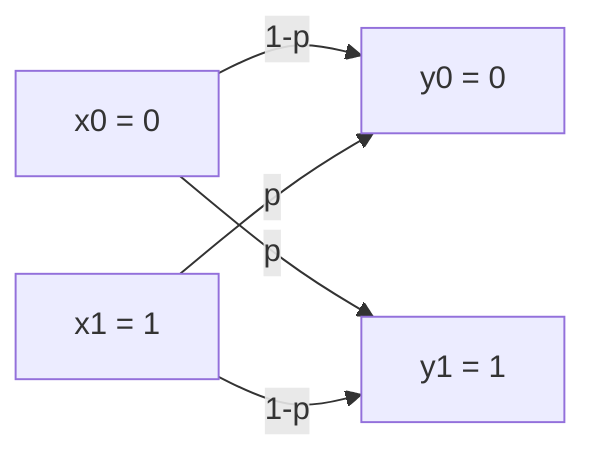
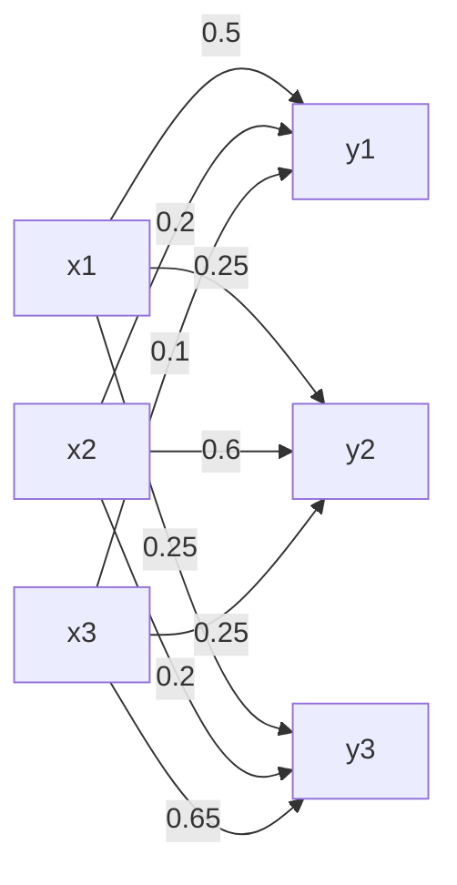
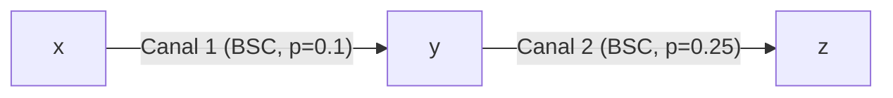
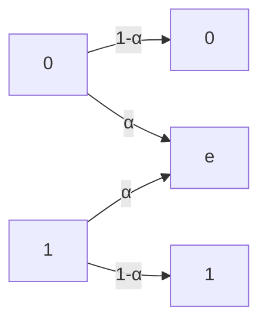

# Tema 4: Teoría de la Información — Problemas de Canales de Comunicación

> Material de estudio resuelto desde cero. Cada ejercicio sigue la estructura: **(1) Comprensión · (2) Fundamentos · (3) Resolución · (4) Resultado · (5) Aprendizaje**.

## Índice

| Bloque | Ejercicios | Estado |
|---|---|---|
| 0 | [Fundamentos comunes](#0-fundamentos-comunes-de-teoría-de-la-información) | ✅ |
| 1 | [Ej. 1](#ejercicio-1--canal-binario-simétrico-bsc-información-mutua-y-capacidad) · [Ej. 2](#ejercicio-2--canal-ternario-con-matriz-de-transición-dada) · [Ej. 3](#ejercicio-3--bsc-información-mutua-en-función-de-p_1) | ✅ |
| 2 | [Ej. 4](#ejercicio-4--dos-bsc-en-serie-con-parámetros-distintos) · [Ej. 5](#ejercicio-5--dos-bsc-idénticos-en-serie) · [Ej. 6](#ejercicio-6--canal-binario-de-borrado-bec) | ✅ |
| 3 | [Ej. 7](#ejercicio-7--regenerador-de-señal) · [Ej. 8](#ejercicio-8--canal-ternario-cíclico) | ✅ |
| 4 | [Ej. 9](#ejercicio-9--entropías-a-partir-de-la-pmf-conjunta) · [Ej. 10](#ejercicio-10--canal-con-2-entradas-y-3-salidas) · [Ej. 11](#ejercicio-11--canal-con-salidas-solapadas) | ✅ |

**Advertencias sobre el enunciado** (detalladas en cada ejercicio):
- **Ej. 1, 3 y 5:** no dan un valor numérico de $p$; se resuelve en función de $p$ y se añaden valores ilustrativos.
- **Ej. 7:** la matriz de transición depende de $\alpha,\beta$ (probabilidades de la *fuente*); se explica qué significa "capacidad" aquí.
- **Ej. 8, 10 y 11:** las matrices se leen de las figuras; se muestra la lectura realizada.

---

## 0. Fundamentos comunes de Teoría de la Información

Esta sección reúne los conceptos que se usan en **todos** los ejercicios. En cada ejercicio se hará referencia a ella (por ejemplo «ver 0.5») en lugar de repetirla. Todos los logaritmos son en base 2, de modo que la información se mide en **bits**.

### 0.1 Canal discreto sin memoria (DMC)

Un **canal de comunicación** es el modelo matemático de lo que ocurre entre lo que se envía y lo que se recibe.

- $X$ es la **variable aleatoria de entrada**, con alfabeto $\mathcal{X}=\{x_1,\dots,x_M\}$.
- $Y$ es la **variable aleatoria de salida**, con alfabeto $\mathcal{Y}=\{y_1,\dots,y_N\}$.
- El canal queda definido por las **probabilidades de transición** $P(y_j\mid x_i)$: la probabilidad de recibir $y_j$ *sabiendo* que se envió $x_i$.

Se organizan en la **matriz de transición** $\mathbf{P}$, de tamaño $M\times N$:

$$
\mathbf{P}=\begin{pmatrix}
P(y_1\mid x_1) & P(y_2\mid x_1) & \cdots & P(y_N\mid x_1)\\
P(y_1\mid x_2) & P(y_2\mid x_2) & \cdots & P(y_N\mid x_2)\\
\vdots & & \ddots & \vdots\\
P(y_1\mid x_M) & P(y_2\mid x_M) & \cdots & P(y_N\mid x_M)
\end{pmatrix}
$$

**Convención:** la fila $i$ corresponde a la entrada $x_i$ y la columna $j$ a la salida $y_j$.

**Propiedad (estocástica por filas).** Cada fila suma 1, porque, enviado $x_i$, *algo* tiene que recibirse:
$$\sum_{j=1}^{N}P(y_j\mid x_i)=1\qquad\forall i.$$
Las columnas **no** tienen por qué sumar 1.

«Sin memoria» significa que la salida de cada instante depende solo de la entrada de ese instante. Por eso basta una matriz para describirlo todo.

**Diagrama del canal:** un grafo con los símbolos de entrada a la izquierda, los de salida a la derecha, y una flecha $x_i\to y_j$ etiquetada con $P(y_j\mid x_i)$ cuando es distinta de 0.

### 0.2 Probabilidades en un canal

Se distinguen tres tipos de probabilidades; confundirlas es el error más frecuente.

| Nombre | Notación | Origen |
|---|---|---|
| A priori de entrada | $p(x_i)$ | **Hipótesis** del problema: cómo usa el canal la fuente |
| Transición | $P(y_j\mid x_i)$ | **Hipótesis**: es el canal (matriz $\mathbf{P}$) |
| Conjunta | $p(x_i,y_j)$ | **Derivada** de las anteriores |
| Salida | $p(y_j)$ | **Derivada** de las anteriores |

**Probabilidad conjunta** (regla del producto, que es la definición de probabilidad condicionada despejada):
$$p(x_i,y_j)=p(x_i)\,P(y_j\mid x_i).$$

**Probabilidad de salida** (teorema de la probabilidad total: el evento «sale $y_j$» ocurre por exactamente uno de los $M$ caminos, mutuamente excluyentes, «se envió $x_i$ y salió $y_j$»):
$$p(y_j)=\sum_{i=1}^{M}p(x_i,y_j)=\sum_{i=1}^{M}p(x_i)\,P(y_j\mid x_i).$$

En forma matricial, si $\mathbf{p}_X=(p(x_1),\dots,p(x_M))$ es un **vector fila**, entonces
$$\mathbf{p}_Y=\mathbf{p}_X\,\mathbf{P}.$$
Es decir, la distribución de salida es la de entrada multiplicada por la matriz del canal.

**Probabilidad a posteriori** (regla de Bayes): $P(x_i\mid y_j)=\dfrac{p(x_i,y_j)}{p(y_j)}$.

### 0.3 Entropía

La **entropía** de una variable aleatoria discreta $X$ mide la incertidumbre media sobre su valor (o, equivalentemente, la información media que se obtiene al observarla):
$$H(X)=-\sum_{x}p(x)\log_2 p(x)\quad[\text{bits}].$$
Se adopta la convención $0\log 0=0$, justificada porque $\lim_{t\to0^+}t\log t=0$.

La cantidad $-\log_2p(x)$ es la *autoinformación* de un símbolo: cuanto más improbable, más información aporta. $H(X)$ es su valor esperado.

**Propiedades** (matemáticas, demostrables):
1. $H(X)\ge0$, con igualdad si y solo si $X$ es determinista.
2. $H(X)\le\log_2|\mathcal{X}|$, con igualdad si y solo si $X$ es **uniforme**. Esto es clave para calcular capacidades.
3. $H$ es una función **cóncava** de la distribución $p(x)$.

**Entropía binaria.** Para una variable con dos valores de probabilidades $p$ y $1-p$:
$$H_b(p)=-p\log_2p-(1-p)\log_2(1-p).$$
Valores útiles: $H_b(0)=H_b(1)=0$, $H_b(1/2)=1$, $H_b(p)=H_b(1-p)$ (simétrica), máximo en $p=1/2$.

### 0.4 Entropía conjunta y condicional

- **Conjunta:** $H(X,Y)=-\sum_{x,y}p(x,y)\log_2p(x,y)$. Incertidumbre del par.
- **Condicional dado un valor:** $H(Y\mid X=x_i)=-\sum_jP(y_j\mid x_i)\log_2P(y_j\mid x_i)$. Es la entropía de **la fila $i$ de $\mathbf{P}$**.
- **Condicional:** la media de lo anterior ponderada por $p(x_i)$:
$$H(Y\mid X)=\sum_ip(x_i)\,H(Y\mid X=x_i).$$
Mide la incertidumbre que *queda* sobre la salida cuando se conoce la entrada; es decir, el **ruido** del canal.

**Regla de la cadena** (sale de $p(x,y)=p(x)p(y\mid x)$ al tomar $-\log$ y esperanza):
$$H(X,Y)=H(X)+H(Y\mid X)=H(Y)+H(X\mid Y).$$

### 0.5 Información mutua

La **información mutua** es lo que la salida nos dice sobre la entrada: la incertidumbre sobre $X$ antes de ver $Y$ menos la que queda después.
$$I(X;Y)=H(X)-H(X\mid Y)=H(Y)-H(Y\mid X)=H(X)+H(Y)-H(X,Y).$$
Las tres igualdades se obtienen de la regla de la cadena. En el estudio de canales, **la forma más cómoda es casi siempre**
$$\boxed{I(X;Y)=H(Y)-H(Y\mid X)}$$
porque $H(Y\mid X)$ se calcula directamente de las **filas** de $\mathbf{P}$ y $H(Y)$ de $\mathbf{p}_Y=\mathbf{p}_X\mathbf{P}$.

**Propiedades:** $I(X;Y)\ge0$; $I(X;Y)=I(Y;X)$; $I(X;Y)=0$ si y solo si $X$ e $Y$ son independientes (el canal no transmite nada); $I(X;Y)\le\min\{H(X),H(Y)\}$.

### 0.6 Capacidad del canal

$I(X;Y)$ depende de **dos cosas**: el canal ($\mathbf{P}$, fijo) y cómo se usa ($p(x)$, elegible por el diseñador). La **capacidad** es el mejor uso posible:
$$C=\max_{p(x)}I(X;Y)\quad[\text{bits/uso del canal}].$$
Es el máximo de información por símbolo que se puede transmitir de forma fiable (teorema de codificación de canal de Shannon). Como $I$ es cóncava en $p(x)$ para $\mathbf{P}$ fija, el máximo existe y es único en valor.

**Consecuencia inmediata.** Para *cualquier* distribución de entrada, $I(X;Y)\le C$. Por tanto, **cualquier $I(X;Y)$ calculado con una entrada concreta es una cota inferior de $C$**.

### 0.7 Canales simétricos y su capacidad

**Canal binario simétrico (BSC).** Entradas y salidas $\{0,1\}$; cada bit se invierte con probabilidad $p$ (**probabilidad de error** o de cruce):
$$\mathbf{P}_{\rm BSC}=\begin{pmatrix}1-p&p\\p&1-p\end{pmatrix}.$$

**Canal débilmente simétrico.** Es aquel en el que (i) **todas las filas** de $\mathbf{P}$ son permutaciones unas de otras y (ii) **todas las columnas suman lo mismo**.

**Teorema.** La capacidad de un canal débilmente simétrico es
$$C=\log_2|\mathcal{Y}|-H(\mathbf{r}),$$
siendo $\mathbf{r}$ cualquier fila de $\mathbf{P}$ y $H(\mathbf{r})$ su entropía.

*Demostración.* Se parte de $I=H(Y)-H(Y\mid X)$.
1. Por (i), todas las filas tienen la misma entropía $H(\mathbf{r})$. Entonces $H(Y\mid X)=\sum_ip(x_i)H(\mathbf{r})=H(\mathbf{r})$ **para cualquier entrada**. El ruido no depende de cómo se use el canal.
2. Luego maximizar $I$ equivale a maximizar $H(Y)$, y por la propiedad 2 de 0.3, $H(Y)\le\log_2|\mathcal{Y}|$.
3. Esa cota se alcanza si $Y$ es uniforme. Con entrada uniforme, $p(y_j)=\frac1M\sum_iP(y_j\mid x_i)=\frac{\text{suma de la columna }j}{M}$, que es constante por (ii) y por tanto igual a $1/N$. $\blacksquare$

Para el BSC: $C=\log_22-H_b(p)=1-H_b(p)$.

### 0.8 Canales en serie (cascada)

Si la salida del canal 1 es la entrada del canal 2 y este último **solo** «ve» esa salida (el ruido de cada etapa es independiente), entonces $X\to Y\to Z$ es una cadena de Markov. La matriz del conjunto es el **producto de matrices**:
$$\mathbf{P}_{XZ}=\mathbf{P}_1\,\mathbf{P}_2.$$
*Por qué:* $P(z\mid x)=\sum_yP(y\mid x)P(z\mid y)$ (probabilidad total, usando que $Z$ depende de $X$ solo a través de $Y$), que es justamente el producto de matrices fila × columna.

**Desigualdad de procesamiento de datos:** $I(X;Z)\le I(X;Y)$ y $I(X;Z)\le I(Y;Z)$. Procesar o reenviar datos no puede crear información. De ahí $C_{\rm serie}\le\min\{C_1,C_2\}$.

### 0.9 Resumen de notación

| Símbolo | Significado |
|---|---|
| $p(x)$, $p(y)$ | Probabilidades de entrada / salida |
| $P(y\mid x)$ | Probabilidad de transición (elementos de $\mathbf{P}$) |
| $p(x,y)$ | Probabilidad conjunta |
| $H(\cdot)$, $H_b(p)$ | Entropía; entropía binaria |
| $I(X;Y)$ | Información mutua |
| $C$ | Capacidad (bits por uso del canal) |

---

## Ejercicio 1 — Canal binario simétrico (BSC): información mutua y capacidad

### 1. Comprensión del problema

**Qué nos dan.** Un BSC (figura del enunciado): entradas $x_0=0$, $x_1=1$; salidas $y_0=0$, $y_1=1$. Las flechas horizontales llevan $1-p$ (el bit llega bien) y las cruzadas llevan $p$ (el bit se invierte).

**Qué nos piden.**
1. Probabilidades de salida $p(y_0),p(y_1)$ con entrada equiprobable.
2. Lo mismo con $p(x_0)=1/4$, $p(x_1)=3/4$.
3. $I(X;Y)$ en ambos casos.
4. La capacidad $C$.

> ⚠️ **Advertencia sobre el enunciado:** no da ningún valor numérico de $p$. Se resuelve de forma general en función de $p$ y, para que se vean órdenes de magnitud, se añade el caso ilustrativo $p=0{,}1$ (dato **inventado por mí con fines didácticos**, no del enunciado).

**Interpretación.** Es un canal con ruido que voltea cada bit con probabilidad $p$, con independencia de qué bit sea. Los dos casos de entrada cambian solo $p(x)$, no el canal.

### 2. Fundamentos teóricos

Se usan, de la sección 0: la matriz de transición (0.1), la probabilidad total $p(y_j)=\sum_ip(x_i)P(y_j\mid x_i)$ (0.2), $I=H(Y)-H(Y\mid X)$ (0.5), y la capacidad del BSC (0.7).

La matriz del canal (**hipótesis**, leída de la figura) es
$$\mathbf{P}=\begin{pmatrix}1-p&p\\p&1-p\end{pmatrix}.$$

### 3. Resolución paso a paso

#### 3.1 Entrada equiprobable: $p(x_0)=p(x_1)=\tfrac12$

La salida $y_0=0$ se produce por dos caminos excluyentes: (envío 0 y no hay error) o (envío 1 y hay error). Por la probabilidad total:
$$p(y_0)=p(x_0)P(y_0\mid x_0)+p(x_1)P(y_0\mid x_1)=\tfrac12(1-p)+\tfrac12\,p=\tfrac12\bigl[(1-p)+p\bigr]=\tfrac12.$$
Como las dos probabilidades de salida suman 1,
$$p(y_1)=1-p(y_0)=\tfrac12.$$
**Interpretación:** con entrada uniforme, la salida también es uniforme *para cualquier* $p$. El canal es simétrico y no «prefiere» ningún símbolo.

#### 3.2 Entrada no uniforme: $p(x_0)=\tfrac14$, $p(x_1)=\tfrac34$

Se repite la misma regla con los nuevos pesos:
$$p(y_0)=\tfrac14(1-p)+\tfrac34\,p=\tfrac14-\tfrac p4+\tfrac{3p}4=\tfrac14+\tfrac p2.$$
$$p(y_1)=\tfrac14\,p+\tfrac34(1-p)=\tfrac p4+\tfrac34-\tfrac{3p}4=\tfrac34-\tfrac p2.$$
**Comprobación:** $p(y_0)+p(y_1)=\tfrac14+\tfrac p2+\tfrac34-\tfrac p2=1$ ✓.

**Casos límite (coherencia).** Si $p=0$ (canal sin ruido) la salida copia a la entrada: $(1/4,\,3/4)$ ✓. Si $p=1/2$, la salida es $(1/2,\,1/2)$ sea cual sea la entrada, porque el canal es una moneda al aire ✓.

#### 3.3 Información mutua con entrada equiprobable

Se usa $I(X;Y)=H(Y)-H(Y\mid X)$.

- **$H(Y)$:** $Y$ es uniforme, luego $H(Y)=H_b(1/2)=1$ bit.
- **$H(Y\mid X)$:** por 0.4, es la media ponderada de las entropías de las filas de $\mathbf{P}$. Ambas filas son $(1-p,\,p)$ y tienen entropía $H_b(p)$. Entonces
$$H(Y\mid X)=\tfrac12H_b(p)+\tfrac12H_b(p)=H_b(p).$$
Y, por tanto,
$$\boxed{I_A=1-H_b(p)}.$$

#### 3.4 Información mutua con $p(x_0)=\tfrac14$, $p(x_1)=\tfrac34$

- **$H(Y)$:** $Y$ tiene probabilidades $\bigl(\tfrac14+\tfrac p2,\;\tfrac34-\tfrac p2\bigr)$, así que $H(Y)=H_b\!\left(\tfrac14+\tfrac p2\right)$.
- **$H(Y\mid X)$:** sigue siendo $H_b(p)$. Como las dos filas tienen la misma entropía, la media ponderada da el mismo valor sea cual sea $p(x)$.
$$\boxed{I_B=H_b\!\left(\tfrac14+\tfrac p2\right)-H_b(p)}.$$

#### 3.5 Capacidad

El BSC es débilmente simétrico (filas permutadas; columnas con suma $(1-p)+p=1$ ambas), así que el teorema de 0.7 da
$$C=\log_2 2-H_b(p)=1-H_b(p).$$
Se alcanza con entrada uniforme, es decir, **con el caso A**: $I_A=C$.

#### 3.6 Ejemplo numérico ilustrativo ($p=0{,}1$)

Entropía binaria:
$$H_b(0{,}1)=-0{,}1\log_2 0{,}1-0{,}9\log_2 0{,}9=0{,}1\cdot3{,}3219+0{,}9\cdot0{,}1520=0{,}3322+0{,}1368=0{,}4690.$$

- Caso A: $I_A=1-0{,}4690=0{,}5310$ bit.
- Caso B: $p(y_0)=\tfrac14+0{,}05=0{,}30$, $p(y_1)=0{,}70$. $H_b(0{,}3)=0{,}3\cdot1{,}7370+0{,}7\cdot0{,}5146=0{,}5211+0{,}3602=0{,}8813$. Entonces $I_B=0{,}8813-0{,}4690=0{,}4123$ bit.
- Capacidad: $C=0{,}5310$ bit.

### 4. Resultado e interpretación

| | $p(y_0)$ | $p(y_1)$ | $I(X;Y)$ |
|---|---|---|---|
| A: $p(x)=(\tfrac12,\tfrac12)$ | $\tfrac12$ | $\tfrac12$ | $1-H_b(p)$ |
| B: $p(x)=(\tfrac14,\tfrac34)$ | $\tfrac14+\tfrac p2$ | $\tfrac34-\tfrac p2$ | $H_b(\tfrac14+\tfrac p2)-H_b(p)$ |

$$C_{\rm BSC}=1-H_b(p)\ \text{bit/uso}.$$

**Interpretación.** $H_b(p)$ es la información «perdida» por el ruido en cada símbolo. Se cumple $I_B\le I_A=C$ (como debe ser, $I\le C$ siempre): en B, $H(Y)=H_b(\tfrac14+\tfrac p2)<1$ salvo en $p=\tfrac12$, y el ruido ($H_b(p)$) no cambia. Usar el canal de forma no uniforme **desperdicia capacidad**. **Unidades:** bits por uso del canal. **Casos límite:** $p=0\Rightarrow C=1$; $p=\tfrac12\Rightarrow C=0$ ✓.

### 5. Aprendizaje

- **Método:** salida con probabilidad total (producto $\mathbf{p}_X\mathbf{P}$); $I=H(Y)-H(Y\mid X)$ con $H(Y\mid X)$ sacado de las filas.
- **Cuándo se aplica:** cualquier canal discreto con $\mathbf{P}$ conocida.
- **Errores a evitar:** (i) confundir $p(y)$ con $P(y\mid x)$; (ii) olvidar que $H(Y\mid X)=H_b(p)$ no depende de la entrada en el BSC; (iii) afirmar que la capacidad depende de $p(x)$: **es el máximo sobre** $p(x)$.

---

## Ejercicio 2 — Canal ternario con matriz de transición dada

### 1. Comprensión del problema

**Datos.** Canal de 3 entradas $\{x_1,x_2,x_3\}$ y 3 salidas $\{y_1,y_2,y_3\}$ con
$$\mathbf{P}=\begin{pmatrix}0{,}5&0{,}25&0{,}25\\0{,}2&0{,}6&0{,}2\\0{,}1&0{,}25&0{,}65\end{pmatrix}.$$
**Comprobación de coherencia:** cada fila suma 1 ($0{,}5+0{,}25+0{,}25=1$; $0{,}2+0{,}6+0{,}2=1$; $0{,}1+0{,}25+0{,}65=1$) ✓.

**Se pide:** (a) diagrama; (b) $p(y)$ con entrada equiprobable; (c) $p(x)$ que hace la salida equiprobable; (d) la matriz conjunta con la entrada de (c); (e) $I(X;Y)$ en (b) y (c) y qué se deduce sobre $C$.

### 2. Fundamentos teóricos

Se usan: matriz de transición (0.1), probabilidad total y conjunta (0.2), entropía de una fila y $H(Y\mid X)$ (0.4), $I=H(Y)-H(Y\mid X)$ (0.5) y la idea de que cada $I$ es cota inferior de $C$ (0.6).

### 3. Resolución paso a paso

#### (a) Diagrama

Una flecha $x_i\to y_j$ por cada elemento no nulo de $\mathbf{P}$ (aquí los 9 son no nulos):

Esquema equivalente en texto: $x_1\to(y_1,y_2,y_3)$ con $(0{,}5;0{,}25;0{,}25)$; $x_2\to$ con $(0{,}2;0{,}6;0{,}2)$; $x_3\to$ con $(0{,}1;0{,}25;0{,}65)$. Las probabilidades que salen de cada entrada suman 1.

#### (b) Salida con entrada equiprobable

Hipótesis: $p(x_1)=p(x_2)=p(x_3)=\tfrac13$. Por la probabilidad total, $p(y_j)=\tfrac13\sum_iP(y_j\mid x_i)=\tfrac13\cdot(\text{suma de la columna }j)$. Sumas de columna:

- Columna 1: $0{,}5+0{,}2+0{,}1=0{,}8$.
- Columna 2: $0{,}25+0{,}6+0{,}25=1{,}1$.
- Columna 3: $0{,}25+0{,}2+0{,}65=1{,}1$.

$$p(y_1)=\frac{0{,}8}{3}=\frac4{15}\approx0{,}2667,\qquad p(y_2)=p(y_3)=\frac{1{,}1}{3}=\frac{11}{30}\approx0{,}3667.$$
**Comprobación:** $\tfrac{8}{30}+\tfrac{11}{30}+\tfrac{11}{30}=1$ ✓.

**Interpretación:** entrada uniforme **no** da salida uniforme: el canal es asimétrico (la salida $y_1$ se produce menos que las otras).

#### (c) Entrada que produce salida equiprobable

**Qué queremos:** encontrar $\mathbf{p}_X=(a,b,c)$ tal que $\mathbf{p}_X\mathbf{P}=(\tfrac13,\tfrac13,\tfrac13)$. Es un sistema lineal. Las incógnitas son $a=p(x_1)$, $b=p(x_2)$, $c=p(x_3)$. Cada columna de $\mathbf{P}$ da una ecuación (probabilidad total para cada $y_j$):

$$\begin{aligned}
(1)\quad &0{,}5a+0{,}2b+0{,}1c=\tfrac13\\
(2)\quad &0{,}25a+0{,}6b+0{,}25c=\tfrac13\\
(3)\quad &0{,}25a+0{,}2b+0{,}65c=\tfrac13\\
(4)\quad &a+b+c=1.
\end{aligned}$$

(La ecuación (4) es normalización. Realmente es redundante: al sumar (1)+(2)+(3) y usar que cada fila de $\mathbf{P}$ suma 1 sale $a+b+c=1$. Usamos (4) por comodidad.)

**Paso 1: despejar $b$ con (2) y (4).** En (2), los coeficientes de $a$ y $c$ coinciden (0,25), luego se puede agrupar: $0{,}25(a+c)+0{,}6b=\tfrac13$. De (4), $a+c=1-b$. Sustituyendo:
$$0{,}25(1-b)+0{,}6b=\tfrac13\ \Rightarrow\ 0{,}25+0{,}35b=\tfrac13\ \Rightarrow\ 0{,}35b=\tfrac13-\tfrac14=\tfrac1{12}.$$
$$b=\frac{1}{12\cdot0{,}35}=\frac1{4{,}2}=\frac5{21}.$$

**Paso 2:** de (4), $a+c=1-\tfrac5{21}=\tfrac{16}{21}$.

**Paso 3: usar (1).** Se pasa $0{,}2b$ al lado derecho: $0{,}5a+0{,}1c=\tfrac13-0{,}2\cdot\tfrac5{21}=\tfrac7{21}-\tfrac1{21}=\tfrac6{21}$. Se sustituye $c=\tfrac{16}{21}-a$:
$$0{,}5a+0{,}1\Bigl(\tfrac{16}{21}-a\Bigr)=\tfrac6{21}\ \Rightarrow\ 0{,}4a=\tfrac6{21}-\tfrac{1{,}6}{21}=\tfrac{4{,}4}{21}\ \Rightarrow\ a=\frac{4{,}4}{0{,}4\cdot21}=\frac{11}{21}.$$

**Paso 4:** $c=\tfrac{16}{21}-\tfrac{11}{21}=\tfrac5{21}$.

**Verificación con (3) (que no se ha usado):**
$$0{,}25\cdot\tfrac{11}{21}+0{,}2\cdot\tfrac5{21}+0{,}65\cdot\tfrac5{21}=\frac{2{,}75+1+3{,}25}{21}=\frac7{21}=\frac13\ ✓.$$

**Condición de validez:** las tres soluciones son $\ge0$, luego es una distribución legítima.
$$\boxed{\mathbf{p}_X=\Bigl(\tfrac{11}{21},\tfrac5{21},\tfrac5{21}\Bigr)\approx(0{,}5238;\,0{,}2381;\,0{,}2381)}.$$

#### (d) Matriz de probabilidades conjuntas

Se usa $p(x_i,y_j)=p(x_i)P(y_j\mid x_i)$: **se multiplica cada fila de $\mathbf{P}$ por la probabilidad de su entrada**.

- Fila 1 (×$\tfrac{11}{21}$): $\tfrac{11}{21}\cdot0{,}5=\tfrac{5{,}5}{21}=\tfrac{22}{84}$; $\tfrac{11}{21}\cdot0{,}25=\tfrac{2{,}75}{21}=\tfrac{11}{84}$; igual $\tfrac{11}{84}$.
- Fila 2 (×$\tfrac5{21}$): $\tfrac{1}{21}=\tfrac4{84}$; $\tfrac5{21}\cdot0{,}6=\tfrac3{21}=\tfrac{12}{84}$; $\tfrac4{84}$.
- Fila 3 (×$\tfrac5{21}$): $\tfrac5{21}\cdot0{,}1=\tfrac{0{,}5}{21}=\tfrac2{84}$; $\tfrac5{21}\cdot0{,}25=\tfrac{1{,}25}{21}=\tfrac5{84}$; $\tfrac5{21}\cdot0{,}65=\tfrac{3{,}25}{21}=\tfrac{13}{84}$.

$$\mathbf{P}_{XY}=\frac1{84}\begin{pmatrix}22&11&11\\4&12&4\\2&5&13\end{pmatrix}\approx\begin{pmatrix}0{,}2619&0{,}1310&0{,}1310\\0{,}0476&0{,}1429&0{,}0476\\0{,}0238&0{,}0595&0{,}1548\end{pmatrix}.$$

**Comprobaciones:**
- Suma total: $\tfrac{22+11+11+4+12+4+2+5+13}{84}=\tfrac{84}{84}=1$ ✓.
- Marginal de entrada (suma por filas): $\tfrac{44}{84}=\tfrac{11}{21}$, $\tfrac{20}{84}=\tfrac5{21}$, $\tfrac{20}{84}=\tfrac5{21}$ ✓.
- Marginal de salida (suma por columnas): $\tfrac{28}{84}=\tfrac13$ las tres ✓ (justo lo exigido en (c)).

#### (e) Información mutua en los casos (b) y (c)

**Entropías de las filas** (necesarias para $H(Y\mid X)$), con $\log_2 5=2{,}3219$:
- $H(0{,}5;0{,}25;0{,}25)=0{,}5\cdot1+2\cdot0{,}25\cdot2=1{,}5$ bits.
- $H(0{,}2;0{,}6;0{,}2)=2\cdot0{,}2\log_25+0{,}6\log_2\tfrac53=0{,}4\cdot2{,}3219+0{,}6\cdot0{,}7370=0{,}9288+0{,}4422=1{,}3710$ bits.
- $H(0{,}1;0{,}25;0{,}65)=0{,}1\cdot3{,}3219+0{,}25\cdot2+0{,}65\cdot0{,}6215=0{,}3322+0{,}5+0{,}4040=1{,}2362$ bits.

**Caso (b): entrada uniforme.**
- $H(Y)=H\!\left(\tfrac4{15},\tfrac{11}{30},\tfrac{11}{30}\right)=\tfrac4{15}\log_2\tfrac{15}4+2\cdot\tfrac{11}{30}\log_2\tfrac{30}{11}=0{,}2667\cdot1{,}9069+0{,}7333\cdot1{,}4474=0{,}5085+1{,}0614=1{,}5699$ bits.
- $H(Y\mid X)=\tfrac13(1{,}5+1{,}3710+1{,}2362)=\tfrac{4{,}1072}3=1{,}3690$ bits.
- $I_b=1{,}5699-1{,}3690=\mathbf{0{,}2009}$ bits.

**Caso (c): entrada $(\tfrac{11}{21},\tfrac5{21},\tfrac5{21})$ y salida uniforme.**
- $H(Y)=\log_23=1{,}5850$ bits.
- $H(Y\mid X)=\tfrac{11}{21}\cdot1{,}5+\tfrac5{21}\cdot1{,}3710+\tfrac5{21}\cdot1{,}2362=\tfrac{16{,}5+6{,}8548+6{,}1808}{21}=\tfrac{29{,}5356}{21}=1{,}4065$ bits.
- $I_c=1{,}5850-1{,}4065=\mathbf{0{,}1785}$ bits.

**¿Qué se puede decir de la capacidad?**
1. Como $C=\max_{p(x)}I$, ambos valores son **cotas inferiores**: $C\ge0{,}2009$ bits/uso (la mejor de las dos).
2. Que la salida sea uniforme **no** maximiza $I$ aquí: $I_c<I_b$. El truco «salida uniforme ⇒ capacidad» solo funciona en canales (débilmente) simétricos (0.7), y este no lo es: las filas **no** son permutaciones unas de otras (sus entropías son distintas: 1,5; 1,371; 1,236). Con entropías de fila distintas, $H(Y\mid X)$ sí depende de $p(x)$ y hay que equilibrar ambos términos.
3. Para hallar $C$ exacta hay que maximizar $I$ sobre $p(x)$ (algoritmo iterativo de Blahut–Arimoto; está fuera del alcance de este ejercicio). Ejecutado numéricamente da $C\approx0{,}204$ bits/uso, con entrada óptima $\approx(0{,}31;\,0{,}28;\,0{,}41)$. Es un dato de contraste mío, no se deduce a mano del enunciado.

### 4. Resultado e interpretación

| Apartado | Resultado |
|---|---|
| (b) | $p(y)=(\tfrac4{15},\tfrac{11}{30},\tfrac{11}{30})$ |
| (c) | $p(x)=(\tfrac{11}{21},\tfrac5{21},\tfrac5{21})$ |
| (d) | $\mathbf{P}_{XY}=\tfrac1{84}\begin{pmatrix}22&11&11\\4&12&4\\2&5&13\end{pmatrix}$ |
| (e) | $I_b\approx0{,}2009$ bit; $I_c\approx0{,}1785$ bit; $C\ge0{,}2009$ bit/uso |

### 5. Aprendizaje

- **Salida a partir de la entrada:** $\mathbf{p}_Y=\mathbf{p}_X\mathbf{P}$. **Entrada a partir de la salida deseada:** se resuelve el sistema lineal $\mathbf{p}_X\mathbf{P}=\mathbf{p}_Y$ y se **comprueba que no salgan probabilidades negativas**.
- **Joint:** multiplicar cada *fila* de $\mathbf{P}$ por $p(x_i)$.
- **Error típico:** pensar que la salida uniforme siempre es la óptima. Solo es cierto en canales simétricos.

---

## Ejercicio 3 — BSC: información mutua en función de $p_1$

### 1. Comprensión del problema

**Datos.** BSC con probabilidad de cruce $p$ (los valores a estudiar: $p\in\{0;\,0{,}1;\,0{,}2;\,0{,}3;\,0{,}5\}$). Sea $p_1=P(X=1)$ la probabilidad a priori del símbolo 1 (por tanto, $P(X=0)=1-p_1$).

**Se pide:** (i) $I(X;Y)$ como función de $p_1$ (y $p$); (ii) evaluarla para los valores de $p$ dados; (iii) la capacidad en cada caso.

### 2. Fundamentos teóricos

Mismas herramientas que en el ejercicio 1: probabilidad total (0.2), $I=H(Y)-H(Y\mid X)$ (0.5), entropía binaria (0.3) y capacidad del BSC (0.7).

### 3. Resolución paso a paso

**Paso 1: probabilidad de que la salida sea 1.** Hay dos caminos excluyentes: (se envía 1 y no hay error) o (se envía 0 y hay error):
$$p(y=1)=p_1(1-p)+(1-p_1)p=p+p_1(1-2p).$$
(Desarrollando: $p_1-p_1p+p-p_1p=p+p_1-2pp_1$.) La salida es una variable binaria con probabilidades $\bigl(1-q,\;q\bigr)$, siendo $q\equiv p+p_1(1-2p)$. Entonces $H(Y)=H_b(q)$.

**Paso 2: ruido.** Las dos filas, $(1-p,p)$ y $(p,1-p)$, tienen entropía $H_b(p)$, luego $H(Y\mid X)=(1-p_1)H_b(p)+p_1H_b(p)=H_b(p)$.

**Paso 3: información mutua.**
$$\boxed{I(X;Y)=H_b\bigl(p+p_1(1-2p)\bigr)-H_b(p)}.$$

**Paso 4: maximización en $p_1$ (capacidad).** $H_b(q)\le1$ con igualdad solo si $q=\tfrac12$:
$$p+p_1(1-2p)=\tfrac12\ \Rightarrow\ p_1(1-2p)=\tfrac12-p=\tfrac{1-2p}2.$$
Si $p\ne\tfrac12$ se puede dividir por $(1-2p)\ne0$ y sale $p_1=\tfrac12$. Entonces $C=1-H_b(p)$. Si $p=\tfrac12$ entonces $q=\tfrac12$ para *todo* $p_1$ y $I=1-1=0$.

**Paso 5: evaluación.** Valores de la entropía binaria necesarios: $H_b(0)=0$; $H_b(0{,}1)=0{,}4690$; $H_b(0{,}2)=0{,}7219$; $H_b(0{,}3)=0{,}8813$; $H_b(0{,}5)=1$.

*Ejemplo desarrollado, $p=0{,}1$ y $p_1=0{,}25$:* $q=0{,}1+0{,}25\cdot0{,}8=0{,}3$; $I=H_b(0{,}3)-H_b(0{,}1)=0{,}8813-0{,}4690=0{,}4123$ bits.

Información mutua (bits) para varios valores de $p_1$:

| $p$ | $p_1=0$ | $0{,}1$ | $0{,}25$ | $0{,}5$ | $0{,}75$ | $0{,}9$ | $1$ | Capacidad $C=1-H_b(p)$ |
|---|---|---|---|---|---|---|---|---|
| $0$ | 0 | 0,4690 | 0,8113 | 1 | 0,8113 | 0,4690 | 0 | **1** |
| $0{,}1$ | 0 | 0,2111 | 0,4123 | 0,5310 | 0,4123 | 0,2111 | 0 | **0,5310** |
| $0{,}2$ | 0 | 0,1048 | 0,2121 | 0,2781 | 0,2121 | 0,1048 | 0 | **0,2781** |
| $0{,}3$ | 0 | 0,0435 | 0,0897 | 0,1187 | 0,0897 | 0,0435 | 0 | **0,1187** |
| $0{,}5$ | 0 | 0 | 0 | 0 | 0 | 0 | 0 | **0** |

### 4. Resultado e interpretación

$$I(X;Y)=H_b\bigl(p+p_1(1-2p)\bigr)-H_b(p),\qquad C=1-H_b(p)\ \text{(con }p_1=\tfrac12).$$

| $p$ | $C$ (bit/uso) |
|---|---|
| 0 | 1 |
| 0,1 | 0,5310 |
| 0,2 | 0,2781 |
| 0,3 | 0,1187 |
| 0,5 | 0 |

**Interpretación.**
- $p=0$: canal ideal. $I=H_b(p_1)=H(X)$: todo lo que entra se recibe, y el máximo (1 bit) se logra con bits equiprobables.
- $p$ creciente: $C$ decrece de forma continua; con $p=0{,}5$ la salida es independiente de la entrada y no se transmite nada.
- $I$ es simétrica en $p_1\leftrightarrow1-p_1$ (porque $H_b(q)=H_b(1-q)$) y siempre máxima en $p_1=\tfrac12$. Para $p_1\in\{0,1\}$ la entrada es determinista, $H(X)=0$ y no hay nada que transmitir: $I=0$.

### 5. Aprendizaje

- **Método:** escribir $q=P(Y=1)$ por probabilidad total y reducir todo a $H_b$.
- **Reconocimiento:** «información mutua en función de la probabilidad de entrada» ⇒ $H(Y)$ depende de $p_1$ y $H(Y\mid X)$ no (en canales simétricos).
- **Error típico:** olvidar que $C$ es el *máximo en $p_1$*, no el valor para un $p_1$ cualquiera.

---

## Ejercicio 4 — Dos BSC en serie con parámetros distintos

### 1. Comprensión del problema

**Datos (leídos de la figura).**
- Canal 1: BSC con $P(\text{correcto})=0{,}9$ y $P(\text{error})=0{,}1$. Entrada $x_1,x_2$; salida $y_1,y_2$.
- Canal 2: BSC con $P(\text{correcto})=0{,}75$ y $P(\text{error})=0{,}25$. Entrada $y_1,y_2$ (la salida del canal 1); salida $z_1,z_2$.
- El sistema completo $x\to z$ se describe con una matriz $\begin{pmatrix}p_{11}&p_{12}\\p_{21}&p_{22}\end{pmatrix}$, donde $p_{ij}=P(z_j\mid x_i)$.

**Se pide:** la capacidad de cada canal; las cuatro probabilidades $p_{ij}$; la capacidad del conjunto; comentar.

### 2. Fundamentos teóricos

- Capacidad de un BSC: $C=1-H_b(p)$ (0.7).
- Cascada: $\mathbf{P}_{XZ}=\mathbf{P}_1\mathbf{P}_2$, porque $P(z\mid x)=\sum_yP(y\mid x)P(z\mid y)$ (0.8). La **hipótesis** que lo justifica es que $Z$ depende de $X$ solo a través de $Y$.
- Desigualdad de procesamiento de datos: $C_{\rm serie}\le\min\{C_1,C_2\}$ (0.8).

### 3. Resolución paso a paso

**Paso 1: capacidades individuales.**

Canal 1 ($p=0{,}1$): $H_b(0{,}1)=0{,}4690$ (calculado en el ejercicio 1), luego $C_1=1-0{,}4690=0{,}5310$ bit/uso.

Canal 2 ($p=0{,}25$): $H_b(0{,}25)=-0{,}25\log_20{,}25-0{,}75\log_20{,}75=0{,}25\cdot2+0{,}75\cdot0{,}4150=0{,}5+0{,}3113=0{,}8113$, luego $C_2=1-0{,}8113=0{,}1887$ bit/uso.

**Paso 2: matriz del conjunto.** Las matrices son
$$\mathbf{P}_1=\begin{pmatrix}0{,}9&0{,}1\\0{,}1&0{,}9\end{pmatrix},\qquad\mathbf{P}_2=\begin{pmatrix}0{,}75&0{,}25\\0{,}25&0{,}75\end{pmatrix}.$$
Cada elemento del producto es (fila de $\mathbf{P}_1$)·(columna de $\mathbf{P}_2$). Se interpreta cada uno con la probabilidad total:

- $p_{11}=P(z_1\mid x_1)$: o ninguna etapa se equivoca, o se equivocan ambas (dos inversiones se anulan):
$$p_{11}=0{,}9\cdot0{,}75+0{,}1\cdot0{,}25=0{,}675+0{,}025=0{,}700.$$
- $p_{12}=P(z_2\mid x_1)$: se equivoca exactamente una de las dos etapas:
$$p_{12}=0{,}9\cdot0{,}25+0{,}1\cdot0{,}75=0{,}225+0{,}075=0{,}300.$$
- $p_{21}=0{,}1\cdot0{,}75+0{,}9\cdot0{,}25=0{,}075+0{,}225=0{,}300.$
- $p_{22}=0{,}1\cdot0{,}25+0{,}9\cdot0{,}75=0{,}025+0{,}675=0{,}700.$

$$\mathbf{P}_{XZ}=\begin{pmatrix}0{,}7&0{,}3\\0{,}3&0{,}7\end{pmatrix}.$$

**Comprobación:** las filas suman 1 ✓. Fórmula general del error: $p_{\rm tot}=p_a(1-p_b)+(1-p_a)p_b=0{,}1\cdot0{,}75+0{,}9\cdot0{,}25=0{,}3$ ✓.

**Paso 3: capacidad del conjunto.** El resultado es de nuevo un BSC, esta vez con $p=0{,}3$:
$$C=1-H_b(0{,}3)=1-0{,}8813=0{,}1187\ \text{bit/uso}.$$

### 4. Resultado e interpretación

| | Canal 1 | Canal 2 | Conjunto |
|---|---|---|---|
| Probabilidad de error | 0,1 | 0,25 | **0,3** |
| Capacidad (bit/uso) | 0,5310 | 0,1887 | **0,1187** |

$$p_{11}=p_{22}=0{,}7,\qquad p_{12}=p_{21}=0{,}3.$$

**Comentario.**
- $C_{\rm total}=0{,}1187<\min\{C_1,C_2\}=0{,}1887$: se cumple la desigualdad de procesamiento de datos. Encadenar canales ruidosos **nunca mejora** y normalmente **empeora** la comunicación, porque el ruido se acumula y la información perdida en una etapa no se recupera en la siguiente.
- El conjunto es peor que *cada uno* de los dos, no solo que el peor. La capacidad no se «promedia» ni se «multiplica»: lo que se compone son las **matrices**.
- La probabilidad de error crece ($0{,}3>0{,}25>0{,}1$) porque ambos $p\le\tfrac12$; si alguna fuese $>\tfrac12$ habría que repensarlo (un canal que casi siempre invierte es aprovechable).

### 5. Aprendizaje

- **Método:** serie ⇒ multiplicar matrices; reconocer el tipo de canal resultante (aquí BSC) y usar su capacidad conocida.
- **Cuándo se aplica:** ruidos independientes en etapas sucesivas (repetidores, enlaces concatenados).
- **Errores a evitar:** sumar o multiplicar capacidades; sumar probabilidades de error sin descontar el caso «las dos fallan y se compensan» ($2p_ap_b$).

---

## Ejercicio 5 — Dos BSC idénticos en serie

### 1. Comprensión del problema

Dos BSC iguales, con la misma probabilidad de error $p$ (la del ejercicio 1), conectados en serie (BSC 1 → BSC 2). Hay que hallar la capacidad del canal compuesto.

> ⚠️ Igual que en el ejercicio 1, **el enunciado no da valor de $p$**: se resuelve en función de $p$, y se añaden ejemplos ($p=0{,}1$ y $p=0{,}2$, valores elegidos por mí).

### 2. Fundamentos teóricos

Cascada: $\mathbf{P}_{\rm tot}=\mathbf{P}_1\mathbf{P}_2$ (0.8). Capacidad del BSC: $1-H_b(p)$ (0.7).

### 3. Resolución paso a paso

**Paso 1: matriz del conjunto.** Con $\mathbf{P}_1=\mathbf{P}_2=\begin{pmatrix}1-p&p\\p&1-p\end{pmatrix}$:
$$\mathbf{P}_{\rm tot}=\begin{pmatrix}(1-p)^2+p^2&2p(1-p)\\2p(1-p)&(1-p)^2+p^2\end{pmatrix}.$$
(Elemento 11: $(1-p)(1-p)+p\cdot p$; elemento 12: $(1-p)p+p(1-p)$.)

**Paso 2: simplificar.** Como $(1-p)^2+p^2=1-2p+2p^2=1-2p(1-p)$, se cumple que cada fila suma 1 ✓ y la matriz es la de un BSC con probabilidad de error
$$q=2p(1-p).$$

**Paso 3: capacidad.**
$$\boxed{C_{\rm tot}=1-H_b\bigl(2p(1-p)\bigr)}.$$

**Paso 4: comparación con un solo canal.** $q-p=2p-2p^2-p=p(1-2p)\ge0$ para $p\le\tfrac12$, es decir, $q\ge p$ y además $q\le\tfrac12$ (porque $2p(1-p)\le\tfrac12\iff(1-2p)^2\ge0$). Como $H_b$ es creciente en $[0,\tfrac12]$, $C_{\rm tot}\le1-H_b(p)=C_1$.

**Ejemplos.**
- $p=0{,}1$: $q=2\cdot0{,}1\cdot0{,}9=0{,}18$; $H_b(0{,}18)=0{,}6801$; $C_{\rm tot}=\mathbf{0{,}3199}$ bit/uso (frente a $0{,}5310$ de un solo canal).
- $p=0{,}2$: $q=0{,}32$; $C_{\rm tot}=\mathbf{0{,}0956}$ bit/uso (frente a $0{,}2781$).

### 4. Resultado e interpretación

$$C=1-H_b\bigl(2p(1-p)\bigr)\ \text{bit/uso}.$$
La concatenación equivale a un BSC más ruidoso ($q\ge p$); la capacidad cae. Casos límite: $p=0\Rightarrow q=0$, $C=1$; $p=\tfrac12\Rightarrow q=\tfrac12$, $C=0$ ✓. (Generalización: con $n$ etapas, $q_n=\tfrac12\bigl[1-(1-2p)^n\bigr]$, que tiende a $\tfrac12$ cuando $n\to\infty$: la información se pierde por completo.)

### 5. Aprendizaje

- Es el caso particular del ejercicio 4 con $p_a=p_b$.
- Error a evitar: dar $C=1-H_b(p)$ para el conjunto (ignorar la segunda etapa) o $2(1-H_b(p))$.

---

## Ejercicio 6 — Canal binario de borrado (BEC)

### 1. Comprensión del problema

Canal de entrada $\{0,1\}$ y salida $\{0,1,e\}$, donde $e$ significa «borrado» (el receptor *sabe* que ese bit se perdió, pero no su valor). Cada bit se borra con probabilidad $\alpha$, y llega intacto con $1-\alpha$. **Nunca** se produce un error de tipo $0\to1$. Se pide la capacidad.

### 2. Fundamentos teóricos

Se usan 0.2 (probabilidad total), 0.3–0.4 (entropías) y 0.5–0.6 ($I$ y $C$). Con salidas ordenadas $(0,e,1)$ y entradas $(0,1)$:
$$\mathbf{P}=\begin{pmatrix}1-\alpha&\alpha&0\\0&\alpha&1-\alpha\end{pmatrix}.$$
Nota didáctica: las columnas suman $1-\alpha,\ 2\alpha,\ 1-\alpha$, que **no** son iguales. El BEC **no** es débilmente simétrico en el sentido de 0.7, así que no se puede aplicar $C=\log|\mathcal Y|-H(\mathbf r)$ (daría $\log3-H_b(\alpha)$, que es incorrecto). Hay que maximizar de verdad.

### 3. Resolución paso a paso

Sea $\pi=P(X=1)$ y $1-\pi=P(X=0)$.

**Paso 1: distribución de la salida.**
$$p(y=0)=(1-\pi)(1-\alpha),\quad p(y=e)=(1-\pi)\alpha+\pi\alpha=\alpha,\quad p(y=1)=\pi(1-\alpha).$$
**Comprobación:** suman $(1-\alpha)(1-\pi+\pi)+\alpha=1$ ✓. Observación importante: la probabilidad de borrado $\alpha$ **no depende** de la entrada.

**Paso 2: $H(Y)$.** Por definición,
$$H(Y)=-(1-\pi)(1-\alpha)\log\bigl[(1-\pi)(1-\alpha)\bigr]-\alpha\log\alpha-\pi(1-\alpha)\log\bigl[\pi(1-\alpha)\bigr].$$
Se separa cada logaritmo del producto ($\log ab=\log a+\log b$):
$$H(Y)=-(1-\alpha)\bigl[(1-\pi)\log(1-\pi)+\pi\log\pi\bigr]-(1-\alpha)\log(1-\alpha)\underbrace{\bigl[(1-\pi)+\pi\bigr]}_{=1}-\alpha\log\alpha.$$
Reconociendo $H_b(\pi)$ y $H_b(\alpha)=-\alpha\log\alpha-(1-\alpha)\log(1-\alpha)$:
$$H(Y)=(1-\alpha)H_b(\pi)+H_b(\alpha).$$
**Interpretación:** la incertidumbre de la salida = incertidumbre sobre *si hubo borrado* ($H_b(\alpha)$) más, con probabilidad $1-\alpha$ (no borrado), la incertidumbre sobre el bit ($H_b(\pi)$).

**Paso 3: $H(Y\mid X)$.** Las dos filas son $(1-\alpha,\alpha,0)$ y $(0,\alpha,1-\alpha)$, ambas de entropía $H_b(\alpha)$ (el término con probabilidad 0 no aporta). Así,
$$H(Y\mid X)=H_b(\alpha).$$

**Paso 4: información mutua.**
$$I(X;Y)=H(Y)-H(Y\mid X)=(1-\alpha)H_b(\pi)+H_b(\alpha)-H_b(\alpha)=(1-\alpha)H_b(\pi).$$

**Paso 5: capacidad.** $\alpha$ es una propiedad del canal, fija, así que solo se puede variar $\pi$. $H_b(\pi)\le1$ con igualdad en $\pi=\tfrac12$:
$$C=\max_\pi(1-\alpha)H_b(\pi)=(1-\alpha)\cdot1=1-\alpha.$$

### 4. Resultado e interpretación

$$\boxed{C_{\rm BEC}=1-\alpha\ \text{bit/uso}},\quad\text{con entrada uniforme.}$$
**Interpretación física:** de cada símbolo enviado, una fracción $1-\alpha$ llega intacta y la fracción $\alpha$ se pierde; la capacidad coincide con la fracción de bits que sobreviven. Es el mejor caso posible dado el borrado: como el receptor sabe *cuáles* se perdieron, no hay confusión sobre los demás. **Casos límite:** $\alpha=0\Rightarrow C=1$; $\alpha=1\Rightarrow C=0$ ✓. **Contraste con el BSC:** para $\alpha\le\tfrac12$ y a igual probabilidad de «fallo» $\alpha$, el BEC ($1-\alpha$) tiene más capacidad que el BSC ($1-H_b(\alpha)$), porque saber *dónde* falló es información valiosa.

### 5. Aprendizaje

- **Método:** $I=H(Y)-H(Y\mid X)$; descomponer $H(Y)$ con la propiedad $\log ab=\log a+\log b$.
- **Reconocer:** canal con símbolo de borrado ⇒ $C=1-\alpha$.
- **Error a evitar:** aplicar sin comprobar la fórmula de canal simétrico (aquí falla la condición sobre las columnas).

---

## Ejercicio 7 — Regenerador de señal

### 1. Comprensión del problema

**Datos.**
- Entrada $X\in\{1,0,-1\}$ con $P[X=1]=\alpha$, $P[X=0]=1-\alpha-\beta$, $P[X=-1]=\beta$, $0<\alpha+\beta\le1$. El símbolo $X=0$ es un «borrón» (símbolo ilegible).
- El regenerador devuelve $Y\in\{1,-1\}$: si $X=\pm1$, $Y=X$ (sin error). Si $X=0$, decide al azar $Y=1$ con probabilidad $\tfrac{\alpha}{\alpha+\beta}$ e $Y=-1$ con $\tfrac{\beta}{\alpha+\beta}$ (misma proporción en que se generan $\pm1$).

**Matriz de transición** (filas $X=1,0,-1$; columnas $Y=1,-1$):
$$\mathbf{P}=\begin{pmatrix}1&0\\\dfrac{\alpha}{\alpha+\beta}&\dfrac{\beta}{\alpha+\beta}\\0&1\end{pmatrix}.$$

**Notación auxiliar** (la defino aquí): $s=\alpha+\beta$ (probabilidad de que la entrada **no** sea borrón) y $r=\dfrac{\alpha}{\alpha+\beta}$ (proporción de $+1$ entre los símbolos no nulos). Entonces $\beta/(\alpha+\beta)=1-r$, y $P[X=0]=1-s$.

**Se pide:** (a) $H(Y)$; (b) $I(X;Y)$; (c) capacidad en bits/símbolo para $\alpha=\beta$.

> ⚠️ **Advertencia:** la matriz $\mathbf{P}$ **depende de $\alpha$ y $\beta$**, es decir, de las estadísticas de la fuente. No es un canal de $\mathbf{P}$ fija sobre el que podamos variar libremente $p(x)$. Por eso la «capacidad» del apartado (c) se interpreta como el máximo de $I(X;Y)$ al variar $\alpha$ (con $\alpha=\beta$, y respetando $0<2\alpha\le1$). Es la lectura natural del enunciado, pero conviene tenerlo presente.

### 2. Fundamentos teóricos

Se usan: probabilidad total (0.2), $H_b$ (0.3), $H(Y\mid X)$ como media de entropías de fila (0.4) y $I=H(Y)-H(Y\mid X)$ (0.5). También la **propiedad de agrupación** de la entropía, que se demuestra en la verificación del apartado (b).

### 3. Resolución paso a paso

#### (a) Entropía de la salida

**Paso 1: probabilidades de salida.** $Y=1$ ocurre si $X=1$ (siempre) o si $X=0$ y el regenerador elige $+1$:
$$P(Y=1)=\alpha\cdot1+(1-\alpha-\beta)\frac{\alpha}{\alpha+\beta}=\alpha\left[1+\frac{1-\alpha-\beta}{\alpha+\beta}\right]=\alpha\cdot\frac{(\alpha+\beta)+(1-\alpha-\beta)}{\alpha+\beta}=\frac{\alpha}{\alpha+\beta}.$$
Análogamente $P(Y=-1)=\beta\cdot1+(1-\alpha-\beta)\dfrac{\beta}{\alpha+\beta}=\dfrac{\beta}{\alpha+\beta}$. **Comprobación:** suman $\tfrac{\alpha+\beta}{\alpha+\beta}=1$ ✓.

**Interpretación:** el regenerador conserva la proporción entre $+1$ y $-1$ (por eso $P(Y=1)=r$, igual que entre los no-borrones).

**Paso 2: entropía.** $Y$ es binaria con probabilidades $(r,1-r)$:
$$\boxed{H(Y)=H_b\!\left(\frac{\alpha}{\alpha+\beta}\right)}.$$

#### (b) Información mutua

**Paso 1: $H(Y\mid X)$.** Media de las entropías de fila ponderada por $p(x)$:
- Fila $X=1$: $(1,0)$, entropía $0$ (determinista). Fila $X=-1$: $(0,1)$, entropía $0$.
- Fila $X=0$: $(r,1-r)$, entropía $H_b(r)$.
$$H(Y\mid X)=\alpha\cdot0+(1-\alpha-\beta)H_b(r)+\beta\cdot0=(1-s)H_b(r).$$

**Paso 2: información mutua.**
$$I(X;Y)=H(Y)-H(Y\mid X)=H_b(r)-(1-s)H_b(r)=s\,H_b(r).$$
$$\boxed{I(X;Y)=(\alpha+\beta)\,H_b\!\left(\frac{\alpha}{\alpha+\beta}\right)}.$$

**Verificación por otro camino** ($I=H(X)-H(X\mid Y)$):
- $H(X\mid Y)$: dado $Y=1$, $X$ puede ser $1$ o $0$. $P(X=1\mid Y=1)=\tfrac{\alpha}{r}=s$ y $P(X=0\mid Y=1)=\tfrac{(1-s)r}{r}=1-s$. Luego $H(X\mid Y=1)=H_b(s)$; por simetría, $H(X\mid Y=-1)=H_b(s)$. Entonces $H(X\mid Y)=H_b(s)$.
- $H(X)=-\alpha\log\alpha-\beta\log\beta-(1-s)\log(1-s)$. Escribiendo $\alpha=sr$, $\beta=s(1-r)$ y separando logaritmos de productos:
$$-sr(\log s+\log r)-s(1-r)(\log s+\log(1-r))=-s\log s+sH_b(r).$$
Se suma el término $-(1-s)\log(1-s)$ y queda $H(X)=H_b(s)+sH_b(r)$ (agrupación: primero «¿borrón o no?», luego, si no lo es, «¿$+1$ o $-1$?»).
- $I=H(X)-H(X\mid Y)=H_b(s)+sH_b(r)-H_b(s)=sH_b(r)$ ✓. Coincide.

**Interpretación:** solo los símbolos no borrados (fracción $s$) transportan información, y esta es la que cabe en un bit $\pm1$ cuya proporción es $r$. Los borrones aportan $Y$ aleatoria sin relación con la fuente.

#### (c) Capacidad para $\alpha=\beta$

**Paso 1: particularizar.** Con $\alpha=\beta$: $s=2\alpha$, $r=\tfrac12$, $H_b(\tfrac12)=1$:
$$I(X;Y)=2\alpha\cdot1=2\alpha\ \text{bits/símbolo}.$$

**Paso 2: rango de $\alpha$.** La condición $0<\alpha+\beta\le1$ se convierte en $0<2\alpha\le1$, esto es, $\alpha\in(0,\tfrac12]$.

**Paso 3: maximizar.** $I=2\alpha$ es creciente en $\alpha$; el máximo está en el extremo $\alpha=\tfrac12$:
$$C=2\cdot\tfrac12=1\ \text{bit/símbolo}.$$
En ese punto $P[X=0]=1-2\alpha=0$: **no hay borrones** y el regenerador es la identidad $Y=X$ sobre $\{\pm1\}$ equiprobables (un canal binario sin ruido).

*Comentario:* aun sin forzar $\alpha=\beta$, $sH_b(r)\le1\cdot1$, con igualdad en $s=1$, $r=\tfrac12$. La restricción $\alpha=\beta$ no reduce el máximo.

### 4. Resultado e interpretación

| Apartado | Resultado |
|---|---|
| (a) | $H(Y)=H_b\!\left(\tfrac{\alpha}{\alpha+\beta}\right)$ |
| (b) | $I(X;Y)=(\alpha+\beta)H_b\!\left(\tfrac{\alpha}{\alpha+\beta}\right)$ |
| (c) | $I=2\alpha$; $C=1$ bit/símbolo (en $\alpha=\beta=\tfrac12$) |

**Coherencia:** si $s=1$ (sin borrones), $I=H_b(r)=H(X)$ (canal sin pérdida) ✓. Si $s\to0$ (casi todo borrones), $I\to0$ ✓. Unidades: bits/símbolo.

### 5. Aprendizaje

- **Método:** $I=H(Y)-H(Y\mid X)$ con filas deterministas (entropía 0) y una fila aleatoria.
- **Reconocer:** un «borrón» sustituido por una decisión aleatoria **pierde** la información del símbolo.
- **Errores a evitar:** olvidar ponderar $H_b(r)$ por $P[X=0]$; tratar $\mathbf{P}$ como fija cuando depende de $\alpha,\beta$.

---

## Ejercicio 8 — Canal ternario cíclico

### 1. Comprensión del problema

**Lectura de la figura.** Entradas $F\in\{0,1,2\}$ (fuente), salidas $D\in\{0,1,2\}$ (destino). Cada símbolo se transmite bien (línea horizontal) o se desplaza al siguiente en sentido cíclico con probabilidad $p$:
- $0\to1$ con probabilidad $p$,
- $1\to2$ con probabilidad $p$,
- $2\to0$ con probabilidad $p$.

Las líneas horizontales no llevan etiqueta en la figura. Como la suma de cada fila debe ser 1, su probabilidad ha de ser $1-p$ (**deducción mía**, no dato literal).

**Se pide:** (a) matriz de transición; (b) $I(F;D)$ en función de $H(D)$ y $H(p)$; (c) capacidad.

### 2. Fundamentos teóricos

Matriz de transición (0.1), $I=H(D)-H(D\mid F)$ (0.5), entropía binaria (0.3) y capacidad de canales débilmente simétricos (0.7).

### 3. Resolución paso a paso

#### (a) Matriz del canal

Fila = entrada, columna = salida:
$$\mathbf{P}=\begin{pmatrix}1-p&p&0\\0&1-p&p\\p&0&1-p\end{pmatrix}.$$
Cada fila suma 1 ✓. Cada columna **también**: columna 0: $(1-p)+0+p=1$; columna 1: $p+(1-p)+0=1$; columna 2: $0+p+(1-p)=1$. Una matriz con filas y columnas que suman 1 se llama **doblemente estocástica**.

#### (b) Información mutua

**Paso 1: ruido.** Cada fila contiene los valores $\{1-p,\,p,\,0\}$ en algún orden; el término de probabilidad 0 no aporta a la entropía. Luego **todas** las filas tienen entropía $H_b(p)\equiv H(p)$ y
$$H(D\mid F)=\sum_ip(f_i)H_b(p)=H_b(p),$$
sea cual sea la distribución de entrada.

**Paso 2:**
$$\boxed{I(F;D)=H(D)-H(p)}.$$

#### (c) Capacidad

**Paso 1.** Como $H(D\mid F)=H(p)$ no depende de $p(f)$, maximizar $I$ equivale a maximizar $H(D)$, y $H(D)\le\log_23$ (0.3).

**Paso 2: ¿se alcanza la cota?** Con entrada uniforme $p(f_i)=\tfrac13$, por la probabilidad total, $p(d_j)=\tfrac13\cdot(\text{suma de la columna }j)=\tfrac13\cdot1=\tfrac13$. La salida es uniforme y $H(D)=\log_23$ ✓. (Es el teorema de 0.7: filas permutadas y columnas con suma constante.)

$$C=\log_23-H_b(p).$$

### 4. Resultado e interpretación

$$\mathbf{P}=\begin{pmatrix}1-p&p&0\\0&1-p&p\\p&0&1-p\end{pmatrix},\quad I(F;D)=H(D)-H(p),\quad\boxed{C=\log_23-H_b(p)\approx1{,}585-H_b(p)\ \text{bit/uso}}.$$

**Interpretación y casos límite.**
- $p=0$: canal ideal, $C=\log_23=1{,}585$ bit (3 símbolos distinguibles).
- $p=1$: cada símbolo se desplaza *siempre* una posición: es una permutación fija, determinista y reversible, y $C=\log_23$ también.
- $p=\tfrac12$: $H_b=1$ y $C=\log_23-1\approx0{,}585$ bit. **No se anula**, a diferencia del BSC. El motivo: cada entrada llega solo a 2 de las 3 salidas. Por ejemplo, usando solo las entradas $0$ y $1$ con $p=\tfrac12$, la salida $0$ delata a $F=0$ y la salida $2$ delata a $F=1$; solo la salida $1$ es ambigua.

### 5. Aprendizaje

- **Método:** leer la matriz de la figura, comprobar fila y columna, y aplicar $C=\log|\mathcal Y|-H(\text{fila})$ tras *demostrar* que es débilmente simétrico.
- **Error a evitar:** copiar $1-H_b(p)$ del BSC; con 3 símbolos el primer término es $\log_23$.

---

## Ejercicio 9 — Entropías a partir de la pmf conjunta

### 1. Comprensión del problema

**Datos.** $X,Y\in\{a,b,c,d\}$ y la función masa de probabilidad **conjunta** $P(X,Y)$ (hipótesis):

| $P(X,Y)$ | $Y=a$ | $Y=b$ | $Y=c$ | $Y=d$ |
|---|---|---|---|---|
| $X=a$ | $\tfrac18$ | $\tfrac1{16}$ | $\tfrac1{32}$ | $\tfrac1{32}$ |
| $X=b$ | $\tfrac1{16}$ | $\tfrac18$ | $\tfrac1{32}$ | $\tfrac1{32}$ |
| $X=c$ | $\tfrac1{16}$ | $\tfrac1{16}$ | $\tfrac1{16}$ | $\tfrac1{16}$ |
| $X=d$ | $\tfrac14$ | $0$ | $0$ | $0$ |

Para trabajar sin fracciones, se escribe todo con denominador 32:
$$P(X,Y)=\frac1{32}\begin{pmatrix}4&2&1&1\\2&4&1&1\\2&2&2&2\\8&0&0&0\end{pmatrix}.$$
**Comprobación:** $(8+8+8+8)/32=1$ ✓ (es una pmf válida).

**Se pide:** (a) $H(X)$ y $H(Y)$; (b) $H(X,Y)$; (c) $H(Y\mid X)$; (d) $I(X;Y)$; (e) una cota inferior no nula de $C$, justificada.

### 2. Fundamentos teóricos

- **Marginales** a partir de la conjunta: $p(x)=\sum_yp(x,y)$ y $p(y)=\sum_xp(x,y)$ (suma por filas / por columnas).
- **Entropías** $H(X)$, $H(Y)$, $H(X,Y)$ por definición (0.3, 0.4).
- **Regla de la cadena:** $H(X,Y)=H(X)+H(Y\mid X)$ (0.4).
- $I(X;Y)=H(Y)-H(Y\mid X)=H(X)+H(Y)-H(X,Y)$ (0.5).
- $C=\max_{p(x)}I\ge I$ para cualquier $p(x)$ (0.6).

### 3. Resolución paso a paso

#### (a) $H(X)$ y $H(Y)$

**Paso 1: marginal de $X$ (suma por filas, en 32avos).** Fila $a$: $4+2+1+1=8$; fila $b$: $2+4+1+1=8$; fila $c$: $2+2+2+2=8$; fila $d$: $8$. Así,
$$p(X)=\left(\tfrac8{32},\tfrac8{32},\tfrac8{32},\tfrac8{32}\right)=\left(\tfrac14,\tfrac14,\tfrac14,\tfrac14\right).$$
$$H(X)=-4\cdot\tfrac14\log_2\tfrac14=\log_24=\mathbf{2}\ \text{bits}.$$
(Entrada uniforme: es la entropía máxima posible para 4 símbolos, 0.3.)

**Paso 2: marginal de $Y$ (suma por columnas).** Columna $a$: $4+2+2+8=16$; columna $b$: $2+4+2+0=8$; columna $c$: $1+1+2+0=4$; columna $d$: $1+1+2+0=4$:
$$p(Y)=\left(\tfrac{16}{32},\tfrac8{32},\tfrac4{32},\tfrac4{32}\right)=\left(\tfrac12,\tfrac14,\tfrac18,\tfrac18\right).$$
$$H(Y)=\tfrac12\log_22+\tfrac14\log_24+2\cdot\tfrac18\log_28=\tfrac12\cdot1+\tfrac14\cdot2+\tfrac14\cdot3=\tfrac12+\tfrac12+\tfrac34=\tfrac74=\mathbf{1{,}75}\ \text{bits}.$$

#### (b) Entropía conjunta

Se agrupan las celdas por valor, porque aportan lo mismo cada una: $-p\log_2p$.

| Valor $p$ | Nº de celdas | $-\log_2p$ | Aportación $=n\cdot p\cdot(-\log_2p)$ |
|---|---|---|---|
| $\tfrac18$ | 2 (celdas $aa$, $bb$) | 3 | $2\cdot\tfrac18\cdot3=\tfrac68$ |
| $\tfrac1{16}$ | 6 ($ab$, $ba$ y las 4 de la fila $c$) | 4 | $6\cdot\tfrac1{16}\cdot4=\tfrac{24}{16}=\tfrac{12}8$ |
| $\tfrac1{32}$ | 4 ($ac$, $ad$, $bc$, $bd$) | 5 | $4\cdot\tfrac1{32}\cdot5=\tfrac{20}{32}=\tfrac58$ |
| $\tfrac14$ | 1 ($da$) | 2 | $\tfrac14\cdot2=\tfrac48$ |
| $0$ | 3 | — | $0$ (convención $0\log0=0$) |

$$H(X,Y)=\frac{6+12+5+4}8=\frac{27}8=\mathbf{3{,}375}\ \text{bits}.$$
(Nº de celdas con probabilidad no nula: $2+6+4+1=13$; más las 3 nulas hacen 16 ✓.)

#### (c) Entropía condicional $H(Y\mid X)$

**Método 1 (regla de la cadena):**
$$H(Y\mid X)=H(X,Y)-H(X)=\tfrac{27}8-2=\tfrac{11}8=\mathbf{1{,}375}\ \text{bits}.$$

**Método 2 (comprobación directa).** Se calcula cada fila condicional dividiendo la fila de la conjunta por $p(x)=\tfrac14$ (ver 0.2, regla del producto): $P(y\mid x)=\dfrac{p(x,y)}{p(x)}$.
- $X=a$: $\left(\tfrac12,\tfrac14,\tfrac18,\tfrac18\right)$, entropía $\tfrac12+\tfrac12+\tfrac38+\tfrac38=\tfrac74$.
- $X=b$: $\left(\tfrac14,\tfrac12,\tfrac18,\tfrac18\right)$, entropía $\tfrac74$.
- $X=c$: $\left(\tfrac14,\tfrac14,\tfrac14,\tfrac14\right)$, entropía $2$.
- $X=d$: $(1,0,0,0)$, entropía $0$.

$$H(Y\mid X)=\tfrac14\left(\tfrac74+\tfrac74+2+0\right)=\tfrac14\cdot\tfrac{11}2=\tfrac{11}8\ ✓.$$

*Esto es, además, la matriz del canal implícita:* $\mathbf{P}=\begin{pmatrix}\tfrac12&\tfrac14&\tfrac18&\tfrac18\\\tfrac14&\tfrac12&\tfrac18&\tfrac18\\\tfrac14&\tfrac14&\tfrac14&\tfrac14\\1&0&0&0\end{pmatrix}$, usada con entrada uniforme.

#### (d) Información mutua

$$I(X;Y)=H(Y)-H(Y\mid X)=\tfrac74-\tfrac{11}8=\tfrac{14-11}8=\tfrac38=\mathbf{0{,}375}\ \text{bits}.$$
**Comprobación con otra expresión:** $I=H(X)+H(Y)-H(X,Y)=2+\tfrac74-\tfrac{27}8=\tfrac{16+14-27}8=\tfrac38$ ✓. (Además, $H(X\mid Y)=H(X,Y)-H(Y)=\tfrac{13}8$ y $I=H(X)-H(X\mid Y)=2-\tfrac{13}8=\tfrac38$ ✓.)

#### (e) Cota inferior de la capacidad

**Idea.** El canal queda definido por $P(y\mid x)$ (la matriz de (c)). La pmf conjunta del enunciado corresponde a usarlo con entrada **uniforme**. La capacidad es el máximo de $I$ sobre *todas* las distribuciones de entrada, y la uniforme es una de ellas:
$$C=\max_{p(x)}I(X;Y)\ \ge\ I(X;Y)\Big|_{p(x)=\text{uniforme}}=\tfrac38.$$
$$\boxed{C\ge\tfrac38=0{,}375\ \text{bit/uso}>0}.$$
Es una cota inferior distinta de cero justificada con un único valor de $I$, sin tener que maximizar.

*Contraste mío (fuera del enunciado):* resolviendo el máximo numéricamente (algoritmo de Blahut–Arimoto) sale $C\approx0{,}585$ bit/uso, con una entrada que descarta el símbolo $a$ ($\approx(0;\,0{,}22;\,0{,}22;\,0{,}56)$). Es decir, $\tfrac38$ está lejos de ser ajustada: la entrada uniforme no es la mejor para este canal.

### 4. Resultado e interpretación

| Magnitud | Valor |
|---|---|
| $H(X)$ | $2$ bits |
| $H(Y)$ | $\tfrac74=1{,}75$ bits |
| $H(X,Y)$ | $\tfrac{27}8=3{,}375$ bits |
| $H(Y\mid X)$ | $\tfrac{11}8=1{,}375$ bits |
| $I(X;Y)$ | $\tfrac38=0{,}375$ bits |
| Cota inferior de $C$ | $\tfrac38$ bit/uso |

**Interpretación.** De los 2 bits que contiene la entrada, solo $0{,}375$ llegan a la salida; el resto lo borra el ruido ($H(X\mid Y)=\tfrac{13}8$). La entrada $d$ siempre produce $a$ (comportamiento determinista), y la $c$ es completamente confusa (salida uniforme).

### 5. Aprendizaje

- **Método:** con una pmf conjunta, calcular primero las **marginales** (sumando), después las entropías y la regla de la cadena; **comprobar por dos caminos**.
- **Reconocer:** «cota inferior de la capacidad» ⇒ cualquier $I$ calculado con una entrada concreta.
- **Errores a evitar:** olvidar la convención $0\log0=0$; confundir $H(X,Y)$ con $H(X)+H(Y)$ (solo vale si son independientes).

---

## Ejercicio 10 — Canal con 2 entradas y 3 salidas

### 1. Comprensión del problema

**Lectura de la figura** (dos entradas, tres salidas). Las etiquetas manuscritas se asignan así:

| Entrada | $\to y_1$ | $\to y_2$ | $\to y_3$ |
|---|---|---|---|
| $x_1$ | $\tfrac13$ | $\tfrac16$ | $\tfrac12$ |
| $x_2$ | $\tfrac13$ | $\tfrac12$ | $\tfrac16$ |

$$\mathbf{P}=\begin{pmatrix}\tfrac13&\tfrac16&\tfrac12\\[2pt]\tfrac13&\tfrac12&\tfrac16\end{pmatrix}.$$
**Comprobación:** $\tfrac13+\tfrac16+\tfrac12=1$ y $\tfrac13+\tfrac12+\tfrac16=1$ ✓.

> ⚠️ **Advertencia:** la figura está dibujada a mano y las etiquetas $\tfrac16$ y $\tfrac12$ se cruzan. La asignación de arriba es la que se lee en la figura (cada fila suma 1). Si se intercambiaran $\tfrac16$ y $\tfrac12$ en la fila de $x_1$, las dos filas serían idénticas y la capacidad sería $0$; el resultado dependería de ello.

**Se pide:** (a) $I(X;Y)$ con $P(x_1)=0{,}3$, $P(x_2)=0{,}7$; (b) la capacidad $C$ (con la ayuda $H(Y)-H(Y\mid X)$).

### 2. Fundamentos teóricos

Probabilidad total (0.2), $I=H(Y)-H(Y\mid X)$ (0.5), capacidad en canales débilmente simétricos (0.7).

### 3. Resolución paso a paso

#### (a) Información mutua para $p(x)=(0{,}3;\,0{,}7)$

**Paso 1: distribución de salida** $p(y_j)=0{,}3\,P(y_j\mid x_1)+0{,}7\,P(y_j\mid x_2)$:
- $p(y_1)=0{,}3\cdot\tfrac13+0{,}7\cdot\tfrac13=\tfrac13$.
- $p(y_2)=0{,}3\cdot\tfrac16+0{,}7\cdot\tfrac12=0{,}05+0{,}35=0{,}40=\tfrac25$.
- $p(y_3)=0{,}3\cdot\tfrac12+0{,}7\cdot\tfrac16=0{,}15+0{,}1167=0{,}2667=\tfrac4{15}$.

**Comprobación:** $\tfrac5{15}+\tfrac6{15}+\tfrac4{15}=1$ ✓.

**Paso 2: $H(Y)$.**
$$H(Y)=\tfrac13\log_23+\tfrac25\log_2\tfrac52+\tfrac4{15}\log_2\tfrac{15}4=0{,}5283+0{,}4\cdot1{,}3219+0{,}2667\cdot1{,}9069=0{,}5283+0{,}5288+0{,}5085=1{,}5656\ \text{bits}.$$

**Paso 3: $H(Y\mid X)$.** Las dos filas contienen $\{\tfrac13,\tfrac16,\tfrac12\}$ en distinto orden, así que tienen la misma entropía:
$$H\!\left(\tfrac13,\tfrac16,\tfrac12\right)=\tfrac13\log_23+\tfrac16\log_26+\tfrac12\log_22=0{,}5283+0{,}4308+0{,}5=1{,}4591\ \text{bits}.$$
Luego $H(Y\mid X)=0{,}3\cdot1{,}4591+0{,}7\cdot1{,}4591=1{,}4591$ bits.

**Paso 4:**
$$I(X;Y)=1{,}5656-1{,}4591=\mathbf{0{,}1064}\ \text{bits}.$$

#### (b) Capacidad

**Paso 1.** $H(Y\mid X)=1{,}4591$ bits **no depende** de la entrada (filas permutadas). Entonces $C=\max H(Y)-1{,}4591$.

**Paso 2.** Con 3 salidas, $H(Y)\le\log_23=1{,}5850$, con igualdad si $Y$ es uniforme.

**Paso 3: ¿se logra la salida uniforme?** Con entrada uniforme $(\tfrac12,\tfrac12)$: $p(y_1)=\tfrac13$; $p(y_2)=\tfrac12(\tfrac16+\tfrac12)=\tfrac13$; $p(y_3)=\tfrac12(\tfrac12+\tfrac16)=\tfrac13$ ✓. (Las columnas suman $\tfrac23$ cada una: canal débilmente simétrico, 0.7.)

**Paso 4: valor exacto.** $H\!\left(\tfrac13,\tfrac16,\tfrac12\right)=\tfrac13\log_23+\tfrac16(1+\log_23)+\tfrac12=\tfrac12\log_23+\tfrac23$. Entonces
$$C=\log_23-\tfrac12\log_23-\tfrac23=\tfrac12\log_23-\tfrac23=0{,}7925-0{,}6667=\mathbf{0{,}1258}\ \text{bits/uso}.$$

### 4. Resultado e interpretación

$$I(X;Y)\big|_{(0{,}3;\,0{,}7)}\approx0{,}106\ \text{bit},\qquad\boxed{C=\tfrac12\log_23-\tfrac23\approx0{,}126\ \text{bit/uso}}\ \text{(entrada uniforme)}.$$
Se cumple $0{,}106\le0{,}126$ ✓. La capacidad es pequeña porque las filas, aunque distintas, se parecen mucho (comparten $y_1$ con probabilidad $\tfrac13$, que no discrimina nada). Distinguir $x_1$ de $x_2$ solo se puede hacer mediante $y_2$ e $y_3$.

### 5. Aprendizaje

- **Método:** comprobar filas permutadas + columnas con suma constante ⇒ $C=\log|\mathcal Y|-H(\text{fila})$. Si no, hay que maximizar.
- **Error a evitar:** aplicar el atajo sin verificar la condición de las columnas.

---

## Ejercicio 11 — Canal con salidas solapadas

### 1. Comprensión del problema

**Lectura de la figura.** Entradas $X\in\{0,1\}$ y salidas $Y\in\{-1,0,1,2\}$. Todas las flechas llevan probabilidad $\tfrac13$:
- $X=0\to Y\in\{-1,\,0,\,1\}$;
- $X=1\to Y\in\{0,\,1,\,2\}$.

(Cada fila suma $3\cdot\tfrac13=1$ ✓.)

**Se pide:** (a) matriz; (b) $H(Y\mid X)$ e $I$ en función de $H(Y)$; (c) $H(Y)$ en función de $H(X)$; (d) capacidad.

### 2. Fundamentos teóricos

Matriz de transición (0.1), probabilidad total (0.2), $H(Y\mid X)$ y $I$ (0.4, 0.5), capacidad (0.6). Se usará también $\log(ab)=\log a+\log b$ para separar términos de la entropía.

### 3. Resolución paso a paso

#### (a) Matriz del canal

Con salidas ordenadas $(-1,\,0,\,1,\,2)$ en columnas:
$$\mathbf{P}=\begin{pmatrix}\tfrac13&\tfrac13&\tfrac13&0\\[2pt]0&\tfrac13&\tfrac13&\tfrac13\end{pmatrix}.$$

#### (b) $H(Y\mid X)$ e información mutua

**Paso 1.** Ambas filas son uniformes sobre 3 valores, con entropía $\log_23$:
$$H(Y\mid X)=p(0)\log_23+p(1)\log_23=\log_23\ \text{bits}\quad(\text{para toda distribución de entrada}).$$

**Paso 2.**
$$I(X;Y)=H(Y)-H(Y\mid X)=H(Y)-\log_23.$$

#### (c) $H(Y)$ en función de $H(X)$

Sea $\pi_0=P(X=0)$ y $\pi_1=P(X=1)=1-\pi_0$. Por la probabilidad total:
- $P(Y=-1)=\tfrac13\pi_0$ (solo se llega desde $X=0$).
- $P(Y=0)=\tfrac13\pi_0+\tfrac13\pi_1=\tfrac13$.
- $P(Y=1)=\tfrac13\pi_0+\tfrac13\pi_1=\tfrac13$.
- $P(Y=2)=\tfrac13\pi_1$ (solo desde $X=1$).

**Comprobación:** $\tfrac{\pi_0}3+\tfrac13+\tfrac13+\tfrac{\pi_1}3=1$ ✓.

Se escribe la entropía separando $\log\tfrac{\pi}{3}=\log\pi-\log3$:
$$H(Y)=-\tfrac{\pi_0}3\log\tfrac{\pi_0}3-\tfrac{\pi_1}3\log\tfrac{\pi_1}3-2\cdot\tfrac13\log\tfrac13$$
$$=\tfrac13\bigl[-\pi_0\log\pi_0-\pi_1\log\pi_1\bigr]+\tfrac{\pi_0+\pi_1}3\log3+\tfrac23\log3.$$
El primer corchete es $H(X)$ y $\pi_0+\pi_1=1$:
$$H(Y)=\tfrac13H(X)+\tfrac13\log_23+\tfrac23\log_23=\boxed{\tfrac13H(X)+\log_23}.$$

**Consecuencia:** $I(X;Y)=\bigl[\tfrac13H(X)+\log_23\bigr]-\log_23=\tfrac13H(X)$.

#### (d) Capacidad

$I(X;Y)=\tfrac13H(X)$ y $X$ es binaria, luego $H(X)\le1$ con igualdad en $\pi_0=\pi_1=\tfrac12$:
$$C=\tfrac13\cdot1=\tfrac13\ \text{bit/uso}.$$

**Comprobación numérica con entrada uniforme:** $p(Y)=(\tfrac16,\tfrac13,\tfrac13,\tfrac16)$, $H(Y)=2\cdot\tfrac16\log_26+2\cdot\tfrac13\log_23=0{,}8617+1{,}0566=1{,}9183$ y $I=1{,}9183-1{,}5850=0{,}3333$ ✓.

### 4. Resultado e interpretación

$$\mathbf{P}=\begin{pmatrix}\tfrac13&\tfrac13&\tfrac13&0\\0&\tfrac13&\tfrac13&\tfrac13\end{pmatrix},\quad H(Y\mid X)=\log_23,\quad I=H(Y)-\log_23=\tfrac13H(X),\quad\boxed{C=\tfrac13\ \text{bit/uso}}.$$

**Interpretación (equivalencia con un canal de borrado).** Las salidas $0$ y $1$ tienen la misma probabilidad $\tfrac13$ desde ambas entradas, así que **no informan** sobre $X$ (con probabilidad $\tfrac23$ la salida es «ambigua»). Solo $Y=-1$ ($X=0$ seguro) e $Y=2$ ($X=1$ seguro), con probabilidad total $\tfrac13$, revelan la entrada. Es, en términos de información, un canal de borrado con $\alpha=\tfrac23$, cuya capacidad es $1-\alpha=\tfrac13$ (ejercicio 6) ✓. Coincide.

### 5. Aprendizaje

- **Método:** escribir $p(y)$ en términos de $p(x)$, separar los $\log$ de cocientes y reconocer $H(X)$.
- **Reconocer:** salidas que son iguales de probables para todas las entradas no aportan información.
- **Error a evitar:** olvidar que $H(Y\mid X)$ es constante aquí y entonces tratar de maximizarlo.

---

## Resumen final de resultados

| Ej. | Resultado principal |
|---|---|
| 1 | $p(y)=(\tfrac12,\tfrac12)$ y $(\tfrac14+\tfrac p2,\tfrac34-\tfrac p2)$; $I_A=1-H_b(p)$, $I_B=H_b(\tfrac14+\tfrac p2)-H_b(p)$; $C=1-H_b(p)$ |
| 2 | $p_Y=(\tfrac4{15},\tfrac{11}{30},\tfrac{11}{30})$; $p_X=(\tfrac{11}{21},\tfrac5{21},\tfrac5{21})$; $I_b=0{,}2009$, $I_c=0{,}1785$; $C\ge0{,}2009$ |
| 3 | $I=H_b(p+p_1(1-2p))-H_b(p)$; $C=1;\ 0{,}531;\ 0{,}278;\ 0{,}119;\ 0$ |
| 4 | $C_1=0{,}531$, $C_2=0{,}189$; conjunto BSC con $p=0{,}3$, $C=0{,}119$ |
| 5 | $C=1-H_b(2p(1-p))$ |
| 6 | $C=1-\alpha$ |
| 7 | $H(Y)=H_b(\tfrac\alpha{\alpha+\beta})$; $I=(\alpha+\beta)H_b(\tfrac\alpha{\alpha+\beta})$; $C=1$ bit/símbolo ($\alpha=\beta=\tfrac12$) |
| 8 | $I=H(D)-H(p)$; $C=\log_23-H_b(p)$ |
| 9 | $H(X)=2$, $H(Y)=\tfrac74$, $H(X,Y)=\tfrac{27}8$, $H(Y\mid X)=\tfrac{11}8$, $I=\tfrac38$; $C\ge\tfrac38$ |
| 10 | $I\approx0{,}106$; $C=\tfrac12\log_23-\tfrac23\approx0{,}126$ |
| 11 | $H(Y\mid X)=\log_23$; $I=\tfrac13H(X)$; $C=\tfrac13$ |
